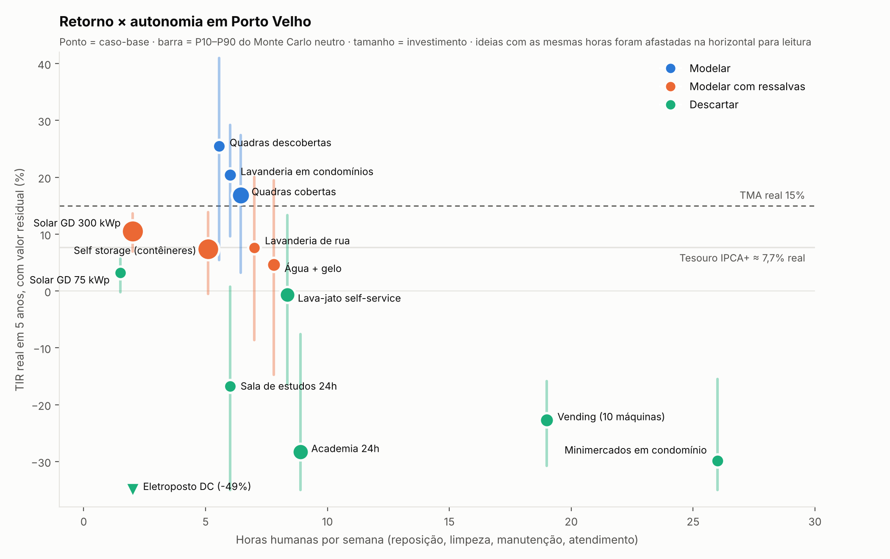
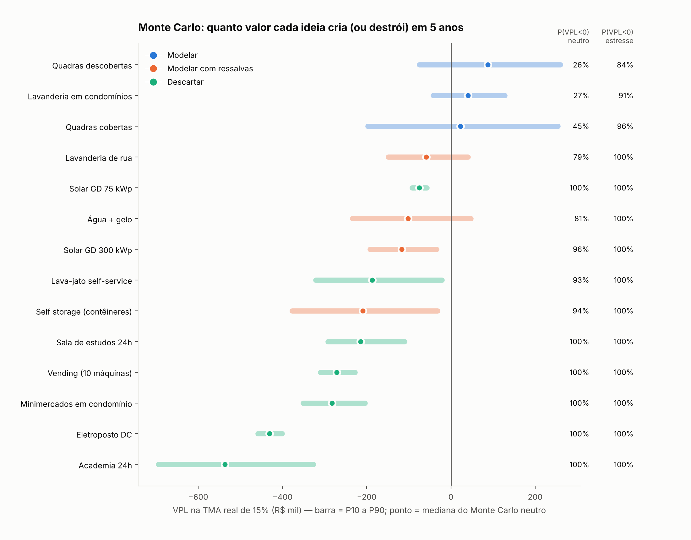

# Stress test — negócio autônomo em Porto Velho (RO)

**Data:** 17/11/2026 · **Etapa:** triagem, antes da planilha de business cases · **Horizonte:** 5 anos, moeda constante (R$ de 2026)

Este documento estressa ideias de negócio 100% (ou quase) autônomas para Porto Velho. Ele usa pesquisa local, um modelo de fluxo de caixa igual para todas as ideias, choques determinísticos e Monte Carlo. Os números são **triagem**: servem para decidir o que vai para a planilha, não para assinar contrato. Tudo é reproduzível com `python3 gerar_saidas.py` nesta pasta.

---

## 1. Resumo para decisão

1. **"100% autônomo" não existe; o que existe é horas humanas por semana.** Toda operação mantém reposição, limpeza, manutenção, atendimento (PIX que falha, porta travada) e compliance. As melhores ideias ficam em 5–8 h/semana. Nas que dependem de reposição (minimercado, vending), o "autônomo" é só para o cliente: para o dono, são 19–26 h/semana.
2. **A régua de 2026 é alta.** O Tesouro IPCA+ 2032 paga IPCA + 7,68% (11/11/2026). Com prêmio de ~7 p.p. por ser um negócio pequeno e ilíquido, a TMA fica em **15% real (≈ 20% nominal)**. Contando o tempo humano a R$ 30/h, a manutenção e a maturação, **só 3 de 15 modelos passam no caso-base**: quadras esportivas descobertas (TIR real de 25,5%), lavanderia compartilhada em condomínios (20,4%) e quadras cobertas (16,9%).
3. **O ponto vale mais que a tecnologia.** Na lavanderia de rua, pôr placa solar soma +3 p.p. de TIR; um ponto em posto 24h (aluguel menor e mais fluxo) soma +16 p.p. Na água + gelo, o ponto soma +10 p.p.
4. **As dores mais "Porto Velho" (água ruim, calor, chuva, fumaça) geram demanda, mas não garantem retorno.** A água + gelo, a ideia mais aderente à cidade e sem nenhum concorrente autônomo, dá TIR real de 4,6% no caso-base: o ticket é baixo e os custos fixos (ponto, responsável técnico, laudos, manutenção de refrigeração) são altos. Ela só passa com ponto forte e preço um pouco maior. O caminho é testar a demanda com pouco capital antes de construir.
5. **A lavanderia de rua chegou tarde.** Porto Velho já tem 7–9 lojas self-service (a 60 Minutos tem ao menos 4, ao lado de postos Shell), com preço-âncora de R$ 15–17 por ciclo. No Brasil, o setor saltou de ~1,5 mil para ~8 mil lojas entre 2022 e 2026. O caso-base rende 7,6% real, o mesmo que o Tesouro com muito mais risco.
6. **Os ativos mais autônomos rendem como imóvel ou renda fixa, não como negócio.** A usina solar de 300 kWp (2 h/semana) dá 10,5% real; o self storage em contêineres, 7,4%. Servem como renda com pouco trabalho, não para bater 15%.
7. **Nenhuma ideia se paga em valor presente dentro de 5 anos sem o valor residual.** Entre 31% e 45% do valor das finalistas vem do fim do ano 5. Por isso a planilha precisa tratar o valor residual do mesmo jeito em todas as abas (método na seção 3).
8. **Descartadas com número:** minimercado em condomínio (−30% real; mesmo com o tempo do dono de graça, −6%), vending (−23%), academia 24h (−28%, e o CREF exige responsável técnico), sala de estudos 24h (−17%), lava-jato self-service (−0,6%), eletroposto (−49%). **Descartadas por lei:** farmácia e medicamentos (inclusive MIP), combustível self-service, GLP em máquina e cigarro em máquina.



---

## 2. O que "autônomo" significa na prática

| Função humana que não some | Exemplo | Como reduzir |
|---|---|---|
| Reposição | Estoque do minimercado, sacos de gelo, químicos da lavanderia | Escolher negócio **sem estoque** (serviço sobre máquina ou espaço) |
| Limpeza | Lavanderia, quadras, banheiros | Terceirizar (vira custo fixo) |
| Manutenção | Máquina parada = receita zero | Contrato preventivo, estoque de peças, técnico local |
| Atendimento | PIX que não liberou, porta travada, cliente que quebrou algo | Atendimento remoto por WhatsApp/app; alguém resolve em menos de 1 h |
| Compliance | Laudos de água, RT, alvarás, Bombeiros, impostos | Contador e RT terceirizados |

**Regra de bolso:** autonomia troca mão de obra por capex e custo fixo. Isso aumenta a alavancagem operacional: o ponto de equilíbrio sobe e o negócio fica mais sensível à demanda. Por isso a margem de segurança da demanda é a métrica central deste estresse.

---

## 3. Método

### 3.1 Filtros eliminatórios (qualitativos)
1. **Legal:** pode funcionar sem pessoa no local?
2. **Autonomia real:** cabe em 10 h/semana ou menos?
3. **Demanda estrutural local:** por que Porto Velho precisa disso (clima, saneamento, servidor público, logística, renda)?
4. **Substituto informal:** a mão de obra barata local faz o serviço por menos? Exemplo: o lava-jato manual cobra R$ 30–50 e lava para você.
5. **Unit economics:** o ponto de equilíbrio fica abaixo de ~60% da capacidade?
6. **Robustez:** o VPL continua positivo nos choques e no Monte Carlo?
7. **Operação em PVH:** existe assistência técnica local? Quanto tempo leva uma peça de SP? Como ficam energia (tarifa e quedas) e segurança?

### 3.2 Modelo (o mesmo para todas as ideias) — `motor.py`
Fluxo anual com o ano 0 (investimento) e os anos 1 a 5, em moeda constante:

```
Receita_t      = Receita madura × rampa_t × choque_demanda × choque_preço
Custos de volume (CMV, energia variável, água, químicos) acompanham o VOLUME (não caem quando o preço cai)
Custos sobre receita (cartão/PIX, royalties, repasse ao condomínio) acompanham a RECEITA
Simples Nacional: alíquota efetiva = (RBT12 × alíquota nominal − parcela a deduzir) / RBT12   (Anexos I, II, III; locação de bens móveis = Anexo III sem ISS)
EBITDA_t       = Receita − custos de volume − custos sobre receita − Simples − fixos − tempo humano (h/sem × 52 × R$ 30) − perda esperada com sinistro
FCL_t          = EBITDA_t − manutenção de capex (% do capex a partir do ano 2) − Δ capital de giro
VR_5           = max( capex × % de liquidação ;  FCL estável × [1 − (1+TMA)^−N] / TMA × (1 − 30% de deságio) ) + giro devolvido
```

| Indicador | Fórmula |
|---|---|
| VPL | Σ FC_t / (1 + TMA)^t, com TMA real de 15% |
| TIR | taxa que zera o VPL (fluxo com VR no ano 5) |
| TIR nominal | (1 + TIR real) × (1 + IPCA 4,5%) − 1 |
| TIRM | entradas reinvestidas a 9,5% real (≈ CDI real), saídas descontadas pela TMA |
| Payback | (t − 1) + \|Acumulado_(t−1)\| / FC_t, sem VR; o descontado usa os fluxos a valor presente |
| ROI 5 anos | (Σ FCL_1..5 + VR − Investimento) / Investimento |
| MOIC | (Σ FCL_1..5 + VR) / Investimento |
| Margem de segurança | 1 − (demanda que zera o VPL ÷ demanda do caso-base). Negativa = falta demanda |

**Por que o VR é "o maior entre liquidar e continuar":** uma usina solar dura 25 anos e uma máquina de vending, 7. Cortar tudo no ano 5 sem valor residual pune os ativos longos e distorce a comparação. Usar o mesmo método em todas as abas mantém a comparabilidade. A métrica "dependência do VR" mostra quanto do valor vem do fim do ano 5.

**TMA:** Tesouro IPCA+ 2032 a IPCA + 7,68% (11/11/2026), mais ~7 p.p. de prêmio por negócio pequeno, ilíquido e operado pelo dono, dá **15% real**. Para comparar, o Prefixado 2029 pagava 14,59% a.a. em 10/11/2026.

### 3.3 Estresse — `rodar.py`
- **Choques determinísticos (um de cada vez):**
  - demanda −30%;
  - preço −15%;
  - capex +25%;
  - maturação 1 ano mais lenta;
  - energia +30%;
  - fixos +20%;
  - horas humanas ×2;
  - tempo humano de graça (a visão "do bolso", que muita gente usa sem perceber);
  - sem valor residual;
  - combinado: demanda −20%, preço −5%, capex +15%, energia +15%, atraso de 6 meses e fixos +10%.
- **Monte Carlo neutro (4.000 sorteios):** ruído simétrico em torno do caso-base. Mede só a volatilidade.
  - Demanda: ± a largura própria de cada ideia.
  - Preço, capex e fixos: ±8%.
  - Energia: ±15%.
  - VR: ±30%.
  - Horas: ±20%.
  - Ramp-up: 3 meses mais rápido ou mais lento.
- **Monte Carlo de estresse:** caudas para baixo, que reproduzem o viés de planejamento típico de pequeno negócio.
  - Demanda: triangular entre o piso da ideia e +5–25%.
  - Preço: −15% a +5%.
  - Capex: −5% a +30%.
  - Fixos: −8% a +20%.
  - Energia: −5% a +30%.
  - VR: −40% a +10%.
  - Horas: −20% a +50%.
  - Atraso: 0 (55%), 6 meses (30%) ou 12 meses (15%).
  - Sinistros sorteados ano a ano.

  É um teste deliberadamente duro: uma ideia com probabilidade alta de VPL negativo nele não é "proibida", mas não tem gordura.

---

## 4. Porto Velho: os fatos que mudam a conta

| Fato | Dado | Implicação |
|---|---|---|
| População | 460.434 hab. (Censo 2022); 517.709 (estimativa IBGE 2025) | Cidade média: cabe pouca loja de cada formato; a saturação chega rápido |
| Renda | Renda domiciliar per capita de RO: R$ 1.991/mês (2025), contra R$ 2.316 no Brasil. PIB per capita de PVH: R$ 55.170 (2023) | Renda concentrada em servidores; o ticket médio é sensível a preço; o informal compete |
| Setor público | 2.101 servidores por 100 mil hab., 4ª maior proporção entre as capitais (CLP) | Demanda estável de classe média: lavanderia, quadras, concursos |
| Frota | 346.796 veículos (dez/2025). RO tem a maior taxa de motos do país (388 por mil hab.), e ~39% da frota de PVH é moto (estimativa) | Lavagem de carro é cara para o público de moto; lava-moto tem ticket baixo |
| Clima | Chuva de ~2.350–2.450 mm/ano; estação chuvosa de out/nov a abr; seca de jun a ago. Inverno de 2024 com média de 27,7 °C (+2,3 °C) e máxima média de 35,8 °C | A roupa não seca na chuva (secadora vende); calor (gelo, água, esporte à noite); quadra descoberta perde dias |
| Fumaça | Ago/2024: pior ar entre as grandes cidades do país, PM2,5 de 442 µg/m³, decreto de emergência ambiental | Ninguém estende roupa fora; esporte ao ar livre para; a geração solar cai na seca |
| Rio Madeira | 2024: ~25 cm, porto paralisado. 2014: cheia de 19,74 m e 4.937 famílias desabrigadas. Out/2026: decreto de estiagem | Logística de insumos e risco de alagamento: escolher terreno fora da cota de cheia |
| Saneamento | PVH aparece há anos no fim do ranking Trata Brasil [não verificado nesta rodada]. Galão de 20 L a R$ 10–18 entregue (R$ 0,50–0,90/L). Já houve denúncia de galão com lodo | Espaço para água por litro a R$ 0,30–0,40, se houver confiança (laudos públicos) |
| Energia | Tarifa estimada de ~R$ 1,00/kWh com impostos [VALIDAR na conta da Energisa]. Fio B não compensado na GD: 75% em 2027, 90% em 2028 | Secadora, gelo e ar-condicionado pesam; a solar ajuda pouco no retorno total |
| Juros | IPCA+ 2032 a 7,68% real; Prefixado 2029 a 14,59% (nov/2026) | TMA real de 15% |

### Concorrência encontrada em PVH (nov/2026)

| Formato | Situação |
|---|---|
| Lavanderia self-service | **Moderada.** 7 a 9 lojas: 60 Minutos (ao menos 4, junto a postos Shell), Lavô, Porto Aqua, AquaPar, Maria Lavadeira, Laundrexpress, La Ville Express. Preço-âncora de R$ 15 por ciclo |
| Minimercado autônomo em condomínio | **Baixa, com redes entrando.** Fast4you abriu em jul/2025; Market4u busca condomínios |
| Self storage | **Baixa a moderada.** Guarde Mais, StockGuard, Canguru |
| Água por litro em máquina | **Nenhuma.** A distribuição de galão está saturada |
| Gelo autônomo | **Nenhuma máquina.** Ao menos 4 fábricas, duas com retirada 24h |
| Lava-jato self-service | **Nenhum.** Manual saturado, de R$ 30 a R$ 50 |
| Sala de estudos paga | **Nenhuma encontrada.** Coworkings pequenos |
| Arenas, academias, estacionamentos, eletropostos, GD em RO, condomínios, pátios | **Não pesquisado.** O limite de buscas acabou; é a primeira validação de campo |

---

## 5. Long list: 35 ideias e veredito

| # | Ideia | Por que poderia dar certo em PVH | O que mata (ou salva) | Veredito |
|---|---|---|---|---|
| 1 | Farmácia/medicamentos autônomos (inclusive MIP) | Cidade grande, pouca farmácia 24h na periferia | Lei 5.991/73 art. 6º e Lei 13.021/14 art. 6º, I: farmacêutico presente | ❌ Proibido |
| 2 | Posto de combustível self-service | — | Lei 9.956/2000 proíbe o autosserviço | ❌ Proibido |
| 3 | GLP em máquina/locker | Todo mundo usa botijão | ANP: revenda autorizada e armazenagem regulada; o formato não está previsto | ❌ Inviável |
| 4 | Cigarro em máquina | Margem | Lei 9.294/96 e ECA art. 243: falha no controle de idade é crime | ❌ Descartar |
| 5 | Álcool sem trava | Calor, consumo alto | ECA art. 243 (Lei 13.106/15): crime. Só com trava biométrica | ⚠️ Nunca como núcleo do negócio |
| 6 | Minimercado em condomínio (rede de 4) | Conveniência, condomínios novos | Reposição de 26 h/semana; margem bruta de ~35%; furtos de 1–6%; Fast4you e Market4u já na cidade. **TIR −30%** | ❌ Descartar |
| 7 | Vending (10 máquinas) | Órgãos públicos, hospitais, faculdades | Reposição de 19 h/semana, ticket baixo, chocolate derrete no calor, ponto público exige licitação. **TIR −23%** | ❌ Descartar |
| 8 | Hortifrúti autônomo | Hortaliça cara (vem de fora) | Perecível, perda alta, reposição diária | ❌ Descartar |
| 9 | Conveniência 24h de rua | Bairros sem comércio à noite | Furto, vandalismo, reposição | ❌ Descartar |
| 10 | **Lavanderia de rua** | Umidade, 6 meses de chuva, fumaça, kitnets | 7–9 concorrentes, preço de R$ 15–17. **TIR 7,6%**; com ponto em posto, 23% | 🟠 Modelar com ressalvas |
| 11 | **Lavanderia compartilhada em condomínios** | Sem aluguel, demanda cativa, prédios compactos | Depende do síndico e de haver condomínios grandes. **TIR 20,4%** | 🔵 Modelar |
| 12 | Lava-jato self-service | Poeira e lama; não existe na cidade | Cultura de pagar alguém para lavar (R$ 30–50); licença ambiental e separador de água e óleo. **TIR −0,6%** | ❌ Como negócio isolado; reavaliar como módulo dentro de posto |
| 13 | Lava-moto self-service | 39% da frota | Ticket de R$ 8–10; é um módulo do item 12 | ⚠️ Só como complemento |
| 14 | **Água purificada por litro** | Saneamento ruim, galão caro, nenhum concorrente | SAC (Portaria 888/2021): RT, laudos, licença da DVISA; o cliente carrega 20 kg | 🟠 Dentro do item 15 |
| 15 | **Água + gelo (quiosque)** | Calor extremo, rio e balneários, saneamento | Fixos altos para ticket baixo; a máquina de gelo perde capacidade no calor. **TIR 4,6%**; com ponto e preço, 14–15% | 🟠 Modelar com ressalvas, em fases |
| 16 | Pet wash self-service | Classe média com pet | Nicho: 3–8 banhos/dia a R$ 30–50 | ⚠️ Complemento da lavanderia |
| 17 | Impressão/cópia autônoma | Fórum, universidades | Demanda em queda estrutural | ❌ Descartar |
| 18 | Máquinas de grua/pelúcia | Shopping, ticket por impulso | LCP art. 50: risco de enquadramento como jogo de azar | ❌ Descartar |
| 19 | Massagem/fliperama | Shopping | Receita baixa por m² | ❌ Descartar |
| 20 | **Quadras com reserva por app** (beach, futevôlei, padel, society) | Calor empurra o esporte para a noite; cultura de futebol; padel cresceu 65% no Brasil em 2026 | Muito sensível à ocupação; chuva e fumaça; modismo. **TIR 25,5% (descobertas) e 16,9% (cobertas)** | 🔵 Modelar |
| 21 | **Self storage em contêineres** | População flutuante, pequenos comércios, e-commerce | Retorno de imóvel; 3 concorrentes; mofo dentro do contêiner; Bombeiros. **TIR 7,4%** | 🟠 Só com terreno próprio ocioso |
| 22 | Sala de estudos 24h | Cidade de servidor e concurseiro; ar-condicionado como produto | Aluguel e energia do ar-condicionado comem a receita; precisa de 1,9 aluno ou mais por cabine. **TIR −17%** | ❌ No formato testado |
| 23 | Coworking autônomo | — | Oferta existente, demanda fraca | ❌ Descartar |
| 24 | Academia 24h | Calor, rotina de servidor | CREF exige responsável técnico; capex e energia altos. **TIR −28%** | ❌ Descartar |
| 24b | Academia para personal trainers (aluga por hora) | O profissional vem com o aluno, o que resolve o CREF | Modelo inédito (BH, 2026); demanda incerta | ⚠️ Ideia derivada, não modelada |
| 25 | Estacionamento autônomo (leitura de placa + PIX) | Hospitais, fórum, centro | Depende de terreno; Súmula 130 do STJ (responde por furto); flanelinhas | ⚠️ Só com terreno próprio em polo gerador |
| 26 | Pátio de caminhões (portos) | Fila de graneleiros nos portos | Exige vigilância 24h; safra sazonal; a seca parou o porto em 2024 | ❌ Não é autônomo |
| 27 | Studios com self check-in | Viagem a trabalho, saúde, usinas | Limpeza a cada estadia; a convenção pode proibir (STJ, REsp 1.819.075) | ⚠️ É imóvel, não negócio |
| 28 | Lockers inteligentes | Entrega difícil em PVH | R$ 0,50–1,50 por pacote não paga a torre | ❌ Descartar |
| 29 | **Usina solar GD 300 kWp** | Tarifa alta, sol bom, 2 h/semana | Fio B crescente, mercado livre na baixa tensão (2027–28), aluguel tem de ser fixo, possível veto ao Simples. **TIR 10,5%** | 🟠 Benchmark de ativo passivo |
| 30 | Usina solar GD 75 kWp | Entrada mais barata | Custo fixo de gestão por kWp alto. **TIR 3,2%** | ❌ Escala insuficiente |
| 31 | Eletroposto DC | BR-364 | Frota elétrica de RO pequena; demanda contratada fixa. **TIR −49%** | ❌ Descartar por ora |
| 32 | Mineração de cripto | — | Energia a ~R$ 1/kWh | ❌ Descartar |
| 33 | Piscicultura automatizada (tambaqui) | RO é forte em peixe nativo | Manejo diário: não é autônomo | ⛔ Fora da tese |
| 34 | Hidroponia/fazenda vertical | Hortaliça cara | Colheita e venda manuais; resfriamento caro no calor | ⛔ Fora da tese |
| 35 | Mídia digital (telas em elevadores/avenidas) | Pouca oferta local | A operação é autônoma, mas a receita depende de vendedor de mídia | ⚠️ Não modelado |

---

## 6. Resultados quantitativos

### 6.1 Caso-base (TMA real de 15%; tempo humano a R$ 30/h)

| Ideia | Investimento (R$ mil) | Receita madura (R$ mil/ano) | Margem EBITDA | Horas/sem | TIR real | TIR nominal | VPL @15% (R$ mil) | Payback (anos) | ROI 5 anos | Margem de segurança da demanda |
|---|---:|---:|---:|---:|---:|---:|---:|---:|---:|---:|
| Quadras descobertas | 230 | 262 | 38% | 6 | 25,5% | 31,1% | 96 | 3,8 | 152% | 11% |
| Lavanderia em condomínios | 252 | 188 | 44% | 6 | 20,4% | 25,8% | 46 | 4,1 | 101% | 9% |
| Quadras cobertas | 535 | 335 | 46% | 6 | 16,9% | 22,1% | 35 | 4,8 | 88% | 3% |
| Solar GD 300 kWp | 830 | 198 | 71% | 2 | 10,5% | 15,5% | -107 | > 5 | 44% | -11% |
| Lavanderia de rua | 220 | 212 | 26% | 7 | 7,6% | 12,5% | -53 | > 5 | 36% | -10% |
| Self storage (contêineres) | 805 | 308 | 53% | 6 | 7,4% | 12,2% | -202 | > 5 | 36% | -18% |
| Água + gelo | 290 | 223 | 32% | 8 | 4,6% | 9,3% | -96 | > 5 | 21% | -15% |
| Solar GD 75 kWp | 220 | 50 | 52% | 2 | 3,2% | 7,8% | -72 | > 5 | 13% | -36% |
| Lava-jato self-service | 385 | 295 | 27% | 8 | -0,6% | 3,8% | -181 | > 5 | -3% | -25% |
| Água + gelo (MVP de teste) | 117 | 168 | 10% | 9 | -15,3% | -11,5% | -105 | > 5 | -65% | -30% |
| Sala de estudos 24h | 225 | 203 | 14% | 6 | -16,7% | -13,0% | -208 | > 5 | -69% | -32% |
| Vending (10 máquinas) | 295 | 264 | 2% | 19 | -22,7% | -19,3% | -268 | > 5 | -77% | -145% |
| Academia 24h | 425 | 458 | 7% | 8 | -28,3% | -25,1% | -524 | > 5 | -114% | -37% |
| Minimercados em condomínio | 238 | 528 | -2% | 26 | -29,8% | -26,7% | -275 | > 5 | -110% | -90% |
| Eletroposto DC | 320 | 61 | -47% | 2 | -49,3% | -47,0% | -429 | > 5 | -142% | n/d |

Como ler: a margem de segurança de 11% significa que a demanda pode cair 11% antes de o VPL zerar. O valor −10% significa que falta 10% de demanda para empatar com a TMA. O payback simples ignora o valor residual; o payback descontado passa de 5 anos em **todas** as ideias.

### 6.2 Distância até a TMA e probabilidade de destruir valor

| Ideia | Demanda necessária | Preço necessário | Capex máximo | P(VPL<0) MC neutro | P(VPL<0) MC estresse | TIR P10–P90 (neutro) |
|---|---:|---:|---:|---:|---:|---:|
| Quadras descobertas | -11% | -11% | +40% | 26% | 84% | 5% a 41% |
| Lavanderia em condomínios | -9% | -7% | +17% | 27% | 91% | 10% a 29% |
| Quadras cobertas | -3% | -3% | +6% | 45% | 96% | 3% a 27% |
| Solar GD 300 kWp | +11% | +11% | -13% | 96% | 100% | 7% a 14% |
| Lavanderia de rua | +10% | +7% | -24% | 79% | 100% | -9% a 20% |
| Self storage (contêineres) | +18% | +18% | -25% | 94% | 100% | 0% a 14% |
| Água + gelo | +15% | +12% | -31% | 81% | 100% | -15% a 19% |
| Solar GD 75 kWp | +36% | +36% | -40% | 100% | 100% | 0% a 6% |
| Lava-jato self-service | +25% | +18% | -44% | 93% | 100% | -16% a 13% |
| Água + gelo (MVP de teste) | +30% | +17% | -87% | 95% | 100% | -40% a 10% |
| Sala de estudos 24h | +32% | +30% | -92% | 100% | 100% | -36% a 1% |
| Vending (10 máquinas) | +145% | +37% | n/d | 100% | 100% | -31% a -16% |
| Academia 24h | +37% | +37% | n/d | 100% | 100% | -50% a -8% |
| Minimercados em condomínio | +90% | +18% | n/d | 100% | 100% | -48% a -15% |
| Eletroposto DC | n/d | n/d | n/d | 100% | 100% | -60% a -41% |

"Demanda necessária" é a variação de demanda que zera o VPL a 15% real (o mesmo vale para preço e capex). Um valor negativo é folga; um positivo é o que falta.



### 6.3 Choques um a um (TIR real)

| Ideia | Base | Demanda -30% | Preço -15% | Capex +25% | Maturação 1 ano mais lenta | Energia +30% | Custos fixos +20% | Horas humanas x2 | Tempo humano de graça | Sem valor residual | Combinado |
|---|---:|---:|---:|---:|---:|---:|---:|---:|---:|---:|---:|
| Quadras descobertas | 25% | -11% | 10% | 18% | 7% | 24% | 14% | 21% | 30% | 11% | -21% |
| Lavanderia em condomínios | 20% | 1% | 8% | 13% | 9% | 16% | 17% | 15% | 25% | 8% | -7% |
| Quadras cobertas | 17% | -7% | 6% | 10% | 6% | 16% | 10% | 14% | 19% | 1% | -13% |
| Solar GD 300 kWp | 11% | 2% | 6% | 6% | 5% | 11% | 9% | 10% | 11% | -5% | -1% |
| Lavanderia de rua | 8% | -25% | -13% | 2% | -5% | 1% | -4% | 0% | 15% | -5% | -33% |
| Self storage (contêineres) | 7% | -8% | 0% | 2% | 0% | 7% | 3% | 5% | 9% | -10% | -11% |
| Água + gelo | 5% | -20% | -12% | -1% | -7% | 0% | -4% | -2% | 11% | -8% | -26% |
| Solar GD 75 kWp | 3% | -5% | -1% | 0% | -2% | 3% | 1% | 2% | 5% | -15% | -7% |
| Lava-jato self-service | -1% | -22% | -15% | -7% | -11% | -3% | -10% | -6% | 5% | -13% | -27% |
| Água + gelo (MVP de teste) | -15% | -51% | -44% | -17% | -28% | -19% | -29% | -32% | 5% | -28% | -59% |
| Sala de estudos 24h | -17% | -66% | -38% | -21% | -29% | -25% | -39% | -26% | -9% | -30% | -75% |
| Vending (10 máquinas) | -23% | -34% | -42% | -23% | -27% | -23% | -26% | -41% | -7% | -55% | -37% |
| Academia 24h | -28% | -95% | -51% | -29% | -41% | -38% | -59% | -33% | -24% | -48% | n/d |
| Minimercados em condomínio | -30% | -57% | -84% | -29% | -37% | -37% | -41% | -60% | -6% | -49% | -72% |
| Eletroposto DC | -49% | -56% | -55% | -44% | -53% | -61% | -58% | -52% | -47% | n/d | -62% |

Leituras:
- **Demanda e maturação são os assassinos.** Demanda −30% derruba todas as finalistas abaixo de 2%. Um ano a mais de maturação tira de 11 a 18 p.p. das quadras e da lavanderia em condomínios.
- **Energia +30% quase não mexe nas finalistas** (−1 a −4 p.p.). Mexe mais na lavanderia de rua e na água + gelo, que já estão abaixo da TMA.
- **A "visão do bolso" engana.** Sem contar o próprio tempo, a lavanderia de rua passa de 7,6% para 14,5%. É assim que muita gente conclui que "dá dinheiro".
- **Dependência do valor residual:** 31% a 45% do valor presente das entradas das finalistas vem do fim do ano 5. Sem valor residual, as quadras cobertas caem para 1%.

### 6.4 Alavancas (o que faria as "ressalvas" passarem)

| Ideia | Alavanca | TIR real | VPL @15% (R$ mil) | Payback (anos) |
|---|---|---:|---:|---:|
| Lavanderia de rua | (caso-base) | 7,6% | -53 | > 5 |
| Lavanderia de rua | Solar 20 kWp no telhado (energia -50%, +R$ 55 mil) | 10,6% | -40 | > 5 |
| Lavanderia de rua | Ponto em posto 24h (aluguel -40%, demanda +10%) | 23,4% | 67 | 3,9 |
| Lavanderia de rua | Preço R$ 18,50 (+9%) | 16,9% | 15 | 4,6 |
| Lavanderia de rua | Solar + posto + preço | 30,6% | 160 | 3,3 |
| Água + gelo | (caso-base) | 4,6% | -96 | > 5 |
| Água + gelo | Solar 16 kWp (energia -60%, +R$ 45 mil) | 8,0% | -76 | > 5 |
| Água + gelo | Ponto em posto/supermercado (demanda +15%) | 14,8% | -2 | 4,8 |
| Água + gelo | Água a R$ 0,40/L e gelo a R$ 11 (+11%) | 14,1% | -9 | 4,9 |
| Água + gelo | Solar + ponto + preço | 25,3% | 128 | 3,7 |
| Lavanderia em condomínios | (caso-base) | 20,4% | 46 | 4,1 |
| Lavanderia em condomínios | Uso 25% abaixo do plano em cada condomínio | 4,6% | -77 | > 5 |
| Lavanderia em condomínios | Repasse ao condomínio 10% (em vez de 5%) | 15,9% | 8 | 4,6 |
| Lavanderia em condomínios | Preço R$ 15 por ciclo (+7%) | 25,3% | 90 | 3,6 |
| Quadras descobertas | (caso-base) | 25,5% | 96 | 3,8 |
| Quadras descobertas | Ocupação nobre 50% (em vez de 65%) | 1,6% | -101 | > 5 |
| Quadras descobertas | Preço R$ 100/h no nobre (+11%) | 35,0% | 195 | 3,2 |

---

## 7. Finalistas: tese, onde quebra e o que validar em campo

### 7.1 Arena de quadras com reserva por app (descoberta → cobrir depois)
- **Tese local:** o calor empurra o esporte para depois das 17h. Com app de reserva, fechadura inteligente e luz temporizada, a operação cabe em ~6 h/semana. Pode ser beach tennis, futevôlei ou padel; o padel cresceu 65% no Brasil em 2026, e o beach tennis esfriou.
- **Caso-base:** 2 quadras descobertas, R$ 230 mil. Ocupação de 65% no horário nobre a R$ 90/h e de 15% fora dele a R$ 50/h, com −22% de receita por chuva e fumaça. TIR de 25,5%.
- **Onde quebra:** é o negócio mais alavancado à ocupação. Com 50% no horário nobre, a TIR vai a 1,6%.
- **Cobrir ou não:** a cobertura custa ~R$ 300 mil para recuperar ~22% de receita, e a TIR cai para 16,9%. **Começar descoberta e cobrir só se a ocupação noturna provar mais de 70%** (opção real).
- **Validar:**
  - quantas arenas já existem em PVH e quanto cobram (não pesquisado);
  - ocupação noturna dos concorrentes (contar reservas no app deles);
  - terreno fora da cota de cheia e longe de vizinhos (barulho);
  - professores que alugam a quadra para aulas: são a receita-âncora.

### 7.2 Lavanderia compartilhada em condomínios
- **Tese:** sem aluguel, com demanda cativa em prédios de studios e compactos sem área de serviço. A OMO já tem mais de 3 mil operações no Brasil; a LavPop lançou o formato em dez/2025.
- **Caso-base:** 4 condomínios × 2+2 máquinas, 280 ciclos/mês a R$ 14 por condomínio, R$ 252 mil, 6 h/semana. TIR de 20,4%.
- **Onde quebra:** uso 25% abaixo do plano leva a TIR a 4,6%. Repasse de 10% ao condomínio, a 15,9%. O contrato é precário: depende de síndico e assembleia.
- **Validar:**
  - lista de condomínios verticais com 150 apartamentos ou mais em PVH (não pesquisado);
  - carta de intenção de 2 a 3 síndicos **antes** de comprar máquina;
  - checar se OMO ou LavPop já atuam na cidade.

### 7.3 Lavanderia de rua (só com ponto superior)
- **Problema:** 7 a 9 lojas, preço-âncora de R$ 15–17, e o setor quintuplicou no país em 4 anos. Caso-base de 4+4 máquinas e R$ 17,7 mil/mês: TIR de 7,6%.
- **O negócio é o ponto:** um posto 24h (segurança, luz, fluxo e aluguel menor) leva a TIR a 23%. A concorrência já pegou postos Shell.
- **Validar:**
  - bairros sem loja (Zona Leste e Zona Norte, a confirmar);
  - contrato de cessão com posto ou supermercado;
  - gás x elétrico na secadora (sem gás canalizado, os custos se equivalem; o gás seca mais rápido e permite mais giros).

### 7.4 Água + gelo, em 3 fases (a ideia mais "Porto Velho")
- **Tese:** água ruim, galão a R$ 10–18, calor extremo e nenhum concorrente autônomo.
- **Problema:** com produção própria (R$ 290 mil), a TIR é de 4,6%. Ticket baixo contra fixos de R$ 6,5 mil/mês (ponto, RT e laudos, manutenção de refrigeração). Pelo nosso cálculo, a máquina de gelo perde capacidade no calor de PVH.
- **Caminho em fases:**
  1. **Teste de demanda (R$ 10–20 mil):** freezer com PIX revendendo gelo de fábrica local, num posto parceiro, por 90 dias.
  2. **Estação de água** (~R$ 60–90 mil): só com laudos públicos no próprio quiosque, porque a confiança é o produto.
  3. **Produção própria de gelo, com solar:** só se a venda passar de ~40 sacos/dia e ~600 L/dia num ponto forte. Com ponto, preço e solar juntos, a TIR chega a 25%.
- **Regulação:**
  - a água é tratada como SAC (Portaria GM/MS 888/2021), com RT e ART, plano de amostragem e licença DVISA/SEMUSA;
  - o gelo é alimento (RDC 717/2022): boas práticas e rótulo se for ensacado.
- **Risco estrutural:** se a concessão do saneamento melhorar a água da rede nos próximos 5 anos (status não verificado), a demanda por água cai.

### 7.5 Usina solar GD 300 kWp (benchmark de ativo passivo)
- **Números:** 2 h/semana, R$ 830 mil, TIR real de 10,5% (≈ 15,5% nominal). Bate o Tesouro, não a TMA.
- **Riscos:**
  - Fio B não compensado de 75% em 2027 e 90% em 2028, e regra nova a partir de 2029;
  - o aluguel tem de ser **fixo** (preço em R$/kWh é vedado);
  - abertura do mercado livre para baixa tensão em 2027–28 (a confirmar), com comercializadoras competindo com o desconto;
  - risco de veto ao Simples (LC 123, art. 17, VII), que levaria ao Lucro Presumido;
  - negativa por inversão de fluxo (a REN 1.098/2024 obriga a distribuidora a justificar);
  - furto de cabos e fumaça na seca.
- **Leitura:** é renda fixa com risco regulatório. Entra se a sua TMA para infraestrutura for ~10% real.

### 7.6 Self storage em contêineres (só com terreno ocioso)
- **Números:** 24 contêineres de 40' viram 72 boxes, R$ 805 mil, TIR real de 7,4% com terreno alugado. É retorno de imóvel: os FIIs do setor têm cap rate de ~13% nominal.
- **Quando faz sentido:** se você já tem um terreno parado bem localizado. Nesse caso, vira uma forma de rentabilizar o terreno, não um negócio para bater 15%.
- **Riscos:**
  - mofo e calor dentro do contêiner;
  - inadimplência;
  - Bombeiros (carga de incêndio);
  - responsabilidade por furto (CDC).

---

## 8. Riscos transversais e mitigação

| Risco | Como aparece em PVH | Mitigação |
|---|---|---|
| Ponto ruim | Maior alavanca de todas (+10 a +16 p.p. de TIR) | Co-locação com posto 24h ou supermercado; bairro sem concorrente; teste antes de construir |
| Saturação rápida | Lavanderias de 1,5 mil para 8 mil no país; no Ceará, de 45 para 111 franquias em 2025 | Entrar onde não há loja; contrato de exclusividade com o ponto |
| Segurança | Arrombamento, vandalismo, furto de cabo | Só PIX ou cartão, câmeras em nuvem, alarme monitorado, seguro, local iluminado e movimentado |
| Assistência técnica | Peça vem de SP; máquina parada é receita zero | Estoque de peças de 3–5% do capex; técnico local treinado; fornecedor com representante no Norte |
| Energia | Tarifa de ~R$ 1/kWh [validar], quedas e surtos | DPS e nobreak; solar onde o consumo é diurno (gelo); contrato na conta certa |
| Clima | Chuva de nov a abr; fumaça de ago a set; Madeira (cheia e seca) | Sazonalidade explícita na planilha; terreno fora da cota de cheia |
| Regulação | RT e laudos (água e gelo), CREF, ECA (álcool), Bombeiros, licença ambiental, Fio B, LGPD (biometria é dado sensível) | Escolher formatos sem exigência de presença; RT terceirizado; RIPD se usar biometria |
| Tributos | Simples continua; CBS em 2027; ICMS e ISS caem de 2029 a 2032 | Para B2C, pouco efeito; confirmar enquadramento (GD e locação) com contador |
| Juros | TMA alta | Crédito subsidiado (FNO via Banco da Amazônia, Pronampe) pode mudar a TIR do sócio. **Não pesquisado nesta rodada** |
| O "autônomo" | Alguém precisa resolver em menos de 1 h | Atendimento remoto com SLA; horas humanas como custo no modelo |

---

## 9. Proposta para a planilha

**Abas:**
- `Capa`
- `Instrucoes` (com a legenda de cores)
- `Premissas_Globais`: TMA, IPCA, custo da hora humana, tarifa de energia e água, tabelas do Simples, deságio do VR
- `Painel`: comparativo lado a lado com TIR, VPL, payback, ROI, MOIC, margem de segurança, horas/semana, dependência do VR e investimento
- **6 abas de business case:**
  1. Arena de quadras, com chave descoberta/coberta;
  2. Lavanderia em condomínios;
  3. Lavanderia de rua;
  4. Água + gelo, com fases;
  5. Solar GD;
  6. Self storage.
- `Sensibilidade`
- `Checks`

**Layout idêntico em cada aba de caso (mesmas linhas):**
1. Inputs
2. Drivers operacionais
3. DRE anual
4. Fluxo de caixa dos anos 0 a 5
5. Indicadores
6. Seletor de cenário (pessimista, base, otimista)
7. Tabela preço × demanda

**Código de cores** (o mesmo do modelo da pecuária):

| Aparência | Significado |
|---|---|
| Fonte azul, fundo amarelo-claro | Input |
| Fundo amarelo forte | Premissa-chave |
| Fonte preta | Fórmula |
| Fonte verde | Link de outra aba |
| Fundo cinza | Totais |
| Fundo verde-claro | Resultado |

**Regras de comparabilidade:**
- 5 anos, moeda constante;
- mesma TMA e mesmo custo da hora humana;
- Simples por faixa;
- valor residual pelo mesmo método;
- mesmos choques de estresse.

---

## 10. Premissas a validar (e o que não foi verificado)

A cota de buscas da sessão acabou antes de completar a pesquisa. **Não verificados:**
- tarifa da Energisa RO (usei ~R$ 1,00/kWh com impostos);
- tarifa da CAERD (R$ 12/m³) e o status da concessão do saneamento;
- aluguel comercial em PVH (R$ 25–50/m² para loja; R$ 10–20/m² para galpão);
- Selic e Focus de nov/2026;
- linhas e taxas do FNO;
- concorrência de arenas, academias, estacionamentos, GD em RO e condomínios;
- preço do saco de gelo e da hora de quadra em PVH.

Números de franqueadoras foram tratados como otimistas, e o modelo usa faixas independentes. Cada premissa está comentada em `premissas.py`.

---

## Fontes principais

- **Demografia, renda e clima:**
  - [IBGE Cidades — Porto Velho](https://www.ibge.gov.br/cidades-e-estados/ro/porto-velho.html)
  - [Rendimento domiciliar per capita 2025](https://agenciadenoticias.ibge.gov.br/agencia-sala-de-imprensa/45942-ibge-divulga-rendimento-domiciliar-per-capita-2025-para-brasil-e-unidades-da-federacao.html)
  - [INMET — inverno 2024 em PVH](https://portal.inmet.gov.br/noticias/porto-velho-registra-um-inverno-2024-seco)
  - [Qualidade do ar ago/2024](https://jornaldebrasilia.com.br/noticias/brasil/com-neblina-diaria-e-dificuldade-para-respirar-porto-velho-tem-qualidade-do-ar-mais-insalubre-do-pais/)
  - [MPF — PM2,5](https://portal.rondoniaovivo.com/imagensNoticias/documentos/MPF_RO_recomendacao_Uniao_brigadistas_queimadas_2024_08_23.pdf)
  - [Porto paralisado pela seca](https://www.cnnbrasil.com.br/nacional/porto-de-porto-velho-paralisa-operacoes-devido-a-seca-no-rio-madeira/)
  - [Cheia de 2014](https://portalamazonia.com/noticias/rondonienses-relembram-10-anos-da-cheia-historica-do-rio-madeira/)
- **Concorrência em PVH:**
  - [Lavanderia 60 Minutos RO05](https://lavanderia60minutos.com.br/unidades/ro05)
  - [Lavô PVH](https://lavobrasil.com.br/portovelho/)
  - [Fast4you no Norte](https://mercadoeconsumo.com.br/18/07/2025/noticias-varejo/fast4you-amplia-presenca-no-brasil-com-primeira-loja-na-regiao-norte/)
  - [Market4u PVH](https://market4u.com.br/condominios/porto-velho-ro/)
  - [Guarde Mais PVH](https://guardemais.com.br/unidades-self-storage/rondonia/porto-velho/)
  - [Galão em PVH](https://distribuidorasdealimentos.com.br/agua-mineral/ro/porto-velho)
  - [Big Gelo](https://www.instagram.com/biggelopvh/)
  - [Expansão das lavanderias (La Ville Express, nov/2026)](https://www.uai.com.br/networking-e-negocios/2026/11/12/lavar-e-secar-a-propria-roupa-como-funcionam-as-lojas-da-la-ville-express/)
- **Unit economics:**
  - [OMO Lavanderia sem comprar máquina](https://www.portaldofranchising.com.br/noticias/omo-lavanderia-permite-abrir-franquia-sem-comprar-as-maquinas/)
  - [OMO em condomínios](https://mercadoeconsumo.com.br/11/03/2025/destaque-do-dia/omo-lavanderia-compartilhada-ultrapassa-3-mil-operacoes-dentro-de-condominios/)
  - [Market4u 2025](https://www.seudinheiro.com/2026/seu-negocio/rede-de-mercados-autonomos-para-condominios-market4u-faturou-r-336-milhoes-em-2025-e-preco-da-franquia-e-acessivel-cbcb/)
  - [Furtos em mercadinhos](https://www.sindiconet.com.br/informese/alta-nos-furtos-a-mercadinhos-de-condominio-surpreende-noticias-seguranca)
  - [Self storage — mercado 1T26](https://forbes.com.br/forbes-money/2026/09/mercado-de-self-storage-cresce-107-no-brasil-e-ultrapassa-244-mil-boxes/)
  - [Salas de estudo na PB](https://auniao.pb.gov.br/noticias/economia/procura-por-concursos-vira-nicho-de-negocio-na-paraiba)
  - [Padel 2026](https://superpadel.com.br/2026/10/14/brasil-registra-crescimento-de-655-no-numero-de-quadras-de-padel-em-2026-aponta-relatorio-da-fip/)
  - [Ice vending (EUA)](https://www.carwash.com/the-value-of-ice-vending/)
  - [Máquina de gelo autosserviço](https://loja.impomac.com.br/produto/maquina-de-gelo-nugget-de-auto-servico-atm200-ate-166-kg-dia/)
- **Regulação:**
  - [Lei 14.300/2022](https://www.planalto.gov.br/ccivil_03/_ato2019-2022/2022/lei/l14300.htm)
  - [REN ANEEL 1.098/2024](https://www2.aneel.gov.br/cedoc/ren20241098.pdf)
  - [Portaria GM/MS 888/2021](https://ses.sp.bvs.br/wp-content/uploads/2021/05/U_PT-MS-GM-888_040521.pdf)
  - [IN DVISA PVH 3/2023](https://dvs.portovelho.ro.gov.br/uploads/editor/files/IN%20003%202023%20FINAL%20PUBLICADA.pdf)
  - [Lei 13.106/2015](https://www.planalto.gov.br/ccivil_03/_ato2015-2018/2015/lei/l13106.htm)
  - [Lei 9.956/2000](https://www.planalto.gov.br/ccivil_03/leis/l9956.htm)
  - [Lei 13.021/2014](https://www.planalto.gov.br/ccivil_03/_ato2011-2014/2014/lei/l13021.htm)
  - [LC 123/2006](https://www.planalto.gov.br/ccivil_03/leis/lcp/lcp123.htm)
  - [LC 214/2025](https://www.planalto.gov.br/ccivil_03/leis/lcp/lcp214.htm)
- **Juros:**
  - [Tesouro IPCA+ 2032 a 7,68% (11/11/2026)](https://brapi.dev/news/tesouro-direto-fica-estavel-com-sinal-de-corte-de-r-80-bi-74eb7a72)
  - [Renda fixa nov/2026](https://rankia.com.br/renda-fixa-novembro-2026-tesouro-prefixado/)
