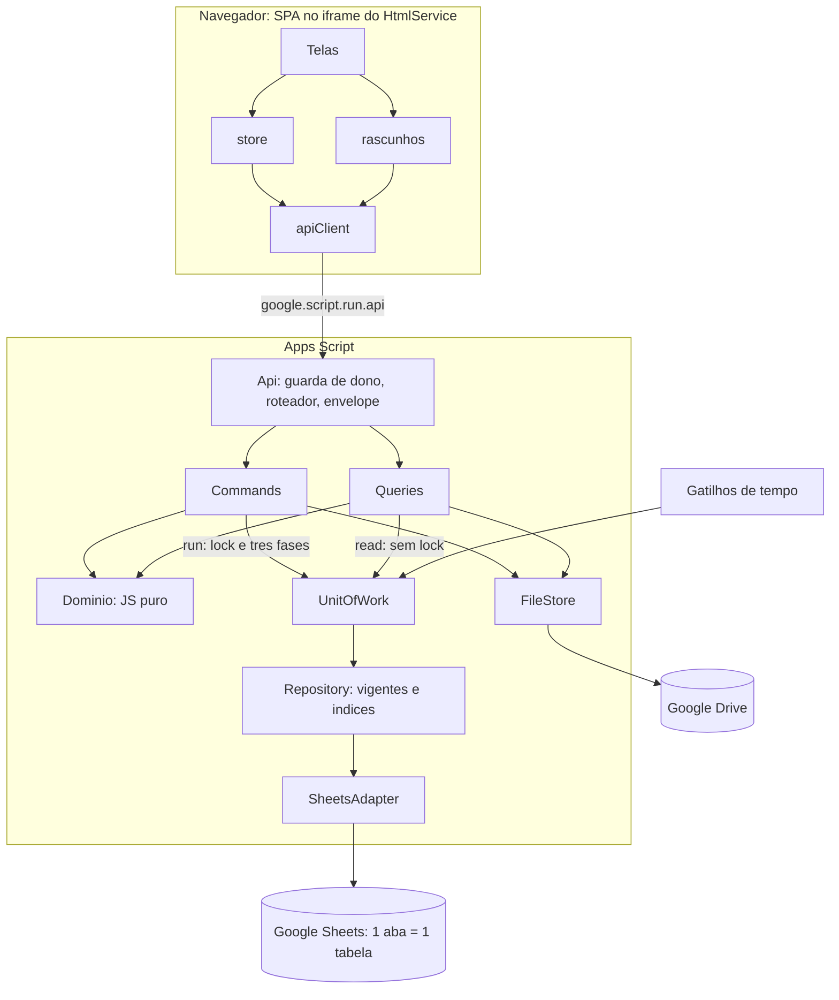
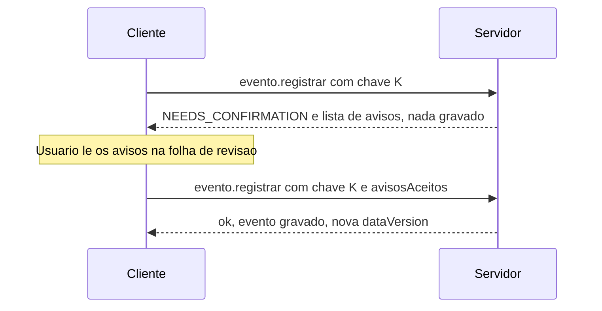
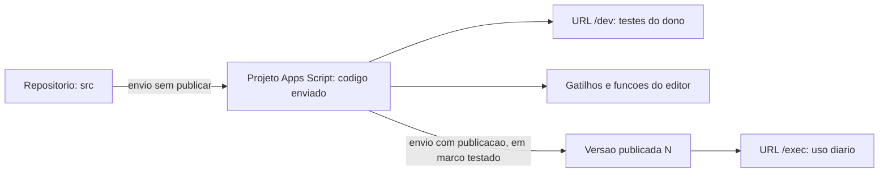

# 01 — Arquitetura técnica e estrutura de arquivos

## Em resumo

- Página única no HtmlService que fala com o Apps Script por uma só função de negócio, `api()`: envelope JSON fixo e 51 rotas `dominio.acao`, cada uma comando (muta, sob lock, idempotente) ou consulta (nunca escreve na planilha).
- Regras em JavaScript puro: 19 dos 25 arquivos de backend não tocam serviço do Google. É o que permite testar em Node e trocar o Sheets por banco relacional mexendo só nos adaptadores.
- Publicação `executeAs = USER_DEPLOYING` + `access = MYSELF`, com guarda de dono em toda função pública, sem presumir `Session.getActiveUser().getEmail()` preenchido.
- Cinco escopos OAuth, com `drive.file` no lugar de `drive`; por isso todo arquivo nasce pela API do Drive.
- Os 17 + 14 nomes de arquivo da §3.1 ficam; entram 8 de backend e 1 de frontend, justificados.
- Fora do MVP, por decisão: offline/PWA, multiusuário, `doPost`, CacheService.

**Documentos relacionados:** `README.md` · `02-modelo-de-dados.md` · `04-motor-de-eventos.md` · `06-persistencia-e-integridade.md` · `08-ux-ui.md` · `09-plano-de-testes.md` · `10-plano-de-implementacao.md` · `11-riscos-e-premissas.md` · `12-fatos-de-plataforma.md`

Entregáveis 2 e 7 da §23. É desenho: nada aqui foi implementado, implantado ou testado.

---

## 1. Visão em camadas



| Camada | Responsabilidade | Não faz |
|---|---|---|
| Cliente (SPA) | Telas, store, rascunhos, `apiClient`; valida formato; mostra prévia rotulada "prévia". | Regra de negócio; valor definitivo (P5). |
| Api | `assertOwner_()`, roteador, envelope, exceção → código de erro. | Regra de domínio. |
| Aplicação | *Commands*: validação → plano de escrita → `UnitOfWork`. *Queries*: leitura e cálculo. | Chamar serviço do Google. |
| Domínio | `EventCatalog`, `TimelineValidator`, `Projector`, genealogia, classificação, rateio, `Money`, `Dates`, indicadores. | Ler ou gravar: funções puras. |
| UnitOfWork + Repository | Lock, idempotência, journal `OPERACOES`, três fases, recuperação; `repo.vigentes(tabela)` e índices em memória. | Conhecer pecuária. |
| Adaptadores | `SheetsAdapter` (E/S em lote, codec por tipo de coluna) e `FileStore` (API do Drive). | Filtrar vigência; validar negócio. |

Cada camada só chama a de baixo; o domínio não chama ninguém. Os mecanismos da §2.4 (lock, validação prévia, identificador de operação, registro de processamento, duplicidade, compensação, reconciliação) ficam na `UnitOfWork`. "Compensação" foi lida como refazer (redo idempotente), não desfazer: a primeira fase só anexa linhas inertes, então não há o que reverter.

### 1.1 Comando × consulta

| | Comando | Consulta |
|---|---|---|
| Efeito | Muta dados. | Não escreve na planilha (P2). |
| Concorrência | Lock de script, `waitLock` ≤ 25 s; senão `LOCKED`. | Sem lock; leitura validada pela `DATA_VERSION` (repete até 3 vezes). |
| Idempotência | `idempotencyKey` obrigatória; autoridade em `OPERACOES`. | Não se aplica. |
| Operação órfã | Recupera sob lock antes de trabalhar. | Marcador presente → recupera, ou aguarda ~5 s e devolve `LOCKED`. |
| Resposta | Evento, projeções alteradas, nova `dataVersion`. | Dados e `dataVersion` lida. |

`evento.simular` é consulta: roda a mesma função de validação e plano de escrita do comando e para antes de gravar. Prévia e gravação não divergem.

---

## 2. Os 11 princípios e o que cada um impõe

| Princípio | Consequência prática |
|---|---|
| **P1** Fato persistido; derivado calculado | Idade, GMD, UA, categoria automática e valor estimado não têm coluna. Colunas `*` são projeções reconstruídas pelo `Projector` e conferidas contra o replay. |
| **P2** Uma fronteira de escrita | Só a `UnitOfWork` grava; gatilhos entram por ela. |
| **P3** Uma operação = uma célula de commit | Commit = `OPERACOES.status: INICIADA → CONFIRMADA`. Antes, tudo é inerte; depois, redo. O `Repository` só entrega linhas vigentes. |
| **P4** Domínio puro + adaptadores | Globais do Apps Script confinados a 6 arquivos (seção 6); o resto recebe portas (`Repository`, `Clock`, `IdGen`, `Lock`, `FileStore`). |
| **P5** Backend é a autoridade | Formulário renderizado a partir do `EventCatalog`; nenhuma regra escrita duas vezes (§20 regra 8). |
| **P6** Valor lido === valor gravado | Um codec por tipo de coluna; nunca `Date` na planilha nem em `google.script.run`; toda resposta passa por ida e volta de JSON. |
| **P7** Sem exclusão física de histórico | Não existe rota de exclusão: há `ativo = N`, `REMOVIDO`, estorno ou evento substituto. |
| **P8** Configurável > codificado | Categorias, listas, protocolos, plano de contas e parâmetros são tabelas, semeadas por "insere se ausente". |
| **P9** Sem dado, sem indicador | Indicador devolve `{valor, motivo, n}`; `null` vira "—", nunca zero (§12). |
| **P10** Calculado nunca vira fato | Projeção de peso e médias só existem na resposta; nada automático grava em `PESAGENS`. |
| **P11** Fatos completos desde a fase de origem | O `setup()` da Fase 1 cria as 34 abas; COMPRA e VENDA da Fase 2 já gravam financeiro, parcelas e alocações. |

---

## 3. Contrato da API

### 3.1 Pedido e envelope

```js
google.script.run.api({
  rota: 'evento.registrar',     // dominio.acao (tabela em 3.6)
  dados: { /* JSON simples */ },
  idempotencyKey: '<uuid>',     // obrigatória em todo comando
  avisosAceitos: [],            // opcional (3.4)
  dataVersionEsperada: 812      // obrigatória no commit de tipos com revisão no servidor
});
```

```json
{ "ok": true,  "data": {}, "meta": { "dataVersion": 813, "appVersion": "…", "serverTime": "2026-11-13T20:15:02Z" } }
{ "ok": false, "error": { "code": "VALIDATION", "message": "1 de 80 animais com problema", "details": [] }, "meta": {} }
```

- `meta` vem sempre: `dataVersion` invalida o cache do cliente; `appVersion` aciona "nova versão — recarregar"; `serverTime` (UTC) data os indicadores (§12).
- `error.message` é escrita pelo app e pode ser exibida; exceção inesperada vira `INTERNAL` com texto genérico, e o detalhe vai para o log.
- A §3 pede `google.script.run`. Leitura adotada: ele é o transporte do MVP; o contrato `rota + dados → envelope` não depende dele.

### 3.2 Códigos de erro

| Código | Quando | O que o cliente faz |
|---|---|---|
| `VALIDATION` | Regra ou formato violado. | Mostra erros por animal/campo; reenvia corrigido. |
| `NEEDS_CONFIRMATION` | Aviso ainda não aceito. | Mostra avisos; reenvia com `avisosAceitos`. |
| `CONFLICT` | O estado mudou ou impede: `dataVersionEsperada` divergente, linha do tempo quebrada por evento retroativo ou estorno, importação em andamento. | Refaz a revisão; não retenta sozinho. |
| `IDEMPOTENCY_MISMATCH` | Chave já `CONFIRMADA` com outro conteúdo. | Mostra o que foi gravado; não regrava. |
| `LOCKED` | Lock não obtido em 25 s, ou leitura com gravação em curso. | Retenta em 2, 5 e 10 s; depois oferece botão. |
| `DENIED` | Guarda de dono recusou. | Tela de acesso negado. |
| `NOT_FOUND` | Registro inexistente, ou rota de módulo não entregue. | Volta à lista. |
| `CONFIG` | `setup()` pendente, banco inacessível, esquema ≠ `SCHEMA_META`. | Instrução ao dono. |
| `INTERNAL` | Qualquer outra exceção. | "Tentar de novo". |

Nos quatro primeiros, nada novo foi gravado.

### 3.3 Estrutura de `error.details[]`

Cada item: `{codigo, animal_id, brinco, campo, mensagem, conflito: {event_id, tipo, data}}`; o que não se aplica vem `null`. Exemplo: vacinação datada de 10/11 para 80 animais, um deles nascido em 11/11. O servidor rejeita tudo (§2.4) com um item `brinco: "0612"`, `campo: "event_date"`, `mensagem: "0612 nasceu em 11/11 — não pode ser vacinado em 10/11"`, `conflito: {tipo: "NASCIMENTO", data: "2026-11-11"}`. A tela mostra "1 de 80 com problema"; gravar os 79 restantes é novo envio explícito, nunca parcial em silêncio. Os valores de `codigo` são definidos em `05-regras-de-negocio.md`.

### 3.4 Avisos com aceite (`NEEDS_CONFIRMATION`)

A validação devolve `{erros[], avisos[]}`. Erro bloqueia sempre; aviso bloqueia até ser aceito. `CONFIGURACOES.avisos_politica` define, por código, `BLOQUEIA`, `AVISA` ou `IGNORA`. Resolve o caso em que a regra não pode ser erro (impediria o uso legítimo) nem passar calada: carência ativa, possível duplicidade, peso implausível.



- Os avisos vêm em `error.details[]`, na estrutura de 3.3, com código estável (`CARENCIA_ATIVA`, `POSSIVEL_DUPLICIDADE`, `BRINCO_PARECIDO`, `LOTACAO_ACIMA_DA_CAPACIDADE`, `PESO_IMPLAUSIVEL`, `IDADE_REPRODUTIVA`, `PERIODO_BLOQUEADO`…).
- Item de `avisosAceitos`: `{codigo, animal_id, justificativa}` — `animal_id` vazio quando o aviso é do evento; `justificativa` exigida só em `PERIODO_BLOQUEADO`.
- `NEEDS_CONFIRMATION` não consome a chave de idempotência; os aceites ficam em `EVENTOS.payload_json`, auditáveis.

### 3.5 Idempotência vista do cliente

A chave (UUID) nasce quando o formulário abre, é salva com o rascunho e **só muda depois de sucesso confirmado**. O `payload_hash` cobre `rota` + `dados`; `avisosAceitos` e `dataVersionEsperada` ficam fora, para o reenvio com aceite ser a mesma operação.

| Desfecho | Ação do cliente |
|---|---|
| `ok` (com ou sem `duplicado: true`) | Apaga o rascunho; chave nova no próximo formulário. |
| `VALIDATION`, `NEEDS_CONFIRMATION`, `CONFLICT` | Usuário ajusta e reenvia com a mesma chave (nada foi gravado, então conteúdo novo é aceito). |
| `LOCKED` | Retentativa automática, mesma chave. |
| Sem resposta em ~45 s | "Verificando se gravou": consulta `operacao.status(chave)`. `CONFIRMADA` → trata como `ok`; `EM_ANDAMENTO` → consulta de novo; `FALHOU` ou `INEXISTENTE` → reenvia com a mesma chave. |

Por que 45 s: espera máxima do lock (25 s) + orçamento p95 do comando no pior volume planejado (15 s) = 40 s, mais 5 s de folga de rede. `google.script.run` não tem timeout próprio; o relógio é do `apiClient`.

### 3.6 Rotas (51)

Entre parênteses, a fase em que a rota nasce.

| Domínio | Consultas | Comandos |
|---|---|---|
| Sistema | `sistema.bootstrap` (1), `operacao.status` (1) | `sistema.backup` (1), `sistema.restaurarBackup` (1), `sistema.integridade` (1) ¹ |
| Evento | `evento.simular` (1), `evento.listar` (1), `evento.obter` (1) | `evento.registrar` (1), `evento.corrigir` (1), `evento.estornar` (1) |
| Animal | `animal.listar` (1), `animal.ficha` (1) | `animal.editar` (1), `animal.cadastrarExterno` (1) |
| Inventário | `inventario.posicao` (2), `inventario.elegiveis` (2) | — |
| Pasto e propriedade | `pasto.listar` (1), `pasto.painel` (1; lotação e data histórica na 2) | `pasto.salvar` (1), `propriedade.salvar` (1) |
| Cadastros de apoio | — | `categoria.salvar` (1), `lista.salvar` (1), `config.salvar` (1), `parceiro.salvar` (2), `produto.salvar` (3), `protocolo.salvar` (3), `estacao.salvar` (3), `conta.salvar` (4), `preco.salvar` (4) |
| Manejo | `peso.desempenho` (3), `sanidade.agenda` (3), `reproducao.indicadores` (3) | — |
| Financeiro | `financeiro.fluxoCaixa` (4), `financeiro.resultado` (4), `financeiro.custosAnimal` (4) | `parcela.baixar` (4), `parcela.desfazerBaixa` (4) |
| Gerencial | `dashboard.obter` (1 como "Visão geral"; completo na 5), `alerta.listar` (1; cresce a cada fase), `relatorio.obter` (5), `relatorio.exportar` (5) ² | — |
| Importação | — | `importacao.criar`, `importacao.validarBloco`, `importacao.importarBloco`, `importacao.concluir`, `importacao.desfazer` (todas 1; novos tipos de arquivo nas fases 2 e 3) |
| Anexo | `anexo.obter` (1) | `anexo.adicionar` (1), `anexo.remover` (1) |
| Auditoria | `auditoria.listar` (2) | — |

¹ Manutenção: entram pela `UnitOfWork` sob lock, recuperam órfãs antes de trabalhar e não criam evento.
² Gera XLSX/PDF em `ERP Pecuário/Exportações`, sem tocar a planilha-banco. O CSV é montado no cliente, sem rota.

Os 21 tipos de evento não são rotas: todos passam por `evento.registrar` (inclusive lançamento financeiro avulso, rateio e entrada de estoque), e a fase de cada um está no campo `fase` do `EventCatalog`. O bootstrap entrega a lista de módulos ativos; menu e seletor só mostram o que existe (§20 regra 3).

---

## 4. Superfície pública, acesso e publicação

### 4.1 Superfície pública fechada

| Função | Quem chama | Papel |
|---|---|---|
| `doGet` | Navegador | Entrega a página (`Index` + includes), com viewport por `addMetaTag`. |
| `api` | Cliente | Única porta de negócio: as 51 rotas. |
| `setup` | Dono, no editor | Cria ou atualiza banco, sementes e gatilhos; idempotente. |
| `runAcceptanceTests` | Dono, no editor | Testes de nível 2 em planilha temporária. |
| `verifyIntegrity` | Dono, no editor | Mesma verificação de `sistema.integridade`. |
| `trgManutencaoDiaria` | Gatilho diário (02:00–04:00) | Backup → limpeza de exportações e anexos temporários. |
| `trgIntegridadeSemanal` | Gatilho semanal | Verificação de integridade. |

Função global sem `_` final é chamável do navegador por `google.script.run`. Por isso a lista é fechada em sete (um teste estático no Node falha com uma oitava) e **cada uma começa com `assertOwner_()`**. Não dá para deixar só `api()` pública: função com `_` não aparece no menu Executar do editor, e não há fonte de que um gatilho consiga chamá-la (a confirmar no spike, SP-09).

### 4.2 Guarda de dono e a indisponibilidade do e-mail ativo

A §17 proíbe presumir `Session.getActiveUser().getEmail()` disponível, e seu comportamento em `USER_DEPLOYING` + `MYSELF` com conta gmail não tem fonte verificada (a confirmar no spike, SP-04). A guarda cobre os dois desfechos, como no projeto irmão `inbox-intelligence`:

| E-mail do usuário ativo | Flag `ALLOW_EMPTY_ACTIVE_USER` | Resultado |
|---|---|---|
| Igual ao dono | — | Passa. |
| Diferente do dono | — | `DENIED`. |
| Vazio | ausente (padrão) | `DENIED`, com instrução para o guia. |
| Vazio | `true` | Passa; `created_by` e `usuario` recebem o e-mail do dono. |

- Dono = Script Property `OWNER_EMAIL`, gravada pelo `setup()`; na falta, o e-mail do usuário efetivo (SP-04).
- A flag é ligada à mão, só se o spike mostrar e-mail vazio. Ela não abre o app: com `MYSELF` o Google barra outras contas antes de o código rodar; a guarda é a segunda camada.
- Gatilho de tempo não tem usuário ativo: o handler reconhece a chamada por `e.triggerUid` e confere se o identificador pertence a um gatilho instalado (`ScriptApp.getProjectTriggers()`, `getUniqueId()`).

### 4.3 Modelo de publicação: as duas opções da §17

| Critério | **A. Executar como proprietário** (`USER_DEPLOYING`) + acesso `MYSELF` | B. Executar como usuário que acessa (`USER_ACCESSING`) |
|---|---|---|
| Identidade que lê e grava planilha e Drive | Sempre quem implantou. | Cada pessoa que abre o link. |
| Autorização dos escopos | O dono, uma vez. | Cada usuário. |
| Permissão no arquivo do banco | Só o dono. | Cada usuário teria de ser editor da planilha e das pastas, e poderia editar por fora do app (contra P2). |
| Identificação do operador | E-mail ativo pode vir vazio (NV, SP-04) → flag. | Tende a vir preenchido (NV). |
| Um único usuário (PR-01) | Atende com a menor superfície. | Equivale a A, com mais telas de autorização. |
| Multiusuário futuro | Banco privado; papéis em tabela `USUARIOS`; exige identificar o operador sem depender do e-mail do Google. | Identificação natural, ao custo de abrir o banco. |

**Escolha: A.** O usuário é quem implanta; `MYSELF` faz o Google recusar outras contas; o banco não é compartilhado; gatilhos e uso rodam com a mesma identidade; é o manifesto do projeto irmão. Custo conhecido: com várias contas Google logadas no navegador, o link pode abrir com a conta errada e cair na página de erro do Google (NV, SP-04). O guia de implantação instruirá um perfil de navegador só com a conta dona, sobretudo no celular.

### 4.4 Escopos OAuth e a regra do `drive.file`

| Escopo | Para quê |
|---|---|
| `spreadsheets` | Ler e gravar a planilha-banco. |
| `drive.file` | Criar, copiar, exportar e descartar **apenas arquivos que o app criou**: banco, backups, anexos, exportações. |
| `script.scriptapp` | Criar e listar os dois gatilhos. |
| `userinfo.email` | Identificar o dono. |
| `script.external_request` | `UrlFetchApp` para `www.googleapis.com` (exportação XLSX/PDF, bytes de anexos); host restrito por `urlFetchWhitelist` no manifesto. |

`drive.file` só alcança arquivo criado pelo app. Regra: **todo arquivo nasce pelo serviço avançado Drive v3** (`Drive.Files.create`, `copy`, `update`), nunca por `SpreadsheetApp.create`, `Spreadsheet.copy` ou `DriveApp.*`; um lint no Node proíbe esses usos em `src/`. Consequências:

1. Restauração só por `sistema.restaurarBackup`, que copia o backup pela API. Cópia feita à mão na interface do Sheets abre, mas backup e exportação falhariam nela.
2. `setup()` e `verifyIntegrity()` sondam o banco pela API do Drive; arquivo fora do alcance vira `CONFIG` com instrução, não falha silenciosa de madrugada.
3. `drive.file` com o serviço avançado v3 é item do spike (SP-02). Contingência: escopo `drive` completo, com nova autorização do dono.

### 4.5 Implantação: clasp, cópia manual, `/dev` × `/exec`

O caminho recomendado repete o do projeto irmão (`scripts/push-gas.js`, via `npm run gas:push`), com a conferência de manifesto adaptada:

0. Uma vez só: criar o projeto vazio no Apps Script, ativar a Google Apps Script API nas configurações do usuário e abrir um terminal com Node 22 ou mais novo (o Cloud Shell serve).
1. Primeira vez: `npm run gas:push -- <ID do script ou URL do editor>`; depois, sem argumento (o ID fica em `.clasp.json`, fora do git, com `rootDir: "src"`). O script usa o clasp em versão fixa via `npx`, sem `npm install`.
2. Recusa enviar se `src/appsscript.json` não for o manifesto do projeto: escopos esperados, serviços avançados, `MYSELF`, `USER_DEPLOYING`, runtime V8.
3. Se não houver sessão, faz o login do clasp; mostra a conta e o projeto, pede confirmação e executa `clasp push --force`, que substitui todos os arquivos — por isso não se edita código no navegador.
4. Sem `--no-deploy`, lista as implantações, reaproveita a deste app (reconhecida pela descrição) e cria nela uma versão nova: a URL `/exec` não muda. Não usa `clasp create`, `clone` nem `pull`, que gravariam o manifesto padrão por cima do nosso.
5. Depois do primeiro envio, o dono executa `setup` no editor e autoriza os escopos.

**Cópia manual** (sem terminal): colar o manifesto no editor e criar um arquivo para cada `src/*.js` e `src/*.html`, com nomes idênticos (os includes são carregados pelo nome). São 41 arquivos (25 + 15 + manifesto) a cada atualização; por isso o clasp é o recomendado (PR-16).



- `/dev` executa o último código enviado; `/exec`, a versão publicada. Desenvolve-se em `/dev` com `gas:push -- --no-deploy` e publica-se só em marco testado.
- Gatilhos e funções do editor usam o código enviado mesmo sem publicação (documentado no projeto irmão). Por isso a migração de esquema é só aditiva: a versão publicada anterior continua funcionando sobre o banco já migrado.
- **Versões:** limite de 200 por script (NV); a API não exclui versão, a limpeza é manual no editor. Publicar a cada envio estouraria o limite: num ritmo ilustrativo de 3 envios por dia × 5 dias × 14 semanas = 210. Política: 5 fases × (1 marco + até 5 correções) = 30 versões; o script avisará a partir de 150.
- **Gatilhos:** 2 dos 20 permitidos. Pior caso de tempo: 6 min (manutenção) + 6 min (integridade, no dia em que coincide) = 12 min, contra 90 min/dia somados entre os projetos da conta. O projeto irmão reserva até 60: 60 + 12 = 72, sobram 18. O tempo real será medido no spike (SP-05).

---

## 5. Estado do sistema fora da planilha

Tudo o que não mora na planilha-banco fica em Script Properties, lidas com um único `getProperties()` por execução (custo por chamada sem fonte: a confirmar no spike, SP-05). Limites: 9 KB por valor, 500 KB no total.

| Chave | Conteúdo | Quem grava | Se faltar ou estiver errada |
|---|---|---|---|
| `SPREADSHEET_ID` | Banco em uso. | `setup()` e `sistema.restaurarBackup`; nunca à mão. | Erro `CONFIG` com instrução. |
| `OWNER_EMAIL` | Dono autorizado. | `setup()`. | A guarda usa o usuário efetivo. |
| `ALLOW_EMPTY_ACTIVE_USER` | Flag de contingência (4.2). | O dono, à mão. | Vale o padrão: desligada. |
| `DRIVE_FOLDERS` | JSON com os IDs das pastas `ERP Pecuário`, `Backups`, `Exportações` e `Anexos`. | `setup()`. | `setup()` reencontra ou recria. |
| `DATA_VERSION:<spreadsheetId>` | Contador que invalida o cache do cliente. | Fim da fase C e recuperação. | O cliente recarrega; nenhum dado se perde. |
| `PENDING_OP:<spreadsheetId>` | Marcador "há operação em curso ou órfã". | Fase A põe; fim da fase C tira. | A recuperação relê `OPERACOES`. |

**Por que as duas últimas levam o ID da planilha.** Script Properties pertencem ao projeto de script, não ao arquivo. O teste de aceitação (planilha temporária) e um banco restaurado rodam no mesmo projeto: sem o sufixo, o marcador de um banco travaria o outro e a versão de um validaria o cache do outro. Na restauração, a versão do banco novo nasce acima da última servida, para o cliente nunca ver um número repetido.

**Por que a verdade fica em `OPERACOES`, dentro da planilha.**

1. Não existe gravação atômica entre Properties e planilha; uma execução pode morrer entre as duas. Se o marcador fosse a verdade, perdê-lo esconderia uma operação pela metade. Por isso a órfã é definida pela planilha — linha `INICIADA`, ou `CONFIRMADA` com `aplicada_em` vazio — e o marcador é só um atalho para o leitor não varrer o journal a cada consulta.
2. O backup copia a planilha, não as Properties. Um banco restaurado traz o próprio journal: `sistema.restaurarBackup` troca `SPREADSHEET_ID` e roda `recoverAll()` sem depender de estado externo.
3. Idempotência e numeração têm de sobreviver aos dois casos: chave e `payload_hash` moram em `OPERACOES`; `event_seq` e `codigo_interno` são o máximo + 1 lido da planilha sob lock, nunca um contador em Properties.

Se um incremento de `DATA_VERSION` se perder, o pior caso é uma tela desatualizada até o próximo comando; nenhuma gravação depende dela, porque todo comando revalida tudo no servidor, sob lock. Não há CacheService no MVP: com um usuário, cache no cliente por `dataVersion` e memoização dentro da execução bastam, e o desenho fica com uma fonte de invalidação a menos. O protocolo completo está em `06-persistencia-e-integridade.md`.

---

## 6. Estrutura de arquivos

`erp-pecuario/src` espelha o projeto irmão: `.js` no repositório (o clasp envia como `.gs`), `.html` e `appsscript.json`. Os 17 nomes de backend e os 14 de frontend da §3.1 ficam, com o papel sugerido; a §3.1 admite ajuste com justificativa técnica, e há nove.

### 6.1 Backend (25 arquivos)

| Arquivo | Camada | Responsabilidade | §3.1 |
|---|---|---|---|
| `Code` ● | Entrada | As sete funções públicas (4.1) e o include do template; só delegam. | `Code.gs` |
| `Api` ● | Api | Guarda de dono, roteador, envelope, exceção → código, montagem das portas da execução. | novo: tira roteador e guarda de `Code` ("não concentrar toda a lógica em Code.gs"). |
| `Config` ● | Infraestrutura | Script Properties (seção 5); leitura tipada de `CONFIGURACOES` e `LISTAS`; `config.salvar` e `lista.salvar`. | `Config.gs` |
| `Schema` | Domínio (declarativo) | As 34 tabelas, o tipo de cada coluna, enums fechados, FKs e sementes: fonte única do `setup()`, do codec e do dicionário de dados. | `Schema.gs` |
| `Database` ● | Adaptador | `SheetsAdapter`: E/S em lote, codec por tipo de coluna, criação e migração aditiva das abas; implementações de `Lock` e `IdGen`. | `Database.gs` |
| `Repository` | Persistência | `repo.vigentes(tabela)`, índices em memória, memoização por execução; acesso cru só para `UnitOfWork`, recuperação e integridade. | novo: é a separação pedida na §3.3. |
| `UnitOfWork` | Persistência | Lock, idempotência, journal, fases A/B/C, recuperação, leitura validada. | novo: os mecanismos da §2.4 num só lugar. |
| `Validation` | Domínio | Validação de formato a partir do catálogo, tetos de célula, coletor `{erros, avisos}`, política de avisos. | `Validation.gs` |
| `Utils` | Domínio | `Money` (centavos inteiros), `Dates` e `Clock`, normalização de texto e de brinco, hash. | `Utils.gs` |
| `EventCatalog` | Domínio (declarativo) | Os 21 tipos de evento: campos, seleção de animais, revisão, `reads[]`, fase. | novo: uma definição alimenta formulário e validação (P5; §20 regra 8). |
| `EventService` | Aplicação | Pipeline único do evento: simular, registrar, corrigir, estornar; plano de escrita. | `EventService.gs` |
| `Timeline` | Domínio | `TimelineValidator`, `Projector`, inventário e pasto em data. | novo: replay e projeção numa rotina só (§2.3). |
| `AnimalService` | Aplicação + domínio | Lista, ficha, edição, animal externo; genealogia; classificação; `categoria.salvar`. | `AnimalService.gs` |
| `PastureService` | Aplicação + domínio | Propriedades e pastos; painel; UA, UA/ha, ocupação. | `PastureService.gs` |
| `WeightService` | Aplicação + domínio | Regras de PESAGEM; ganho, GMD, peso vigente, projeção. | `WeightService.gs` |
| `HealthService` | Aplicação + domínio | Regras de SANIDADE; produtos, protocolos, estoque, agenda, carência. | `HealthService.gs` |
| `ReproductionService` | Aplicação + domínio | Regras de REPRODUCAO e DESMAMA; estações; situação reprodutiva; indicadores. | `ReproductionService.gs` |
| `FinancialService` | Aplicação + domínio | Lançamentos, parcelas e baixas, rateio, as três visões, patrimônio; parceiros, plano de contas, preços. | `FinancialService.gs` |
| `InventoryService` | Aplicação | Posição em data, elegíveis por evento, regras de AJUSTE_INVENTARIO. | `InventoryService.gs` |
| `ReportService` | Aplicação | `ReportCatalog`, dashboard, alertas, os 17 relatórios, exportação. | `ReportService.gs` |
| `ImportService` | Aplicação | Os 10 passos da §14 em blocos; desfazer; reconciliação. | `ImportService.gs` |
| `AuditService` | Aplicação | AUDITORIA, verificação de integridade, `ERROS_LOG`. | `AuditService.gs` |
| `FileService` ● | Adaptador | `FileStore` sobre a API do Drive: banco, backups, anexos, exportações; leitura de bytes e conversão de arquivos. | novo: isola o Drive e a regra do `drive.file`. |
| `Maintenance` ● | Infraestrutura | `ensureTriggers_` e o corpo dos dois gatilhos (backup, limpeza, integridade). | novo: tarefa agendada não pertence a nenhum domínio. |
| `TestRunner` | Teste | Aceitação de nível 2 e `seedDemoData_()`, sempre em planilha separada. | novo: a §18 pede massa fictícia sem misturar com a base real. |

● Únicos arquivos em que podem aparecer globais do Apps Script (`SpreadsheetApp` ou `Sheets`, `Drive`, `LockService`, `PropertiesService`, `Session`, `HtmlService`, `ScriptApp`, `UrlFetchApp`, `Utilities`); um teste estático garante a lista. Os outros 19 recebem as portas por parâmetro e rodam no Node com portas falsas.

Camada é propriedade da função, não do arquivo: nos serviços de domínio convivem os tratadores de rota (aplicação) e as regras puras do assunto. Separá-los dobraria a lista sem ganho; o que impede a mistura com a plataforma é o teste estático.

### 6.2 Frontend (15 arquivos)

| Arquivo | Papel | Conteúdo | §3.1 |
|---|---|---|---|
| `Index` | Casca | Template servido por `doGet`: inclui os demais e monta menu, barra e área de rota. | `Index.html` |
| `Styles` | Estilo | CSS único: variáveis de tema, grade responsiva, componentes. | `Styles.html` |
| `JavaScript` | Núcleo | `apiClient`, `store`, `roteador`, `rascunhos`, catálogo (seção 7). | `JavaScript.html` |
| `Components` | UI kit | Componentes reutilizáveis, renderizador de formulário, os quatro compostos (`seletor_animais`, `grade_novos_animais`, `bloco_negociacao`, `bloco_parcelas`), modo curral, gráficos. | `Components.html` |
| `Dashboard`, `Animals`, `Pastures`, `Events`, `Weights`, `Health`, `Reproduction`, `Financial`, `Reports`, `Settings` | Telas | Uma por item do menu da §15, na mesma ordem; só montam componentes e conversam com o `store`. | os dez homônimos |
| `Import` | Tela | Assistente de importação: 5 telas para os 10 passos da §14. | novo: fluxo longo, de desktop, que não cabe em `Settings`. |

`Index` é avaliado por `HtmlService.createTemplateFromFile`; os demais entram por `createHtmlOutputFromFile(nome).getContent()`. Orçamento da página inteira: até ~450 KB.

### 6.3 Fora de `src/`

| Local | Conteúdo |
|---|---|
| `tests/` | *Harness* que carrega `src/*.js` num contexto `vm`; fakes fiéis das APIs do Apps Script (coerção de célula, perda de escrita não descarregada, lock); testes por área (`*.test.js`, `node --test`); testes estáticos (superfície pública, globais, usos proibidos, duas ordens de carga); `ui/` com Playwright e mock de `google.script.run`. Detalhe em `09-plano-de-testes.md`. |
| `scripts/` | `push-gas.js` (4.5). |
| `docs/` | `ESPECIFICACAO_MESTRE.md`, `fase-0/`, guia de implantação, CHANGELOG, CHECKLIST e relatório de testes por fase. |
| raiz | `package.json` (`npm test`, `npm run gas:push`) e `.clasp.json.example`; o `.clasp.json` real fica fora do git. |

### 6.4 Carga independente de ordem

O desenho não presume ordem de carga entre arquivos (clasp e cópia manual podem ordená-los de modo diferente). Regras, as do projeto irmão: um *namespace* por arquivo (objeto global, não chamável pelo cliente); nenhuma referência a outro arquivo em tempo de carga, só dentro de função; função de topo só em `Code`, e qualquer auxiliar de topo termina em `_`. Um teste carrega `src/` em ordem alfabética e na inversa e exige o mesmo comportamento.

---

## 7. Frontend em módulos

SPA sem framework e sem etapa de build: o arquivo do repositório é o que roda. É condição para a cópia manual continuar possível e para caber no orçamento de página.

| Módulo | Responsabilidade | Decisão que carrega |
|---|---|---|
| `apiClient` | Promise sobre `google.script.run.api`; desembrulha o envelope; relógio de 45 s; retentativa de `LOCKED`; consulta a `operacao.status`; compara `appVersion`. | Única parte que conhece o transporte: trocá-lo não toca nenhuma tela (seção 9). |
| `store` | Cache em memória por `dataVersion`: configurações, pastos, categorias, listas e a lista leve de animais ATIVOS e EXTERNOS em formato colunar. Busca, filtro, ordenação e paginação do rebanho no cliente. | Depois de um comando, aplica o delta se `novaVersao == versaoLocal + 1`; senão recarrega. Nunca calcula valor definitivo (P5). |
| `rascunhos` | Guarda o formulário em andamento e a `idempotencyKey` em `localStorage`. | Durabilidade no iframe a confirmar no spike (SP-06); contingência: rascunho no servidor. |
| `roteador` | Rotas por hash com `google.script.history` e `google.script.url`; no celular, cada etapa de formulário é uma entrada de histórico. | APIs de cliente sem fonte verificada (NV): a confirmar no spike, junto de SP-06; contingência: navegação só em memória. A URL leva tela e ID opaco, nunca dado (§17). |
| catálogo | Cópia do `EventCatalog` e da lista de módulos ativos, recebida no bootstrap. | O renderizador de `Components` monta qualquer formulário a partir dela; a validação local é só de formato, e todo total exibido antes do servidor leva o rótulo "prévia". |

O dado anda numa direção só: tela → `store` ou `rascunhos` → `apiClient` → servidor → `store` → tela. Nenhuma tela chama `google.script.run` diretamente (teste estático), o que dá um ponto único para carregamento, erro e prevenção de duplo clique (§15). O bootstrap é condicional: o cliente envia a `dataVersion` que tem e só recebe a carga se ela mudou. Telas, navegação e modo curral estão em `08-ux-ui.md`.

---

## 8. Bibliotecas externas e política de dependências

| Dependência | Onde roda | Para quê | Se faltar |
|---|---|---|---|
| Chart.js, versão fixa, cdnjs, com SRI | Navegador, carregada só nas telas com gráfico | Gráficos do dashboard e de desempenho. | Toda série tem tabela equivalente; contingência decidida no spike (SP-08): gráficos SVG próprios. |
| Serviço avançado Drive v3 | Servidor | Todo arquivo (4.4). | Contingência: escopo `drive` (SP-02). |
| Serviço avançado Sheets v4 | Servidor | E/S tipada, se o spike a escolher (SP-01). | `SpreadsheetApp` com primitiva única de append. |
| clasp (versão fixa, via `npx`), Playwright, `@types/google-apps-script` | Só no desenvolvimento | Envio, testes de interface, conferência de assinaturas (§20 regra 5). | Nada disso vai para o Apps Script. |

A curva de peso da ficha usa SVG inline desde o início: é a tela mais aberta no celular e não deve depender de CDN.

Política, lendo a §3 ("quando realmente agregarem valor", "leves e confiáveis", sem Firebase, Supabase, servidor externo ou API paga):

1. Nada externo no caminho de gravação nem em regra de negócio.
2. Biblioteca de navegador só com versão fixa e SRI, e a tela funciona sem ela.
3. Sem framework e sem empacotador.
4. Nenhum dado sai para terceiros: a CDN entrega código estático; não há telemetria, fonte ou ícone remoto.
5. Biblioteca nova entra com justificativa registrada no CHANGELOG.

---

## 9. Preparação para evolução

### 9.1 O que já fica pronto e o que não será feito no MVP

| Evolução | O desenho já deixa | Fora do MVP |
|---|---|---|
| Banco relacional (§3.3) | Portas; `Schema` declarativo com tipos, PK UUID e FKs; fatos *append-only*; commit num ponto só. | SQL, ORM. |
| Offline e PWA (§17, §22) | Comando idempotente com chave gerada no cliente; rascunho persistente; `store` por versão; contrato `rota + dados → envelope` independente do transporte. | *Service worker* (na prática inviável no iframe do HtmlService; limitação sem fonte direta), fila offline, sincronização. |
| Aplicativo ou frontend externo (§22) | O mesmo roteador pode ser chamado pela Apps Script API (`scripts.run` com OAuth). | `doPost` (com `MYSELF` depende da sessão Google no navegador e não serve a outra origem); hospedagem própria. |
| Mais usuários (§21) | `created_by` e `usuario` em toda trilha; guarda num ponto só; tabela USUARIOS com papel é aditiva. | Papéis e permissões. |
| Várias propriedades (§21, §22) | `property_id` em PASTOS, EVENTOS, FINANCEIRO e ESTACOES_MONTA; filtro de propriedade no dashboard. | Consolidação entre propriedades. |
| Brinco eletrônico e balança (§22) | IDENTIFICACOES com tipos RFID e SISBOV; modo curral aceita "brinco;peso" colado; `PESAGENS.metodo`. | Leitura por câmera ou dispositivo. |
| Estoque, lotes, análises (§22) | MOVIMENTOS_ESTOQUE e `controla_estoque` por produto; entidade LOTES aditiva; indicadores no formato `{valor, motivo, n}`. | Custo médio, planejamento, IA. |

### 9.2 Caminho para um banco relacional

| Troca | Fica |
|---|---|
| `Database`: `SheetsAdapter` → adaptador SQL; o codec some (o banco tem tipos). | Domínio inteiro: `Timeline`, `EventCatalog`, `Validation`, `Utils` e as regras dos serviços. |
| `UnitOfWork`: as fases A/B/C viram uma transação; `OPERACOES` continua como registro de idempotência; `Lock` vira bloqueio do banco. | Contrato da API e o frontend. |
| Estado em Script Properties → tabela de controle. | `Schema`: passa a gerar o DDL (tipo → coluna, FK declarada → restrição). |
| `FileService` e `Maintenance`, só se o backend sair do Google. | Testes de nível 1: rodam contra as portas e ganham um segundo adaptador. |

Roteiro previsto: (1) escrever o adaptador SQL e fazê-lo passar na mesma suíte do adaptador atual, corpus de tipos incluído; (2) copiar cada aba para uma tabela, com os UUID preservados (por isso nunca número de linha); (3) rodar a verificação de integridade no banco novo, projeção × replay; (4) trocar o adaptador na montagem das portas, em `Api`. Ressalva: `repo.vigentes` filtra em memória; em SQL o predicado de vigência deve descer para uma *view*, trabalho de otimização que fica dentro de `Repository`.

---

## 10. Segurança e privacidade: checklist da §17

| Item da §17 | Como é atendido |
|---|---|
| Controle de acesso adequado | `access = MYSELF` barra outras contas antes do código; `assertOwner_()` abre as sete funções públicas; teste estático fecha a lista (4.1). |
| Restringir ao proprietário autorizado | `OWNER_EMAIL`; resposta `DENIED`; planilha e pastas sem compartilhamento (o guia de implantação dirá para não compartilhar). |
| Não expor dados em URLs ou logs públicos | Pedidos vão no corpo de `google.script.run`; a URL leva só tela e ID opaco; fotos por data URL; exportações em pasta privada; `foto_anexo_id` em vez de URL (DV-11). `ERROS_LOG` guarda código, mensagem e pilha resumida, sem payload. |
| Sem credenciais no frontend | Não há chave de API no MVP. O token OAuth é usado só no servidor; o cliente não recebe token nem ID da planilha. |
| Permissões do Google adequadas | Cinco escopos explícitos; `drive.file` no lugar de `drive`; `urlFetchWhitelist` restrito a `www.googleapis.com` (4.4). |
| Documentar o modelo de publicação | Seções 4.3 e 4.5; passo a passo no guia de implantação. |
| Avaliar "como proprietário" × "como usuário que acessa" | Tabela comparativa e escolha em 4.3. |
| Não presumir `Session.getActiveUser().getEmail()` | Guarda com quatro desfechos e flag de contingência (4.2); comportamento real a confirmar no spike (SP-04). |
| Backup periódico | Gatilho diário pela API do Drive: 30 diários + 12 mensais; também antes de `setup()`, de migração e de confirmar importação. |
| Verificação de integridade | `sistema.integridade`, `verifyIntegrity` e gatilho semanal (`06-persistencia-e-integridade.md`). |
| Registrar erros relevantes | `ERROS_LOG` e AUDITORIA da recuperação; alertas "backup atrasado" e "integridade com erro"; `INTERNAL` devolve texto genérico. |
| Restauração documentada | `sistema.restaurarBackup`; o ensaio de restauração fará parte do relatório de testes da Fase 1; segunda linha de defesa: histórico de versões do Sheets. |
| Online no MVP, sem impedir PWA | Seção 9.1. |

Além da §17:

- **Edição manual da planilha:** proteção "somente aviso" nas abas e detecção pela verificação de integridade.
- **Conteúdo digitado:** todo dado do usuário entra no DOM como texto, nunca como HTML; o saneamento contra fórmula (`= + - @`) acontece só na exportação, para não alterar o dado gravado.
- **Privacidade:** documento e telefone de parceiros, valores e fotos ficam no Drive do dono. A única requisição a terceiros é o download do Chart.js, que não leva dado do rebanho.
