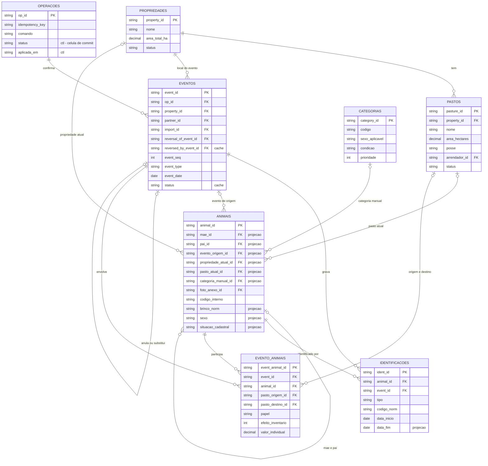
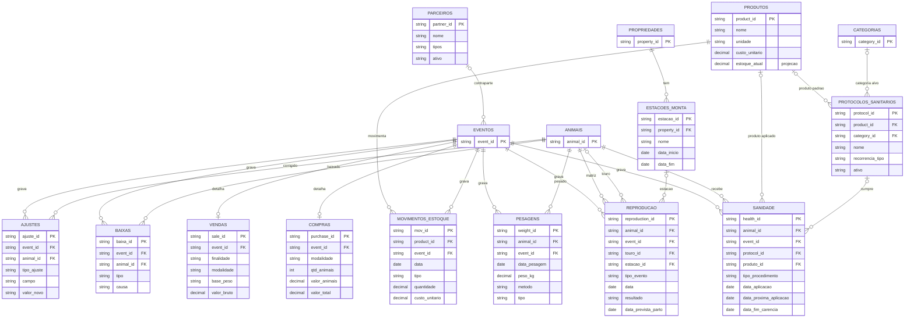
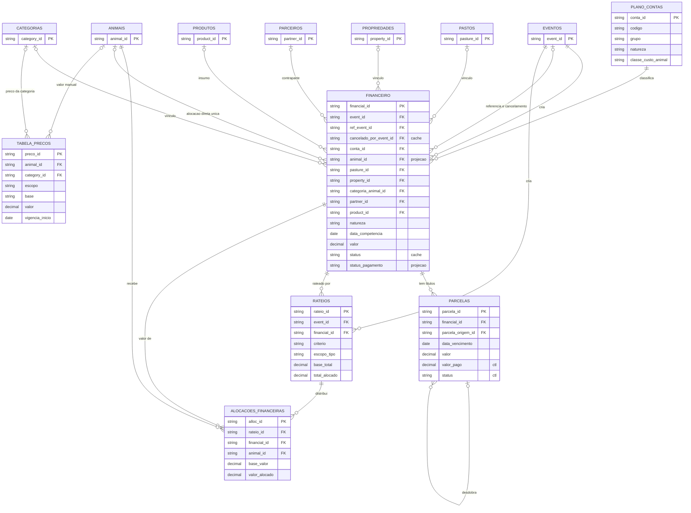
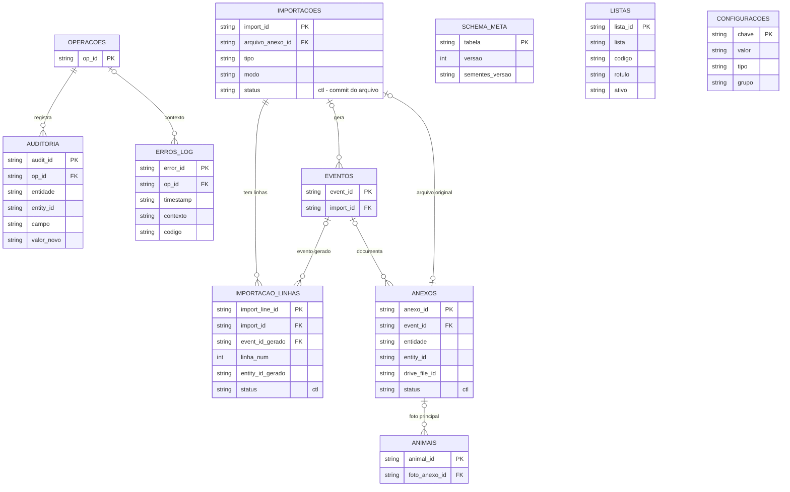
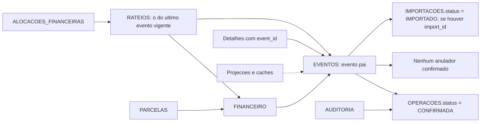

# 02 — Modelo de dados: entidades e relacionamentos

## Em resumo

- **34 abas em 4 grupos** (14 cadastros, 9 de eventos e detalhes, 4 financeiras, 7 de suporte). PK é sempre UUID em texto, nunca número de linha (§2.1, §3.2); o alvo de cada FK é declarado no `Schema`.
- **O modelo é um razão de eventos.** `EVENTOS` + `EVENTO_ANIMAIS` são a fonte; `ANIMAIS` guarda projeções (`*`) reconstruíveis por replay (§2.3). Uma linha só vale se o evento pai for **vigente**, predicado único apoiado em três células de controle: `OPERACOES.status`, `EVENTOS.reversal_of_event_id` e `IMPORTACOES.status`.
- **Dinheiro por animal tem uma única fonte de leitura**, `ALOCACOES_FINANCEIRAS`. Lançamento (`FINANCEIRO`) e título (`PARCELAS`) são níveis separados. Toda coluna redundante tem fonte declarada e conferência na verificação de integridade.
- **Derivado não é persistido**: GMD, categoria automática, valor estimado, agenda sanitária e série patrimonial saem de consulta sobre linhas vigentes.
- **Fora do MVP, com entrada aditiva**: LOTES, USUARIOS e lotes de estoque. A premissa PR-12 foi respondida pelo dono em 14/11/2026: não há gado de terceiros nem parceria, então `proprietario_id` não existe; às vezes o gado fica em pasto arrendado, modelado por `PASTOS.posse` e `PASTOS.arrendador_id` (DV-20).

**Documentos relacionados:** `README.md` · `01-arquitetura.md` · `03a-dicionario-cadastros-suporte.md` e `03b-dicionario-eventos-financeiro.md` (coluna a coluna) · `04-motor-de-eventos.md` · `05-regras-de-negocio.md` · `06-persistencia-e-integridade.md` · `07-financeiro-e-indicadores.md` · `11-riscos-e-premissas.md` · `12-fatos-de-plataforma.md`.

## 1. Convenções do modelo

- Uma aba = uma tabela. Aba em MAIÚSCULAS; colunas em `snake_case` ASCII (DV-01).
- **PK** = UUID gerado pela aplicação. `ANIMAIS.codigo_interno` (A-000123) e `EVENTOS.event_seq` são sequenciais legíveis, derivados da própria planilha sob lock (máximo + 1); não são chaves.
- **FK** = coluna de texto com o UUID do alvo. O nome da FK nem sempre repete o da PK, porque os nomes da §4 foram mantidos: `SANIDADE.produto_id` → `PRODUTOS.product_id`; `pasto_origem_id` → `PASTOS.pasture_id`; `categoria_animal_id` → `CATEGORIAS.category_id`. O `Schema` declara o alvo de cada uma.
- O Sheets não oferece integridade referencial. Quem a garante é a fronteira única de escrita (valida antes de gravar) e a verificação de integridade (confere depois). Não há exclusão física (P7), logo não existe exclusão em cascata.
- Tipos declarados por coluna: ID, TEXTO, DATA (`yyyy-MM-dd`), TS (ISO-8601 UTC), INT, DEC1, DINHEIRO, BOOL (`S`/`N`), ENUM, JSON (até 40.000 caracteres). Vazio (`''`) significa desconhecido ou não se aplica, nunca zero (P6, P9).
- Enum fechado (tem lógica) vive no `Schema`. Lista aberta vive em LISTAS, e a tabela de fato grava o `codigo`, nunca o rótulo.
- Marcas de mutabilidade: `*` projeção, `[ctl]` controle, `[cad]` cadastro editável, sem marca = imutável (seção 6).

## 2. Visão geral das 34 abas

Volumes em ordem de grandeza para 500 animais ativos. Os de EVENTO_ANIMAIS, ALOCACOES_FINANCEIRAS, PESAGENS e SANIDADE vêm do desenho-base; os demais são estimativas deste documento, a calibrar com a base de demonstração no spike de desempenho (SP-05). A soma dá cerca de 40 mil linhas por ano, coerente com o total de 300 a 500 mil linhas (4 a 6 milhões de células) em dez anos, abaixo do limite de 10 milhões de células usado no planejamento.

### 2.1 Cadastros (14)

| Aba | Propósito | Volume esperado |
|---|---|---|
| PROPRIEDADES | Fazenda ou área arrendada; raiz de pastos, eventos e estações (§4.1, §21) | 1 a 3 |
| PASTOS | Unidade de localização do animal, com área e capacidade informadas (§4.2, §7) | 10 a 40 |
| ANIMAIS | Uma linha por animal: identidade imutável e projeções do estado atual (§4.3) | ~500 na implantação; +150 a 250/ano |
| IDENTIFICACOES | Histórico de brincos e outros códigos do animal (§2.1, "substituição formalmente registrada") | 1 a 2 por animal |
| CATEGORIAS | Regras configuráveis de classificação: sexo, idade, condição, prioridade (§4.12) | ~10 |
| PRODUTOS | Biblioteca de vacinas, medicamentos e suplementos (§4.10, §10) | 20 a 60 |
| MOVIMENTOS_ESTOQUE | Razão de entradas, saídas e ajustes de produto; fonte do consumo | 50 a 200/ano |
| PARCEIROS | Fornecedores, compradores, veterinários, transportadores (§4.11) | 20 a 100 |
| PROTOCOLOS_SANITARIOS | Regras de recorrência da agenda sanitária; nenhum vem ativo de fábrica (§10) | 5 a 20 |
| ESTACOES_MONTA | Período de exposição que define o denominador dos indicadores reprodutivos (§9) | 1 a 2/ano |
| LISTAS | Listas abertas (raça, causa de morte, forma de pagamento...) por `lista` + `codigo` | ~100 |
| CONFIGURACOES | Parâmetros por `chave` (§4.14, §21) | 45 chaves |
| PLANO_CONTAS | Contas com `grupo` (apresentação) e `natureza` (cálculo) (§11) | 29 sementes |
| TABELA_PRECOS | Valores de referência do patrimônio, com vigência (§11.4) | 10 a 50/ano |

### 2.2 Eventos e detalhes (9)

| Aba | Propósito | Volume esperado |
|---|---|---|
| EVENTOS | Cabeçalho de todo fato: o que, quando, quem, status (§4.4, §2.5) | ~1 mil/ano |
| EVENTO_ANIMAIS | Razão de animais envolvidos e de movimentação: efeito no inventário, pasto de origem e destino (§4.5) | ~10 mil/ano |
| COMPRAS | Cabeçalho comercial da compra, um por evento COMPRA (§6.2) | 5 a 20/ano |
| VENDAS | Cabeçalho comercial da venda, um por evento VENDA (§6.3) | 5 a 30/ano |
| PESAGENS | Uma linha por animal pesado; só peso vivo (§4.6) | 2 a 4 mil/ano |
| SANIDADE | Uma linha por animal e procedimento sanitário (§4.7) | 2 a 4 mil/ano |
| REPRODUCAO | Uma linha por matriz e fato reprodutivo (§4.8) | 0,6 a 1 mil/ano |
| BAIXAS | Detalhe de morte, descarte e divergência de contagem | 10 a 40/ano |
| AJUSTES | Uma linha por campo corrigido, com valor anterior e justificativa (§6.12) | 20 a 200/ano |

### 2.3 Financeiro (4)

| Aba | Propósito | Volume esperado |
|---|---|---|
| FINANCEIRO | Lançamento econômico: conta, competência, valor, vínculos (§4.9, §11) | 300 a 600/ano |
| PARCELAS | Título a pagar ou a receber: vencimento, pagamento, valor pago (§11.3) | 400 a 800/ano |
| RATEIOS | Cabeçalho auditável de cada distribuição: critério, escopo, base (§11.2) | 150 a 400/ano |
| ALOCACOES_FINANCEIRAS | Razão único de valor por animal; é a tabela que mais cresce | 10 a 20 mil/ano |

### 2.4 Suporte (7)

| Aba | Propósito | Volume esperado |
|---|---|---|
| ANEXOS | Metadados de fotos e documentos guardados no Drive (§5.1-J, §2.5) | 50 a 300/ano |
| AUDITORIA | Mutações fora de evento, campo a campo; também é o log de redo dos comandos sem evento (§4.13) | 2 a 5 mil/ano |
| OPERACOES | Journal: uma linha por comando; idempotência e célula de commit (§2.4) | 1,5 a 3 mil/ano |
| IMPORTACOES | Uma linha por arquivo importado, com o estado do pipeline (§14) | dezenas, concentradas na implantação |
| IMPORTACAO_LINHAS | Linha original do arquivo, erros e o que ela gerou (§14, "preservar os dados originais") | 5 a 20 mil na implantação |
| ERROS_LOG | Erros relevantes de execução (§17) | centenas/ano |
| SCHEMA_META | Versão do esquema e das sementes, por tabela | 34 |

## 3. Diagrama de entidades e relacionamentos

Notação: `||` exatamente um; `|o` zero ou um; `o{` zero ou muitos. `PROPRIEDADES ||--o{ PASTOS` lê-se "uma propriedade tem zero ou mais pastos; cada pasto tem exatamente uma propriedade". Cada diagrama traz só PK, FKs e as colunas-chave; o detalhe está nos dicionários `03a` e `03b`. Os comentários `projecao`, `cache` e `ctl` equivalem às marcas `*` e `[ctl]`. Entidade desenhada só com a PK pertence a outro diagrama.

### 3.1 Núcleo animal-evento

### 3.2 Detalhes de manejo

### 3.3 Financeiro

### 3.4 Suporte

LISTAS, CONFIGURACOES e SCHEMA_META aparecem sem ligações porque são referenciadas por código, por chave ou por nome de aba, não por UUID (seção 4.6).

## 4. Relacionamentos

### 4.1 Políticas de integridade

Como não há exclusão física, "alvo removido" não existe. O alvo de uma FK só pode ficar inválido de três formas: cadastro desativado; evento anulado, falho ou de importação não concluída; animal ANULADO (sua entrada deixou de ser vigente). Cinco políticas cobrem os três casos e são citadas pelo nome nas tabelas.

| Política | Regra |
|---|---|
| `escrita` | O alvo precisa existir, não estar ANULADO e, se for cadastro, estar ativo no momento do comando. Depois de gravada, a referência não muda: alvo desativado mais tarde continua válido no histórico, exibido com a marca "inativo", e só sai dos seletores de novos registros. |
| `pai` | A linha só vale enquanto o evento pai for vigente (seção 5). Pai anulado ou falho: a linha permanece na aba, mas nenhum leitor a enxerga. |
| `bloqueia` | O estorno que tornaria o alvo ANULADO é recusado enquanto houver referência vigente; a resposta (CONFLICT) lista os dependentes. |
| `projeção` | A FK é coluna `*`: o `Projector` a recalcula a partir das linhas vigentes, então ela nunca fica pendurada. |
| `erro` | Se ainda assim uma linha vigente apontar para PK inexistente ou para animal ANULADO (edição manual da planilha), a verificação de integridade acusa erro. |

Desativar um cadastro só é aceito quando nenhuma projeção corrente aponta para ele: pasto com animal ATIVO, propriedade com pasto ativo, categoria em reclassificação manual vigente e conta com `sistema = S` não podem ser desativados. Referência histórica não impede.

Cardinalidade lida como origem : destino.

### 4.2 Núcleo animal-evento

| Origem → Destino | Coluna FK | Card. | Obrigatória | Regra de integridade |
|---|---|---|---|---|
| PASTOS → PROPRIEDADES | `property_id` | N : 1 | sim | `escrita` |
| PASTOS → PARCEIROS | `arrendador_id` | N : 0..1 | não (só com `posse = ARRENDADO`) | `escrita` |
| ANIMAIS → ANIMAIS | `mae_id*`, `pai_id*` | N : 0..1 | não (vazio = desconhecido) | `projeção` (atributo inicial + ajustes vigentes); `bloqueia`; `erro`. Mãe fêmea, pai macho, sem ciclo, filho nascido depois da mãe (§5.2). O alvo pode ser EXTERNO, HISTORICO, VENDIDO ou MORTO |
| ANIMAIS → EVENTOS | `evento_origem_id*` | N : 0..1 | sim, exceto EXTERNO | `projeção`: evento vigente cuja linha criou o animal (a que carrega `atributos_iniciais_json`). Sem entrada vigente o animal fica ANULADO, ou HISTORICO se só tem registros anteriores ao marco zero |
| ANIMAIS → PROPRIEDADES, PASTOS | `propriedade_atual_id*`, `pasto_atual_id*` | N : 0..1 | não (vazias fora do rebanho) | `projeção`: destino do último movimento vigente. ATIVO sem pasto é alerta (§16, regra 18) |
| ANIMAIS → CATEGORIAS | `categoria_manual_id*` | N : 0..1 | só com `categoria_modo = MANUAL` | `projeção` da reclassificação vigente |
| ANIMAIS → ANEXOS | `foto_anexo_id` [cad] | N : 0..1 | não | `escrita`; remover o anexo limpa o campo no mesmo comando |
| IDENTIFICACOES → ANIMAIS | `animal_id` | N : 1 | sim | `escrita`; `erro` |
| IDENTIFICACOES → EVENTOS | `event_id` | N : 1 | sim | `pai` |
| EVENTOS → OPERACOES | `op_id` | N : 1 | sim | Operação diferente de CONFIRMADA: evento não vigente. Uma operação tem 0 eventos (comando sem evento), 1 (caso comum) ou N (lote de importação) |
| EVENTOS → PROPRIEDADES | `property_id` | N : 1 | sim (padrão: `propriedade_padrao_id`) | `escrita` |
| EVENTOS → PARCEIROS | `partner_id` | N : 0..1 | por tipo, conforme o `EventCatalog` | `escrita` |
| EVENTOS → EVENTOS | `reversal_of_event_id` | 0..1 : 1 | só em ESTORNO e em evento substituto | Alvo vigente e diferente de ESTORNO; no máximo um anulador vigente por evento. `reversed_by_event_id*` é o inverso, em cache |
| EVENTOS → IMPORTACOES | `import_id` | N : 0..1 | só com `source = IMPORTACAO` | Importação diferente de IMPORTADO: evento não vigente |
| EVENTO_ANIMAIS → EVENTOS | `event_id` | N : 1 | sim | `pai`. Evento sem animal (lançamento, rateio, estoque, estorno) não tem linhas aqui |
| EVENTO_ANIMAIS → ANIMAIS | `animal_id` | N : 1 | sim | `escrita` pela linha do tempo do animal na data, conforme o `papel`; `bloqueia`; `erro` |
| EVENTO_ANIMAIS → PASTOS | `pasto_origem_id`, `pasto_destino_id` | N : 0..1 | por tipo | `escrita`: destino existente e ativo (§16, regra 5); origem igual ao destino do movimento anterior (§16, regra 6) |

### 4.3 Detalhes de manejo

| Origem → Destino | Coluna FK | Card. | Obrigatória | Regra de integridade |
|---|---|---|---|---|
| COMPRAS, VENDAS → EVENTOS | `event_id` | 0..1 : 1 | sim | `pai` |
| PESAGENS, SANIDADE, REPRODUCAO, BAIXAS, AJUSTES → EVENTOS | `event_id` | N : 1 | sim | `pai` |
| PESAGENS, SANIDADE, REPRODUCAO, BAIXAS, AJUSTES → ANIMAIS | `animal_id` | N : 1 | sim | `escrita`: data dentro de um período de permanência, limites inclusivos; `erro` |
| SANIDADE → PRODUTOS | `produto_id` | N : 0..1 | não (`nome_produto` aceita texto livre) | `escrita`. Nome, fabricante, lote e validade gravados na linha valem sobre o cadastro (DV-19) |
| SANIDADE → PROTOCOLOS_SANITARIOS | `protocol_id` | N : 0..1 | não | `escrita`. Protocolo inativo sai da agenda; o histórico fica |
| REPRODUCAO → ANIMAIS | `touro_id` | N : 0..1 | não (só quando o touro é único) | `escrita`: macho; EXTERNO dispensa presença no rebanho; `bloqueia`; `erro` |
| REPRODUCAO → ESTACOES_MONTA | `estacao_id` | N : 0..1 | não | `escrita` |
| MOVIMENTOS_ESTOQUE → PRODUTOS | `product_id` | N : 1 | sim | `escrita` |
| MOVIMENTOS_ESTOQUE → EVENTOS | `event_id` | N : 1 | sim | `pai` (SANIDADE grava SAIDA; ESTOQUE grava ENTRADA e AJUSTE) |
| PROTOCOLOS_SANITARIOS → PRODUTOS, CATEGORIAS | `product_id`, `category_id` | N : 0..1 | não | `escrita` |
| ESTACOES_MONTA → PROPRIEDADES | `property_id` | N : 1 | sim | `escrita` |

### 4.4 Financeiro

| Origem → Destino | Coluna FK | Card. | Obrigatória | Regra de integridade |
|---|---|---|---|---|
| FINANCEIRO → EVENTOS | `event_id` | N : 1 | sim | `pai`. Evento criador não vigente: `status* = CANCELADO`, com `cancelado_em*` e `cancelado_por_event_id*` |
| FINANCEIRO → EVENTOS | `ref_event_id` | N : 0..1 | não | `escrita`. Informativa: liga a despesa ao evento de negócio; não dá nem tira vigência |
| FINANCEIRO → PLANO_CONTAS | `conta_id` | N : 1 | sim | `escrita`. `natureza`, `tipo` e `categoria` são copiados da conta na gravação; grupo e natureza da conta ficam imutáveis após o primeiro lançamento |
| FINANCEIRO → ANIMAIS | `animal_id*` | N : 0..1 | não | `projeção`: preenchida só quando há exatamente uma alocação direta vigente |
| FINANCEIRO → PASTOS, PROPRIEDADES, CATEGORIAS, PARCEIROS, PRODUTOS | `pasture_id`, `property_id`, `categoria_animal_id`, `partner_id`, `product_id` | N : 0..1 | não | `escrita` (vínculos pedidos pela §11) |
| PARCELAS → FINANCEIRO | `financial_id` | N : 1 | sim | Lançamento sem parcela é fato sem efeito de caixa. Lançamento CANCELADO tira as parcelas do caixa. Parcela LIQUIDADA bloqueia o estorno do evento |
| PARCELAS → PARCELAS | `parcela_origem_id` | N : 0..1 | não | Desdobramento de baixa parcial: a parcela de origem fica CANCELADA e as duas novas apontam para ela |
| RATEIOS → FINANCEIRO | `financial_id` | N : 1 | sim | Vale o rateio do último evento vigente para o lançamento; os anteriores ficam como histórico |
| RATEIOS → EVENTOS | `event_id` | N : 1 | sim | `pai` (evento de negócio ou evento RATEIO) |
| ALOCACOES_FINANCEIRAS → RATEIOS | `rateio_id` | N : 1 | sim | Vale só se o rateio é o vigente |
| ALOCACOES_FINANCEIRAS → FINANCEIRO | `financial_id` | N : 1 | sim | Cópia de `RATEIOS.financial_id`, para leitura direta por lançamento |
| ALOCACOES_FINANCEIRAS → ANIMAIS | `animal_id` | N : 1 | sim | `escrita`; `bloqueia` (alocação vigente impede o estorno da entrada do animal); `erro` |
| TABELA_PRECOS → ANIMAIS, CATEGORIAS | `animal_id`, `category_id` | N : 0..1 | conforme `escopo` (GERAL deixa as duas vazias) | `escrita` |

### 4.5 Suporte

| Origem → Destino | Coluna FK | Card. | Obrigatória | Regra de integridade |
|---|---|---|---|---|
| AUDITORIA → OPERACOES | `op_id` | N : 1 | sim | A linha só vale com a operação CONFIRMADA (é o log de redo da fase C) |
| ERROS_LOG → OPERACOES | `op_id` | N : 0..1 | não | Sem regra: é diagnóstico |
| ANEXOS → EVENTOS | `event_id` | N : 0..1 | não | Com `event_id`: `pai`. Sem: comando próprio, com AUDITORIA |
| IMPORTACOES → ANEXOS | `arquivo_anexo_id` | 0..1 : 0..1 | não | `escrita` |
| IMPORTACAO_LINHAS → IMPORTACOES | `import_id` | N : 1 | sim | `escrita` |
| IMPORTACAO_LINHAS → EVENTOS | `event_id_gerado` | N : 0..1 | não | Rastreio da linha do arquivo até o evento; `entity_id_gerado` aponta o registro criado |

### 4.6 Referências que não são FK de UUID

| Tipo | Onde | Alvo |
|---|---|---|
| Polimórfica | `entidade` + `entity_id` em ANEXOS, AUDITORIA e AJUSTES (em AJUSTES, sempre ANIMAIS no MVP) | A PK é procurada na aba indicada |
| Polimórfica | `RATEIOS.escopo_tipo` + `escopo_ref` | EVENTO → EVENTOS; PASTO → PASTOS; CATEGORIA → CATEGORIAS; REBANHO e LISTA → vazio (os animais são as próprias alocações) |
| Por código | Colunas de lista aberta: `ANIMAIS.raca`, `BAIXAS.causa`, `SANIDADE.via_aplicacao`, `PARCELAS.forma_pagamento`, `REPRODUCAO.tipo_parto` e as demais do dicionário | LISTAS por (`lista`, `codigo`). Código imutável; item inativo continua resolvendo o rótulo do histórico |
| Por código | Contas e categorias citadas pelo `EventCatalog` e pelas sementes | `PLANO_CONTAS.codigo`, `CATEGORIAS.codigo` |
| Por valor | CONFIGURACOES, chave `propriedade_padrao_id` | PROPRIEDADES |
| Externa | `ANEXOS.drive_file_id`, `thumb_drive_file_id` | Arquivo no Drive |
| Nome de aba | `SCHEMA_META.tabela` | A própria aba |

## 5. Vigência: a regra que decide se uma linha existe

### 5.1 Predicado

P3 reduz a validade de qualquer linha de fato a três células de controle. A regra é do modelo, não de cada consulta: o `Repository` só expõe linhas vigentes (`repo.vigentes(tabela)`); acesso cru fica restrito à `UnitOfWork`, à recuperação e à integridade.

Um evento `e` é **vigente** quando as quatro condições valem:

1. a operação `e.op_id` tem `OPERACOES.status = CONFIRMADA`;
2. `e.event_type` é diferente de ESTORNO;
3. não existe evento `x` com `x.reversal_of_event_id = e.event_id` cuja operação esteja CONFIRMADA;
4. `e.import_id` está vazio, ou `IMPORTACOES.status = IMPORTADO`.

| Condição | Problema que resolve |
|---|---|
| 1 | Commit em uma célula: se a execução morrer depois de anexar as linhas, elas ficam inertes e nada precisa ser desfeito (§2.4) |
| 2 e 3 | Estorno é anulação: o ESTORNO não grava linhas inversas e o original sai do replay. Substituir ("corrigir") é um evento do mesmo tipo que anula e substitui no mesmo commit (§2.3) |
| 4 | O arquivo inteiro passa a valer em uma célula; queda no meio não deixa importação parcial que ninguém aprovou (§14) |

Exemplo conferido: rebanho de 100; em 01/03 a COMPRA E1 entra com 20 linhas de efeito +1 (total 120). Em 05/03 o ESTORNO E2 aponta para E1. E1 deixa de ser vigente pela condição 3 e E2 nunca conta, pela condição 2: Σ `efeito_inventario` volta a 100. Se o estorno gravasse 20 linhas −1 além de anular E1, a soma daria 80.

Evento com `pre_marco_zero = S` é vigente, mas tem efeito 0 e fica fora do replay: é histórico informativo.

### 5.2 Quem depende de quem

| Linha | Vale se | Saltos |
|---|---|---|
| EVENTO_ANIMAIS, COMPRAS, VENDAS, PESAGENS, SANIDADE, REPRODUCAO, BAIXAS, AJUSTES, IDENTIFICACOES, MOVIMENTOS_ESTOQUE, ANEXOS com `event_id` | o evento `event_id` é vigente | 1 |
| FINANCEIRO | o evento criador é vigente (em cache: `status* = ATIVO`) | 1 |
| PARCELAS | o lançamento vale e a parcela não está CANCELADA | 2 |
| RATEIOS | o lançamento vale, o evento do rateio é vigente e é o de maior `event_seq` entre os rateios vigentes do mesmo `financial_id` | 2 |
| ALOCACOES_FINANCEIRAS | o rateio vale. É o predicado único de "alocação vigente", usado por todo relatório | 3 |
| AUDITORIA | a operação `op_id` está CONFIRMADA | 1 |
| ANIMAIS | tem entrada vigente, ou é EXTERNO, ou é HISTORICO; caso contrário `situacao_cadastral* = ANULADO` e o animal sai das listas e da unicidade de brinco | projeção |
| Cadastros `[cad]`, LISTAS, CONFIGURACOES | sempre: valem pelo estado corrente | 0 |

Consequências para quem lê o modelo:

- Linha de fato não tem coluna "ativo" nem é atualizada: deixa de valer porque o pai deixou de valer. Linha filha sem pai em EVENTOS é inerte e é erro de integridade.
- Unicidade (brinco) e FKs são avaliadas só sobre linhas vigentes; animal PENDENTE ou ANULADO não ocupa brinco.
- A visão "como foi registrado" (inclusive o que foi anulado) usa acesso cru a EVENTOS + AUDITORIA; a visão "como vale hoje" usa `repo.vigentes()`.

### 5.3 `EVENTOS.status` como cache do predicado

`status*` não decide nada: é o predicado materializado, gravado na fase C e pela recuperação, para a aba ser legível e para acelerar leituras. A verificação de integridade compara os dois. Leitura adotada para os cinco valores do enum, avaliada nesta ordem:

| Condição | `status*` |
|---|---|
| Operação FALHOU | FALHOU |
| Operação INICIADA | PENDENTE |
| Importação do evento CANCELADO | CANCELADO |
| Importação do evento ainda não IMPORTADO | PENDENTE |
| Existe anulador de operação CONFIRMADA | ESTORNADO |
| Nenhuma das anteriores | CONFIRMADO |

Com o cache em dia, vigente equivale a `status* = CONFIRMADO` e `event_type` diferente de ESTORNO.

## 6. Mutabilidade e redundância controlada

### 6.1 As quatro marcas

| Marca | Significado | Quem grava, e quando | Como se corrige | Exemplos |
|---|---|---|---|---|
| sem marca | Fato imutável | Fase A, uma única vez (linha anexada) | Evento substituto, estorno ou ajuste (P7) | `EVENTOS.event_date`, `PESAGENS.peso_kg`, `PARCELAS.valor` |
| `*` | Projeção ou cache: função determinística de linhas vigentes | `Projector`, na fase C e na recuperação | Não se edita: corrige-se a fonte; o rebuild a reconstrói | `ANIMAIS.pasto_atual_id`, `EVENTOS.status`, `PRODUTOS.estoque_atual`, `FINANCEIRO.status_pagamento` |
| `[ctl]` | Controle de processo, mutável por comando | `UnitOfWork` (journal) ou comando próprio com AUDITORIA | Comando inverso, como `parcela.desfazerBaixa` | `OPERACOES.status`, `PARCELAS.valor_pago`, `IMPORTACOES.status`, `ANEXOS.status` |
| `[cad]` | Cadastro editável | Comando direto: AUDITORIA anexada na fase A, valor aplicado na fase C | Nova edição, também auditada (§16, regra 17) | `PASTOS.nome`, `ANIMAIS.observacoes`, `CONFIGURACOES.valor` |

- Em ANIMAIS só `animal_id`, `codigo_interno` e `created_at` são imutáveis. Todo o resto é `*` (muda por evento) ou `[cad]` (muda por comando auditado). Por isso "editar cadastro" na tela pode produzir um evento AJUSTE_INVENTARIO, uma linha de AUDITORIA ou os dois (DV-07).
- `created_at` é imutável; `updated_at` é carimbo do sistema, regravado sempre que a linha muda.
- Lacuna fechada aqui: colunas que o próprio pipeline preenche depois de criar a linha e que o desenho-base deixa sem marca são tratadas como `[ctl]`: `erro` e `finished_at` em OPERACOES; mapeamento, formato, contadores, `modo`, `relatorio_json` e `finished_at` em IMPORTACOES; `erros_json`, `entity_id_gerado` e `event_id_gerado` em IMPORTACAO_LINHAS.

### 6.2 Fonte × cópia × projeção

A especificação pede colunas que repetem o mesmo fato (§4.3 `custo_aquisicao`, §4.7 `custo` e `data_aplicacao`, §4.9 `animal_id` e `status_pagamento`). Elas foram mantidas, mas cada par tem dono. Sem isso o mesmo real é somado duas vezes: um tratamento de R$ 120,00 do animal A-000123, com `FINANCEIRO.animal_id` preenchido e uma alocação direta de R$ 120,00, vira R$ 240,00 no relatório que unir as duas fontes.

| Par | Fonte de verdade | A outra coluna é | Gravada | Conferência na integridade | Regra de leitura |
|---|---|---|---|---|---|
| `FINANCEIRO.animal_id*` × alocações | ALOCACOES_FINANCEIRAS vigentes | Projeção: preenchida só quando o lançamento tem exatamente uma alocação direta | Fase C | `animal_id` preenchido ⇔ exatamente uma alocação direta | Nenhum relatório de custo lê `FINANCEIRO.animal_id` |
| `ANIMAIS.custo_aquisicao*` × alocações | Σ `valor_alocado` das alocações vigentes de natureza AQUISICAO_ANIMAIS | Projeção | Fase C (`Projector`) | Projeção × replay | Listas e ficha leem a projeção; relatórios leem as alocações |
| `SANIDADE.custo` × alocação | Alocação do animal no rateio gravado pelo próprio evento | Cópia congelada | Fase A | Σ `custo` do evento = Σ alocações do rateio original do evento | Nunca somada em relatório; re-rateio posterior não a altera |
| `EVENTO_ANIMAIS.valor_individual` | É fato: valor negociado do animal, sem frete nem deduções | Base do critério VALOR_INDIVIDUAL; não é custo nem receita | Fase A | Σ do evento = `COMPRAS.valor_animais`, ou `VENDAS.valor_bruto` − `desconto_comercial` | Custo e receita por animal saem das alocações |
| `EVENTOS.total_value` | Detalhe do tipo: `COMPRAS.valor_total`, `VENDAS.valor_bruto`, `FINANCEIRO.valor` do lançamento avulso | Cópia informativa | Fase A | Cópia × fonte | Serve à lista de eventos; nenhum relatório financeiro a lê |
| Datas de detalhe × `event_date` | `EVENTOS.event_date` | Cópia: `PESAGENS.data_pesagem`, `SANIDADE.data_aplicacao`, `REPRODUCAO.data` (e `data_parto`, só em PARTO), `MOVIMENTOS_ESTOQUE.data` | Fase A, pela `UnitOfWork`; nunca aceita do cliente | Datas de detalhe = `event_date` | A linha do tempo usa `event_date`; a cópia deixa a aba legível sozinha e serve aos índices por animal |
| `EVENTOS.status*` × predicado | Predicado de vigência (seção 5) | Cache | Fase C e recuperação | `status` × predicado | Leitores usam `repo.vigentes()` |
| `IDENTIFICACOES.data_fim*` | Sequência de identificações vigentes do animal | Projeção: início da identificação seguinte do mesmo tipo, ou data do evento de remoção | Fase C | Projeção × replay | `ANIMAIS.brinco*` = código BRINCO vigente sem `data_fim` |
| `FINANCEIRO.status_pagamento*` × PARCELAS | PARCELAS (`status`, `data_pagamento`) | Projeção agregada, com `data_pagamento*` | Fase C da baixa | Recalculo a partir das parcelas | "Pago", "recebido" e "atrasado" são rótulos derivados |

Regra de agregação de `status_pagamento*`: sem parcela → SEM_CAIXA; lançamento cancelado → CANCELADO; todas as parcelas não canceladas LIQUIDADAS → LIQUIDADO, e `data_pagamento*` recebe a maior data de pagamento; nenhuma liquidada → ABERTO; nos demais casos → PARCIAL. Invariante: Σ `PARCELAS.valor` das parcelas não canceladas = `FINANCEIRO.valor`.

Exemplos conferidos:

- Compra de R$ 60.000,00 em 3 parcelas de R$ 20.000,00. Paga a primeira: PARCIAL. A segunda é paga com R$ 300,00 de juros: `valor_pago` = 20.000,00 + 300,00 = R$ 20.300,00, e `PARCELAS.valor` continua 20.000,00. Paga a terceira: LIQUIDADO. O lançamento segue em R$ 60.000,00 e o custo de aquisição, em R$ 3.000,00 por animal (60.000,00 ÷ 20): juros são caixa, não custo do animal. É o motivo de separar lançamento e título (DV-02).
- Animal com brinco 100 desde 01/12/2026 recebe o brinco 200 em 15/01/2027 (evento IDENTIFICACAO): a linha do 100 ganha `data_fim* = 2027-01-15`. Estornada a troca, `data_fim*` volta a vazio no rebuild, sem escrita compensatória.

Outros pares com a mesma disciplina: `EVENTOS.idempotency_key` (cópia; a autoridade é OPERACOES); `EVENTOS.reversed_by_event_id*` (inverso de `reversal_of_event_id`); `FINANCEIRO.natureza`, `tipo` e `categoria` (cópias da conta); `FINANCEIRO.status*` (cache da vigência do evento criador); `ALOCACOES_FINANCEIRAS.financial_id` (cópia do rateio); `event_subtype` × tipo da linha de detalhe (correspondência fixa); `PRODUTOS.estoque_atual*` (Σ de MOVIMENTOS_ESTOQUE vigentes); `ANIMAIS.peso_atual*` e `data_ultima_pesagem*` (última PESAGENS vigente); produto, fabricante, lote e validade em SANIDADE (cópia congelada do cadastro, DV-19).

## 7. Consultas obrigatórias: de onde sai cada resposta

Todas leem só linhas vigentes. Nenhuma depende de tabela de snapshot ou de agenda.

| # | Consulta | Tabelas e colunas | Cálculo |
|---|---|---|---|
| 1 | Inventário em data passada D, por pasto e categoria | EVENTOS (`event_date`, `event_seq`, `event_type`, `pre_marco_zero = N`); EVENTO_ANIMAIS (`efeito_inventario`, `pasto_destino_id`, `atributos_iniciais_json`); ANIMAIS (`sexo`, `data_nascimento`, `reprodutor`, `partos_previos`); eventos CASTRACAO, partos em REPRODUCAO e reclassificações em AJUSTES até D; CATEGORIAS | Cabeças em D = Σ `efeito_inventario` dos eventos com `event_date ≤ D`. Pasto em D = `pasto_destino_id` do último movimento até D, na ordem (`event_date`, classe, `event_seq`). Categoria em D = função pura de idade, castrado, reprodutor, parida e reclassificação em D |
| 2 | Histórico de pastos do animal | EVENTO_ANIMAIS por `animal_id` (`pasto_origem_id`, `pasto_destino_id`, `efeito_inventario`); EVENTOS (`event_date`, `event_seq`, `event_type`); PASTOS (`nome`) | Cada movimento abre um período no pasto de destino e fecha o anterior. Período = [entrada, saída): o dia da entrada conta, o da saída não |
| 3 | Bezerros de uma matriz | ANIMAIS por `mae_id`, sem os ANULADOS; REPRODUCAO da matriz com `tipo_evento = PARTO` (`qtd_nascidos_vivos`, `qtd_natimortos`) | Lista de filhos, inclusive os importados sem evento de parto. Número de partos = `partos_previos` + partos vigentes |
| 4 | Custo acumulado por animal, por classe de custo | ALOCACOES_FINANCEIRAS (`animal_id`, `valor_alocado`) → FINANCEIRO (`natureza`, `conta_id`) → PLANO_CONTAS (`classe_custo_animal`) | Aquisição = Σ alocações de natureza AQUISICAO_ANIMAIS. Custeio por classe = Σ alocações de natureza CUSTEIO, agrupadas por `classe_custo_animal`. Acumulado = aquisição + custeio |
| 5 | Consumo de produto por período | MOVIMENTOS_ESTOQUE (`product_id`, `data`, `tipo = SAIDA`, `quantidade`, `custo_unitario`); PRODUTOS (`unidade`) | Consumo = Σ `quantidade`, na unidade de dose do produto. Custo = Σ `quantidade` × `custo_unitario` do movimento |
| 6 | Agenda sanitária | SANIDADE (`animal_id`, `protocol_id`, `produto_id`, `data_aplicacao`, `data_proxima_aplicacao`); PROTOCOLOS_SANITARIOS ativos (elegibilidade, recorrência, `antecedencia_alerta_dias`, `tolerancia_dias`); ANIMAIS ATIVOS; CONFIGURACOES (`agenda_antecedencia_dias`, `agenda_tolerancia_dias`) | Pendência por (animal, protocolo) ou (animal, produto), cumprida por aplicação posterior da mesma chave. Vencida: vencimento < hoje. Próxima: vencimento − antecedência ≤ hoje ≤ vencimento |
| 7 | Fluxo de caixa previsto × realizado | PARCELAS (`data_vencimento`, `valor`, `data_pagamento`, `valor_pago`, `status`) → FINANCEIRO (`tipo`) | Realizado em P = Σ `valor_pago` das parcelas de receita LIQUIDADAS com `data_pagamento` em P − Σ `valor_pago` das de despesa. Previsto = parcelas ABERTAS por `data_vencimento`. Lançamento sem parcela não entra |
| 8 | Evolução do rebanho mês a mês | As da consulta 1 | Saldo no fim do mês m = saldo(m − 1) + entradas(m) − saídas(m), abertas por `event_type` |
| 9 | Patrimônio em data passada D | Inventário em D (consulta 1); PESAGENS (peso vigente em D); CATEGORIAS (`peso_referencia_kg`); TABELA_PRECOS (`escopo`, `base`, `valor`, `rendimento_carcaca_pct`, `vigencia_inicio`, `vigencia_fim`) | Preço vigente em D na ordem ANIMAL → CATEGORIA → GERAL. CABECA = valor; KG_VIVO = peso (kg) × R$/kg; ARROBA = peso (kg) × rendimento ÷ 15 × R$/@. Animal sem referência é contado à parte, nunca como zero |

Exemplos conferidos:

- **Consultas 1 e 8.** Marco zero em 01/12/2026 com 300 cabeças (ENTRADA_INICIAL). Eventos vigentes: NASCIMENTO em 15/01/2027 (+2), COMPRA em 10/03/2027 (+20), MORTE em 20/03/2027 (−1), VENDA em 15/04/2027 (−5). Inventário em 31/03/2027 = 300 + 2 + 20 − 1 = 321; em 30/04/2027 = 321 − 5 = 316. Série mensal: dezembro 300, janeiro 302, fevereiro 302, março 321, abril 316. Consulta com data 30/11/2026 devolve `null` com motivo ANTERIOR_AO_MARCO_ZERO.
- **Consulta 4.** Garrote comprado por R$ 3.000,00, com frete rateado de R$ 75,00 (R$ 1.500,00 ÷ 20 cabeças): aquisição = R$ 3.075,00. Custeio alocado: sanitário R$ 45,40 + alimentação R$ 174,60 = R$ 220,00. Acumulado = 3.075,00 + 220,00 = R$ 3.295,00.
- **Consulta 5.** Vacinação de 30 animais, 1 dose por cabeça, R$ 1,80 por dose: uma SAIDA de 30 doses, custo de 30 × 1,80 = R$ 54,00 (R$ 1,80 por animal). Se o frasco de 50 doses foi aberto e o resto descartado, o operador informa 50 doses consumidas: R$ 90,00 (R$ 3,00 por animal).
- **Consulta 6.** Aplicação em 10/05/2027, próxima em 10/11/2027, antecedência de 15 dias: "próxima" de 26/10 a 10/11/2027; "vencida" a partir de 11/11/2027; aplicação da mesma chave em 05/11/2027 encerra a pendência.
- **Consulta 7.** Em maio/2027: recebida uma parcela de venda de R$ 48.000,00; paga uma parcela de compra de R$ 20.000,00 com R$ 300,00 de juros. Realizado = 48.000,00 − 20.300,00 = R$ 27.700,00. Previsto para junho: R$ 20.000,00 a pagar em 08/06.
- **Consulta 9.** Boi de 540 kg, base ARROBA a R$ 320,00/@ e rendimento de 52%: 540 × 0,52 ÷ 15 = 18,72 @; 18,72 × 320,00 = R$ 5.990,40. Novilho de 210 kg, base KG_VIVO a R$ 11,00/kg: R$ 2.310,00.

Três leituras adotadas onde o desenho-base não fecha a regra:

- **Consulta 5.** Toda aplicação com `produto_id` grava a SAIDA, mesmo com `controla_estoque = N`; a opção só decide se o saldo `estoque_atual*` é projetado e exibido. Assim o CT-06 (consumo e custo do produto) não depende de ligar o controle de estoque. Aplicação com produto em texto livre não gera movimento.
- **Consulta 9.** TABELA_PRECOS é só de inserção (nenhuma coluna é `[cad]`): preço novo é linha nova. Preço vigente em D = entre as linhas do alvo com `vigencia_inicio ≤ D` e `vigencia_fim` vazio ou ≥ D, a de maior `vigencia_inicio`. Valor manual (escopo ANIMAL) ainda respeita `patrimonio_valor_manual_validade_dias`.
- **Consultas 1 e 9.** CATEGORIAS não tem vigência: o passado é classificado com as regras e o `peso_referencia_kg` atuais. A limitação é aceita e fica declarada nos relatórios históricos.

## 8. Índices lógicos em memória

A §3.2 pede índices lógicos por mapas em memória. O `Repository` os monta uma vez por execução, com uma passada sobre cada aba lida, só para as tabelas declaradas em `reads[]` do comando e só com linhas vigentes. Não há aba nem coluna de índice persistida: nada a manter em dia, nada a divergir. Índice único = mapa chave → linha; índice múltiplo = mapa chave → lista.

| Tabela | Índices (chave → valor) | Para quê |
|---|---|---|
| ANIMAIS | `animal_id` (único); `brinco_norm` (único entre preenchidos); `mae_id` e `pai_id` → filhos; `pasto_atual_id` → animais | FK; unicidade e resolução de brinco (§16, regra 1); bezerros da matriz e detecção de ciclo; painel do pasto |
| IDENTIFICACOES | `codigo_norm` → linhas; `animal_id` → histórico | Busca por brinco antigo, de origem ou RFID; bloqueio de reuso |
| EVENTOS | `event_id` (único); `op_id` → eventos; `reversal_of_event_id` → anulador; `import_id` → eventos | Predicado de vigência; recuperação por operação; desfazer importação |
| EVENTO_ANIMAIS | `animal_id` → linhas ordenadas por (`event_date`, classe, `event_seq`); `event_id` → linhas | Linha do tempo, inventário em data, dias de permanência; detalhe do evento |
| PESAGENS, SANIDADE, REPRODUCAO, BAIXAS, AJUSTES | `animal_id` → linhas por data; `event_id` → linhas | Ficha, GMD, carência, agenda, situação reprodutiva, projeção de atributos |
| REPRODUCAO (além dos acima) | `estacao_id` → linhas; `touro_id` → linhas | Indicadores por estação; dependentes de um touro no estorno |
| MOVIMENTOS_ESTOQUE | `product_id` → movimentos por data | Saldo e consumo |
| FINANCEIRO | `financial_id` (único); `event_id` → lançamentos | Lançamentos do evento; estorno e substituição |
| PARCELAS | `financial_id` → parcelas | `status_pagamento*`; fluxo de caixa |
| RATEIOS | `financial_id` → rateios por `event_seq` | Rateio vigente |
| ALOCACOES_FINANCEIRAS | `animal_id` → alocações; `financial_id` → alocações; `rateio_id` → alocações | Custo por animal; invariantes de soma; dependentes no estorno |
| OPERACOES | `idempotency_key` → operação; linhas INICIADA ou sem `aplicada_em` | Idempotência; operações órfãs |
| TABELA_PRECOS | (`escopo`, alvo) → linhas por `vigencia_inicio` | Preço vigente em D |
| CATEGORIAS, PLANO_CONTAS, LISTAS, CONFIGURACOES | Ativas por `prioridade`; `codigo`; (`lista`, `codigo`); `chave` | Classificação; contas do catálogo; rótulos; parâmetros |
| ANEXOS, AUDITORIA | (`entidade`, `entity_id`) → linhas | Ficha e trilha de auditoria |
| IMPORTACAO_LINHAS | `import_id` → linhas | Validação em blocos e retomada |

Os contadores `event_seq` e `codigo_interno` saem do mesmo passe: máximo + 1, sob lock. O custo de montar os índices com 10 mil a 300 mil linhas, e a opção de ler só a cauda de OPERACOES, são medidos no spike (SP-05); o limiar de arquivamento (`arquivamento_limiar_linhas` = 60000) é a válvula se o orçamento estourar.

## 9. Decisões que divergem da especificação

| ID | Trecho da especificação | O que o desenho fez | Motivo |
|---|---|---|---|
| DV-01 | §4: nomes com acento (`mãe_id`, `descrição`, `área total`) | Colunas ASCII (`mae_id`, `descricao`), com unidade no nome quando há (`area_total_ha`, `idade_minima_meses`, `peso_referencia_kg`, `periodo_carencia_dias`); acento só nos rótulos da interface | Cabeçalho vira chave de objeto e, depois, coluna SQL; unidade no nome evita ambiguidade |
| DV-02 | §4.9 põe `data_pagamento`, `status_pagamento` e `forma_pagamento` no lançamento; §11.3 exige vencimento, pagamento e status por título | FINANCEIRO (lançamento) + PARCELAS (título). Em FINANCEIRO ficam `status_pagamento*` e `data_pagamento*` como projeção. Colunas novas: `conta_id`, `natureza`, `ref_event_id`, `competencia_inicio`, `competencia_fim`, `property_id`, `categoria_animal_id`, `retida_pelo_comprador` | Compra parcelada: as alocações apontam para um lançamento só e juros de baixa não alteram o custo do animal. A §11 pede vínculo a categoria, período, evento e propriedade |
| DV-03 | §4.5: EVENTO_ANIMAIS com 8 campos | Acrescenta `papel`, `efeito_inventario`, `peso_carcaca_kg`, `preco_unitario`, `motivo_saida`, `atributos_iniciais_json` | Inventário por soma; mãe e cria no mesmo evento; frigorífico paga por carcaça e por animal; valores de criação imutáveis |
| DV-04 | §4.4: EVENTOS com 13 campos | Acrescenta `op_id`, `event_seq`, `event_subtype`, `created_by`, `source`, `confiabilidade`, `pre_marco_zero`, `partner_id`, `payload_json`, `reversed_by_event_id`, `import_id`, `confirmed_at` | Commit por operação, ordem de replay, marco zero, importação e rastreabilidade (§2.4, §2.5, §14) |
| DV-05 | §1 "todos os animais possuem identificação"; §2.1 brinco único entre ativos e históricos; §16, regra 19 manda identificar animais sem identificação | Brinco opcional. Unicidade sobre os brincos preenchidos de todos os animais, comparando códigos numéricos sem zeros à esquerda. Brinco do vendedor vira `BRINCO_ORIGEM`, sem unicidade. Pôr ou repor brinco é o evento IDENTIFICACAO | Leitura adotada: a regra 19 só faz sentido se o brinco puder faltar (bezerro ainda não brincado). Brincar é rotina, não correção |
| DV-06 | §5 "cadastrar animal"; §19, Fase 1 "cadastro de animais" | Todo animal do inventário entra por evento com efeito +1 (NASCIMENTO, COMPRA, ENTRADA_INICIAL, OUTRA_ENTRADA). Animal EXTERNO é cadastro de referência, por comando sem evento | Sem evento de entrada o inventário por soma não fecha (§16, regra 20) |
| DV-07 | §5 "editar dados cadastrais"; §4.3 lista sexo, nascimento, mãe, pai e brinco como campos simples | Esses atributos são projeções: valor de criação em `atributos_iniciais_json` + ajustes vigentes. Editar na tela gera o evento de ajuste | Estornar um ajuste devolve o valor certo sem "restaurar valor anterior"; a integridade enxerga edição manual |
| DV-08 | §6.5 "calcular automaticamente" ganho, GMD, variação e dias | Calculados na leitura, não persistidos | Pesagem retroativa ou estornada invalidaria o valor gravado |
| DV-09 | §4.3 `categoria_atual` | Não persistida; guarda-se só a reclassificação manual (`categoria_modo`, `categoria_manual_id*`) | Categoria muda com a idade, sem evento; persistir obrigaria a regravar o rebanho todo dia |
| DV-10 | §4.3 `valor_estimado`; §11.4 evolução patrimonial | Não persistido; calculado de TABELA_PRECOS. Sem tabela de snapshots | Snapshot diverge do replay quando chega evento retroativo |
| DV-11 | §4.3 `foto_url` | `foto_anexo_id` | Arquivo privado do Drive não carrega por URL, e a §17 proíbe expor dados em URL |
| DV-12 | §11-B põe "compra de animais" em custos diretos; §11.3 proíbe tratá-la como custeio | `PLANO_CONTAS.grupo` (apresentação) × `natureza` (cálculo); todo cálculo usa a natureza | Atende às duas seções sem dupla contagem |
| DV-13 | "Lote" em §6.2, §6.5 e §8 | Sem entidade LOTES: lote = animais de um evento, ou recorte por pasto e categoria | Nenhum requisito do MVP exige a entidade; a §22 deixa a comparação entre lotes para depois |
| DV-14 | §2.3 "registro histórico imutável" × §4.4 `status` | Imutável é o conteúdo de negócio; `status`, `reversed_by_event_id` e `confirmed_at` são cache derivado | Sem isso o estorno exigiria alterar o evento original |
| DV-15 | §6 lista os tipos de evento; §6.10 cita natimorto | Catálogo ganha IDENTIFICACAO, CASTRACAO, MARCACAO, OUTRA_ENTRADA, OCORRENCIA, RATEIO, ESTOQUE e LANCAMENTO_FINANCEIRO. NATIMORTO deixa de ser evento: é parto com zero nascidos vivos | Cada fato com efeito no modelo precisa de evento próprio; parto único evita IEP e contagem de partos errados |
| DV-16 | §6.3 "data prevista de recebimento" | Não é coluna: é o vencimento da primeira parcela aberta da receita | Uma data só conflita com venda parcelada |
| DV-17 | §4.14 "unidade de peso" | Armazenamento sempre em kg; `unidade_peso_exibicao` (KG ou ARROBA) afeta só a exibição | Converter o valor gravado quebraria o histórico |
| DV-18 | §19 põe auditoria na Fase 2 e não dá fase ao backup | AUDITORIA, OPERACOES, ERROS_LOG e SCHEMA_META existem desde o primeiro `setup()`; backup e integridade básica vão para a Fase 1 | A base recebe dados reais na importação inicial |
| DV-19 | §4.10 PRODUTOS com `unidade`, `lote`, `validade` | `unidade` = unidade de dose e de controle; `lote` e `validade` do cadastro são "último lote" | Compra-se em frasco e aplica-se em mL ou dose; valem os dados gravados na aplicação |
| DV-20 | §4.2 PASTOS não distingue pasto próprio de alugado | `PASTOS.posse` (PROPRIO, ARRENDADO) e `PASTOS.arrendador_id` → PARCEIROS; conta "Arrendamento de pasto" no plano de contas | O dono informou, em 14/11/2026, que às vezes paga para deixar o gado em pasto alugado. O aluguel vira custo por animal pelo rateio de dias de permanência |

A numeração 4.4 a 4.12 dentro da seção 6 da especificação é lida como 6.4 a 6.12.

## 10. Fora do modelo no MVP, e como entra depois

Regra de evolução: `setup()` acrescenta abas e colunas ao final, nunca remove nem renomeia; enum novo é valor novo; semente entra por "insere se ausente"; SCHEMA_META registra a versão. Toda extensão abaixo cabe nessa regra, sem regravar histórico.

| Item | Por que ficou fora | Como entra, de forma aditiva |
|---|---|---|
| Entidade LOTES | DV-13. Criaria uma segunda cadeia de continuidade na linha do tempo, sem requisito que a pague | Aba LOTES; `ANIMAIS.lote_atual_id*`; `lote_origem_id` e `lote_destino_id` em EVENTO_ANIMAIS; evento de mudança de lote; valor LOTE em `RATEIOS.escopo_tipo`. Linhas antigas ficam vazias, isto é, sem lote |
| `proprietario_id` (gado de terceiros) | PR-12 respondida em 14/11/2026: não há gado de terceiros nem parceria; todo animal é do dono | Só se a resposta mudar: `ANIMAIS.proprietario_id` → PARCEIROS (vazio = próprio), com revisão dos filtros de patrimônio e de resultado. O pasto arrendado já está no modelo (DV-20) |
| USUARIOS e papéis | Um usuário (§1, §21) | Aba USUARIOS (e-mail, papel, ativo). `created_by` e `usuario` já gravam a identidade em EVENTOS, OPERACOES, AUDITORIA, RATEIOS, ANEXOS e IMPORTACOES: o histórico não precisa de migração |
| Lotes de estoque, custo médio ou PEPS | Estoque é opcional por produto (PR-10) e a §22 o trata como futuro | `MOVIMENTOS_ESTOQUE.lote`, `validade` e `custo_unitario` já são gravados por movimento; saldo por lote e custo médio passam a ser calculáveis sem regravar. Aba própria de lotes só se for preciso bloquear lote vencido |

Também ficam fora, sem coluna reservada: snapshots patrimoniais (DV-10), contas bancárias e conciliação, baixa parcial automática, hora do evento (a ordem no dia é dada por classe e `event_seq`) e evento de contagem de pasto.
