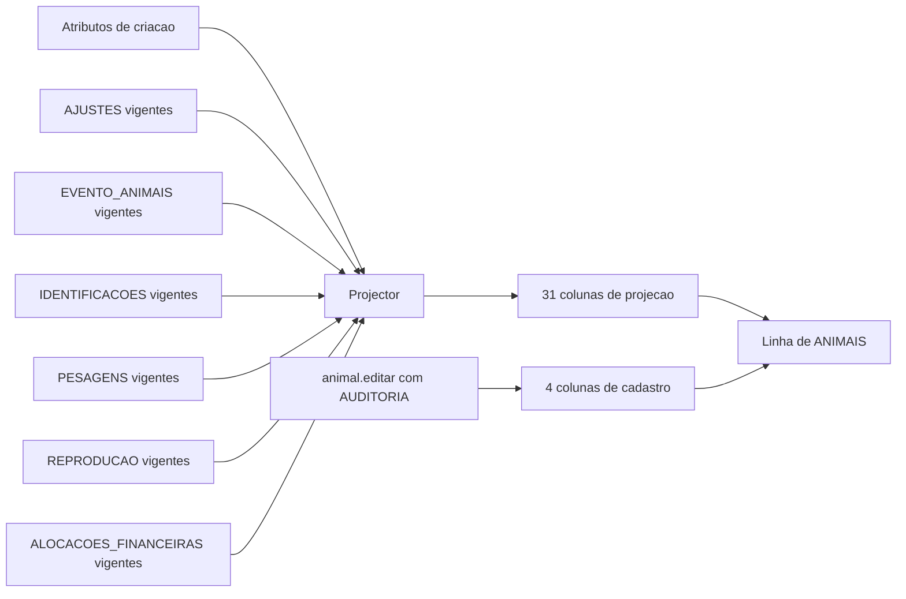
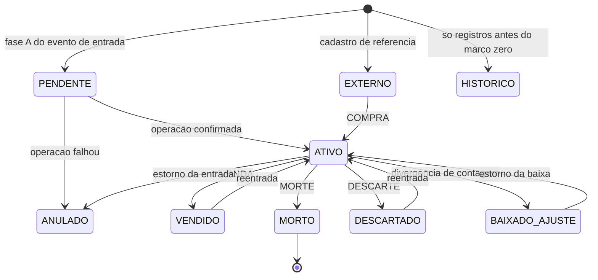

# 03a — Dicionário de dados: convenções, enums, cadastros e suporte

## Em resumo

- Cada coluna tem um tipo declarado no `Schema`, e um único codec converte célula ↔ valor: IDs, brincos e datas são texto, dinheiro vira centavos inteiros na lógica, booleano é `S`/`N`, vazio é `''` ↔ `null` e nunca vale zero (P6, P9).
- Os dez tipos do desenho-base não comportam área, dose nem custo por dose. Este documento acrescenta um tipo, `DEC4`, e fecha outras lacunas de detalhe; todas estão listadas na seção 7 para conferência do arquiteto.
- ANIMAIS tem 39 colunas: 3 imutáveis, 4 de cadastro editável, 1 carimbo e **31 projeções**, cada uma com regra de derivação escrita (seção 4.3). Atributo de criação é fato imutável guardado no evento; projeção é o valor que vale hoje.
- Enum fechado (tem lógica) vive no `Schema` e está catalogado na seção 2, inclusive os das tabelas de eventos e do financeiro. Lista aberta vive em LISTAS (11 listas, seção 3); tabela de fato grava o `codigo`, nunca o rótulo.
- Sementes do `setup()`, sempre por "insere se ausente": 45 chaves de CONFIGURACOES, 9 CATEGORIAS, 29 contas de PLANO_CONTAS e 69 itens de LISTAS.
- Todos os campos de §4.1, §4.2, §4.3 e §4.10 a §4.14 têm destino no modelo (seção 6). Só `categoria_atual` e `valor_estimado` deixam de ser coluna (são calculados na leitura), e `foto_url` vira `foto_anexo_id`.

**Documentos relacionados:** `README.md` · `01-arquitetura.md` · `02-modelo-de-dados.md` (DER, relacionamentos, vigência) · `03b-dicionario-eventos-financeiro.md` (as 13 abas de eventos e financeiro, coluna a coluna) · `04-motor-de-eventos.md` · `05-regras-de-negocio.md` · `06-persistencia-e-integridade.md` · `07-financeiro-e-indicadores.md` · `11-riscos-e-premissas.md` · `12-fatos-de-plataforma.md`.

## 1. Convenções

### 1.1 Nomes

| Elemento | Regra | Exemplo | Por quê |
|---|---|---|---|
| Aba | MAIÚSCULAS, sem acento; uma aba = uma tabela | `PASTOS` | O nome vira identificador no código e, numa migração, nome de tabela SQL (§3.3) |
| Coluna | `snake_case` ASCII, cabeçalho na linha 1 | `mae_id` (§4.3: mãe_id) | DV-01: o cabeçalho vira chave de objeto; acento só no rótulo da interface |
| Chave primária | UUID em texto; nunca o número da linha (§2.1, §3.2). Os nomes da §4 foram mantidos (`property_id`, `pasture_id`, `product_id`, `partner_id`, `category_id`); os novos são em português (`conta_id`, `estacao_id`, `anexo_id`) | `animal_id` | Rastreio direto entre especificação e modelo |
| Chave natural | Só duas abas não têm UUID: CONFIGURACOES (`chave`) e SCHEMA_META (`tabela`) | `ua_peso_kg` | São lidas por nome, não por relacionamento |
| Chave estrangeira | Texto com o UUID do alvo; o nome pode diferir do nome da PK; o alvo é declarado no `Schema` | `pasto_atual_id` → `PASTOS.pasture_id` | Os nomes da §4 foram preservados |
| Unidade no nome | `_kg`, `_ha`, `_dias`, `_meses`, `_bytes`, `_pct` (percentual de 0 a 100, não fração) | `rendimento_carcaca_pct = 52.5` | Evita "52,5 ou 0,525?" |
| Sufixos de tipo | `data_*` = DATA; `*_at`, `timestamp`, `aplicada_em` = TS; `*_json` = JSON; `*_confianca` = enum de confiança | `created_at` | O tipo é legível no cabeçalho |
| Códigos | MAIÚSCULAS ASCII com `_`; valem para enums, `LISTAS.codigo`, `CATEGORIAS.codigo` e `PLANO_CONTAS.codigo` | `RECRIA_ENGORDA` | Código é estável; rótulo é editável |

### 1.2 Tipos de coluna

O `Schema` declara o tipo de cada coluna e o `SheetsAdapter` tem um único codec. O contrato é "valor lido === valor gravado" (P6): nada do que a aplicação grava pode ser reinterpretado pelo Sheets.

| Tipo | Guarda | Na célula | Na lógica | Exemplo (célula) |
|---|---|---|---|---|
| ID | UUID de PK ou FK | Texto de 36 caracteres, minúsculas com hífens | string | `3f2b8c1e-7a4d-4e9b-9c55-0d6a1f2e8b47` |
| TEXTO | Texto livre, ou código que não é enum do `Schema` | Texto, gravado como digitado e nunca interpretado | string | `0012` · `=10 arrobas acima do lote` · `+55 69 99999-0000` |
| DATA | Dia de calendário, sem hora | Texto `yyyy-MM-dd` | string | `2026-11-13` |
| TS | Instante | Texto ISO-8601 em UTC, com milissegundos e `Z` | string | `2026-11-14T01:30:00.000Z` |
| INT | Inteiro | Número sem casas | number | `30` · `-1` |
| DEC1 | Peso em kg | Número com 1 casa | number | `387.5` |
| DEC4 | Área, dose, quantidade, custo por unidade de dose, coeficiente | Número com até 4 casas | number | `37.45` · `0.02` · `1.8` |
| DINHEIRO | Valor em reais | Número com 2 casas | inteiro em centavos | `1234.56` ↔ `123456` centavos |
| BOOL | Sim ou não | Texto `S` ou `N`; nunca booleano nativo | boolean | `S` |
| ENUM | Código de enum fechado do `Schema` | Texto em MAIÚSCULAS | string | `ATIVO` |
| JSON | Objeto pequeno de cabeçalho (seção 1.5) | Texto JSON compacto, até 40.000 caracteres | objeto | `{"delimitador":";","decimal":","}` |

Regras do codec, com o motivo de cada uma:

- **ID, brinco e data são texto.** `0012` gravado como número viraria `12` e a unicidade de brinco compararia coisas diferentes; `2026-11-13` gravado como data voltaria como objeto `Date`, que não atravessa o `google.script.run`.
- **DATA × TS.** DATA é o dia no fuso da fazenda (`fuso`, padrão `America/Porto_Velho`, UTC−4); TS é o instante em UTC. Um registro feito às 21:30 de 13/11/2026 em Porto Velho grava `created_at = 2026-11-14T01:30:00.000Z`, mas a data de registro é `2026-11-13`. Datas de evento nunca têm hora: a ordem dentro do dia vem da classe do evento (entrada, movimento, saída) e de `event_seq` (ver `04-motor-de-eventos.md`).
- **DINHEIRO em centavos inteiros na lógica.** Em ponto flutuante, 0,10 + 0,20 = 0,30000000000000004; em centavos, 10 + 20 = 30. A conversão é `centavos = arredonda(valor × 100)` na leitura e `valor = centavos ÷ 100` na gravação. Valor é sempre positivo; o sentido (entrada ou saída) vem do `tipo` do lançamento.
- **DEC1 só para peso.** Arredondamento "meio para cima" feito sobre o valor decimal informado: 387,46 kg → `387.5`; 387,44 kg → `387.4`.
- **DEC4 (acréscimo deste documento, DL-01).** O desenho-base lista dez tipos e nenhum serve a `area_hectares` (37,45 ha), `dose_padrao_por_kg` (0,02 mL/kg) ou `custo_unitario` por mL (R$ 0,035). Com DEC1, a dose de 0,02 viraria 0,0; com DINHEIRO, o custo de R$ 0,035 viraria R$ 0,04, um erro de 14%. Taxa unitária não é montante: o produto `quantidade × custo_unitario` é que é arredondado a centavos no lançamento.
- **Números são gravados como número**, texto como texto. A planilha fica com localidade `pt_BR` (exibe vírgula), mas o valor armazenado não depende de formatação. Os exemplos deste documento mostram o valor armazenado, com ponto.
- **Normalização não é do codec.** Aparar espaços, padronizar maiúsculas e validar formato são tarefas da validação, antes da gravação. O codec devolve exatamente o que recebeu, inclusive texto com espaços nas pontas.
- **Leitura defensiva.** Coluna DATA que chegar como `Date` (alguém editou a planilha à mão) é reformatada no fuso da planilha e gera o alerta "célula coercida"; coluna de texto que chegar como número é erro de integridade; linha sem PK é ignorada com alerta.

A primitiva de escrita fica para o spike (SP-01): a preferência é a API do Sheets com valores tipados, em que um valor de texto nunca é interpretado; a alternativa é `setValues` sobre coluna com formato de texto, cujo comportamento com valores iniciados por `=` ainda não tem fonte confiável (a confirmar no spike, SP-01). O contrato da tabela acima vale para as duas.

### 1.3 Vazio canônico

Célula vazia (`''`) corresponde a `null` na lógica, em todos os tipos. Não existe outro marcador de ausência: nem `0`, nem `N`, nem `-`, nem `N/A`.

| Situação | Como fica | Exemplo |
|---|---|---|
| Desconhecido | Vazio; quando a distinção importa, há coluna de confiança ao lado | `data_nascimento` vazio com `data_nascimento_confianca = DESCONHECIDA` |
| Não se aplica | Vazio | `castrado` de fêmea; `pasto_atual_id` de animal vendido |
| Ainda não aconteceu | Vazio | `data_saida` de animal ativo; `aplicada_em` de operação ainda em andamento |
| Zero de verdade | `0` | `custo_aquisicao = 0.00` de animal nascido na fazenda |

Consequência para os indicadores (P9): `custo_aquisicao` vazio significa "não sei quanto custou" e tira o animal do cálculo de resultado, com aviso de cobertura; `0.00` significa "custou zero" e entra no cálculo. Tratar vazio como zero inflaria o lucro de todo animal do rebanho inicial sem valor de abertura.

Coluna obrigatória não aceita vazio em linha vigente. No enum de confiança, vazio equivale a DESCONHECIDA.

### 1.4 Marcas de mutabilidade

| Marca | Significado | Quem grava | Como se corrige |
|---|---|---|---|
| imutável (sem marca no desenho-base) | Fato gravado uma única vez, na fase A do comando | `UnitOfWork` | Evento substituto, estorno ou ajuste; nunca edição nem exclusão (P7) |
| `*` | Projeção ou cache: função determinística de linhas vigentes | `Projector`, na fase C e na recuperação | Não se edita; corrige-se o fato de origem e a projeção é reconstruída |
| `[ctl]` | Controle de processo, mutável por comando | `UnitOfWork` (journal) ou comando próprio, com AUDITORIA | Comando inverso (por exemplo, `parcela.desfazerBaixa`) |
| `[cad]` | Cadastro editável | Comando direto: AUDITORIA anexada na fase A, valor aplicado na fase C | Nova edição, também auditada (§16, regra 17) |

Três esclarecimentos:

- `created_at` é imutável. `updated_at` não tem marca no desenho-base; aqui é tratado como `[ctl]`: carimbo que o sistema regrava sempre que a linha muda, sem linha própria em AUDITORIA (DL-02).
- Projeção não entra em AUDITORIA: a trilha dela são os eventos que a produziram.
- A verificação de integridade recalcula toda coluna `*` e compara com o valor gravado. Divergência indica edição manual da planilha ou defeito no `Projector`, nunca "dado a corrigir à mão".

### 1.5 Colunas JSON e teto de célula

- **Teto**: 40.000 caracteres por célula (`json_celula_max_caracteres`), abaixo do limite de 50.000 do Sheets (fonte secundária; a conferir no spike junto com o corpus de tipos, SP-01). Vale também para texto livre (`observacoes`, `valor_novo`, `mensagem`).
- **Validação antes de qualquer escrita**: o tamanho é conferido na etapa de validação do comando; estourar o teto devolve erro VALIDATION com o nome da coluna. Motivo: falha de tamanho na hora de gravar aconteceria no meio do commit.
- **Conteúdo permitido**: só campos de cabeçalho, em quantidade fixa por linha. **Nenhuma célula guarda coleção por animal ou por linha de arquivo**: o que varia por animal vai para tabela de detalhe. Uma compra de 250 animais com a lista dentro de um JSON chegaria a cerca de 55.000 caracteres (250 × 220).
- **Formato interno**: chaves em `snake_case` ASCII; datas `yyyy-MM-dd`; dinheiro em reais com 2 casas; booleano `S`/`N`; ausência = chave omitida.

Colunas JSON desta parte do dicionário:

| Coluna | Conteúdo | Tamanho típico |
|---|---|---|
| `CONFIGURACOES.valor` (quando `tipo = JSON`) | Lista ou mapa pequeno: `[12,24,36]`, política de avisos | < 1.000 |
| `PROTOCOLOS_SANITARIOS.meses_campanha` | Lista de meses: `[5,11]` | < 50 |
| `OPERACOES.resumo_json` | Resumo do resultado do comando, para a resposta idempotente | < 1.000 |
| `IMPORTACOES.mapeamento_json` | Coluna do arquivo → campo do sistema | < 3.000 |
| `IMPORTACOES.formato_json` | Delimitador, codificação, formato de data e de decimal | < 200 |
| `IMPORTACOES.relatorio_json` | Só contadores (por código de erro, criados, ignorados) | < 2.000 |
| `IMPORTACAO_LINHAS.dados_originais_json` | Uma linha do arquivo: cabeçalho → texto exibido | < 2.000 |
| `IMPORTACAO_LINHAS.erros_json` | Erros da linha: `[{codigo, campo, mensagem}]` | < 1.500 |
| `SCHEMA_META.colunas_json` | Lista ordenada dos cabeçalhos da aba | < 1.500 |

`EVENTOS.payload_json` e `EVENTO_ANIMAIS.atributos_iniciais_json` seguem a mesma regra e estão em `03b-dicionario-eventos-financeiro.md`.

### 1.6 Colunas recorrentes

| Coluna | Tipo | Regra |
|---|---|---|
| `created_at` | TS | Instante da gravação da linha; imutável |
| `updated_at` | TS | Instante da última alteração da linha; igual a `created_at` na criação |
| `created_by`, `usuario` | TEXTO | E-mail de quem executou o comando. A disponibilidade do e-mail do usuário ativo no modo de publicação adotado é item do spike (SP-04); até lá o desenho prevê gravar o e-mail do usuário efetivo da implantação, que no modelo de usuário único é o dono |
| `ativo` | BOOL | `N` tira o registro dos seletores de novos lançamentos; o histórico continua resolvendo o nome. Nunca há exclusão física |
| `observacoes` | TEXTO | Livre, até o teto de célula; não participa de regra nem de cálculo |

### 1.7 Como ler as tabelas deste dicionário

- Este documento descreve o desenho da Fase 0. Nada aqui foi implementado nem testado; o presente do indicativo ("o `setup()` semeia", "a fase C aplica") descreve o comportamento previsto.
- **Obrig.**: `sim` = não pode ficar vazia; `não` = pode; `cond.` = depende de outra coluna (a condição está na descrição).
- **Marca**: uma das quatro da seção 1.4.
- **Domínio / FK**: enum da seção 2, lista da seção 3 (`lista RACA`), alvo da FK ou faixa de valores.
- As colunas aparecem na ordem do desenho-base, que é a ordem física na aba. Coluna nova entra sempre no fim (o `setup()` nunca remove nem renomeia).
- Volumes são ordem de grandeza para 500 animais ativos, os mesmos de `02-modelo-de-dados.md`.

## 2. Catálogo de enums fechados

Enum fechado é o que tem lógica associada no código: acrescentar um valor exige programar o comportamento. Por isso vive no `Schema` e o dono só edita o rótulo exibido. Um quadro por enum; "Onde" lista todas as colunas que o usam. O desenho-base fixa os valores; os nomes dos enums (CONFIANCA, TIPO_EVENTO e os demais) são rótulos deste catálogo, propostos para o `Schema` (DL-22).

### 2.1 Transversais

**CONFIANCA** — Onde: `ANIMAIS.data_nascimento_confianca`, `mae_confianca`, `pai_confianca`, `data_entrada_confianca`; `EVENTOS.confiabilidade`. Atende à §14 (confirmada, estimada, desconhecida) e à §5.2 (parentesco confirmado e não confirmado).

| Valor | Significado |
|---|---|
| CONFIRMADA | Informação registrada no momento do fato ou apoiada em documento. Em parentesco: vínculo confirmado |
| ESTIMADA | Informação aproximada ou presumida (idade pela dentição, mãe provável). Em parentesco: vínculo não confirmado |
| DESCONHECIDA | Não há informação; o campo ao lado fica vazio. Célula vazia equivale a este valor |

**SEXO** — Onde: `ANIMAIS.sexo`.

| Valor | Significado |
|---|---|
| M | Macho |
| F | Fêmea |

**SEXO_APLICAVEL** — Onde: `CATEGORIAS.sexo_aplicavel`, `PROTOCOLOS_SANITARIOS.sexo_aplicavel`.

| Valor | Significado |
|---|---|
| M | Vale só para machos |
| F | Vale só para fêmeas |
| AMBOS | Vale para os dois sexos |

**STATUS_CADASTRO** — Onde: `PROPRIEDADES.status`, `PASTOS.status`. O desenho-base não enumera os valores; adotados os dois mínimos (DL-03).

| Valor | Significado |
|---|---|
| ATIVO | Disponível para novos lançamentos |
| INATIVO | Fora dos seletores; mantido no histórico. Pasto com animal ativo e propriedade com pasto ativo não podem ser inativados |

### 2.2 Cadastros

**ORIGEM_ANIMAL** — Onde: `ANIMAIS.origem`. Responde à §1 (nascidos na propriedade × adquiridos de terceiros); não diz por qual evento o animal entrou no sistema (isso é `evento_origem_id`).

| Valor | Significado |
|---|---|
| NASCIDO | Nasceu na propriedade |
| COMPRADO | Adquirido de terceiros |
| DESCONHECIDA | Rebanho inicial ou entrada sem informação de procedência |

**CATEGORIA_MODO** — Onde: `ANIMAIS.categoria_modo`.

| Valor | Significado |
|---|---|
| AUTO | Categoria calculada na leitura pelas regras de CATEGORIAS |
| MANUAL | Vale a categoria de `categoria_manual_id`, definida por reclassificação vigente |

**SITUACAO_REPRODUTIVA** — Onde: `ANIMAIS.situacao_reprodutiva`. Regra de derivação na seção 4.3.3.

| Valor | Significado |
|---|---|
| NAO_APTA | Fêmea que ainda não entrou em reprodução: valor inicial de bezerra nascida no sistema ou declarado na entrada |
| SEM_INFORMACAO | Fêmea sem nenhum fato reprodutivo registrado nem declarado |
| VAZIA | Último fato: parto, aborto ou diagnóstico negativo |
| EXPOSTA | Último fato: exposição a touro ou cobertura |
| INSEMINADA | Último fato: inseminação artificial |
| PRENHA | Último fato: diagnóstico de gestação positivo |

**SITUACAO_CADASTRAL** — Onde: `ANIMAIS.situacao_cadastral`. Detalhe valor a valor na seção 4.3.4.

| Valor | Significado |
|---|---|
| PENDENTE | Linha anexada por operação ainda não confirmada ou por importação não concluída; invisível |
| ATIVO | No rebanho: tem entrada vigente sem saída posterior |
| VENDIDO | Última saída vigente foi VENDA |
| MORTO | Última saída vigente foi MORTE; terminal |
| DESCARTADO | Última saída vigente foi DESCARTE |
| BAIXADO_AJUSTE | Baixado por divergência de contagem |
| HISTORICO | Só existe em registros anteriores ao marco zero |
| EXTERNO | Cadastro de referência fora do rebanho (touro de sêmen, progenitor de terceiro) |
| ANULADO | O evento que o criou deixou de ser vigente |

**CUSTO_AQUISICAO_ORIGEM** — Onde: `ANIMAIS.custo_aquisicao_origem`. Diz de onde veio o número de `custo_aquisicao`, para a §11.4 (valor estimado × valor negociado).

| Valor | Significado |
|---|---|
| NEGOCIADO | Soma das alocações de uma COMPRA registrada (animais, frete e outros custos) |
| ABERTURA_INFORMADA | Valor de abertura informado animal a animal na ENTRADA_INICIAL |
| ABERTURA_ESTIMADA | Valor de abertura aplicado em massa pela TABELA_PRECOS vigente no marco zero |
| NAO_SE_APLICA | Nascido na fazenda: custo de aquisição 0,00 |
| DESCONHECIDO | Sem valor informado; `custo_aquisicao` fica vazio |

**TIPO_IDENTIFICACAO** — Onde: `IDENTIFICACOES.tipo`.

| Valor | Significado |
|---|---|
| BRINCO | Brinco de manejo da fazenda; único (DV-05); alimenta `ANIMAIS.brinco` |
| BRINCO_ORIGEM | Brinco que o animal trazia do vendedor; sem unicidade |
| RFID | Identificador eletrônico |
| SISBOV | Número de rastreabilidade oficial |
| TATUAGEM | Tatuagem ou marca |
| OUTRO | Qualquer outro código |

**CONDICAO_CATEGORIA** — Onde: `CATEGORIAS.condicao`. Atributo vazio no animal conta como "não" (DL-10).

| Valor | A categoria só casa se |
|---|---|
| NENHUMA | Sem condição além de sexo e idade |
| CASTRADO | `castrado = S` |
| INTEIRO | `castrado` diferente de `S` |
| REPRODUTOR | `reprodutor = S` |
| NAO_REPRODUTOR | `reprodutor` diferente de `S` |
| PARIDA | `partos_previos` + partos vigentes ≥ 1, ou há filho cadastrado |
| NAO_PARIDA | O contrário de PARIDA |

**CATEGORIA_PRODUTO** — Onde: `PRODUTOS.categoria`. Decide a conta do lançamento automático de consumo (seção 4.13).

| Valor | Significado |
|---|---|
| VACINA | Imunizante |
| VERMIFUGO | Antiparasitário interno ou externo |
| MEDICAMENTO | Antibiótico, anti-inflamatório e demais fármacos |
| SUPLEMENTO | Sal mineral, proteinado, ração |
| OUTRO | Insumo que não se encaixa nos anteriores |

**TIPO_MOVIMENTO_ESTOQUE** — Onde: `MOVIMENTOS_ESTOQUE.tipo`.

| Valor | Significado |
|---|---|
| ENTRADA | Compra ou recebimento de produto (evento ESTOQUE, subtipo ENTRADA) |
| SAIDA | Consumo em evento SANIDADE |
| AJUSTE | Correção de saldo por contagem, perda ou vencimento (evento ESTOQUE, subtipo AJUSTE) |

**TIPO_PARCEIRO** — Onde: `PARCEIROS.tipos` (multivalorado: códigos separados por vírgula, sem espaços, na ordem deste quadro).

| Valor | Significado |
|---|---|
| FORNECEDOR | Vende animais ou insumos para a fazenda |
| COMPRADOR | Compra animais da fazenda |
| VETERINARIO | Presta serviço veterinário |
| TRANSPORTADOR | Faz frete |
| ARRENDADOR | Cede pasto em arrendamento (`PASTOS.arrendador_id`) |
| OUTRO | Demais contrapartes (contador, prestador) |

**POSSE_PASTO** — Onde: `PASTOS.posse`.

| Valor | Significado |
|---|---|
| PROPRIO | Pasto da fazenda |
| ARRENDADO | Pasto alugado de terceiro. O aluguel é lançado na conta "Arrendamento de pasto" e vai para os animais por rateio de dias de permanência |

**RECORRENCIA_PROTOCOLO** — Onde: `PROTOCOLOS_SANITARIOS.recorrencia_tipo`.

| Valor | Significado |
|---|---|
| UNICA | Uma aplicação por animal, dentro da faixa de idade do protocolo |
| INTERVALO_DIAS | Repete a cada `intervalo_dias` contados da última aplicação |
| CAMPANHA_MESES | Vence nos meses listados em `meses_campanha`, todo ano |

**TIPO_ESTACAO** — Onde: `ESTACOES_MONTA.tipo`.

| Valor | Significado |
|---|---|
| MONTA_NATURAL | Estação só com touros |
| IA | Estação só com inseminação artificial |
| MISTA | Inseminação com repasse de touro |

**NOME_LISTA** — Onde: `LISTAS.lista`. As onze listas abertas: RACA, CAUSA_MORTE, MOTIVO_DESCARTE, DESTINO_DESCARTE, FORMA_PAGAMENTO, VIA_APLICACAO, TIPO_OCORRENCIA, TIPO_PARTO, TIPO_DEDUCAO_VENDA, MOTIVO_IDENTIFICACAO, FINALIDADE_NEGOCIO. Significado e sementes de cada uma na seção 3. O conjunto de listas é fechado; os itens de cada lista são abertos.

**TIPO_CONFIGURACAO** — Onde: `CONFIGURACOES.tipo`.

| Valor | Como `valor` é interpretado |
|---|---|
| NUMERO | Número com ponto decimal (`450`, `-1.0`) |
| TEXTO | Texto; datas no formato `yyyy-MM-dd` |
| BOOL | `S` ou `N` |
| JSON | Objeto ou lista JSON |

**GRUPO_CONFIGURACAO** — Onde: `CONFIGURACOES.grupo`. Em minúsculas, como no desenho-base.

| Valor | Reúne |
|---|---|
| geral | Propriedade padrão, fuso, marco zero, exibição |
| identificacao | Regras de brinco |
| pecuaria | Parâmetros zootécnicos e de desempenho |
| sanidade | Padrões da agenda sanitária |
| financeiro | Bloqueio de período, tolerâncias, saldo inicial |
| alertas | Limiares dos alertas |
| avisos | Política por código de aviso |
| sistema | Backup, importação, tetos técnicos |

**GRUPO_CONTA** — Onde: `PLANO_CONTAS.grupo`; copiado para `FINANCEIRO.categoria`. Só apresentação: é a estrutura A–D da §11.

| Valor | Significado |
|---|---|
| RECEITA | §11-A |
| CUSTO_DIRETO | §11-B |
| CUSTO_OPERACIONAL | §11-C |
| DESPESA_ADMINISTRATIVA | §11-D |
| NAO_OPERACIONAL | Movimentos de caixa fora da operação (acréscimo) |

**NATUREZA_CONTA** — Onde: `PLANO_CONTAS.natureza`; copiada para `FINANCEIRO.natureza`. É o que decide todo cálculo (DV-12).

| Valor | Efeito no resultado gerencial | Efeito no caixa |
|---|---|---|
| RECEITA_VENDA_ANIMAIS | Receita do período de competência | Entrada, quando a parcela é recebida |
| OUTRA_RECEITA | Receita do período de competência | Entrada |
| AQUISICAO_ANIMAIS | Não é despesa do período: vira custo do animal e só entra no resultado quando ele sai (venda, descarte, morte, baixa) | Saída, quando a parcela é paga |
| CUSTEIO | Custo ou despesa do período de competência; pode ser alocado a animais | Saída, quando há parcela |
| DESPESA_VENDA | Reduz o resultado da venda | Saída, ou encontro de contas quando retida pelo comprador |
| ESTOQUE_INSUMOS | Não entra: o custo aparece no consumo, como CUSTEIO | Saída |
| NAO_OPERACIONAL | Não entra | Entrada ou saída |

**TIPO_LANCAMENTO** — Onde: `PLANO_CONTAS.tipo`; copiado para `FINANCEIRO.tipo`.

| Valor | Significado |
|---|---|
| RECEITA | Lançamento a receber; soma no caixa |
| DESPESA | Lançamento a pagar; subtrai do caixa |

**CLASSE_CUSTO_ANIMAL** — Onde: `PLANO_CONTAS.classe_custo_animal`. Agrupa o custo por animal nas linhas pedidas pela §11.2.

| Valor | Linha no custo por animal |
|---|---|
| AQUISICAO | Custo de aquisição |
| SANITARIO | Custos sanitários |
| ALIMENTACAO | Custos de alimentação |
| REPRODUCAO | Custos de reprodução |
| OUTROS | Custos adicionais atribuídos |
| NAO_SE_APLICA | A conta nunca compõe custo de animal (receitas, despesas de venda, insumos, não operacional) |

**ESCOPO_PRECO** — Onde: `TABELA_PRECOS.escopo`. Ordem de precedência na leitura: ANIMAL, depois CATEGORIA, depois GERAL.

| Valor | Significado |
|---|---|
| ANIMAL | Valor manual de um animal específico |
| CATEGORIA | Preço de referência de uma categoria |
| GERAL | Preço de referência para quem não tem os anteriores |

**BASE_PRECO** — Onde: `TABELA_PRECOS.base`.

| Valor | Valor do animal |
|---|---|
| CABECA | `valor` (R$ por cabeça) |
| KG_VIVO | peso vigente (kg) × `valor` (R$ por kg) |
| ARROBA | peso vigente (kg) × rendimento (%) ÷ 100 ÷ 15 × `valor` (R$ por arroba) |

### 2.3 Eventos e detalhes

As tabelas estão em `03b-dicionario-eventos-financeiro.md`; os enums ficam aqui para haver um único catálogo.

**TIPO_EVENTO** — Onde: `EVENTOS.event_type`. Efeito = variação no inventário por animal.

| Valor | Efeito | Significado |
|---|---|---|
| ENTRADA_INICIAL | +1 | Fotografia do rebanho no marco zero |
| OUTRA_ENTRADA | +1 | Doação, permuta, achado, reentrada sem compra |
| NASCIMENTO | +1 por nascido vivo | Parto, inclusive gemelar; natimorto não cria animal |
| COMPRA | +1 | Aquisição de um ou vários animais |
| VENDA | −1 | Saída negociada |
| TRANSFERENCIA | 0 | Mudança de pasto |
| MORTE | −1 | Óbito |
| DESCARTE | −1 | Saída sem negociação (consumo próprio, doação, permuta, sacrifício) |
| PESAGEM | 0 | Pesagem individual, coletiva ou por lote |
| SANIDADE | 0 | Vacinação, vermifugação, medicação, tratamento, exame, doença |
| REPRODUCAO | 0 | Exposição, cobertura, inseminação, diagnóstico de gestação, aborto |
| DESMAMA | 0 | Desmama do bezerro, com a mãe associada |
| CASTRACAO | 0 | Castração |
| IDENTIFICACAO | 0 | Colocação, substituição ou remoção de identificação |
| MARCACAO | 0 | Marca ou desmarca animal para descarte ou como não localizado |
| AJUSTE_INVENTARIO | 0 (−1 na divergência de contagem) | Correção justificada (§6.12) |
| OCORRENCIA | 0 | Registro genérico, com tipo em LISTAS |
| LANCAMENTO_FINANCEIRO | — | Receita ou despesa avulsa |
| RATEIO | — | Rateio ou re-rateio de um lançamento |
| ESTOQUE | — | Entrada ou ajuste de estoque de produto |
| ESTORNO | 0 | Anula o evento apontado; não tem linhas filhas |

**SUBTIPO_EVENTO** — Onde: `EVENTOS.event_subtype`. Só os tipos abaixo têm subtipo. O subtipo corresponde ao tipo da linha de detalhe (correspondência fixa, conferida na integridade).

| `event_type` | Subtipos | Linha de detalhe correspondente |
|---|---|---|
| SANIDADE | VACINACAO, VERMIFUGACAO, MEDICACAO, TRATAMENTO, EXAME, DOENCA | `SANIDADE.tipo_procedimento` = VACINA, VERMIFUGO, MEDICAMENTO, TRATAMENTO, EXAME, DOENCA, nessa ordem |
| REPRODUCAO | EXPOSICAO, COBERTURA, INSEMINACAO, DIAGNOSTICO_GESTACAO, ABORTO | `REPRODUCAO.tipo_evento` de mesmo código |
| IDENTIFICACAO | PRIMEIRA_IDENTIFICACAO, SUBSTITUICAO, REMOCAO | IDENTIFICACOES |
| MARCACAO | DESCARTE, NAO_LOCALIZADO, cada um com a ação MARCAR ou DESMARCAR | Sem tabela de detalhe; a codificação da ação é descrita em `03b` |
| AJUSTE_INVENTARIO | CORRECAO_CADASTRO, IDENTIFICACAO_INCORRETA, RECLASSIFICACAO, CORRECAO_LOCALIZACAO, DIVERGENCIA_CONTAGEM | Os quatro primeiros: `AJUSTES.tipo_ajuste` de mesmo código. DIVERGENCIA_CONTAGEM: `BAIXAS.tipo` de mesmo código |
| ESTOQUE | ENTRADA, AJUSTE | `MOVIMENTOS_ESTOQUE.tipo` de mesmo código |

PESAGEM aparece no desenho-base como "individual, coletiva ou por lote", em minúsculas. A leitura adotada é que não são subtipos codificados: individual e coletiva diferem só no número de animais, e a pesagem por lote se reconhece pelo método MEDIA_LOTE das linhas (DL-21).

**STATUS_EVENTO** — Onde: `EVENTOS.status` (cache do predicado de vigência; ver `02-modelo-de-dados.md`, seção 5.3).

| Valor | Significado |
|---|---|
| PENDENTE | Operação ainda INICIADA, ou importação ainda não concluída |
| CONFIRMADO | Vigente |
| ESTORNADO | Existe evento confirmado que o anula ou substitui |
| FALHOU | A operação que o gravou não chegou a ser confirmada |
| CANCELADO | A importação que o gerou foi cancelada |

**ORIGEM_REGISTRO** — Onde: `EVENTOS.source`.

| Valor | Significado |
|---|---|
| APP | Registrado na interface |
| IMPORTACAO | Gerado por importação de arquivo |
| SISTEMA | Gerado por rotina interna, sem formulário nem arquivo; os casos estão em `03b` |

**PAPEL_ANIMAL** — Onde: `EVENTO_ANIMAIS.papel`.

| Valor | Significado |
|---|---|
| SUJEITO | Animal que sofre o evento |
| CRIA | Animal nascido no evento NASCIMENTO |
| MATRIZ | Mãe no NASCIMENTO e na DESMAMA; efeito 0 |
| TOURO | Touro na exposição ou cobertura; efeito 0 |

**EFEITO_INVENTARIO** — Onde: `EVENTO_ANIMAIS.efeito_inventario` (INT restrito).

| Valor | Significado |
|---|---|
| 1 | Entra no rebanho |
| 0 | Não altera a contagem |
| -1 | Sai do rebanho |

**MODALIDADE_NEGOCIO** — Onde: `COMPRAS.modalidade`, `VENDAS.modalidade` (§6.3).

| Valor | Significado |
|---|---|
| CABECA | Preço por cabeça |
| KG_VIVO | Preço por kg de peso vivo |
| ARROBA | Preço por arroba; `base_peso` diz se de peso vivo ou de carcaça |
| LOTE | Valor fechado pelo lote, rateado entre os animais |

**BASE_PESO** — Onde: `COMPRAS.base_peso`, `VENDAS.base_peso`.

| Valor | Significado |
|---|---|
| VIVO | O peso negociado é o peso vivo |
| CARCACA | O peso negociado é o de carcaça (romaneio do frigorífico) |

**RENDIMENTO_TIPO** — Onde: `COMPRAS.rendimento_tipo`, `VENDAS.rendimento_tipo`.

| Valor | Significado |
|---|---|
| APURADO | Carcaça ÷ peso vivo, ambos medidos |
| NEGOCIADO | Percentual combinado na negociação |
| ESTIMADO | Percentual padrão, usado só para estimar arrobas |

**METODO_PESAGEM** — Onde: `PESAGENS.metodo`.

| Valor | Significado | Entra no GMD individual |
|---|---|---|
| BALANCA | Pesagem individual em balança | Sim |
| FITA | Fita torácica | Só com `gmd_aceita_fita = S` |
| ESTIMATIVA_VISUAL | Peso estimado pelo operador | Não |
| MEDIA_LOTE | Peso total do lote ÷ cabeças | Não |

**TIPO_PESAGEM** — Onde: `PESAGENS.tipo`.

| Valor | Significado |
|---|---|
| ROTINA | Evento PESAGEM |
| NASCIMENTO | Peso ao nascer, gravado pelo NASCIMENTO |
| DESMAMA | Peso à desmama, gravado pela DESMAMA |
| COMPRA | Peso vivo individual informado na COMPRA |
| VENDA | Peso vivo individual informado na VENDA |
| ENTRADA | Peso informado na ENTRADA_INICIAL |

**TIPO_PROCEDIMENTO** — Onde: `SANIDADE.tipo_procedimento`; `PROTOCOLOS_SANITARIOS.tipo_procedimento` (sem DOENCA).

| Valor | Significado |
|---|---|
| VACINA | Aplicação de vacina |
| VERMIFUGO | Vermifugação ou controle de parasitas |
| MEDICAMENTO | Aplicação de medicamento |
| TRATAMENTO | Procedimento terapêutico (curativo, cirurgia, casqueamento) |
| EXAME | Exame, com resultado |
| DOENCA | Registro de doença diagnosticada, sem aplicação |

**MODO_DOSE** — Onde: campo de cabeçalho do evento SANIDADE (em `payload_json`).

| Valor | Significado |
|---|---|
| POR_CABECA | Mesma dose para cada animal |
| POR_PESO | Dose proporcional ao peso do animal |
| TOTAL | Informa-se só a quantidade total consumida |

**TIPO_EVENTO_REPRODUTIVO** — Onde: `REPRODUCAO.tipo_evento`.

| Valor | Significado | Gravado pelo evento |
|---|---|---|
| EXPOSICAO | Período em que a matriz ficou com touros, sem data de cobertura por vaca | REPRODUCAO |
| COBERTURA | Cobertura observada, com data | REPRODUCAO |
| INSEMINACAO | Inseminação artificial | REPRODUCAO |
| DIAGNOSTICO_GESTACAO | Diagnóstico, com resultado positivo ou negativo | REPRODUCAO, ou evento de entrada (prenhez declarada) |
| PARTO | Parto, com nascidos vivos e natimortos | NASCIMENTO |
| ABORTO | Perda gestacional | REPRODUCAO |
| DESMAMA | Desmama da cria desta matriz | DESMAMA |

**TIPO_BAIXA** — Onde: `BAIXAS.tipo`.

| Valor | Significado |
|---|---|
| MORTE | Gravado pelo evento MORTE |
| DESCARTE | Gravado pelo evento DESCARTE |
| DIVERGENCIA_CONTAGEM | Animal não encontrado e baixado por ajuste; entra no relatório de mortalidade como causa própria |

**TIPO_AJUSTE** — Onde: `AJUSTES.tipo_ajuste` (§6.12). A divergência de contagem é subtipo do evento AJUSTE_INVENTARIO, mas a linha de detalhe dela é a de BAIXAS: este enum não tem o valor.

| Valor | Significado |
|---|---|
| CORRECAO_CADASTRO | Corrige atributo sensível (sexo, nascimento, mãe, pai, castrado, reprodutor, partos prévios, origem, data de entrada) |
| IDENTIFICACAO_INCORRETA | Corrige brinco lançado errado (trocar o brinco físico é evento IDENTIFICACAO) |
| RECLASSIFICACAO | Define ou remove a categoria manual |
| CORRECAO_LOCALIZACAO | Corrige o pasto registrado quando difere do real |

### 2.4 Financeiro

**STATUS_LANCAMENTO** — Onde: `FINANCEIRO.status` (cache da vigência do evento criador).

| Valor | Significado |
|---|---|
| ATIVO | O evento que criou o lançamento é vigente |
| CANCELADO | O evento criador foi estornado ou substituído |

**STATUS_PAGAMENTO** — Onde: `FINANCEIRO.status_pagamento` (projeção das parcelas).

| Valor | Significado |
|---|---|
| SEM_CAIXA | Lançamento sem parcela: fato econômico sem efeito de caixa (consumo de insumo, saldo de abertura) |
| ABERTO | Nenhuma parcela liquidada |
| PARCIAL | Parte das parcelas liquidada |
| LIQUIDADO | Todas as parcelas não canceladas liquidadas |
| CANCELADO | Lançamento cancelado |

**STATUS_PARCELA** — Onde: `PARCELAS.status`.

| Valor | Significado |
|---|---|
| ABERTA | A pagar ou a receber. "Atrasada" é rótulo derivado (vencimento anterior a hoje), não valor gravado |
| LIQUIDADA | Paga ou recebida |
| CANCELADA | Parcela desdobrada por baixa parcial, ou de lançamento cancelado |

**CRITERIO_RATEIO** — Onde: `RATEIOS.criterio`, `COMPRAS.criterio_rateio`, `VENDAS.criterio_rateio` (§6.3, §11.2).

| Valor | Base de cada animal |
|---|---|
| DIRETO | Valor atribuído diretamente ao animal indicado, sem base de rateio |
| VALOR_INDIVIDUAL | `EVENTO_ANIMAIS.valor_individual` |
| CABECAS | 1 por animal (partes iguais) |
| PESO_VIVO | Peso vivo na `data_base` |
| PESO_CARCACA | Peso de carcaça do animal no evento |
| DIAS_PERMANENCIA | Dias no escopo dentro do período, contando o dia da entrada e não o da saída |
| MANUAL | Percentual ou valor informado pelo operador, com justificativa |

**ESCOPO_RATEIO** — Onde: `RATEIOS.escopo_tipo`.

| Valor | Animais que recebem a alocação | `escopo_ref` |
|---|---|---|
| EVENTO | Os do evento de negócio | `event_id` |
| REBANHO | Todo o rebanho no período ou na data-base | vazio |
| PASTO | Os que estiveram no pasto | `pasture_id` |
| CATEGORIA | Os da categoria | `category_id` |
| LISTA | Lista escolhida pelo operador | vazio |

### 2.5 Suporte

**TIPO_ANEXO** — Onde: `ANEXOS.tipo`.

| Valor | Significado |
|---|---|
| FOTO | Imagem do animal ou do evento |
| DOCUMENTO | Documento genérico; também o arquivo original de uma importação |
| GTA | Guia de trânsito animal |
| NOTA_FISCAL | Nota fiscal de compra ou venda |
| OUTRO | Demais arquivos |

**STATUS_ANEXO** — Onde: `ANEXOS.status`.

| Valor | Significado |
|---|---|
| TEMPORARIO | Arquivo enviado antes de o comando dono ser confirmado; removido pela limpeza diária se não for promovido |
| ATIVO | Vinculado e visível |
| REMOVIDO | Removido pelo usuário; a linha fica, o arquivo vai para a lixeira do Drive |

**ACAO_AUDITORIA** — Onde: `AUDITORIA.acao`. O desenho-base não enumera os valores; adotados os cinco abaixo (DL-14).

| Valor | Significado |
|---|---|
| CRIAR | Criação de registro de cadastro (uma linha por campo preenchido) |
| ALTERAR | Alteração de campo `[cad]`, inclusive ativar e desativar |
| CONTROLE | Alteração de coluna `[ctl]` por comando (baixa de parcela, status de anexo) |
| RECUPERACAO | Ação da recuperação automática sobre operação órfã |
| MANUTENCAO | Backup, restauração, limpeza, migração de esquema |

**STATUS_OPERACAO** — Onde: `OPERACOES.status`. É a célula de commit (P3).

| Valor | Significado |
|---|---|
| INICIADA | Fase A em andamento ou interrompida; nada do que a operação anexou vale |
| CONFIRMADA | Commit feito; os eventos da operação passam a contar |
| FALHOU | Operação abandonada; as linhas anexadas ficam inertes |

**TIPO_IMPORTACAO** — Onde: `IMPORTACOES.tipo` (§14).

| Valor | O arquivo traz |
|---|---|
| ANIMAIS | Inventário inicial: animais, brincos, sexo, raça, nascimento, mãe, pai, pasto |
| COMPRAS | Compras históricas |
| VENDAS | Vendas históricas |
| TRANSFERENCIAS | Movimentações entre pastos |
| NASCIMENTOS | Partos |
| MORTES | Óbitos |
| PESAGENS | Pesagens |
| SANIDADE | Vacinações e tratamentos |
| REPRODUCAO | Coberturas, inseminações, diagnósticos |
| OCORRENCIAS | Outros eventos |

**MODO_IMPORTACAO** — Onde: `IMPORTACOES.modo`.

| Valor | Significado |
|---|---|
| TOTAL | Só importa se todas as linhas forem válidas |
| PARCIAL_APROVADO | O usuário viu os erros e aprovou importar apenas as linhas válidas (§14) |

**STATUS_IMPORTACAO** — Onde: `IMPORTACOES.status`. A passagem para IMPORTADO é o commit do arquivo inteiro.

| Valor | Significado |
|---|---|
| RASCUNHO | Arquivo carregado; mapeamento em andamento |
| VALIDADO | Todas as linhas validadas; prévia disponível |
| IMPORTANDO | Lotes sendo gravados; os eventos ainda não valem e os demais comandos de escrita são recusados |
| IMPORTADO | Concluída; os eventos passam a valer |
| CANCELADO | Abandonada ou desfeita; os eventos gerados nunca valem |

**STATUS_LINHA_IMPORTACAO** — Onde: `IMPORTACAO_LINHAS.status`.

| Valor | Significado |
|---|---|
| VALIDA | Passou na validação; ainda não importada |
| ERRO | Reprovada; os motivos estão em `erros_json` |
| DUPLICADA | Repete registro já existente ou outra linha do arquivo |
| IMPORTADA | Gerou registro e evento |
| IGNORADA | Excluída pelo usuário na prévia |

### 2.6 Vocabulários fechados que não são coluna

| Vocabulário | Valores | Onde aparece |
|---|---|---|
| Código de erro da API | VALIDATION, NEEDS_CONFIRMATION, CONFLICT, IDEMPOTENCY_MISMATCH, LOCKED, DENIED, NOT_FOUND, CONFIG, INTERNAL | Envelope de resposta; `ERROS_LOG.codigo` |
| Motivo de indicador nulo | DADOS_INSUFICIENTES, ANTERIOR_AO_MARCO_ZERO, FILTRO_NAO_APLICAVEL, SEM_VALOR_DE_REFERENCIA | Resposta `{valor: null, motivo, n}` (P9) |
| Política de aviso | BLOQUEIA, AVISA, IGNORA | Valores do mapa `avisos_politica` |
| Código de aviso | CARENCIA_ATIVA, POSSIVEL_DUPLICIDADE, BRINCO_PARECIDO, LOTACAO_ACIMA_DA_CAPACIDADE, PESO_IMPLAUSIVEL, IDADE_REPRODUTIVA, PERIODO_BLOQUEADO, entre outros | Chaves do mapa `avisos_politica`; a lista completa fica em `05-regras-de-negocio.md` |
| Situação de operação | CONFIRMADA, EM_ANDAMENTO, FALHOU, INEXISTENTE | Resposta da rota `operacao.status` |
| Unidade de exibição de peso | KG, ARROBA | Chave `unidade_peso_exibicao` |

## 3. Listas abertas (aba LISTAS)

Lista aberta não tem lógica no código: o dono acrescenta itens, edita rótulo e ordem e desativa o que não usa, pela tela de configurações (`lista.salvar`), sem programador (P8, §21). Regras:

- `codigo` é imutável e único dentro da lista. As tabelas de fato gravam o código; o rótulo é resolvido na leitura. Renomear "Nelore" para "Nelore PO" não toca em nenhum animal.
- Item desativado sai dos seletores e continua resolvendo o rótulo do histórico.
- O `setup()` semeia por (`lista`, `codigo`): insere o que falta, nunca sobrescreve rótulo editado nem recria item desativado.
- **Códigos reservados** (DL-13): três sementes têm o código reconhecido pelo motor e por isso não podem ser desativadas; só o rótulo muda. São `FINALIDADE_NEGOCIO.ABATE` (a carência sanitária só bloqueia venda para abate) e `TIPO_DEDUCAO_VENDA.FRETE` e `.COMISSAO` (cada uma tem conta própria no plano de contas e coluna própria em VENDAS; as demais deduções caem em "Taxas e retenções sobre venda" e em `outras_deducoes`).

As sementes abaixo são sugestões deste documento, a validar com o uso local (PR-14); o desenho-base fixa as listas, não os itens.

| Lista | Usada em | Sementes sugeridas (código — rótulo) |
|---|---|---|
| RACA | `ANIMAIS.raca` | NELORE — Nelore; ANELORADO — Anelorado; ANGUS — Angus; BRAHMAN — Brahman; GUZERA — Guzerá; TABAPUA — Tabapuã; SENEPOL — Senepol; CRUZADO — Cruzado; SRD — Sem raça definida; OUTRA — Outra |
| CAUSA_MORTE | `BAIXAS.causa` | DOENCA — Doença; ACIDENTE — Acidente ou trauma; PICADA_COBRA — Picada de cobra; RAIO — Raio; PARTO — Complicação de parto; INTOXICACAO — Intoxicação; PREDADOR — Ataque de predador; DESCONHECIDA — Causa desconhecida; OUTRA — Outra |
| MOTIVO_DESCARTE | `BAIXAS.motivo`; `EVENTO_ANIMAIS.motivo_saida` (venda de animal de descarte) | IDADE — Idade avançada; FALHA_REPRODUTIVA — Falha reprodutiva; BAIXO_DESEMPENHO — Baixo desempenho; SANITARIO — Problema sanitário crônico; DEFEITO — Defeito ou lesão; TEMPERAMENTO — Temperamento; OUTRO — Outro |
| DESTINO_DESCARTE | `BAIXAS.destino` | CONSUMO_PROPRIO — Consumo próprio; DOACAO — Doação; PERMUTA — Permuta; SACRIFICIO — Sacrifício; OUTRO — Outro |
| FORMA_PAGAMENTO | `PARCELAS.forma_pagamento` | DINHEIRO — Dinheiro; PIX — Pix; TRANSFERENCIA — Transferência bancária; BOLETO — Boleto; CHEQUE — Cheque; CARTAO — Cartão; OUTRA — Outra |
| VIA_APLICACAO | `SANIDADE.via_aplicacao` | SUBCUTANEA — Subcutânea; INTRAMUSCULAR — Intramuscular; ORAL — Oral; POUR_ON — Pour-on (sobre o dorso); INTRAVENOSA — Intravenosa; OUTRA — Outra |
| TIPO_OCORRENCIA | Evento OCORRENCIA (campo de cabeçalho; ver `03b`) | OBSERVACAO — Observação geral; LESAO — Lesão ou ferimento; DESCORNA — Descorna; FERRA — Marcação a ferro; APARTACAO — Apartação; OUTRA — Outra |
| TIPO_PARTO | `REPRODUCAO.tipo_parto` (§6.1, "situação do nascimento") | NORMAL — Normal; ASSISTIDO — Assistido; DISTOCICO — Distócico; PREMATURO — Prematuro |
| TIPO_DEDUCAO_VENDA | Deduções da VENDA (lançamentos de natureza DESPESA_VENDA; ver `07`) | FRETE — Frete (reservado); COMISSAO — Comissão (reservado); FUNRURAL — Contribuição previdenciária rural retida; SENAR — Contribuição ao Senar; TAXA_FRIGORIFICO — Taxas do frigorífico; OUTRA — Outra dedução |
| MOTIVO_IDENTIFICACAO | `IDENTIFICACOES.motivo` | PERDA — Brinco perdido; DANIFICADO — Brinco danificado ou ilegível; RENUMERACAO — Renumeração do rebanho; EXIGENCIA_OFICIAL — Identificação oficial; OUTRO — Outro |
| FINALIDADE_NEGOCIO | `COMPRAS.finalidade`; `VENDAS.finalidade` | ABATE — Abate (reservado); RECRIA_ENGORDA — Recria e engorda; REPRODUCAO — Reprodução; OUTRA — Outra |

Total: 69 itens. Nenhuma dedução traz alíquota: o valor é sempre informado na venda, e os itens fiscais (FUNRURAL, SENAR) são rótulos a confirmar com o contador.

Não são listas, por terem lógica: tipo de procedimento sanitário, método de pesagem, tipo de parceiro e critério de rateio (enums da seção 2). `PASTOS.tipo_capim` e `PRODUTOS.unidade` são texto livre.

## 4. Cadastros (14 abas)

### 4.1 PROPRIEDADES

- **Propósito**: a fazenda ou área arrendada. É a raiz de pastos, eventos e estações de monta. Existe mesmo com uma única propriedade para permitir expansão (§4.1, §21).
- **Chave**: `property_id`. **Crescimento**: 1 a 3 linhas.
- Criada e editada por `propriedade.salvar`. Ao cadastrar a primeira propriedade, o comando grava `propriedade_padrao_id` em CONFIGURACOES se a chave estiver vazia.

| Coluna | Tipo | Obrig. | Marca | Domínio / FK | Descrição |
|---|---|---|---|---|---|
| `property_id` | ID | sim | imutável | PK | Identificador da propriedade |
| `nome` | TEXTO | sim | `[cad]` | Único entre propriedades | Nome usado em telas e relatórios |
| `descricao` | TEXTO | não | `[cad]` | — | Texto livre |
| `localizacao` | TEXTO | não | `[cad]` | — | Município e UF, coordenadas ou referência de acesso; texto livre |
| `area_total_ha` | DEC4 | não | `[cad]` | > 0, em hectares | Área total. Informativa: a lotação usa a área de cada pasto, não esta |
| `status` | ENUM | sim | `[cad]` | STATUS_CADASTRO | INATIVO só é aceito sem pasto ativo |
| `created_at` | TS | sim | imutável | — | Criação da linha |
| `updated_at` | TS | sim | `[ctl]` | — | Última alteração |

### 4.2 PASTOS

- **Propósito**: unidade de localização do animal, com área e capacidade informadas. Base do painel de lotação (§4.2, §7).
- **Chave**: `pasture_id`. **Crescimento**: 10 a 40 linhas.
- Criado e editado por `pasto.salvar`. A quantidade de animais, o peso vivo e a UA do pasto não são colunas: saem de ANIMAIS e PESAGENS na leitura.

| Coluna | Tipo | Obrig. | Marca | Domínio / FK | Descrição |
|---|---|---|---|---|---|
| `pasture_id` | ID | sim | imutável | PK | Identificador do pasto |
| `property_id` | ID | sim | imutável | → `PROPRIEDADES.property_id` | Propriedade a que o pasto pertence. Não muda: pasto que troca de dono é pasto novo |
| `nome` | TEXTO | sim | `[cad]` | Único entre os pastos ativos da propriedade | Nome de uso corrente ("Maternidade", "Recria 2") |
| `identificacao` | TEXTO | não | `[cad]` | — | Código curto usado no campo ou no mapa ("P07") |
| `area_hectares` | DEC4 | não | `[cad]` | > 0 | Área útil em hectares. Sem área, UA/ha e ocupação ficam "—" (P9) |
| `tipo_capim` | TEXTO | não | `[cad]` | — | Forrageira predominante; texto livre |
| `capacidade_estimada_ua_ha` | DEC4 | não | `[cad]` | > 0 | Capacidade de suporte informada, em UA por hectare. Nunca deduzida da área (§7.1) |
| `capacidade_estimada_cabecas` | INT | não | `[cad]` | > 0 | Capacidade informada em cabeças; alternativa quando não se trabalha com UA |
| `posse` | ENUM | sim | `[cad]` | POSSE_PASTO; padrão PROPRIO | Se o pasto é da fazenda ou arrendado (DV-20). Não muda regra de inventário nem de lotação; separa pastos próprios de arrendados no relatório de custos por pasto |
| `arrendador_id` | ID | não | `[cad]` | → `PARCEIROS.partner_id` | Quem cede o pasto. Só é aceito com `posse = ARRENDADO` e é opcional mesmo nesse caso |
| `observacoes` | TEXTO | não | `[cad]` | — | Texto livre |
| `status` | ENUM | sim | `[cad]` | STATUS_CADASTRO | INATIVO só é aceito sem animal ativo no pasto |
| `created_at` | TS | sim | imutável | — | Criação da linha |
| `updated_at` | TS | sim | `[ctl]` | — | Última alteração |

Uso das capacidades, com exemplo conferido: pasto de 40,00 ha com capacidade de 1,2 UA/ha e 60 animais cujo peso vigente soma 23.400 kg. UA = 23.400 ÷ 450 = 52,0. Lotação = 52,0 ÷ 40,00 = 1,30 UA/ha. Ocupação = 1,30 ÷ 1,2 = 108,3%, o que gera o aviso LOTACAO_ACIMA_DA_CAPACIDADE numa transferência para esse pasto. Se só `capacidade_estimada_cabecas = 55` estiver preenchida, ocupação = 60 ÷ 55 = 109,1%. Com as duas vazias, a ocupação não é calculada.

### 4.3 ANIMAIS

- **Propósito**: uma linha por animal, com a identidade imutável e o estado atual consolidado dos eventos (§4.3, §2.3). Serve às listagens e aos seletores sem reler o histórico inteiro.
- **Chave**: `animal_id`. **Crescimento**: cerca de 500 linhas na implantação, mais 150 a 250 por ano (nascimentos e compras). Animal que sai continua na aba.
- A linha nasce de duas formas: pela fase A de um evento de entrada (NASCIMENTO, COMPRA, ENTRADA_INICIAL, OUTRA_ENTRADA), já com `situacao_cadastral = PENDENTE` (DV-06); ou pelo comando `animal.cadastrarExterno`, para animal de referência fora do rebanho.

#### 4.3.1 Colunas

| Coluna | Tipo | Obrig. | Marca | Domínio / FK | Descrição |
|---|---|---|---|---|---|
| `animal_id` | ID | sim | imutável | PK | Identificador interno único e imutável (§2.1). O evento substituto de uma entrada reaproveita o mesmo valor |
| `codigo_interno` | TEXTO | sim | imutável | `A-` + 6 dígitos; único | Sequencial legível (`A-000123`), obtido da própria aba sob lock (máximo + 1). Identifica na tela o animal sem brinco |
| `brinco` | TEXTO | não | `*` | Único conforme DV-05 | Brinco de manejo em uso. Derivado de IDENTIFICACOES |
| `brinco_norm` | TEXTO | não | `*` | — | Forma normalizada de `brinco`, usada em busca e unicidade |
| `nome` | TEXTO | não | `[cad]` | — | Nome ou apelido. No animal EXTERNO, a identificação do touro ou do sêmen |
| `sexo` | ENUM | sim | `*` | SEXO | Atributo de criação mais correções vigentes |
| `raca` | TEXTO | não | `[cad]` | lista RACA | Código da raça. Valor inicial informado no evento de entrada; depois, edição direta auditada |
| `data_nascimento` | DATA | não | `*` | ≤ data de entrada; posterior ao nascimento da mãe | Atributo de criação mais correções. Vazio = desconhecida (a idade e a categoria automática ficam sem valor) |
| `data_nascimento_confianca` | ENUM | não | `*` | CONFIANCA | CONFIRMADA no NASCIMENTO; declarada nos demais |
| `mae_id` | ID | não | `*` | → `ANIMAIS.animal_id` (fêmea) | Mãe. Vazio = desconhecida (§5.2) |
| `mae_confianca` | ENUM | não | `*` | CONFIANCA | Vínculo confirmado ou não (§5.2) |
| `pai_id` | ID | não | `*` | → `ANIMAIS.animal_id` (macho) | Pai; pode ser animal EXTERNO |
| `pai_confianca` | ENUM | não | `*` | CONFIANCA | Vínculo confirmado ou não |
| `origem` | ENUM | não | `*` | ORIGEM_ANIMAL | Nascido na propriedade ou adquirido. Vazio no animal EXTERNO |
| `evento_origem_id` | ID | cond. | `*` | → `EVENTOS.event_id` | Evento vigente que criou o animal. Vazio só em EXTERNO e ANULADO |
| `castrado` | BOOL | não | `*` | S, N | Só para machos; vazio em fêmea. Atributo de criação, correção ou evento CASTRACAO |
| `reprodutor` | BOOL | não | `*` | S, N | Só para machos: marcado como touro. Castrado nunca é reprodutor |
| `partos_previos` | INT | não | `*` | ≥ 0 | Partos anteriores à entrada no sistema, declarados. Vazio = desconhecido. Partos registrados depois não somam aqui |
| `propriedade_atual_id` | ID | cond. | `*` | → `PROPRIEDADES.property_id` | Propriedade onde o animal está. Preenchida enquanto ATIVO |
| `pasto_atual_id` | ID | não | `*` | → `PASTOS.pasture_id` | Pasto onde o animal está. Vazio fora do rebanho; vazio em animal ATIVO é pendência (§16, regra 18) |
| `categoria_modo` | ENUM | sim | `*` | CATEGORIA_MODO | AUTO ou MANUAL |
| `categoria_manual_id` | ID | cond. | `*` | → `CATEGORIAS.category_id` | Categoria imposta por reclassificação; obrigatória em MANUAL, vazia em AUTO |
| `situacao_reprodutiva` | ENUM | não | `*` | SITUACAO_REPRODUTIVA | Estado reprodutivo da fêmea segundo os fatos registrados. Vazio em macho |
| `cria_ao_pe` | BOOL | não | `*` | S, N | Fêmea com cria ativa ainda não desmamada. Vazio em macho |
| `marcado_descarte` | BOOL | sim | `*` | S, N | Animal marcado para descarte; sai da conta de matrizes ativas |
| `nao_localizado` | BOOL | sim | `*` | S, N | Animal não encontrado na última conferência; pendência até ser desmarcado ou baixado |
| `situacao_cadastral` | ENUM | sim | `*` | SITUACAO_CADASTRAL | Situação consolidada (seção 4.3.4) |
| `data_entrada` | DATA | não | `*` | — | Início do período de permanência mais recente |
| `data_entrada_confianca` | ENUM | não | `*` | CONFIANCA | Confiança de `data_entrada` |
| `data_saida` | DATA | não | `*` | ≥ `data_entrada` | Data da última saída. Vazio enquanto ATIVO |
| `peso_atual` | DEC1 | não | `*` | > 0, em kg | Último peso registrado, de qualquer método |
| `data_ultima_pesagem` | DATA | não | `*` | — | Data do peso acima |
| `data_ultimo_movimento` | DATA | não | `*` | — | Data do último evento que mexeu no inventário ou no pasto do animal |
| `custo_aquisicao` | DINHEIRO | não | `*` | ≥ 0 | Soma das alocações de aquisição. Vazio = desconhecido; 0,00 = nascido na fazenda |
| `custo_aquisicao_origem` | ENUM | não | `*` | CUSTO_AQUISICAO_ORIGEM | De onde veio o custo |
| `observacoes` | TEXTO | não | `[cad]` | — | Texto livre |
| `foto_anexo_id` | ID | não | `[cad]` | → `ANEXOS.anexo_id` | Foto principal (DV-11). Remover o anexo limpa o campo no mesmo comando |
| `created_at` | TS | sim | imutável | — | Criação da linha |
| `updated_at` | TS | sim | `[ctl]` | — | Última alteração, inclusive por projeção |

Não são colunas, por serem calculados na leitura: idade, categoria atual (DV-09), valor estimado (DV-10), GMD e ganho (DV-08), peso vigente para UA (última pesagem dentro de `peso_validade_dias`, senão o maior entre o último peso e o peso de referência da categoria, marcado como estimado), em carência, número de partos e de crias.

#### 4.3.2 Atributo de criação × projeção × cadastro

Um mesmo dado do animal aparece em até três lugares, com papéis diferentes:

| Papel | Onde fica | Muda? | Exemplo |
|---|---|---|---|
| **Atributo de criação** | `EVENTO_ANIMAIS.atributos_iniciais_json`, só na linha do evento que criou o animal | Nunca. É o fato "foi isso que se declarou na entrada" | `{"sexo":"F","data_nascimento":"2026-12-20", ...}` |
| **Correção** | Linha de AJUSTES de um evento AJUSTE_INVENTARIO, ou evento próprio (CASTRACAO) | Nunca; pode ser estornada | AJUSTES: `campo = sexo`, `valor_novo = M` |
| **Projeção** | Coluna `*` de ANIMAIS | A cada rebuild: valor de criação com as correções vigentes aplicadas | `ANIMAIS.sexo = M` |

Por que não gravar o atributo direto em ANIMAIS e editá-lo: (a) estornar uma correção devolve o valor certo sem depender de "valor anterior" guardado, que estaria errado se houvesse duas correções em sequência; (b) a verificação de integridade consegue recalcular a coluna e apontar edição manual na planilha; (c) o inventário em data passada usa os atributos que valiam naquela data (castrado em D, reclassificação em D).

Chaves de `atributos_iniciais_json` e o que alimentam (o formato do JSON está em `03b`):

| Chave do atributo de criação | Coluna em ANIMAIS | Como muda depois da criação |
|---|---|---|
| `sexo` | `sexo*` | AJUSTE_INVENTARIO / CORRECAO_CADASTRO |
| `data_nascimento`, `data_nascimento_confianca` | `data_nascimento*`, `data_nascimento_confianca*` | CORRECAO_CADASTRO |
| `mae_id`, `mae_confianca`, `pai_id`, `pai_confianca` | As quatro colunas de mesmo nome | CORRECAO_CADASTRO |
| `raca` | `raca` `[cad]` | Edição direta (`animal.editar`) com AUDITORIA; o `Projector` não recalcula |
| `castrado` | `castrado*` | Evento CASTRACAO (N → S) ou CORRECAO_CADASTRO |
| `reprodutor` | `reprodutor*` | CORRECAO_CADASTRO; a castração força N |
| `partos_previos` | `partos_previos*` | CORRECAO_CADASTRO |
| `situacao_reprodutiva` (inicial) | `situacao_reprodutiva*` | Qualquer fato reprodutivo posterior |
| `data_prevista_parto` | Nenhuma: o evento de entrada grava uma linha REPRODUCAO de diagnóstico positivo estimado | Fatos reprodutivos posteriores |
| `origem` | `origem*` | CORRECAO_CADASTRO |
| `data_entrada`, `data_entrada_confianca` | `data_entrada*`, `data_entrada_confianca*` (só na ENTRADA_INICIAL; nos demais vem da data do evento) | CORRECAO_CADASTRO |

O brinco não é atributo de criação: o evento de entrada grava uma linha em IDENTIFICACOES e `brinco*` sai de lá.

Na tela, "editar animal" é um formulário só. O servidor separa: campo `[cad]` vira comando direto com AUDITORIA; campo `*` sensível vira evento AJUSTE_INVENTARIO com justificativa (DV-07).

Exceção do animal EXTERNO: como não há evento de criação, sexo, raça, nascimento e nome são gravados por `animal.cadastrarExterno` e alterados por `animal.editar`, sempre com AUDITORIA, e o `Projector` os preserva. Se o animal for comprado depois, passa a ter linha do tempo e segue a regra geral.

#### 4.3.3 Regra de derivação de cada projeção

Todas as regras leem só linhas vigentes. "Último" em linha do tempo significa maior (`event_date`, classe, `event_seq`); em fato independente (pesagem, reprodução), maior data e, no empate, maior `event_seq`. Registros anteriores ao marco zero (`pre_marco_zero = S`) não contam para inventário nem localização, mas contam como fatos independentes para peso e reprodução (DL-09).

| Projeção | Fatos de origem | Regra |
|---|---|---|
| `brinco` | IDENTIFICACOES do animal, `tipo = BRINCO` | `codigo` da linha com `data_fim` vazia. Há no máximo uma: brinco novo fecha o anterior. Sem linha aberta, vazio (animal sem brinco, §16 regra 19) |
| `brinco_norm` | `brinco` | Normalização canônica (regra abaixo); igual ao `codigo_norm` da mesma linha de IDENTIFICACOES |
| `sexo`, `data_nascimento`, `data_nascimento_confianca`, `mae_id`, `mae_confianca`, `pai_id`, `pai_confianca`, `origem`, `partos_previos` | Atributo de criação; AJUSTES com `tipo_ajuste = CORRECAO_CADASTRO` e `campo` = nome da coluna | `valor_novo` da correção vigente de maior `event_seq`; sem correção, o atributo de criação. Correção vale para todo o histórico (o animal sempre foi macho), por isso a ordem é a de registro, não a de data |
| `evento_origem_id` | EVENTO_ANIMAIS | `event_id` do evento vigente cuja linha carrega `atributos_iniciais_json` deste animal |
| `castrado` | Valor-base (criação ou correção, como acima); eventos CASTRACAO | Macho: `S` se o valor-base é `S` ou se existe CASTRACAO vigente do animal; senão `N`. Fêmea: vazio |
| `reprodutor` | Valor-base | Macho: valor-base, forçado a `N` quando `castrado = S`. Fêmea: vazio |
| `pasto_atual_id` | EVENTO_ANIMAIS do animal, a partir do marco zero | Se o animal está ATIVO: `pasto_destino_id` da última linha com destino preenchido (entrada, transferência, desmama com destino, correção de localização). Fora do rebanho: vazio |
| `propriedade_atual_id` | `pasto_atual_id`; evento de entrada | `PASTOS.property_id` do pasto atual; sem pasto, `EVENTOS.property_id` da entrada vigente mais recente. Fora do rebanho: vazio |
| `categoria_modo`, `categoria_manual_id` | AJUSTES com `tipo_ajuste = RECLASSIFICACAO` | Última reclassificação por (`event_date`, `event_seq`): com `valor_novo` preenchido → MANUAL e essa categoria; com `valor_novo` vazio, ou sem reclassificação → AUTO e vazio (DL-07) |
| `situacao_reprodutiva` | Atributo de criação; REPRODUCAO da matriz | Macho: vazio. Fêmea: resultado do último fato entre EXPOSICAO e COBERTURA → EXPOSTA; INSEMINACAO → INSEMINADA; DIAGNOSTICO_GESTACAO positivo → PRENHA; diagnóstico negativo, ABORTO e PARTO → VAZIA. Sem fato: a situação declarada na entrada; sem declaração, NAO_APTA para nascida no sistema e SEM_INFORMACAO para as demais. A linha DESMAMA não altera esta coluna |
| `cria_ao_pe` | ANIMAIS com `mae_id` = esta fêmea; DESMAMA; saídas das crias | `S` se existe cria ATIVA, sem DESMAMA vigente, que nasceu por evento NASCIMENTO ou entrou no sistema com idade inferior a `idade_desmama_padrao_meses`. Desmama, morte ou venda da cria → `N` (DL-06). Macho: vazio |
| `marcado_descarte`, `nao_localizado` | Eventos MARCACAO do subtipo correspondente | Ação da última marcação: MARCAR → `S`; DESMARCAR ou nenhuma → `N` |
| `situacao_cadastral` | EVENTO_ANIMAIS; OPERACOES; IMPORTACOES | Tabela de decisão da seção 4.3.4 |
| `data_entrada`, `data_entrada_confianca` | Entrada vigente mais recente | NASCIMENTO, COMPRA e OUTRA_ENTRADA: `event_date` e `EVENTOS.confiabilidade` do evento. ENTRADA_INICIAL: a data real ou estimada declarada no atributo de criação (o evento é sempre datado do marco zero) e a confiança declarada, com as correções vigentes; sem declaração, vazio e DESCONHECIDA |
| `data_saida` | Última linha com efeito −1 | `event_date` da saída, se o animal não está ATIVO; senão vazio |
| `peso_atual`, `data_ultima_pesagem` | PESAGENS do animal | `peso_kg` e `data_pesagem` da última pesagem, de qualquer método (inclusive estimada). É o "último peso registrado"; a validade e o rótulo de estimado são aplicados na leitura |
| `data_ultimo_movimento` | EVENTO_ANIMAIS do animal | Maior `event_date` entre as linhas com efeito diferente de 0 ou com pasto preenchido. Evento novo com data igual ou posterior a ela não é retroativo e pode ser validado só com as projeções |
| `custo_aquisicao` | ALOCACOES_FINANCEIRAS vigentes do animal em lançamentos de natureza AQUISICAO_ANIMAIS | Σ `valor_alocado` das alocações de lançamentos com competência igual ou posterior à data do evento de entrada vigente mais recente, isto é, do período de permanência atual ou do último (DL-08). Sem alocação: 0,00 se a entrada foi NASCIMENTO; vazio nos demais casos |
| `custo_aquisicao_origem` | Evento de entrada vigente mais recente | COMPRA → NEGOCIADO; ENTRADA_INICIAL com valor informado por animal → ABERTURA_INFORMADA; com valor aplicado em massa pela TABELA_PRECOS → ABERTURA_ESTIMADA; NASCIMENTO → NAO_SE_APLICA; sem valor → DESCONHECIDO; EXTERNO → vazio |

**Normalização de brinco** (DL-04). Quatro passos, nesta ordem: (1) aparar espaços das pontas; (2) converter para maiúsculas; (3) remover espaços internos; (4) se o resultado só tem dígitos, remover zeros à esquerda, mantendo ao menos um dígito. `codigo` guarda o texto digitado, aparado; `codigo_norm` e `brinco_norm` guardam o resultado do passo 4 e não dependem de configuração.

| Digitado | `codigo` | `codigo_norm` |
|---|---|---|
| `␣0012␣` (␣ = espaço) | `0012` | `12` |
| `br 07` | `br 07` | `BR07` |
| `A-0012` | `A-0012` | `A-0012` |
| `1E5` | `1E5` | `1E5` |
| `000` | `000` | `0` |

A unicidade usa a chave `brinco_ignora_zeros_esquerda`: com `S` (padrão), dois animais não podem ter o mesmo `brinco_norm` ("0012" colide com "12"); com `N`, só colide o resultado do passo 3 ("0012" e "12" convivem, com aviso BRINCO_PARECIDO).

**Aptidão por idade não é gravada.** `situacao_reprodutiva*` guarda só o que os fatos dizem, porque uma projeção não pode depender da data de hoje (uma novilha faria 24 meses sem evento algum e a coluna ficaria errada, o mesmo problema de `categoria_atual`, DV-09). Na leitura: fêmea é apta se idade ≥ `idade_min_reprodutiva_meses` ou tem parto; fêmea apta com NAO_APTA ou SEM_INFORMACAO gravado aparece como "sem histórico reprodutivo" (§9) e conta nas matrizes ativas (DL-05).

#### 4.3.4 `situacao_cadastral`, valor a valor

A coluna é projeção: o valor é recalculado a cada rebuild pela primeira condição verdadeira da tabela.

| Ordem | Condição | Valor |
|---|---|---|
| 1 | O animal tem linhas em EVENTO_ANIMAIS, nenhuma de evento vigente, e alguma de operação INICIADA ou de importação ainda não concluída | PENDENTE |
| 2 | A partir do marco zero, a soma de `efeito_inventario` das linhas vigentes é 1 | ATIVO |
| 3 | Há linhas vigentes a partir do marco zero, a soma é 0 e a última saída é VENDA / MORTE / DESCARTE / AJUSTE_INVENTARIO de divergência de contagem | VENDIDO / MORTO / DESCARTADO / BAIXADO_AJUSTE |
| 4 | Só há linhas vigentes anteriores ao marco zero | VENDIDO ou MORTO, se a saída histórica é conhecida; senão HISTORICO |
| 5 | Não há linha em EVENTO_ANIMAIS e o animal foi criado por `animal.cadastrarExterno` | EXTERNO |
| 6 | Nenhuma das anteriores (todas as linhas são de eventos estornados, falhos ou de importação cancelada) | ANULADO |

| Valor | Conta no inventário | Listas e seletores | Ocupa o brinco | Eventos que aceita |
|---|---|---|---|---|
| PENDENTE | Não | Invisível | Não | Nenhum. É estado transitório da fase A; se a operação falhar, a linha fica inerte e é regravada como ANULADO no rebuild seguinte |
| ATIVO | Sim | Lista padrão e todos os seletores | Sim | Todos |
| VENDIDO | Não | Sob demanda (filtro de baixados) | Sim (§2.1: unicidade entre ativos e históricos) | Reentrada (COMPRA ou OUTRA_ENTRADA de animal existente); fato retroativo com data dentro de um período de permanência; estorno ou correção da venda |
| MORTO | Não | Sob demanda | Sim | Só fato retroativo, estorno ou correção. Terminal: não admite reentrada (§16, regra 4) |
| DESCARTADO | Não | Sob demanda | Sim | Como VENDIDO |
| BAIXADO_AJUSTE | Não | Sob demanda | Sim | Como VENDIDO. Reaparecimento do animal = estorno da baixa |
| HISTORICO | Não | Sob demanda; aparece como mãe ou pai na genealogia | Sim | Registros informativos anteriores ao marco zero; reentrada |
| EXTERNO | Não | Seletores de pai, mãe e touro | Não (não tem identificações) | Nenhum como sujeito. Figura como `pai_id`, `mae_id` e `touro_id`; entra no rebanho por COMPRA |
| ANULADO | Não | Invisível | Não | Nenhum. FK apontando para ele é erro de integridade |

Caminhos típicos (como a coluna é projeção, estornar qualquer evento recalcula o valor; o diagrama mostra o uso normal):

#### 4.3.5 Exemplo conferido

Bezerra nascida em 20/12/2026 da vaca de brinco 0231, sem brinco, 32,0 kg, no pasto Maternidade; brincada em 10/03/2027; desmamada em 20/08/2027 com 185,0 kg e levada ao pasto Recria 2.

| Coluna | Após NASCIMENTO (20/12/2026) | Após IDENTIFICACAO (10/03/2027) | Após DESMAMA (20/08/2027) |
|---|---|---|---|
| `brinco` / `brinco_norm` | vazio / vazio | `0412` / `412` | `0412` / `412` |
| `sexo`, `origem` | F, NASCIDO | = | = |
| `data_nascimento` (confiança) | 2026-12-20 (CONFIRMADA) | = | = |
| `mae_id` (confiança) | vaca 0231 (CONFIRMADA) | = | = |
| `partos_previos` | 0 | = | = |
| `pasto_atual_id` | Maternidade | Maternidade | Recria 2 |
| `situacao_reprodutiva` | NAO_APTA | = | = |
| `situacao_cadastral` | ATIVO | = | = |
| `data_entrada` | 2026-12-20 | = | = |
| `peso_atual` / `data_ultima_pesagem` | 32.0 / 2026-12-20 | = | 185.0 / 2027-08-20 |
| `data_ultimo_movimento` | 2026-12-20 | 2026-12-20 (identificação não é movimento) | 2027-08-20 |
| `custo_aquisicao` (origem) | 0.00 (NAO_SE_APLICA) | = | = |
| Na mãe: `cria_ao_pe` | S | S | N |
| Na mãe: `situacao_reprodutiva` | VAZIA | = | = |

Calculado na leitura, nunca gravado: ganho = 185,0 − 32,0 = 153,0 kg em 243 dias (20/12/2026 a 20/08/2027) → GMD = 153,0 ÷ 243 = 0,630 kg/dia. Idade na desmama = 8 meses completos → categoria Bezerra; em 20/12/2027 completa 12 meses e passa a Novilha (12 a 24 meses) sem que nenhuma célula seja regravada. Se a DESMAMA for estornada, o rebuild devolve `pasto_atual_id` = Maternidade, `peso_atual` = 32.0 e, na mãe, `cria_ao_pe` = S, sem escrita compensatória.

### 4.4 IDENTIFICACOES

- **Propósito**: histórico de brincos e outros códigos do animal. É a "substituição formalmente registrada" da §2.1 e a fonte de `ANIMAIS.brinco*`.
- **Chave**: `ident_id`. **Crescimento**: 1 a 2 linhas por animal (500 a 1.000 na implantação; 150 a 500 por ano).
- Só de inserção: as linhas são gravadas por eventos (entradas, IDENTIFICACAO, AJUSTE_INVENTARIO de identificação incorreta) e valem enquanto o evento for vigente. Animal EXTERNO não tem linhas aqui (o comando que o cria não é evento); o registro do touro vai em `ANIMAIS.nome`.

| Coluna | Tipo | Obrig. | Marca | Domínio / FK | Descrição |
|---|---|---|---|---|---|
| `ident_id` | ID | sim | imutável | PK | Identificador da linha |
| `animal_id` | ID | sim | imutável | → `ANIMAIS.animal_id` | Animal identificado |
| `event_id` | ID | sim | imutável | → `EVENTOS.event_id` | Evento que gravou a identificação; a linha só vale se ele for vigente |
| `tipo` | ENUM | sim | imutável | TIPO_IDENTIFICACAO | Só BRINCO tem regra de unicidade; os demais tipos são livres no MVP |
| `codigo` | TEXTO | sim | imutável | — | Código como digitado, aparado |
| `codigo_norm` | TEXTO | sim | imutável | — | Código normalizado (seção 4.3.3); chave de busca e de bloqueio de reuso |
| `data_inicio` | DATA | sim | imutável | Cópia de `EVENTOS.event_date` | Dia em que a identificação passou a valer |
| `data_fim` | DATA | não | `*` | ≥ `data_inicio` | `data_inicio` da identificação vigente seguinte do mesmo tipo no mesmo animal, ou data do evento de remoção. Vazio = em uso |
| `motivo` | TEXTO | não | imutável | lista MOTIVO_IDENTIFICACAO | Motivo da substituição ou remoção; vazio na primeira identificação |
| `created_at` | TS | sim | imutável | — | Criação da linha |

Reuso de brinco: com `brinco_permite_reuso = N` (padrão), um `codigo_norm` que já aparece em qualquer linha vigente de tipo BRINCO, aberta ou fechada, de outro animal, é recusado. Com `S`, só bloqueia o código que está em uso (linha com `data_fim` vazia), inclusive em animal vendido ou morto, até que uma remoção seja registrada. Exceção nos dois casos: o código lançado por engano e corrigido por AJUSTE_INVENTARIO/IDENTIFICACAO_INCORRETA não conta para o bloqueio (o teste ignora o código que é `valor_anterior` de um ajuste vigente do mesmo animal).

### 4.5 CATEGORIAS

- **Propósito**: regras configuráveis de classificação do rebanho (§4.12: "não depender de regras rígidas codificadas"). A categoria do animal não é gravada: é a primeira regra que casa, calculada na leitura (DV-09).
- **Chave**: `category_id`; `codigo` é a chave natural estável usada pelas sementes. **Crescimento**: cerca de 10 linhas.
- Editada por `categoria.salvar`. A tabela não tem vigência: mudar uma faixa reclassifica também o passado nos relatórios históricos (limitação aceita, declarada nos relatórios).

| Coluna | Tipo | Obrig. | Marca | Domínio / FK | Descrição |
|---|---|---|---|---|---|
| `category_id` | ID | sim | imutável | PK | Identificador; alvo de `ANIMAIS.categoria_manual_id`, `FINANCEIRO.categoria_animal_id`, `PROTOCOLOS_SANITARIOS.category_id` e `TABELA_PRECOS.category_id` |
| `codigo` | TEXTO | sim | imutável | Único; MAIÚSCULAS ASCII | Código estável (`BEZERRO`); chave do "insere se ausente" |
| `nome` | TEXTO | sim | `[cad]` | — | Rótulo exibido |
| `sexo_aplicavel` | ENUM | sim | `[cad]` | SEXO_APLICAVEL | Sexo a que a regra se aplica |
| `idade_minima_meses` | INT | não | `[cad]` | ≥ 0 | Idade mínima em meses completos, inclusiva. Vazio = sem mínimo |
| `idade_maxima_meses` | INT | não | `[cad]` | > mínima | Idade máxima em meses completos, exclusiva. Vazio = sem teto |
| `condicao` | ENUM | sim | `[cad]` | CONDICAO_CATEGORIA | Condição além de sexo e idade |
| `peso_referencia_kg` | DEC1 | não | `[cad]` | > 0 | Peso típico da categoria. Usado como peso estimado de animal sem pesagem válida (UA, patrimônio). Vazio = animal sem pesagem fica sem peso |
| `prioridade` | INT | sim | `[cad]` | Único entre as ativas | Ordem de avaliação: menor número primeiro |
| `descricao` | TEXTO | não | `[cad]` | — | Texto livre |
| `ativo` | BOOL | sim | `[cad]` | S, N | Regra inativa não é avaliada. Não pode ser desativada enquanto houver reclassificação manual vigente apontando para ela |

**Regra de classificação automática.** Para um animal na data D: percorrer as categorias ativas em ordem crescente de `prioridade` e devolver a primeira em que (a) `sexo_aplicavel` é o sexo do animal ou AMBOS; (b) `idade_minima_meses` ≤ idade < `idade_maxima_meses`; (c) a `condicao` vale em D. Nenhuma casou: "Sem categoria", pendência visível. Idade desconhecida só casa com categoria sem limites de idade.

Idade em meses completos = (ano de D − ano do nascimento) × 12 + (mês de D − mês do nascimento) − 1 se o dia de D for menor que o dia do nascimento. Conferência: macho nascido em 20/03/2025, em 13/11/2026: 1 × 12 + (11 − 3) − 1 = 19 meses → Garrote. Fêmea nascida em 10/05/2024, na mesma data: 2 × 12 + (11 − 5) − 0 = 30 meses, sem parto → Novilha (24 meses ou mais); no dia em que tiver um parto vigente passa a Vaca.

**Sementes** (as do desenho-base, seção 6; códigos e prioridades definidos aqui, DL-10):

| `prioridade` | `codigo` | `nome` | `sexo_aplicavel` | Idade mín. | Idade máx. | `condicao` | `descricao` |
|---|---|---|---|---|---|---|---|
| 10 | TOURO | Touro | M | — | — | REPRODUTOR | Macho marcado como reprodutor |
| 20 | VACA | Vaca | F | — | — | PARIDA | Fêmea com ao menos um parto |
| 30 | BEZERRO | Bezerro | M | 0 | 12 | NENHUMA | Macho de 0 a 12 meses |
| 40 | BEZERRA | Bezerra | F | 0 | 12 | NENHUMA | Fêmea de 0 a 12 meses |
| 50 | GARROTE | Garrote | M | 12 | 24 | NENHUMA | Macho de 12 a 24 meses |
| 60 | NOVILHA_12_24 | Novilha (12 a 24 meses) | F | 12 | 24 | NENHUMA | Fêmea de 12 a 24 meses |
| 70 | NOVILHO | Novilho | M | 24 | 36 | NAO_REPRODUTOR | Macho não reprodutor de 24 a 36 meses (boi magro) |
| 80 | NOVILHA_24_MAIS | Novilha (24 meses ou mais) | F | 24 | — | NAO_PARIDA | Fêmea não parida a partir de 24 meses, sem teto |
| 90 | BOI | Boi | M | 36 | — | NAO_REPRODUTOR | Macho não reprodutor a partir de 36 meses |

Todas ativas e com `peso_referencia_kg` vazio: o desenho-base não fixa pesos de referência, e um peso inventado distorceria UA e patrimônio em silêncio. O dono informa os da sua fazenda na tela de configurações (PR-14, PR-15); enquanto não informar, animal sem pesagem válida aparece como "sem peso" na cobertura dos indicadores.

Cobertura das sementes (o `setup()` e a tela validam que todo par sexo × idade × condição tem categoria):

| Sexo | Condição | 0 a 12 meses | 12 a 24 | 24 a 36 | 36 ou mais |
|---|---|---|---|---|---|
| M | Reprodutor | Touro | Touro | Touro | Touro |
| M | Não reprodutor | Bezerro | Garrote | Novilho | Boi |
| F | Parida | Vaca | Vaca | Vaca | Vaca |
| F | Não parida | Bezerra | Novilha (12 a 24) | Novilha (24 ou mais) | Novilha (24 ou mais) |

As faixas etárias do relatório por sexo × faixa (12, 24 e 36 meses) são parâmetro separado, `faixas_etarias_meses`, e não dependem desta tabela.

### 4.6 PRODUTOS

- **Propósito**: biblioteca configurável de vacinas, vermífugos, medicamentos e suplementos (§4.10, §10). Pré-preenche a aplicação; o que vale como fato é o que foi gravado em SANIDADE (DV-19).
- **Chave**: `product_id`. **Crescimento**: 20 a 60 linhas.
- Editado por `produto.salvar`. Todas as colunas são `[cad]`, exceto a PK, `estoque_atual*` e os carimbos.

| Coluna | Tipo | Obrig. | Marca | Domínio / FK | Descrição |
|---|---|---|---|---|---|
| `product_id` | ID | sim | imutável | PK | Identificador |
| `nome` | TEXTO | sim | `[cad]` | Único entre os ativos | Nome comercial |
| `categoria` | ENUM | sim | `[cad]` | CATEGORIA_PRODUTO | Define a conta do lançamento de consumo (seção 4.13) |
| `fabricante` | TEXTO | não | `[cad]` | — | Fabricante; sugerido na aplicação |
| `unidade` | TEXTO | sim | `[cad]` | Sugestões: `mL`, `dose`, `g`, `kg` | Unidade de dose e de controle: a mesma em que se aplica, se dá baixa e se informa o custo (DV-19) |
| `apresentacao` | TEXTO | não | `[cad]` | — | Embalagem de compra, em texto: "frasco de 50 doses" |
| `fator_conversao` | DEC4 | não | `[cad]` | > 0 | Unidades de dose por apresentação (frasco de 500 mL → 500). Converte a entrada de estoque informada em embalagens |
| `custo_unitario` | DEC4 | não | `[cad]` | ≥ 0, R$ por unidade de dose | Custo de referência. Na aplicação é congelado em `MOVIMENTOS_ESTOQUE.custo_unitario`. Vazio = consumo sem custo |
| `dose_padrao_por_cabeca` | DEC4 | não | `[cad]` | > 0 | Dose sugerida no modo POR_CABECA |
| `dose_padrao_por_kg` | DEC4 | não | `[cad]` | > 0 | Dose sugerida por kg de peso vivo no modo POR_PESO |
| `carencia_padrao_dias` | INT | não | `[cad]` | ≥ 0 | Carência sugerida na aplicação. O sistema registra e alerta; não prescreve (§10) |
| `controla_estoque` | BOOL | sim | `[cad]` | S, N; padrão N | S: o saldo é projetado e exibido (PR-10). A SAIDA é gravada nos dois casos |
| `estoque_atual` | DEC4 | não | `*` | Na unidade de dose | Σ ENTRADA − Σ SAIDA + Σ AJUSTE dos movimentos vigentes. Vazio quando `controla_estoque = N` |
| `estoque_minimo` | DEC4 | não | `[cad]` | ≥ 0 | Abaixo dele o produto é destacado na tela de produtos |
| `validade` | DATA | não | `[cad]` | — | Validade do último lote; sugestão na aplicação |
| `lote` | TEXTO | não | `[cad]` | — | Último lote; sugestão na aplicação |
| `observacoes` | TEXTO | não | `[cad]` | — | Texto livre |
| `ativo` | BOOL | sim | `[cad]` | S, N | Inativo sai dos seletores |
| `created_at` | TS | sim | imutável | — | Criação da linha |
| `updated_at` | TS | sim | `[ctl]` | — | Última alteração |

Exemplo conferido: vacina em frasco de 50 doses por R$ 90,00 → `unidade = dose`, `fator_conversao = 50`, `custo_unitario = 90,00 ÷ 50 = 1,80`. Vermífugo em frasco de 500 mL por R$ 17,50 → `unidade = mL`, `fator_conversao = 500`, `custo_unitario = 17,50 ÷ 500 = 0,035`, dose de 1 mL para 50 kg → `dose_padrao_por_kg = 0,02`. Um animal de 400 kg recebe 400 × 0,02 = 8 mL, ao custo de 8 × 0,035 = R$ 0,28.

### 4.7 MOVIMENTOS_ESTOQUE

- **Propósito**: razão de entradas, saídas e ajustes de produto. É a fonte do consumo por período e de `PRODUTOS.estoque_atual*`.
- **Chave**: `mov_id`. **Crescimento**: 50 a 200 linhas por ano (uma SAIDA por evento sanitário com produto cadastrado, não por animal).
- Só de inserção; a linha vale enquanto o evento for vigente. Estornar uma vacinação devolve o saldo sem movimento inverso.

| Coluna | Tipo | Obrig. | Marca | Domínio / FK | Descrição |
|---|---|---|---|---|---|
| `mov_id` | ID | sim | imutável | PK | Identificador |
| `product_id` | ID | sim | imutável | → `PRODUTOS.product_id` | Produto movimentado |
| `event_id` | ID | sim | imutável | → `EVENTOS.event_id` | Evento que gerou o movimento: SANIDADE (SAIDA) ou ESTOQUE (ENTRADA, AJUSTE) |
| `data` | DATA | sim | imutável | Cópia de `EVENTOS.event_date` | Data do movimento |
| `tipo` | ENUM | sim | imutável | TIPO_MOVIMENTO_ESTOQUE | Sentido do movimento |
| `quantidade` | DEC4 | sim | imutável | Na unidade de dose do produto | ENTRADA e SAIDA: positiva. AJUSTE: variação com sinal (negativa para perda) |
| `custo_unitario` | DEC4 | não | imutável | R$ por unidade de dose | Custo congelado no momento do movimento. Na SAIDA é a base do lançamento de consumo |
| `lote` | TEXTO | não | imutável | — | Lote movimentado |
| `validade` | DATA | não | imutável | — | Validade do lote |
| `observacoes` | TEXTO | não | imutável | — | Texto livre |
| `created_at` | TS | sim | imutável | — | Criação da linha |

Exemplo conferido: ENTRADA de 2 frascos de 50 doses (quantidade 100, custo 1,80); SAIDA de 30 doses numa vacinação; AJUSTE de −5 doses por frasco quebrado. Saldo = 100 − 30 − 5 = 65 doses. Consumo do período = 30 doses; custo do consumo = 30 × 1,80 = R$ 54,00, que é o valor do lançamento de CUSTEIO sem parcela gerado pela vacinação.

### 4.8 PARCEIROS

- **Propósito**: fornecedores, compradores, veterinários e transportadores (§4.11). É a contraparte de eventos e de lançamentos.
- **Chave**: `partner_id`. **Crescimento**: 20 a 100 linhas.
- Editado por `parceiro.salvar` e pelo "+ Novo" embutido nos formulários de evento.

| Coluna | Tipo | Obrig. | Marca | Domínio / FK | Descrição |
|---|---|---|---|---|---|
| `partner_id` | ID | sim | imutável | PK | Identificador |
| `nome` | TEXTO | sim | `[cad]` | — | Nome ou razão social |
| `tipos` | TEXTO | sim | `[cad]` | Um ou mais códigos de TIPO_PARCEIRO, separados por vírgula | Papéis do parceiro: `FORNECEDOR,COMPRADOR`. Filtra os seletores (comprador na venda, fornecedor na compra) sem impedir escolher outro |
| `documento` | TEXTO | não | `[cad]` | — | CPF ou CNPJ, como texto. Repetição entre parceiros gera aviso, não bloqueio |
| `telefone` | TEXTO | não | `[cad]` | — | Texto; `+55 69 99999-0000` é preservado como digitado |
| `endereco` | TEXTO | não | `[cad]` | — | Texto livre |
| `observacoes` | TEXTO | não | `[cad]` | — | Texto livre |
| `ativo` | BOOL | sim | `[cad]` | S, N | Inativo sai dos seletores |
| `created_at` | TS | sim | imutável | — | Criação da linha |
| `updated_at` | TS | sim | `[ctl]` | — | Última alteração |

### 4.9 PROTOCOLOS_SANITARIOS

- **Propósito**: regras de recorrência que alimentam a agenda sanitária (§6.6, §10). A agenda não é tabela: é calculada na leitura a partir destas regras e das aplicações em SANIDADE.
- **Chave**: `protocol_id`. **Crescimento**: 5 a 20 linhas.
- Editado por `protocolo.salvar`. O `setup()` não semeia protocolo algum: nenhum calendário sanitário vem de fábrica, e o que o dono cadastrar segue a orientação do veterinário e do órgão de defesa (§6.6, §21).

| Coluna | Tipo | Obrig. | Marca | Domínio / FK | Descrição |
|---|---|---|---|---|---|
| `protocol_id` | ID | sim | imutável | PK | Identificador |
| `nome` | TEXTO | sim | `[cad]` | — | Nome do protocolo |
| `descricao` | TEXTO | não | `[cad]` | — | Texto livre (orientação recebida, base legal) |
| `tipo_procedimento` | ENUM | sim | `[cad]` | TIPO_PROCEDIMENTO, exceto DOENCA | Procedimento que cumpre o protocolo |
| `product_id` | ID | não | `[cad]` | → `PRODUTOS.product_id` | Produto padrão sugerido na aplicação. Não restringe: o protocolo é cumprido por qualquer aplicação que o cite |
| `sexo_aplicavel` | ENUM | sim | `[cad]` | SEXO_APLICAVEL | Elegibilidade por sexo |
| `idade_min_meses` | INT | não | `[cad]` | ≥ 0 | Idade mínima de elegibilidade, em meses completos, inclusiva |
| `idade_max_meses` | INT | não | `[cad]` | > mínima | Idade máxima, exclusiva |
| `category_id` | ID | não | `[cad]` | → `CATEGORIAS.category_id` | Restringe aos animais cuja categoria atual é esta |
| `recorrencia_tipo` | ENUM | sim | `[cad]` | RECORRENCIA_PROTOCOLO | Forma de repetição |
| `intervalo_dias` | INT | cond. | `[cad]` | > 0 | Obrigatório em INTERVALO_DIAS |
| `meses_campanha` | JSON | cond. | `[cad]` | Lista de inteiros de 1 a 12 | Obrigatório em CAMPANHA_MESES: `[5,11]` = maio e novembro |
| `antecedencia_alerta_dias` | INT | não | `[cad]` | ≥ 0 | Dias antes do vencimento em que a pendência vira "próxima". Vazio = `agenda_antecedencia_dias` |
| `tolerancia_dias` | INT | não | `[cad]` | ≥ 0 | Margem para a aplicação contar como feita no prazo. Vazio = `agenda_tolerancia_dias` |
| `ativo` | BOOL | sim | `[cad]` | S, N | Só protocolo ativo gera pendência na agenda; desativar preserva o histórico de aplicações |
| `observacoes` | TEXTO | não | `[cad]` | — | Texto livre |
| `created_at` | TS | sim | imutável | — | Criação da linha |
| `updated_at` | TS | sim | `[ctl]` | — | Última alteração |

Como as colunas viram pendência (leitura adotada aqui, DL-16; a regra completa da agenda fica em `05-regras-de-negocio.md`):

| `recorrencia_tipo` | Vencimento da pendência de um animal elegível | Cumprida por |
|---|---|---|
| UNICA | Dia em que o animal completa `idade_max_meses`; sem máxima, o dia em que completa `idade_min_meses`; sem faixa, a data de entrada | Qualquer aplicação vigente com este `protocol_id` |
| INTERVALO_DIAS | `data_proxima_aplicacao` da última aplicação do protocolo, se informada; senão `data_aplicacao` + `intervalo_dias`. Animal nunca aplicado: o dia em que se tornou elegível | Aplicação posterior com este `protocol_id` |
| CAMPANHA_MESES | Último dia de cada mês listado | Aplicação com este `protocol_id` entre o primeiro dia do mês − tolerância e o último dia + tolerância |

Exemplo conferido (ilustrativo, não é recomendação sanitária): protocolo com INTERVALO_DIAS = 180 e antecedência de 15 dias; aplicação em 10/05/2027 → vencimento em 06/11/2027 (10/05 + 180 dias). A pendência aparece como "próxima" de 22/10 a 06/11/2027 e como "vencida" a partir de 07/11/2027. Protocolo de campanha com `meses_campanha = [5,11]` e tolerância de 7 dias: a campanha de maio de 2027 vence em 31/05/2027 e é cumprida por aplicação entre 24/04 e 07/06/2027.

### 4.10 ESTACOES_MONTA

- **Propósito**: período de exposição das matrizes. Define o denominador ("expostas") das taxas de prenhez, parição, natalidade e desmama (§9: "documentar precisamente os denominadores").
- **Chave**: `estacao_id`. **Crescimento**: 1 a 2 linhas por ano.
- Editada por `estacao.salvar`. Fazenda com touro o ano todo pode não cadastrar estação; os indicadores passam então à forma anual, rotulada como tal (PR-07).

| Coluna | Tipo | Obrig. | Marca | Domínio / FK | Descrição |
|---|---|---|---|---|---|
| `estacao_id` | ID | sim | imutável | PK | Identificador; alvo de `REPRODUCAO.estacao_id` |
| `property_id` | ID | sim | `[cad]` | → `PROPRIEDADES.property_id` | Propriedade da estação |
| `nome` | TEXTO | sim | `[cad]` | Único na propriedade | Rótulo: "Estação 2026/2027" |
| `data_inicio` | DATA | sim | `[cad]` | — | Início da exposição |
| `data_fim` | DATA | sim | `[cad]` | ≥ `data_inicio` | Fim da exposição |
| `tipo` | ENUM | sim | `[cad]` | TIPO_ESTACAO | Monta natural, IA ou mista |
| `observacoes` | TEXTO | não | `[cad]` | — | Texto livre |
| `created_at` | TS | sim | imutável | — | Criação da linha |
| `updated_at` | TS | sim | `[ctl]` | — | Última alteração |

O formulário de evento reprodutivo sugere a estação cujo período contém a data do evento. Alterar as datas de uma estação não mexe em REPRODUCAO: os indicadores usam o vínculo `estacao_id` gravado em cada fato.

### 4.11 LISTAS

- **Propósito**: itens das listas abertas da seção 3.
- **Chave**: `lista_id`; a chave natural é (`lista`, `codigo`). **Crescimento**: 69 sementes, cerca de 100 linhas em uso.
- Editada por `lista.salvar`.

| Coluna | Tipo | Obrig. | Marca | Domínio / FK | Descrição |
|---|---|---|---|---|---|
| `lista_id` | ID | sim | imutável | PK | Identificador da linha |
| `lista` | ENUM | sim | imutável | NOME_LISTA | Lista a que o item pertence |
| `codigo` | TEXTO | sim | imutável | Único na lista; MAIÚSCULAS ASCII | Valor gravado nas tabelas de fato. Definido na criação do item e nunca alterado |
| `rotulo` | TEXTO | sim | `[cad]` | — | Texto exibido |
| `ordem` | INT | sim | `[cad]` | ≥ 0 | Posição no seletor |
| `ativo` | BOOL | sim | `[cad]` | S, N | Inativo sai dos seletores. Código reservado não pode ser desativado |

### 4.12 CONFIGURACOES

- **Propósito**: parâmetros ajustáveis sem alterar código (§4.14, §21).
- **Chave**: `chave` (texto, chave natural). **Crescimento**: 45 linhas, fixas.
- Editada por `config.salvar`, com AUDITORIA. Chave ausente na aba assume o padrão do `Schema` e é inserida no próximo `setup()`; chave desconhecida na aba é ignorada com alerta. O estado de execução (`DATA_VERSION` e `PENDING_OP` por planilha) não fica aqui: está nas propriedades do script (ver `06-persistencia-e-integridade.md`).

| Coluna | Tipo | Obrig. | Marca | Domínio / FK | Descrição |
|---|---|---|---|---|---|
| `chave` | TEXTO | sim | imutável | PK; uma das 45 abaixo | Nome do parâmetro |
| `valor` | TEXTO | não | `[cad]` | Conforme `tipo` | Sempre texto na célula; interpretado pelo `tipo`. Número com ponto decimal (`-1.0`); data `yyyy-MM-dd`; vazio = parâmetro não informado |
| `tipo` | ENUM | sim | imutável | TIPO_CONFIGURACAO | Como interpretar `valor` |
| `grupo` | ENUM | sim | imutável | GRUPO_CONFIGURACAO | Agrupamento na tela |
| `descricao` | TEXTO | sim | imutável | — | Explicação exibida ao lado do campo |
| `updated_at` | TS | sim | `[ctl]` | — | Última alteração |

**Chaves** (as 45 da seção 15.2 do desenho-base). Os valores zootécnicos e financeiros são pontos de partida a validar (PR-15), não recomendações. "Quem lê" usa os nomes de arquivo do backend; toda leitura passa por `Config`.

| Grupo | Chave | Tipo | Padrão | O que controla | Quem lê |
|---|---|---|---|---|---|
| geral | `propriedade_padrao_id` | TEXTO | vazio | Propriedade assumida em novo evento e nos filtros. Preenchida no cadastro da primeira propriedade | `EventService`, `Api` (bootstrap) |
| geral | `fuso` | TEXTO | `America/Porto_Velho` | Fuso da planilha e do "hoje" (data de registro, idade, vencimentos). A validar (PR-02) | `Utils`, `Database` (`setup()`), `Maintenance` |
| geral | `data_marco_zero` | TEXTO (data) | vazio | Marco zero: data de toda ENTRADA_INICIAL e início da linha do tempo validada; consulta anterior devolve ANTERIOR_AO_MARCO_ZERO. Definida na primeira entrada inicial ou importação; não muda enquanto houver evento vigente com efeito de inventário (PR-03) | `Timeline`, `EventService`, `ImportService`, `InventoryService`, `ReportService` |
| geral | `unidade_peso_exibicao` | TEXTO | `KG` | KG ou ARROBA. Só exibição; o armazenamento é sempre em kg (DV-17) | Frontend |
| geral | `itens_por_pagina` | NUMERO | 50 | Linhas por página nas listagens | Frontend |
| identificacao | `brinco_somente_numerico` | BOOL | N | S: recusa brinco com caractere que não seja dígito | `Validation` |
| identificacao | `brinco_ignora_zeros_esquerda` | BOOL | S | S: "0012" e "12" são o mesmo brinco e colidem. N: convivem, com aviso BRINCO_PARECIDO | `Validation`, `AnimalService` |
| identificacao | `brinco_permite_reuso` | BOOL | N | N: brinco já usado por outro animal não pode ser reutilizado. S: pode, se não estiver em uso | `Validation` |
| pecuaria | `ua_peso_kg` | NUMERO | 450 | Peso de uma UA: UA = Σ peso vigente ÷ `ua_peso_kg` (§7.1) | `PastureService`, `InventoryService`, `ReportService` |
| pecuaria | `arroba_kg` | NUMERO | 15 | Quilos por arroba em todas as conversões (§11.1) | `FinancialService`, `EventService`, frontend |
| pecuaria | `rendimento_carcaca_padrao_pct` | NUMERO | 50 | Rendimento usado para estimar arrobas a partir do peso vivo quando não há carcaça apurada nem rendimento negociado; valor sugerido nos formulários | `FinancialService`, `InventoryService` |
| pecuaria | `dias_gestacao` | NUMERO | 290 | Previsão de parto = data da inseminação ou cobertura + `dias_gestacao` | `ReproductionService` |
| pecuaria | `idade_min_reprodutiva_meses` | NUMERO | 24 | Idade a partir da qual a fêmea conta como apta (matrizes ativas). Evento reprodutivo abaixo dela gera aviso IDADE_REPRODUTIVA | `ReproductionService`, `Validation` |
| pecuaria | `idade_desmama_padrao_meses` | NUMERO | 8 | Idade de referência da desmama. Cria que entra no sistema com idade igual ou superior é tratada como já desmamada (`cria_ao_pe`) | `Timeline`, `ReproductionService` |
| pecuaria | `faixas_etarias_meses` | JSON | `[12,24,36]` | Cortes do relatório por sexo × faixa etária: 0–12, 12–24, 24–36 e acima de 36 meses | `InventoryService`, `ReportService` |
| pecuaria | `peso_validade_dias` | NUMERO | 180 | Validade da última pesagem para o peso vigente (UA, peso médio, patrimônio). Vencida, o peso é tratado como estimado | `WeightService`, `PastureService`, `InventoryService` |
| pecuaria | `gmd_intervalo_min_dias` | NUMERO | 28 | Intervalo mínimo entre duas pesagens para calcular GMD | `WeightService` |
| pecuaria | `gmd_plausivel_min_kg_dia` | NUMERO | -1.0 | Limite inferior do GMD plausível. Abaixo, aviso PESO_IMPLAUSIVEL | `WeightService`, `Validation` |
| pecuaria | `gmd_plausivel_max_kg_dia` | NUMERO | 2.0 | Limite superior do GMD plausível. Acima, aviso PESO_IMPLAUSIVEL | `WeightService`, `Validation` |
| pecuaria | `gmd_referencia_janela_dias` | NUMERO | 120 | Janela, em dias para trás, das pesagens válidas que formam o GMD de referência da projeção de peso | `WeightService` |
| pecuaria | `gmd_aceita_fita` | BOOL | N | S: pesagem por fita entra no GMD individual | `WeightService` |
| pecuaria | `projecao_peso_horizonte_dias` | NUMERO | 90 | Horizonte máximo da projeção de peso, sempre rotulada como estimativa (§8) | `WeightService` |
| pecuaria | `peso_nascer_padrao_kg_macho` | NUMERO | vazio | Peso ao nascer de referência para machos. Ponto inicial estimado da curva de quem não foi pesado ao nascer; nunca gravado em PESAGENS (P10) | `WeightService` |
| pecuaria | `peso_nascer_padrao_kg_femea` | NUMERO | vazio | O mesmo, para fêmeas | `WeightService` |
| pecuaria | `parto_tolerancia_dias` | NUMERO | 20 | Margem em torno da data prevista de parto: a previsão é exibida como janela (prevista ± margem) e o parto é associado à cobertura ou inseminação cuja janela o contém | `ReproductionService` |
| pecuaria | `prenhez_cobertura_dg_min_pct` | NUMERO | 90 | Percentual mínimo de expostas com diagnóstico para o indicador se chamar "taxa de prenhez"; abaixo, "prenhez entre diagnosticadas" | `ReproductionService` |
| pecuaria | `indicador_n_minimo` | NUMERO | 5 | Tamanho mínimo da amostra. Abaixo, o indicador devolve DADOS_INSUFICIENTES (§9) | `ReproductionService`, `WeightService`, `ReportService` |
| sanidade | `agenda_antecedencia_dias` | NUMERO | 15 | Antecedência padrão da pendência "próxima", quando o protocolo não define a sua | `HealthService` |
| sanidade | `agenda_tolerancia_dias` | NUMERO | 7 | Tolerância padrão de prazo, quando o protocolo não define a sua | `HealthService` |
| financeiro | `fin_bloqueio_ate` | TEXTO (data) | vazio | Criar ou cancelar lançamento com competência até essa data, ou mexer em baixa com pagamento até ela, exige aceite do aviso PERIODO_BLOQUEADO com justificativa | `FinancialService`, `EventService` |
| financeiro | `fin_tolerancia_conferencia_pct` | NUMERO | 1 | Diferença máxima entre o valor informado e quantidade × preço. Acima, aviso de conferência | `EventService`, `FinancialService` |
| financeiro | `caixa_saldo_inicial` | NUMERO | vazio | Saldo de caixa de partida do fluxo acumulado. Vazio: o fluxo mostra só o movimento do período, sem saldo | `FinancialService` |
| financeiro | `caixa_saldo_inicial_data` | TEXTO (data) | vazio | Data a que se refere o saldo inicial | `FinancialService` |
| financeiro | `patrimonio_valor_manual_validade_dias` | NUMERO | 180 | Validade do valor manual por animal em TABELA_PRECOS. Vencido, vale o preço da categoria | `InventoryService`, `FinancialService` |
| alertas | `alerta_sem_pesagem_dias` | NUMERO | 180 | Animal ativo sem pesagem há mais dias que isso entra no alerta | `WeightService` |
| alertas | `alerta_parto_previsto_dias` | NUMERO | 30 | Parto previsto dentro desse número de dias entra no alerta | `ReproductionService` |
| alertas | `alerta_prenhez_vencida_dias` | NUMERO | 15 | Prenhez cuja previsão de parto passou há mais dias que isso, sem parto nem aborto | `ReproductionService` |
| alertas | `alerta_parcela_a_vencer_dias` | NUMERO | 7 | Parcela aberta que vence dentro desse número de dias | `FinancialService` |
| alertas | `alerta_backup_atrasado_dias` | NUMERO | 2 | Último backup há mais dias que isso | `Maintenance` |
| avisos | `avisos_politica` | JSON | `{"CARENCIA_ATIVA":"BLOQUEIA"}` | Mapa código do aviso → BLOQUEIA, AVISA ou IGNORA. Código ausente = AVISA. A política de CARENCIA_ATIVA é consultada só na venda com finalidade ABATE; nas demais vendas a carência é sempre aviso | `Validation`, `EventService` |
| sistema | `backup_retencao_diarios` | NUMERO | 30 | Backups diários mantidos | `Maintenance` |
| sistema | `backup_retencao_mensais` | NUMERO | 12 | Backups mensais mantidos | `Maintenance` |
| sistema | `importacao_lote_linhas` | NUMERO | 200 | Linhas por lote de importação; cada lote é uma operação | `ImportService`, frontend |
| sistema | `json_celula_max_caracteres` | NUMERO | 40000 | Teto de caracteres por célula, validado antes da escrita (seção 1.5) | `Validation`, `Database` |
| sistema | `arquivamento_limiar_linhas` | NUMERO | 60000 | Linhas por tabela de fato a partir das quais a verificação de integridade recomenda arquivar | `AuditService` |

Exemplos conferidos:

- `ua_peso_kg`: 120 animais com peso vigente somando 46.800 kg → 46.800 ÷ 450 = 104,0 UA. Com o parâmetro em 400, a mesma boiada daria 117,0 UA; por isso o painel mostra o parâmetro em uso.
- `arroba_kg` e `rendimento_carcaca_padrao_pct`: boi de 540 kg sem carcaça apurada → 540 × 50 ÷ 100 ÷ 15 = 18,0 arrobas, rotuladas como estimativa.
- `dias_gestacao`: inseminação em 01/12/2026 → parto previsto para 17/09/2027 (290 dias depois); com `parto_tolerancia_dias = 20`, janela de 28/08 a 07/10/2027.
- `fin_tolerancia_conferencia_pct`: 20 cabeças a R$ 3.000,00 = R$ 60.000,00 calculados. Informado R$ 60.500,00: diferença de 500,00 ÷ 60.000,00 = 0,83%, sem aviso. Informado R$ 61.000,00: 1,67%, com aviso. Nos dois casos prevalece o valor informado.

### 4.13 PLANO_CONTAS

- **Propósito**: contas do financeiro, com dois eixos: `grupo` organiza a apresentação na estrutura A–D da §11; `natureza` decide todo cálculo (DV-12). O motor de eventos referencia contas por `codigo`, nunca por nome.
- **Chave**: `conta_id`; `codigo` é a chave natural estável. **Crescimento**: 29 sementes, mais as contas que o dono criar.
- Editada por `conta.salvar`. O dono pode renomear, reordenar, desativar (exceto `sistema = S`) e criar contas.

| Coluna | Tipo | Obrig. | Marca | Domínio / FK | Descrição |
|---|---|---|---|---|---|
| `conta_id` | ID | sim | imutável | PK | Identificador; alvo de `FINANCEIRO.conta_id` |
| `codigo` | TEXTO | sim | imutável | Único; MAIÚSCULAS ASCII | Código estável usado pelo `EventCatalog` e pelas sementes |
| `nome` | TEXTO | sim | `[cad]` | — | Rótulo exibido |
| `grupo` | ENUM | sim | imutável após o primeiro lançamento | GRUPO_CONTA | Seção do demonstrativo |
| `natureza` | ENUM | sim | imutável após o primeiro lançamento | NATUREZA_CONTA | Como o lançamento entra em caixa, resultado e custo do animal |
| `tipo` | ENUM | sim | imutável após o primeiro lançamento | TIPO_LANCAMENTO | Receita ou despesa; copiado para cada lançamento |
| `classe_custo_animal` | ENUM | sim | imutável após o primeiro lançamento | CLASSE_CUSTO_ANIMAL | Linha do custo por animal em que a conta aparece |
| `sistema` | BOOL | sim | imutável | S, N | S: conta que o motor lança sozinho; não pode ser desativada, só renomeada. Conta criada pelo dono nasce N |
| `ordem` | INT | sim | `[cad]` | ≥ 0 | Posição dentro do grupo |
| `ativo` | BOOL | sim | `[cad]` | S, N | Inativa sai dos seletores; lançamentos antigos continuam válidos |

O desenho-base trava `grupo` e `natureza` depois do primeiro lançamento; a mesma trava foi estendida a `tipo` e `classe_custo_animal`, porque os relatórios são sempre recalculados dos dados vigentes e mudar qualquer um dos quatro reclassificaria o passado em silêncio (DL-11). Antes do primeiro lançamento os quatro são editáveis.

Combinações aceitas na criação de conta:

| `natureza` | `tipo` | `grupo` | `classe_custo_animal` |
|---|---|---|---|
| RECEITA_VENDA_ANIMAIS | RECEITA | RECEITA | NAO_SE_APLICA |
| OUTRA_RECEITA | RECEITA | RECEITA | NAO_SE_APLICA |
| AQUISICAO_ANIMAIS | DESPESA | CUSTO_DIRETO | AQUISICAO |
| CUSTEIO | DESPESA | CUSTO_DIRETO, CUSTO_OPERACIONAL ou DESPESA_ADMINISTRATIVA | SANITARIO, ALIMENTACAO, REPRODUCAO ou OUTROS |
| DESPESA_VENDA | DESPESA | CUSTO_DIRETO | NAO_SE_APLICA |
| ESTOQUE_INSUMOS | DESPESA | CUSTO_DIRETO | NAO_SE_APLICA |
| NAO_OPERACIONAL | RECEITA ou DESPESA | NAO_OPERACIONAL | NAO_SE_APLICA |

**Sementes** (as 29 contas da seção 7 do desenho-base; `codigo`, `tipo`, `classe_custo_animal`, `sistema` e `ordem` definidos aqui, DL-11):

| `ordem` | `codigo` | `nome` | `grupo` | `natureza` | `tipo` | `classe_custo_animal` | `sistema` |
|---|---|---|---|---|---|---|---|
| 110 | VENDA_ANIMAIS | Venda de animais | RECEITA | RECEITA_VENDA_ANIMAIS | RECEITA | NAO_SE_APLICA | S |
| 120 | OUTRAS_RECEITAS_OPERACIONAIS | Outras receitas operacionais | RECEITA | OUTRA_RECEITA | RECEITA | NAO_SE_APLICA | S |
| 130 | RECEITAS_EXTRAORDINARIAS | Receitas extraordinárias | RECEITA | OUTRA_RECEITA | RECEITA | NAO_SE_APLICA | N |
| 210 | COMPRA_ANIMAIS | Compra de animais | CUSTO_DIRETO | AQUISICAO_ANIMAIS | DESPESA | AQUISICAO | S |
| 220 | FRETE_DESPESAS_COMPRA | Frete e despesas de compra | CUSTO_DIRETO | AQUISICAO_ANIMAIS | DESPESA | AQUISICAO | S |
| 230 | SALDO_ABERTURA_REBANHO | Saldo de abertura do rebanho | CUSTO_DIRETO | AQUISICAO_ANIMAIS | DESPESA | AQUISICAO | S |
| 240 | ALIMENTACAO | Alimentação | CUSTO_DIRETO | CUSTEIO | DESPESA | ALIMENTACAO | S |
| 250 | VACINAS | Vacinas | CUSTO_DIRETO | CUSTEIO | DESPESA | SANITARIO | S |
| 260 | MEDICAMENTOS | Medicamentos | CUSTO_DIRETO | CUSTEIO | DESPESA | SANITARIO | S |
| 270 | TRATAMENTOS | Tratamentos | CUSTO_DIRETO | CUSTEIO | DESPESA | SANITARIO | S |
| 280 | TRANSPORTE_INTERNO | Transporte interno | CUSTO_DIRETO | CUSTEIO | DESPESA | OUTROS | N |
| 290 | REPRODUCAO | Reprodução | CUSTO_DIRETO | CUSTEIO | DESPESA | REPRODUCAO | N |
| 300 | FRETE_VENDA | Frete de venda | CUSTO_DIRETO | DESPESA_VENDA | DESPESA | NAO_SE_APLICA | S |
| 310 | COMISSAO_VENDA | Comissão de venda | CUSTO_DIRETO | DESPESA_VENDA | DESPESA | NAO_SE_APLICA | S |
| 320 | TAXAS_RETENCOES_VENDA | Taxas e retenções sobre venda | CUSTO_DIRETO | DESPESA_VENDA | DESPESA | NAO_SE_APLICA | S |
| 330 | COMPRA_INSUMOS | Compra de insumos | CUSTO_DIRETO | ESTOQUE_INSUMOS | DESPESA | NAO_SE_APLICA | S |
| 410 | MANUTENCAO_PASTOS | Manutenção de pastos | CUSTO_OPERACIONAL | CUSTEIO | DESPESA | ALIMENTACAO | N |
| 415 | ARRENDAMENTO_PASTO | Arrendamento de pasto | CUSTO_OPERACIONAL | CUSTEIO | DESPESA | ALIMENTACAO | N |
| 420 | MAO_DE_OBRA | Mão de obra | CUSTO_OPERACIONAL | CUSTEIO | DESPESA | OUTROS | N |
| 430 | EQUIPAMENTOS | Equipamentos | CUSTO_OPERACIONAL | CUSTEIO | DESPESA | OUTROS | N |
| 440 | COMBUSTIVEL | Combustível | CUSTO_OPERACIONAL | CUSTEIO | DESPESA | OUTROS | N |
| 450 | ENERGIA | Energia | CUSTO_OPERACIONAL | CUSTEIO | DESPESA | OUTROS | N |
| 460 | SERVICOS_VETERINARIOS | Serviços veterinários | CUSTO_OPERACIONAL | CUSTEIO | DESPESA | SANITARIO | N |
| 510 | CONTABILIDADE | Contabilidade | DESPESA_ADMINISTRATIVA | CUSTEIO | DESPESA | OUTROS | N |
| 520 | DESPESAS_GERAIS | Despesas gerais | DESPESA_ADMINISTRATIVA | CUSTEIO | DESPESA | OUTROS | N |
| 530 | OUTROS_GASTOS | Outros gastos | DESPESA_ADMINISTRATIVA | CUSTEIO | DESPESA | OUTROS | N |
| 610 | APORTES | Aportes | NAO_OPERACIONAL | NAO_OPERACIONAL | RECEITA | NAO_SE_APLICA | N |
| 620 | RETIRADAS | Retiradas | NAO_OPERACIONAL | NAO_OPERACIONAL | DESPESA | NAO_SE_APLICA | N |
| 630 | EMPRESTIMOS | Empréstimos | NAO_OPERACIONAL | NAO_OPERACIONAL | RECEITA | NAO_SE_APLICA | N |

Leituras adotadas nas sementes:

- **Por que `classe_custo_animal` existe.** O `grupo` separa Vacinas (custo direto) de Serviços veterinários (custo operacional), mas a §11.2 quer os dois na linha "custos sanitários" do animal. A classe resolve isso sem mexer na apresentação A–D.
- **Contas `sistema = S`** (12): as que o motor lança sem o usuário escolher. COMPRA usa COMPRA_ANIMAIS e FRETE_DESPESAS_COMPRA; ENTRADA_INICIAL usa SALDO_ABERTURA_REBANHO; VENDA usa VENDA_ANIMAIS, FRETE_VENDA, COMISSAO_VENDA e TAXAS_RETENCOES_VENDA; a entrada de estoque usa COMPRA_INSUMOS; o consumo de produto usa a conta da categoria do produto: VACINA → VACINAS; VERMIFUGO e MEDICAMENTO → MEDICAMENTOS; SUPLEMENTO → ALIMENTACAO; OUTRO → TRATAMENTOS (proposta deste documento, DL-12; o mapeamento definitivo é do `EventCatalog`, descrito em `07-financeiro-e-indicadores.md`).
- **Empréstimos.** Como `tipo` é atributo da conta, uma conta só não comporta a entrada do dinheiro e a devolução. A semente EMPRESTIMOS é DESPESA (pagamento de principal e encargos); o ingresso do empréstimo é lançado em APORTES, ou em conta de receita não operacional que o dono criar. Nenhuma das duas entra no resultado gerencial.
- **Compra de animais em custo direto.** A conta aparece no grupo B, como a §11 pede, mas a natureza AQUISICAO_ANIMAIS a tira do custeio do período, como a §11.3 exige. Exemplo: compra de 20 garrotes por R$ 60.000,00 com frete de R$ 1.500,00 → dois lançamentos de natureza AQUISICAO_ANIMAIS; custo de aquisição por animal = (60.000,00 + 1.500,00) ÷ 20 = R$ 3.075,00; efeito no resultado do mês da compra = zero; o custo entra no resultado no mês em que cada animal sair.

### 4.14 TABELA_PRECOS

- **Propósito**: valores de referência para o patrimônio pecuário, com vigência (§11.4: "definir valores estimados por animal ou categoria"). Substitui a coluna `valor_estimado` da §4.3 (DV-10).
- **Chave**: `preco_id`. **Crescimento**: 10 a 50 linhas por ano.
- Só de inserção, por `preco.salvar`: preço novo é linha nova, e nenhuma coluna é editável. Assim a evolução patrimonial de uma data passada usa o preço que valia naquela data.

| Coluna | Tipo | Obrig. | Marca | Domínio / FK | Descrição |
|---|---|---|---|---|---|
| `preco_id` | ID | sim | imutável | PK | Identificador |
| `escopo` | ENUM | sim | imutável | ESCOPO_PRECO | A quem o preço se aplica |
| `animal_id` | ID | cond. | imutável | → `ANIMAIS.animal_id` | Obrigatório em ANIMAL; vazio nos demais |
| `category_id` | ID | cond. | imutável | → `CATEGORIAS.category_id` | Obrigatório em CATEGORIA; vazio nos demais |
| `base` | ENUM | sim | imutável | BASE_PRECO | Unidade do preço |
| `valor` | DINHEIRO | sim | imutável | > 0 | R$ por cabeça, por kg vivo ou por arroba, conforme `base` |
| `rendimento_carcaca_pct` | DEC1 | não | imutável | Entre 0 e 100, exclusivos | Só na base ARROBA. Vazio = `rendimento_carcaca_padrao_pct` |
| `vigencia_inicio` | DATA | sim | imutável | — | Primeiro dia de validade |
| `vigencia_fim` | DATA | não | imutável | ≥ `vigencia_inicio` | Último dia de validade. Vazio = vale até aparecer linha mais nova |
| `fonte` | TEXTO | não | imutável | — | De onde veio o número: "cotação regional", "avaliação própria" |
| `observacoes` | TEXTO | não | imutável | — | Texto livre |
| `created_at` | TS | sim | imutável | — | Criação da linha |

Preço vigente em D para um alvo: entre as linhas do alvo com `vigencia_inicio` ≤ D e `vigencia_fim` vazio ou ≥ D, a de maior `vigencia_inicio`. Ordem de busca: valor manual do animal (escopo ANIMAL, ainda dentro de `patrimonio_valor_manual_validade_dias` contados de `vigencia_inicio`) → preço da categoria do animal em D → linha GERAL → sem referência (o animal é contado à parte, nunca como zero).

Exemplo conferido: boi de 540 kg, linha da categoria Boi com base ARROBA, R$ 320,00 por arroba e rendimento de 52% → 540 × 52 ÷ 100 ÷ 15 = 18,72 arrobas → 18,72 × 320,00 = R$ 5.990,40. Novilho de 210 kg com base KG_VIVO a R$ 11,00 por kg → 210 × 11,00 = R$ 2.310,00. Touro com valor manual de R$ 18.000,00 (escopo ANIMAL, base CABECA) → R$ 18.000,00, enquanto o valor manual não vencer.

## 5. Suporte (7 abas)

Não guardam fatos do negócio: guardam arquivos, trilhas, o journal das operações, a área de preparação da importação, o log de erros e os metadados do esquema. Existem desde o primeiro `setup()` (DV-18), porque a base recebe dados reais já na importação inicial.

### 5.1 ANEXOS

- **Propósito**: metadados de fotos e documentos; o arquivo fica no Google Drive (§3, §5.1-J, §2.5 "referências a documentos ou anexos"). A planilha nunca guarda o conteúdo nem uma URL pública (§17).
- **Chave**: `anexo_id`. **Crescimento**: 50 a 300 linhas por ano.
- Gravado por `anexo.adicionar` e por eventos com anexo; removido logicamente por `anexo.remover`; servido por `anexo.obter` (o backend devolve a imagem como data URL). Todo arquivo nasce pela API do Drive, para caber no escopo `drive.file` (a confirmar no spike, SP-02).

| Coluna | Tipo | Obrig. | Marca | Domínio / FK | Descrição |
|---|---|---|---|---|---|
| `anexo_id` | ID | sim | imutável | PK | Identificador; alvo de `ANIMAIS.foto_anexo_id` e `IMPORTACOES.arquivo_anexo_id` |
| `entidade` | TEXTO | sim | imutável | Nome de aba: ANIMAIS, EVENTOS ou IMPORTACOES no MVP | Tabela do registro a que o arquivo pertence |
| `entity_id` | ID | sim | imutável | PK na aba indicada em `entidade` | Registro a que o arquivo pertence |
| `event_id` | ID | não | imutável | → `EVENTOS.event_id` | Preenchido quando o anexo foi gravado dentro de um evento: a linha só vale se o evento for vigente. Vazio quando veio de comando próprio |
| `drive_file_id` | TEXTO | sim | imutável | Identificador do arquivo no Drive | Arquivo principal (imagem de cerca de 300 KB, reduzida no cliente, ou documento) |
| `thumb_drive_file_id` | TEXTO | não | imutável | Identificador do arquivo no Drive | Miniatura de cerca de 15 KB, gerada no cliente; só para imagens. Evita trafegar a imagem inteira nas listagens |
| `nome_arquivo` | TEXTO | sim | imutável | — | Nome original do arquivo |
| `mime_type` | TEXTO | sim | imutável | — | Tipo do conteúdo: `image/jpeg`, `application/pdf` |
| `tamanho_bytes` | INT | sim | imutável | > 0 | Tamanho do arquivo principal |
| `tipo` | ENUM | sim | imutável | TIPO_ANEXO | Natureza do documento |
| `descricao` | TEXTO | não | imutável | — | Legenda informada no envio |
| `status` | ENUM | sim | `[ctl]` | STATUS_ANEXO | Ciclo: TEMPORARIO → ATIVO → REMOVIDO |
| `created_by` | TEXTO | sim | imutável | — | Quem enviou |
| `created_at` | TS | sim | imutável | — | Envio |

Outras entidades (parceiro, pasto, lançamento) podem receber anexos depois, sem mudança de esquema: basta aceitar o novo nome de aba em `entidade`.

### 5.2 AUDITORIA

- **Propósito**: trilha das mutações que não são evento (§4.13; §16, regra 17): edição de campo `[cad]`, alteração de coluna `[ctl]` por comando, configuração, recuperação e manutenção. É também o **log de redo** dos comandos sem evento: a fase A anexa as linhas, a fase B confirma a operação, a fase C aplica `valor_novo` no registro.
- **Chave**: `audit_id`. **Crescimento**: 2 a 5 mil linhas por ano (a baixa de uma parcela gera cerca de 5 linhas).
- Só de inserção. Consultada por `auditoria.listar`.

Por que eventos não são copiados para cá: o evento já registra quem, quando, o quê e com quais animais (§2.5), e os valores anterior e novo de uma correção ficam em AJUSTES. Duplicar dobraria o volume sem acrescentar informação. A trilha completa de um registro é a união de EVENTOS, AJUSTES e AUDITORIA, e é assim que a tela de auditoria a apresenta. No cenário de estorno (CT-07), a "auditoria" verificada é o próprio evento ESTORNO, que permanece para sempre ao lado do original.

| Coluna | Tipo | Obrig. | Marca | Domínio / FK | Descrição |
|---|---|---|---|---|---|
| `audit_id` | ID | sim | imutável | PK | Identificador da linha |
| `op_id` | ID | sim | imutável | → `OPERACOES.op_id` | Operação que fez a mudança. A linha só vale se a operação estiver CONFIRMADA |
| `entidade` | TEXTO | sim | imutável | Nome de aba, ou `SISTEMA` | Tabela do registro alterado. `SISTEMA` para ações sem registro-alvo (backup, restauração, limpeza) |
| `entity_id` | TEXTO | cond. | imutável | PK do registro; em CONFIGURACOES, a `chave` | Registro alterado. Vazio só com `entidade = SISTEMA` |
| `acao` | ENUM | sim | imutável | ACAO_AUDITORIA | O que foi feito |
| `campo` | TEXTO | cond. | imutável | Nome de coluna da aba | Coluna alterada: uma linha por campo, nunca o registro inteiro numa célula. Vazio em RECUPERACAO e MANUTENCAO |
| `valor_anterior` | TEXTO | não | imutável | Até o teto de célula | Valor antes da mudança, como texto, no formato de célula do tipo da coluna. Vazio na criação |
| `valor_novo` | TEXTO | não | imutável | Até o teto de célula | Valor depois da mudança; é o que a fase C aplica. Em RECUPERACAO e MANUTENCAO, descrição curta do que foi feito |
| `usuario` | TEXTO | sim | imutável | — | Quem executou (seção 1.6) |
| `timestamp` | TS | sim | imutável | — | Instante do comando |
| `justificativa` | TEXTO | cond. | imutável | — | Motivo informado. Obrigatória quando o comando exige (por exemplo, aceite do aviso PERIODO_BLOQUEADO); opcional nos demais |

Exemplos:

| Comando | `entidade` | `acao` | `campo` | `valor_anterior` | `valor_novo` |
|---|---|---|---|---|---|
| `pasto.salvar` (mesma operação, 2 linhas) | PASTOS | ALTERAR | `area_hectares` | `38.5` | `40` |
| | PASTOS | ALTERAR | `capacidade_estimada_ua_ha` | `1` | `1.2` |
| `config.salvar` | CONFIGURACOES | ALTERAR | `valor` | `450` | `400` |
| `parcela.baixar` (5 linhas) | PARCELAS | CONTROLE | `status` | `ABERTA` | `LIQUIDADA` |
| | PARCELAS | CONTROLE | `data_pagamento` | vazio | `2027-05-08` |
| | PARCELAS | CONTROLE | `valor_pago` | vazio | `20300.00` |
| | PARCELAS | CONTROLE | `juros_multa` | vazio | `300.00` |
| | PARCELAS | CONTROLE | `forma_pagamento` | vazio | `PIX` |
| Recuperação de operação órfã | OPERACOES | RECUPERACAO | vazio | vazio | `fase C reexecutada` |

Na baixa do exemplo, `valor_pago` = 20.000,00 + 300,00 = R$ 20.300,00; o valor nominal da parcela continua R$ 20.000,00.

### 5.3 OPERACOES

- **Propósito**: journal de todo comando de escrita. Cumpre três papéis da §2.4: registro de processamento, controle de duplicidade (idempotência) e **célula de commit** (P3): a passagem de `status` de INICIADA para CONFIRMADA é o único ponto em que uma operação passa a valer.
- **Chave**: `op_id`. **Crescimento**: 1,5 a 3 mil linhas por ano. Consulta não gera linha; comando recusado na validação também não (a recusa acontece antes da fase A).
- Só a `UnitOfWork` e a recuperação escrevem aqui.

| Coluna | Tipo | Obrig. | Marca | Domínio / FK | Descrição |
|---|---|---|---|---|---|
| `op_id` | ID | sim | imutável | PK | Identificador; alvo de `EVENTOS.op_id` e `AUDITORIA.op_id` |
| `idempotency_key` | TEXTO | sim | imutável | No máximo uma operação CONFIRMADA por chave | Chave gerada pelo cliente ao abrir o formulário; `imp:<import_id>:<n>` nos lotes de importação. Reenvio com a mesma chave devolve o resultado já gravado. Pode repetir em linhas FALHOU |
| `payload_hash` | TEXTO | sim | imutável | — | Resumo do conteúdo do comando. Mesma chave com resumo diferente devolve IDEMPOTENCY_MISMATCH. O algoritmo fica em `06-persistencia-e-integridade.md` |
| `comando` | TEXTO | sim | imutável | Rota da API ou nome do handler | O que foi executado: `evento.registrar`, `parcela.baixar`, `trgManutencaoDiaria` |
| `status` | ENUM | sim | `[ctl]` | STATUS_OPERACAO | Célula de commit |
| `aplicada_em` | TS | não | `[ctl]` | — | Fim da fase C: projeções e caches atualizados. Vazio com `status = CONFIRMADA` indica derivados pendentes |
| `resumo_json` | JSON | não | imutável | Só cabeçalho; sem lista por animal | O que a resposta idempotente precisa: evento gerado, tipo, quantidade de animais, valor |
| `erro` | TEXTO | não | `[ctl]` | — | Motivo, quando `status = FALHOU` |
| `usuario` | TEXTO | sim | imutável | — | Quem executou |
| `started_at` | TS | sim | imutável | — | Início da fase A |
| `finished_at` | TS | não | `[ctl]` | — | Fim da execução, com sucesso ou falha |

Leitura conjunta de `status` e `aplicada_em`:

| `status` | `aplicada_em` | Situação | O que a recuperação faz |
|---|---|---|---|
| INICIADA | vazio | Em andamento, ou órfã (a execução morreu na fase A) | Marca FALHOU; não há o que desfazer, a fase A só anexou linhas inertes |
| CONFIRMADA | vazio | Commit feito, derivados pendentes | Reexecuta a fase C com rebuild de todas as projeções |
| CONFIRMADA | preenchido | Completa | Nada |
| FALHOU | vazio | Abandonada | Nada |

Exemplo de linha de uma venda de 5 animais: `comando = evento.registrar`, `status = CONFIRMADA`, `started_at = 2027-04-15T18:02:11.120Z`, `aplicada_em = 2027-04-15T18:02:13.480Z`, `resumo_json = {"event_type":"VENDA","animais":5,"total_value":21450.00,"event_id":"…"}`.

### 5.4 IMPORTACOES

- **Propósito**: uma linha por arquivo importado, com o estado do pipeline da §14 (seleção, mapeamento, validação, prévia, confirmação, importação, relatório). A passagem de `status` para IMPORTADO é o commit do arquivo inteiro: até lá nenhum evento gerado vale.
- **Chave**: `import_id`. **Crescimento**: dezenas de linhas, concentradas na implantação.
- Conduzida pelas rotas `importacao.criar`, `validarBloco`, `importarBloco`, `concluir` e `desfazer`.

| Coluna | Tipo | Obrig. | Marca | Domínio / FK | Descrição |
|---|---|---|---|---|---|
| `import_id` | ID | sim | imutável | PK | Identificador; alvo de `EVENTOS.import_id` |
| `tipo` | ENUM | sim | imutável | TIPO_IMPORTACAO | O que o arquivo traz; define os campos mapeáveis |
| `arquivo_nome` | TEXTO | sim | imutável | — | Nome do arquivo enviado |
| `arquivo_anexo_id` | ID | não | imutável | → `ANEXOS.anexo_id` | Cópia do arquivo original guardada no Drive (§14 "preservar os dados originais") |
| `arquivo_hash` | TEXTO | sim | imutável | — | Resumo do conteúdo do arquivo; avisa quando o mesmo arquivo é enviado de novo |
| `mapeamento_json` | JSON | cond. | `[ctl]` | Obrigatório a partir de VALIDADO | Coluna do arquivo → campo do sistema: `{"Brinco":"brinco","Nasc.":"data_nascimento"}` |
| `formato_json` | JSON | cond. | `[ctl]` | Obrigatório a partir de VALIDADO | Como ler o arquivo: `{"delimitador":";","codificacao":"UTF-8","formato_data":"dd/MM/yyyy","decimal":","}` |
| `total_linhas` | INT | sim | `[ctl]` | ≥ 0 | Linhas de dados do arquivo, sem o cabeçalho |
| `linhas_validas` | INT | não | `[ctl]` | ≥ 0 | Linhas aptas a importar (VALIDA ou IMPORTADA) |
| `linhas_erro` | INT | não | `[ctl]` | ≥ 0 | Linhas reprovadas (ERRO ou DUPLICADA) |
| `linhas_importadas` | INT | não | `[ctl]` | ≥ 0 | Linhas que geraram registro |
| `modo` | ENUM | cond. | `[ctl]` | MODO_IMPORTACAO | Definido na confirmação. TOTAL exige `linhas_validas = total_linhas` |
| `status` | ENUM | sim | `[ctl]` | STATUS_IMPORTACAO | Estado do pipeline; IMPORTADO é o commit |
| `relatorio_json` | JSON | não | `[ctl]` | Só contadores | Totais por código de erro, ignoradas, registros criados. O detalhe por linha fica em IMPORTACAO_LINHAS |
| `created_by` | TEXTO | sim | imutável | — | Quem iniciou |
| `created_at` | TS | sim | imutável | — | Início |
| `finished_at` | TS | não | `[ctl]` | — | Chegada a IMPORTADO ou CANCELADO |

Invariantes: `total_linhas` = `linhas_validas` + `linhas_erro` + ignoradas (contador em `relatorio_json`); ao chegar a IMPORTADO, `linhas_importadas` = `linhas_validas`.

Exemplo conferido: arquivo de animais com 480 linhas; a validação aprova 465, reprova 12 e acusa 3 duplicadas. `linhas_validas = 465`, `linhas_erro = 12 + 3 = 15`, e 465 + 15 + 0 = 480. O modo TOTAL é recusado. O dono corrige o arquivo e reenvia, ou aprova PARCIAL_APROVADO: as 465 linhas entram em 3 lotes (200, 200 e 65, com `importacao_lote_linhas = 200`), cada lote uma operação de chave `imp:<import_id>:1` a `:3`; ao final `linhas_importadas = 465` e as 15 reprovadas ficam listadas no relatório, com o motivo de cada uma.

### 5.5 IMPORTACAO_LINHAS

- **Propósito**: área de preparação da importação. Guarda cada linha do arquivo exatamente como veio, o resultado da validação e o que a linha gerou. Atende a três exigências da §14: preservar os dados originais, não importar em silêncio registro inconsistente e emitir relatório final.
- **Chave**: `import_line_id`. **Crescimento**: 5 a 20 mil linhas na implantação; quase nada depois.
- As linhas permanecem depois da importação, como prova de origem de cada registro.

| Coluna | Tipo | Obrig. | Marca | Domínio / FK | Descrição |
|---|---|---|---|---|---|
| `import_line_id` | ID | sim | imutável | PK | Identificador |
| `import_id` | ID | sim | imutável | → `IMPORTACOES.import_id` | Arquivo de origem |
| `linha_num` | INT | sim | imutável | ≥ 2 | Número da linha no arquivo original, contando o cabeçalho como linha 1, para o dono localizar a linha na planilha dele |
| `dados_originais_json` | JSON | sim | imutável | Cabeçalho → texto | Texto exibido de cada célula, sem interpretação: `{"Brinco":"0012","Nasc.":"13/11/2024","Peso":"1.234,5"}`. A conversão para data e número usa `formato_json` e pode ser refeita |
| `status` | ENUM | sim | `[ctl]` | STATUS_LINHA_IMPORTACAO | Resultado da validação e da importação |
| `erros_json` | JSON | não | `[ctl]` | Lista de `{codigo, campo, mensagem}` | Motivos da reprovação; vazio em linha sem erro |
| `entity_id_gerado` | TEXTO | não | `[ctl]` | PK do registro criado | Registro principal gerado pela linha: `animal_id` na importação de animais, `weight_id` na de pesagens |
| `event_id_gerado` | ID | não | `[ctl]` | → `EVENTOS.event_id` | Evento gerado pela linha |

Guardar o texto exibido, e não o valor interpretado, evita a perda clássica de importação: "03/04/2025" é 3 de abril ou 4 de março conforme o formato, e "0012" deixa de ser "12" só se continuar texto.

### 5.6 ERROS_LOG

- **Propósito**: registro de erros relevantes de execução (§17), para diagnóstico pelo dono ou por quem der suporte.
- **Chave**: `error_id`. **Crescimento**: centenas de linhas por ano.
- Só de inserção. Entram: erro INTERNAL, CONFIG e DENIED, falha de gatilho, ação de recuperação, célula coercida detectada na leitura. Não entram os erros do fluxo normal (VALIDATION, NEEDS_CONFIRMATION, CONFLICT, LOCKED retentável), que já são devolvidos ao usuário. A forma de gravação, dentro ou fora do journal, é descrita em `06-persistencia-e-integridade.md`.

| Coluna | Tipo | Obrig. | Marca | Domínio / FK | Descrição |
|---|---|---|---|---|---|
| `error_id` | ID | sim | imutável | PK | Identificador |
| `timestamp` | TS | sim | imutável | — | Instante do erro |
| `contexto` | TEXTO | sim | imutável | Rota, handler ou rotina | Onde ocorreu: `evento.registrar`, `trgManutencaoDiaria`, `recuperacao`, `setup` |
| `codigo` | TEXTO | sim | imutável | Código de erro da API (seção 2.6) ou de diagnóstico da persistência | Código estável, para filtrar e contar |
| `mensagem` | TEXTO | sim | imutável | Até o teto de célula | Texto do erro. Não inclui conteúdo de formulário além do necessário ao diagnóstico (§17) |
| `stack_resumida` | TEXTO | não | imutável | — | Primeiras linhas da pilha de chamadas |
| `op_id` | ID | não | imutável | → `OPERACOES.op_id` | Operação em curso, quando havia |
| `usuario` | TEXTO | não | imutável | — | Quem executava |

### 5.7 SCHEMA_META

- **Propósito**: o que o `setup()` precisa para ser repetível (§3.2): qual versão do esquema e das sementes cada aba já recebeu.
- **Chave**: `tabela` (nome da aba, chave natural). **Crescimento**: 34 linhas, uma por aba.
- Só o `setup()` escreve. A verificação de integridade compara os cabeçalhos reais de cada aba com `colunas_json`.

| Coluna | Tipo | Obrig. | Marca | Domínio / FK | Descrição |
|---|---|---|---|---|---|
| `tabela` | TEXTO | sim | imutável | PK; nome de aba do `Schema` | Aba descrita |
| `versao` | INT | sim | `[ctl]` | ≥ 1 | Versão do esquema da aba; sobe quando o `setup()` acrescenta coluna |
| `colunas_json` | JSON | sim | `[ctl]` | Lista de textos | Cabeçalhos esperados, na ordem: `["property_id","nome","descricao", ...]` |
| `sementes_versao` | TEXTO | não | `[ctl]` | — | Versão do conjunto de sementes já aplicado à aba; vazio em aba sem sementes |
| `updated_at` | TS | sim | `[ctl]` | — | Última execução do `setup()` que tocou a aba |

### 5.8 Conferência: colunas por aba

Para conferir o `Schema` contra este dicionário.

| Grupo | Aba | Colunas | Projeções `*` | Sementes |
|---|---|---|---|---|
| Cadastros | PROPRIEDADES | 8 | 0 | — |
| Cadastros | PASTOS | 12 | 0 | — |
| Cadastros | ANIMAIS | 39 | 31 | — |
| Cadastros | IDENTIFICACOES | 10 | 1 | — |
| Cadastros | CATEGORIAS | 11 | 0 | 9 |
| Cadastros | PRODUTOS | 20 | 1 | — |
| Cadastros | MOVIMENTOS_ESTOQUE | 11 | 0 | — |
| Cadastros | PARCEIROS | 10 | 0 | — |
| Cadastros | PROTOCOLOS_SANITARIOS | 18 | 0 | — |
| Cadastros | ESTACOES_MONTA | 9 | 0 | — |
| Cadastros | LISTAS | 6 | 0 | 69 |
| Cadastros | CONFIGURACOES | 6 | 0 | 45 |
| Cadastros | PLANO_CONTAS | 10 | 0 | 28 |
| Cadastros | TABELA_PRECOS | 12 | 0 | — |
| Suporte | ANEXOS | 14 | 0 | — |
| Suporte | AUDITORIA | 11 | 0 | — |
| Suporte | OPERACOES | 11 | 0 | — |
| Suporte | IMPORTACOES | 17 | 0 | — |
| Suporte | IMPORTACAO_LINHAS | 8 | 0 | — |
| Suporte | ERROS_LOG | 8 | 0 | — |
| Suporte | SCHEMA_META | 5 | 0 | 34 (uma linha por aba) |

Total desta parte: 182 colunas nos 14 cadastros e 74 nas 7 abas de suporte, 256 ao todo.

## 6. Mapeamento especificação → modelo

Uma linha por campo listado na especificação. "Coluna" sem nome de aba refere-se à aba do título. As divergências numeradas (DV-nn) estão justificadas em `02-modelo-de-dados.md`, seção 9; mudança sem número é registrada aqui.

### 6.1 §4.1 PROPRIEDADES

| Campo na §4.1 | Destino no modelo | Divergência ou observação |
|---|---|---|
| property_id | `property_id` | — |
| nome | `nome` | — |
| descrição | `descricao` | DV-01 (ASCII) |
| localização | `localizacao` | DV-01; texto livre |
| área total | `area_total_ha` | DV-01 (unidade no nome) |
| status | `status` | Valores ATIVO e INATIVO (DL-03) |
| created_at | `created_at` | — |
| updated_at | `updated_at` | — |

### 6.2 §4.2 PASTOS

| Campo na §4.2 | Destino no modelo | Divergência ou observação |
|---|---|---|
| pasture_id | `pasture_id` | — |
| property_id | `property_id` | "Cada pasto pertence a uma propriedade": obrigatória e imutável |
| nome | `nome` | — |
| identificação | `identificacao` | DV-01 |
| área_hectares | `area_hectares` | DV-01 |
| tipo_capim | `tipo_capim` | Texto livre |
| capacidade_estimada_ua_ha | `capacidade_estimada_ua_ha` | Informada, nunca deduzida da área (§7.1) |
| capacidade_estimada_cabecas | `capacidade_estimada_cabecas` | — |
| (não previsto na §4.2) | `posse`, `arrendador_id` | DV-20: o dono informou, em 14/11/2026, que às vezes o gado fica em pasto arrendado |
| observações | `observacoes` | DV-01 |
| status | `status` | Valores ATIVO e INATIVO (DL-03) |
| created_at | `created_at` | — |
| updated_at | `updated_at` | — |

### 6.3 §4.3 ANIMAIS

| Campo na §4.3 | Destino no modelo | Divergência ou observação |
|---|---|---|
| animal_id | `animal_id` | — |
| brinco | `brinco*`, com `brinco_norm*`; histórico em IDENTIFICACOES | DV-05 (opcional; unicidade sem zeros à esquerda); DV-07 (projeção) |
| nome | `nome` | — |
| sexo | `sexo*` | DV-07 |
| raça | `raca` | DV-01; código da lista RACA |
| data_nascimento | `data_nascimento*`, com `data_nascimento_confianca*` | DV-07; a confiança atende à §14 |
| mãe_id | `mae_id*`, com `mae_confianca*` | DV-01, DV-07; a confiança atende à §5.2 |
| pai_id | `pai_id*`, com `pai_confianca*` | DV-07 |
| origem | `origem*` | Valores NASCIDO, COMPRADO, DESCONHECIDA |
| evento_origem_id | `evento_origem_id*` | Projeção: evento vigente que criou o animal (DV-06) |
| propriedade_atual_id | `propriedade_atual_id*` | — |
| pasto_atual_id | `pasto_atual_id*` | — |
| categoria_atual | **Calculado na leitura**; guardam-se `categoria_modo*` e `categoria_manual_id*` | DV-09 |
| situação_reprodutiva | `situacao_reprodutiva*`, com `cria_ao_pe*` | DV-01 |
| situação_cadastral | `situacao_cadastral*` | DV-01; nove valores (seção 4.3.4) |
| data_entrada | `data_entrada*`, com `data_entrada_confianca*` | — |
| data_saida | `data_saida*` | — |
| peso_atual | `peso_atual*` | Último peso registrado; o peso vigente para UA é calculado na leitura |
| data_ultima_pesagem | `data_ultima_pesagem*` | — |
| custo_aquisicao | `custo_aquisicao*`, com `custo_aquisicao_origem*` | Projeção das alocações financeiras |
| valor_estimado | **Calculado na leitura** a partir de TABELA_PRECOS | DV-10 |
| observações | `observacoes` | DV-01 |
| foto_url | `foto_anexo_id` → ANEXOS | DV-11 |
| created_at | `created_at` | — |
| updated_at | `updated_at` | — |

Colunas acrescentadas, sem campo correspondente na §4.3: `codigo_interno` (identificar na tela o animal sem brinco); `castrado*`, `reprodutor*` e `partos_previos*` (condições da categoria automática e estado inicial de quem entra por compra ou no rebanho inicial); `marcado_descarte*` e `nao_localizado*` (pendências operacionais, §6.9 e §6.12); `data_ultimo_movimento*` (validar evento não retroativo sem reler o histórico). A frase final da §4.3, "os campos de estado atual devem ser projeções atualizáveis a partir dos eventos", é atendida pelas 31 colunas `*`.

### 6.4 §4.10 PRODUTOS

| Campo na §4.10 | Destino no modelo | Divergência ou observação |
|---|---|---|
| product_id | `product_id` | — |
| nome | `nome` | — |
| categoria | `categoria` | Enum fechado: decide a conta do consumo |
| fabricante | `fabricante` | — |
| unidade | `unidade` | DV-19: unidade de dose e de controle |
| custo_unitario | `custo_unitario` | DV-19: por unidade de dose; tipo DEC4 (DL-01) |
| estoque_atual | `estoque_atual*` | Projeção de MOVIMENTOS_ESTOQUE; só com `controla_estoque = S` |
| estoque_minimo | `estoque_minimo` | — |
| validade | `validade` | DV-19: do último lote; vale a da aplicação |
| lote | `lote` | DV-19: último lote; vale o da aplicação |
| observações | `observacoes` | DV-01 |

Acrescentadas: `apresentacao`, `fator_conversao`, `dose_padrao_por_cabeca`, `dose_padrao_por_kg`, `carencia_padrao_dias`, `controla_estoque`, `ativo`, `created_at`, `updated_at`, e a aba MOVIMENTOS_ESTOQUE (o cenário CT-06 pede "consumo e custo do produto").

### 6.5 §4.11 PARCEIROS

| Campo na §4.11 | Destino no modelo | Divergência ou observação |
|---|---|---|
| partner_id | `partner_id` | — |
| nome | `nome` | — |
| tipo | `tipos` | Sem DV numerada: virou multivalorado, porque o mesmo vizinho compra e vende |
| documento | `documento` | — |
| telefone | `telefone` | — |
| endereço | `endereco` | DV-01 |
| observações | `observacoes` | DV-01 |

Acrescentadas: `ativo`, `created_at`, `updated_at`.

### 6.6 §4.12 CATEGORIAS

| Campo na §4.12 | Destino no modelo | Divergência ou observação |
|---|---|---|
| category_id | `category_id` | — |
| nome | `nome` | — |
| sexo_aplicável | `sexo_aplicavel` | DV-01; aceita AMBOS |
| idade_minima | `idade_minima_meses` | DV-01 (unidade no nome); inclusiva |
| idade_maxima | `idade_maxima_meses` | DV-01; exclusiva |
| peso_referência | `peso_referencia_kg` | DV-01 |
| descrição | `descricao` | DV-01 |
| ativo | `ativo` | — |

Acrescentadas: `codigo` (chave estável das sementes), `condicao` (sexo e idade não distinguem boi de touro nem novilha de vaca) e `prioridade` (ordem de avaliação, para a regra ficar na tabela e não no código).

### 6.7 §4.13 AUDITORIA

| Campo na §4.13 | Destino no modelo | Divergência ou observação |
|---|---|---|
| audit_id | `audit_id` | — |
| entidade | `entidade` | Nome de aba |
| entity_id | `entity_id` | — |
| ação | `acao` | DV-01; cinco valores (DL-14) |
| valor_anterior | `valor_anterior` | Em correção feita por evento, o valor anterior fica em `AJUSTES.valor_anterior` |
| valor_novo | `valor_novo` | Idem, em `AJUSTES.valor_novo` |
| usuário | `usuario` | DV-01 |
| timestamp | `timestamp` | — |
| justificativa | `justificativa` | Em evento, a justificativa fica em AJUSTES ou nas observações do evento |

Acrescentadas: `op_id` (liga a linha à operação que a confirma) e `campo` (uma linha por campo alterado). Escopo: só mutações fora de evento. A aba existe desde a Fase 1 (DV-18).

### 6.8 §4.14 CONFIGURAÇÕES

| Parâmetro na §4.14 | Destino no modelo | Divergência ou observação |
|---|---|---|
| propriedade padrão | Chave `propriedade_padrao_id` | — |
| unidade de peso | Chave `unidade_peso_exibicao` | DV-17: só exibição; o armazenamento é em kg |
| conversão de UA | Chave `ua_peso_kg` | — |
| categorias | **Movido para a aba CATEGORIAS**; os cortes de faixa etária ficam na chave `faixas_etarias_meses` | Regra com várias colunas não cabe em chave e valor |
| configurações de interface | Chaves `itens_por_pagina` e `unidade_peso_exibicao` | Preferências de um único navegador (filtro lembrado, rascunho) ficam no cliente |
| parâmetros de projeção | Chaves `gmd_referencia_janela_dias`, `projecao_peso_horizonte_dias`, `peso_validade_dias`, `dias_gestacao`, `rendimento_carcaca_padrao_pct` | — |
| preferências operacionais | Grupos identificacao, sanidade, financeiro, alertas, avisos e sistema | 45 chaves ao todo (seção 4.12) |

A recomendação final da §4 ("avaliar tabelas adicionais para compras, vendas, partos, protocolos sanitários, contas e anexos") resultou em COMPRAS, VENDAS, REPRODUCAO (linha PARTO), PROTOCOLOS_SANITARIOS, PLANO_CONTAS com PARCELAS, e ANEXOS.

## 7. Decisões tomadas neste documento

Lacunas e ambiguidades do desenho-base fechadas aqui com a menor decisão coerente. Ficam sujeitas à conferência do arquiteto; onde alguma divergir de outro documento da Fase 0, vale o desenho-base e a decisão é revista.

| ID | Decisão | Motivo | Seção |
|---|---|---|---|
| DL-01 | Tipo `DEC4` (até 4 casas) para área, dose, quantidade, capacidade em UA/ha, fator de conversão e custo por unidade de dose | Os dez tipos do desenho-base só têm 1 casa (peso) e 2 casas (dinheiro); dose de 0,02 mL/kg e custo de R$ 0,035/mL não cabem | 1.2 |
| DL-02 | `updated_at` tratado como `[ctl]`, sem linha em AUDITORIA; TS com milissegundos | O desenho-base não dá marca à coluna, mas ela muda a cada alteração | 1.4, 1.6 |
| DL-03 | `status` de PROPRIEDADES e PASTOS com dois valores: ATIVO e INATIVO | O desenho-base não enumera; outros estados do pasto (vazio, em descanso) são deriváveis da lotação | 2.1 |
| DL-04 | `codigo_norm` e `brinco_norm` sempre na forma canônica, sem depender de configuração; `brinco_ignora_zeros_esquerda` só decide se a colisão bloqueia | Coluna imutável não pode depender de parâmetro que muda; é a leitura de "bloqueio configurável" | 4.3.3 |
| DL-05 | `situacao_reprodutiva*` não depende da data de hoje: NAO_APTA é só valor inicial; a aptidão por idade é calculada na leitura; macho fica vazio | Projeção precisa ser função determinística de linhas vigentes (P1) | 4.3.3 |
| DL-06 | `cria_ao_pe*` considera cria nascida por evento NASCIMENTO ou que entrou no sistema com idade inferior a `idade_desmama_padrao_meses` | Sem isso, toda filha adulta importada com `mae_id` deixaria a mãe com cria ao pé | 4.3.3 |
| DL-07 | Voltar de categoria MANUAL para AUTO = nova RECLASSIFICACAO com `valor_novo` vazio | O desenho-base define como entrar em MANUAL, não como sair | 4.3.3 |
| DL-08 | Em reentrada, `custo_aquisicao*` soma só as alocações do período de permanência mais recente | A soma literal contaria duas vezes a compra de um animal vendido e recomprado | 4.3.3 |
| DL-09 | Registros anteriores ao marco zero contam como fatos independentes para peso e reprodução, não para inventário nem localização | "Fora do replay" no desenho-base refere-se à linha do tempo de inventário | 4.3.3 |
| DL-10 | CATEGORIAS: 9 sementes com `codigo` e `prioridade`; duas regras de novilha; `peso_referencia_kg` vazio; atributo vazio conta como "não" na condição; idade desconhecida só casa com regra sem limite de idade | O desenho-base lista nomes e faixas, não códigos nem pesos | 4.5 |
| DL-11 | PLANO_CONTAS: `codigo`, `tipo`, `classe_custo_animal`, `sistema` e `ordem` das 29 sementes; EMPRESTIMOS como RECEITA (entrada do principal; a amortização pede conta de tipo DESPESA criada pelo dono); trava pós-lançamento estendida a `tipo` e `classe_custo_animal`; tabela de combinações válidas | O desenho-base lista nome, grupo e natureza | 4.13 |
| DL-12 | Conta do consumo de produto definida por `PRODUTOS.categoria` | O lançamento de consumo é automático e PRODUTOS não tem coluna de conta | 4.13 |
| DL-13 | 69 sementes de LISTAS; três códigos reservados (ABATE, FRETE, COMISSAO) que não podem ser desativados | O desenho-base põe FINALIDADE_NEGOCIO e TIPO_DEDUCAO_VENDA em lista aberta, mas dá lógica a esses códigos | 3 |
| DL-14 | `AUDITORIA.acao` com cinco valores; uma linha por campo, inclusive na criação; `entidade = SISTEMA` para ação sem registro-alvo | O desenho-base não enumera as ações | 2.5, 5.2 |
| DL-15 | `MOVIMENTOS_ESTOQUE.quantidade` positiva em ENTRADA e SAIDA e com sinal em AJUSTE | O desenho-base não diz se o ajuste é variação ou saldo | 4.7 |
| DL-16 | PROTOCOLOS_SANITARIOS sem sementes; `tipo_procedimento` sem DOENCA; `meses_campanha` como JSON; regra de vencimento por tipo de recorrência; tolerância como margem de cumprimento, sem adiar o rótulo "vencida" | Colunas listadas no desenho-base sem semântica detalhada | 4.9 |
| DL-17 | CONFIGURACOES: `valor` sempre texto, número com ponto; datas como TEXTO; significado de `idade_desmama_padrao_meses`, `parto_tolerancia_dias`, `peso_nascer_padrao_kg_*`, `agenda_tolerancia_dias` e `caixa_saldo_inicial*`; formato de `avisos_politica`; trava de `data_marco_zero` | O desenho-base dá chave e padrão, não o efeito de cada uma | 4.12 |
| DL-18 | IMPORTACOES: `linhas_erro` inclui DUPLICADA; ignoradas em `relatorio_json`; TOTAL exige todas as linhas válidas; `linha_num` conta o cabeçalho | Contadores listados sem definição | 5.4, 5.5 |
| DL-19 | `ANEXOS.entidade` restrita a ANIMAIS, EVENTOS e IMPORTACOES no MVP; `PARCEIROS.tipos` gravado como códigos separados por vírgula; ERROS_LOG não registra erros do fluxo normal | Detalhes não fixados | 4.8, 5.1, 5.6 |
| DL-20 | Animal EXTERNO: atributos gravados e alterados por comando com AUDITORIA, sem linhas em IDENTIFICACOES; unicidade só para identificação do tipo BRINCO | O cadastro de externo é comando sem evento; o desenho-base só trata a unicidade do brinco | 4.3.2, 4.4 |
| DL-21 | PESAGEM sem subtipo codificado; no subtipo DIVERGENCIA_CONTAGEM a linha de detalhe é a de BAIXAS | "Individual, coletiva, lote" aparece em minúsculas e é dedutível das linhas; `AJUSTES.tipo_ajuste` não tem o valor de divergência | 2.3 |
| DL-22 | Nomes dos enums no catálogo (CONFIANCA, TIPO_EVENTO, STATUS_OPERACAO e os demais) | O desenho-base enumera valores, não dá nome aos enums | 2 |

