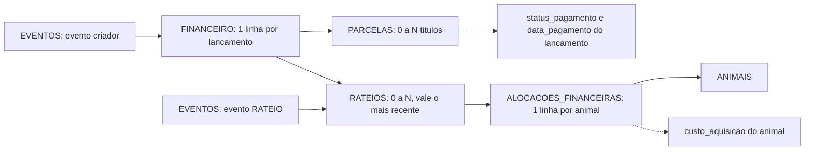
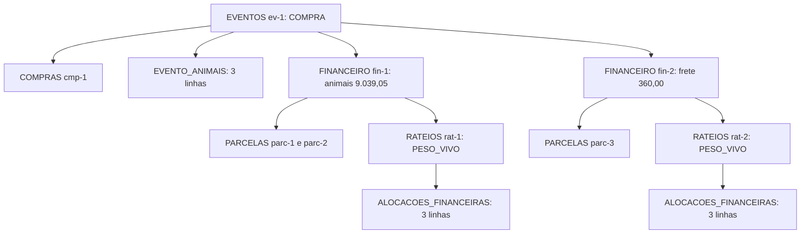

# 03b — Dicionário de dados: eventos, detalhes e financeiro

## Em resumo

- Este documento descreve, coluna a coluna, as 13 abas de fato: 9 de eventos e detalhes e 4 financeiras (210 colunas). Todas são só de inserção: a linha nasce na fase A do comando e vale enquanto o evento pai for vigente. Depois disso só mudam as colunas `*` (cache, regravado na fase C) e as `[ctl]` de PARCELAS (baixa).
- `EVENTOS` guarda o cabeçalho. Dado por animal vai para `EVENTO_ANIMAIS` ou para a tabela de detalhe. `payload_json` tem lista fechada de chaves por tipo (seção 2.6) e nunca guarda coleção por animal.
- Em compra e venda o valor informado prevalece e quantidade × preço é só conferência. Peso vivo e peso de carcaça têm colunas separadas. `valor_individual` é sempre preenchido e soma exatamente o valor principal do evento.
- O dinheiro tem três níveis ligados por invariantes em centavos: lançamento (`FINANCEIRO`), título (`PARCELAS`) e distribuição por animal (`RATEIOS` + `ALOCACOES_FINANCEIRAS`). A seção 15 traz dois exemplos completos, linha a linha, com as somas fechando.
- Todo campo de §4.4 a §4.9 e de §6.1 a §6.12 tem destino na seção 16.

**Documentos relacionados:** `02-modelo-de-dados.md` (DER, vigência, fonte × cópia) · `03a-dicionario-cadastros-suporte.md` (tipos de coluna, enums, LISTAS, cadastros e suporte) · `04-motor-de-eventos.md` (catálogo, pipeline, estorno) · `05-regras-de-negocio.md` (validações) · `06-persistencia-e-integridade.md` (fases A/B/C, verificação) · `07-financeiro-e-indicadores.md` (fórmulas das três visões) · `09-plano-de-testes.md` (CT-01 a CT-20).

## 1. Como ler este dicionário

### 1.1 Legenda das tabelas de colunas

Tipos de coluna, codec de leitura e gravação, enums compartilhados e sementes de LISTAS estão em `03a-dicionario-cadastros-suporte.md` e não são repetidos aqui. Este documento lista os valores de um enum só quando a coluna pertence a uma das 13 abas descritas.

| Campo da tabela | Como ler |
|---|---|
| tipo | Um dos tipos do `Schema` descritos em `03a`, seção 1.2: os dez do desenho-base (ID, TEXTO, DATA, TS, INT, DEC1, DINHEIRO, BOOL, ENUM, JSON) e o `DEC4` acrescentado lá (até 4 casas; usado aqui em dose, quantidade e base de rateio) |
| obrig. | **S** = sempre preenchida. **N** = opcional. **S: caso** = obrigatória só no caso indicado. "auto" = preenchida pelo servidor, nunca enviada pelo cliente |
| marca | **imutável** = gravada uma única vez, na fase A. `*` = projeção ou cache, gravada na fase C e na recuperação. `[ctl]` = controle mutável por comando próprio, com AUDITORIA |
| domínio / FK | Valores do enum fechado; `LISTAS.X` = código da lista aberta X; `→ TABELA.coluna` = alvo da FK |

As colunas aparecem na ordem do desenho-base, que é a ordem física da aba.

### 1.2 Regras que valem para as 13 abas

| Regra | Consequência prática |
|---|---|
| A linha só vale se o evento pai for vigente (predicado em `02-modelo-de-dados.md`, seção 5) | Nenhuma dessas abas tem coluna "ativo". Corrigir é anular ou substituir o evento, nunca editar a linha (§2.3, §16 regra 16) |
| Coluna sem marca é gravada na fase A e nunca mais muda | Vale para toda coluna de fato: datas, pesos, valores, vínculos |
| Coluna `*` fica vazia na fase A e é preenchida na fase C | Exceção única: `EVENTOS.status`, que nasce PENDENTE na fase A. Linha órfã de operação que falhou fica com as demais `*` vazias |
| Data de detalhe é cópia de `EVENTOS.event_date` | `PESAGENS.data_pesagem`, `SANIDADE.data_aplicacao`, `REPRODUCAO.data` e `data_parto`. Gravadas pela UnitOfWork, nunca aceitas do cliente; a integridade confere |
| Detalhe por animal exige linha em EVENTO_ANIMAIS | Todo `animal_id` de PESAGENS, SANIDADE, REPRODUCAO, BAIXAS e AJUSTES tem linha em EVENTO_ANIMAIS com o mesmo `event_id`. É o que permite montar a linha do tempo lendo uma aba só |
| Vazio não é zero | Vazio = desconhecido ou não se aplica (P6, P9). Total monetário que é zero de fato (compra sem frete) grava `0,00` |
| Dinheiro em reais com 2 casas; peso em kg com 1 casa | Toda divisão de dinheiro é feita em centavos inteiros, pelo método do maior resto (seção 13.3) |
| Lista aberta grava o `codigo` | Nunca o rótulo. Item desativado continua resolvendo o rótulo do histórico |
| JSON | Chave ausente = não informado (não se grava `null` nem texto vazio). Datas como texto `yyyy-MM-dd`, booleano como `S`/`N`, número com ponto decimal. Teto de 40.000 caracteres (`json_celula_max_caracteres`), validado antes de qualquer escrita |

### 1.3 Quem grava em qual aba

● = sempre · ○ = conforme o caso (a seção da aba diz qual) · em branco = nunca.

| Tipo de evento | EVENTOS | EVENTO_ANIMAIS | COMPRAS | VENDAS | PESAGENS | SANIDADE | REPRODUCAO | BAIXAS | AJUSTES | FINANCEIRO | PARCELAS | RATEIOS | ALOCACOES |
|---|---|---|---|---|---|---|---|---|---|---|---|---|---|
| ENTRADA_INICIAL | ● | ● | | | ○ | | ○ | | | ○ | | ○ | ○ |
| OUTRA_ENTRADA | ● | ● | | | | | ○ | | | | | | |
| NASCIMENTO | ● | ● | | | ○ | | ● | | | | | | |
| COMPRA | ● | ● | ● | | ○ | | ○ | | | ● | ● | ● | ● |
| VENDA | ● | ● | | ● | ○ | | | | | ● | ● | ● | ● |
| TRANSFERENCIA | ● | ● | | | | | | | | | | | |
| MORTE | ● | ● | | | | | | ● | | ○ | ○ | ○ | ○ |
| DESCARTE | ● | ● | | | | | | ● | | ○ | ○ | ○ | ○ |
| PESAGEM | ● | ● | | | ● | | | | | | | | |
| SANIDADE | ● | ● | | | | ● | | | | ○ | ○ | ○ | ○ |
| REPRODUCAO | ● | ● | | | | | ● | | | ○ | ○ | ○ | ○ |
| DESMAMA | ● | ● | | | ○ | | ○ | | | | | | |
| CASTRACAO | ● | ● | | | | | | | | ○ | ○ | ○ | ○ |
| IDENTIFICACAO | ● | ● | | | | | | | | | | | |
| MARCACAO | ● | ● | | | | | | | | | | | |
| AJUSTE_INVENTARIO | ● | ● | | | | | | ○ | ○ | | | | |
| OCORRENCIA | ● | ○ | | | | | | | | ○ | ○ | ○ | ○ |
| LANCAMENTO_FINANCEIRO | ● | | | | | | | | | ● | ● | ○ | ○ |
| RATEIO | ● | | | | | | | | | | | ● | ○ |
| ESTOQUE | ● | | | | | | | | | ○ | ○ | | |
| ESTORNO | ● | | | | | | | | | | | | |

Os mesmos eventos também gravam em abas descritas em `03a`: ANIMAIS (entradas que criam animal), IDENTIFICACOES (entradas com brinco, o evento IDENTIFICACAO e o ajuste de identificação incorreta), MOVIMENTOS_ESTOQUE (SANIDADE e ESTOQUE) e ANEXOS (documentos do evento).

A coluna REPRODUCAO das três entradas (ENTRADA_INICIAL, OUTRA_ENTRADA, COMPRA) refere-se à fêmea declarada prenha: o evento de entrada grava para ela uma linha de diagnóstico de gestação informado (seção 7). O catálogo do desenho-base só cita essa linha na ENTRADA_INICIAL; aqui ela vale também para COMPRA e OUTRA_ENTRADA, porque a situação reprodutiva pode ser declarada em qualquer entrada (`03a`, seção 4.3) e, sem a linha, a vaca comprada prenha ficaria fora da previsão de parto.

Nenhuma fase preenche retroativamente um evento confirmado (P11): COMPRA e VENDA gravam FINANCEIRO, PARCELAS, RATEIOS e ALOCACOES_FINANCEIRAS desde a Fase 2, embora as telas do módulo financeiro só cheguem na Fase 4.

## 2. EVENTOS

### 2.1 Ficha

| Item | Definição |
|---|---|
| Propósito | Cabeçalho de todo fato registrado: o que aconteceu, quando, onde, quem registrou e em que estado está (§2.3, §2.5, §4.4) |
| Chave | PK `event_id` (UUID). `event_seq` é único em toda a aba, mas não é chave: serve à ordem de replay |
| Crescimento | Cerca de 1 mil linhas por ano. Um evento coletivo é uma linha só, qualquer que seja o número de animais |
| Quem grava | Os 21 tipos do catálogo. Um comando de aplicativo grava 1 evento; um lote de importação grava N eventos na mesma operação |
| Imutabilidade | O conteúdo de negócio é imutável. `status`, `reversed_by_event_id` e `confirmed_at` são cache derivado (DV-14) |

### 2.2 Colunas

| Coluna | Tipo | Obrig. | Marca | Domínio / FK | Descrição |
|---|---|---|---|---|---|
| `event_id` | ID | S (auto) | imutável | PK | UUID gerado pelo servidor no plano de escrita |
| `op_id` | ID | S (auto) | imutável | → OPERACOES.op_id | Operação que gravou o evento. É por ela que o evento é confirmado: a célula de commit é `OPERACOES.status` |
| `event_seq` | INT | S (auto) | imutável | ≥ 1, único | Sequencial global de registro. Desempata a ordem de replay dentro do mesmo dia e da mesma classe (seção 2.3) |
| `event_type` | ENUM | S | imutável | os 21 tipos da seção 1.3 | Tipo do evento. Define quais abas recebem linhas e quais chaves o payload aceita |
| `event_subtype` | ENUM | S: tipos com subtipo | imutável | por tipo (seção 2.4) | Subtipo do catálogo. Vazio nos tipos sem subtipo |
| `event_date` | DATA | S | imutável | não pode ser futura | Data em que o fato ocorreu (§2.5). ENTRADA_INICIAL: sempre o marco zero (`data_marco_zero`). ESTORNO: a data do registro |
| `registration_date` | DATA | S (auto) | imutável | — | Data em que o comando foi executado, no fuso da planilha. Com `event_date`, separa ocorrência de registro (§2.5) |
| `property_id` | ID | S | imutável | → PROPRIEDADES.property_id | Propriedade onde o fato ocorreu. Padrão: `propriedade_padrao_id`. No ESTORNO, cópia da propriedade do evento anulado |
| `description` | TEXTO | S: OUTRA_ENTRADA, OCORRENCIA | imutável | — | Frase curta do operador que identifica o evento. Em OUTRA_ENTRADA diz como o animal entrou (doação, permuta, achado, reentrada); em OCORRENCIA, o que ocorreu. Vazia nos demais casos: a interface monta o resumo na leitura, sem gravá-lo |
| `status` | ENUM | S (auto) | `*` | PENDENTE · CONFIRMADO · ESTORNADO · FALHOU · CANCELADO | Cache do predicado de vigência. Nasce PENDENTE na fase A; a fase C e a recuperação gravam o valor final. Não decide nada: leitores usam o predicado. Significado de cada valor em `03a`, seção 2.3; ordem de avaliação em `02-modelo-de-dados.md`, seção 5.3. O evento ESTORNO fica CONFIRMADO, embora nunca seja vigente |
| `total_value` | DINHEIRO | N | imutável | > 0 ou vazio | Valor informativo do evento, definido por tipo (seção 2.5). Nenhum relatório financeiro o lê |
| `responsible` | TEXTO | N | imutável | — | Quem executou o manejo em campo (campo "Responsável" de §6.4, §6.6 e §6.8). Texto livre |
| `created_by` | TEXTO | S (auto) | imutável | — | Usuário do sistema que registrou, resolvido pela guarda de dono. É o e-mail quando a plataforma o fornece; a contingência está em `01-arquitetura.md` |
| `source` | ENUM | S (auto) | imutável | APP · IMPORTACAO · SISTEMA | Origem do registro. SISTEMA fica reservado a rotinas internas (base de demonstração, migração) |
| `confiabilidade` | ENUM | N | imutável | CONFIRMADA · ESTIMADA · DESCONHECIDA | Confiança do registro como um todo (§14, §21). Evento do aplicativo nasce CONFIRMADA; na importação o operador escolhe por arquivo. Vazio = desconhecida |
| `pre_marco_zero` | BOOL | S (auto) | imutável | S · N | S quando `event_date` é anterior ao marco zero: registro informativo, com efeito de inventário 0 e fora do replay |
| `partner_id` | ID | S: COMPRA, VENDA | imutável | → PARCEIROS.partner_id | Contraparte principal: fornecedor na compra, comprador na venda. Opcional nos demais (veterinário, fornecedor de insumo, doador). Frete e comissão têm parceiro próprio em `FINANCEIRO.partner_id` |
| `notes` | TEXTO | N | imutável | — | Campo "Observações" do formulário, valendo para o evento inteiro. Observação de um animal vai em `EVENTO_ANIMAIS.observacoes` |
| `payload_json` | JSON | N | imutável | chaves fechadas por tipo (seção 2.6) | Campos de cabeçalho que não têm coluna, mais os avisos aceitos. Nada por animal |
| `idempotency_key` | TEXTO | S (auto) | imutável | — | Cópia da chave da operação, para leitura da aba. Não é única aqui (um lote de importação repete a chave em N eventos). A autoridade é OPERACOES |
| `reversal_of_event_id` | ID | S: ESTORNO e substituto | imutável | → EVENTOS.event_id | Evento que esta linha anula. Vazio em evento comum (seção 2.7) |
| `reversed_by_event_id` | ID | N (auto) | `*` | → EVENTOS.event_id | Inverso da coluna anterior: quem anulou este evento. Cache gravado na fase C do anulador |
| `import_id` | ID | S: `source` = IMPORTACAO | imutável | → IMPORTACOES.import_id | Arquivo de origem. O evento só passa a vigente quando `IMPORTACOES.status` = IMPORTADO |
| `created_at` | TS | S (auto) | imutável | — | Instante da gravação na fase A (UTC) |
| `confirmed_at` | TS | N (auto) | `*` | — | Instante em que o evento passou a vigente: fase C do comando, ou conclusão da importação |

Os treze campos de §4.4 foram mantidos com o mesmo nome. Os doze acréscimos estão em DV-04.

### 2.3 Como `event_seq` é atribuído

1. Sob o lock de script, o plano de escrita lê o maior `event_seq` de **todas** as linhas de EVENTOS, inclusive PENDENTE, FALHOU e ESTORNADO, e soma 1. O contador vem da própria planilha, nunca de Script Properties: restaurar um backup devolve o contador certo junto.
2. Uma operação com N eventos (lote de importação) recebe N valores consecutivos, na ordem das linhas do arquivo.
3. O valor nunca é reutilizado nem renumerado. Operação que falha deixa um buraco na sequência, e isso é esperado.
4. `event_seq` é a ordem de **registro**, não a de ocorrência. A ordem de replay é (`event_date`, classe, `event_seq`), com classe 0 = entradas, 1 = movimentos e demais, 2 = saídas.

Exemplo: transferência de 05/03 registrada em 20/03 recebe `event_seq` 520; uma pesagem de 10/03, registrada no próprio dia, tem 498. No replay a transferência vem antes, porque a data manda. O 520 só desempataria contra outro movimento de 05/03.

Consequência a conhecer: o evento substituto ("corrigir") recebe `event_seq` novo, maior que o do original, porque o contador é monotônico e linhas confirmadas não são regravadas. Para que corrigir um valor não mude a ordem dos movimentos do dia, a ordem canônica do replay usa, para o substituto, o `event_seq` do primeiro evento da cadeia de substituição (a posição do original). Só quando a correção muda a data ou os pastos a posição muda, e aí vale a validação do conjunto final, que devolve CONFLICT se a cadeia de pastos quebrar.

### 2.4 `event_subtype` e a coluna de tipo do detalhe

O subtipo e a coluna de tipo da tabela de detalhe têm correspondência fixa, conferida na verificação de integridade.

| `event_type` | `event_subtype` | Coluna de detalhe e valor gravado |
|---|---|---|
| SANIDADE | VACINACAO · VERMIFUGACAO · MEDICACAO · TRATAMENTO · EXAME · DOENCA | `SANIDADE.tipo_procedimento` = VACINA · VERMIFUGO · MEDICAMENTO · TRATAMENTO · EXAME · DOENCA, nessa ordem |
| REPRODUCAO | EXPOSICAO · COBERTURA · INSEMINACAO · DIAGNOSTICO_GESTACAO · ABORTO | `REPRODUCAO.tipo_evento` = o mesmo código |
| IDENTIFICACAO | PRIMEIRA_IDENTIFICACAO · SUBSTITUICAO · REMOCAO | Linhas em IDENTIFICACOES (`03a`) |
| MARCACAO | DESCARTE · NAO_LOCALIZADO | Sem tabela de detalhe; a ação (marcar ou desmarcar) vai no payload |
| AJUSTE_INVENTARIO | CORRECAO_CADASTRO · IDENTIFICACAO_INCORRETA · RECLASSIFICACAO · CORRECAO_LOCALIZACAO | `AJUSTES.tipo_ajuste` = o mesmo código |
| AJUSTE_INVENTARIO | DIVERGENCIA_CONTAGEM | `BAIXAS.tipo` = DIVERGENCIA_CONTAGEM |
| ESTOQUE | ENTRADA · AJUSTE | `MOVIMENTOS_ESTOQUE.tipo` = o mesmo código |
| NASCIMENTO | vazio | `REPRODUCAO.tipo_evento` = PARTO; `PESAGENS.tipo` = NASCIMENTO |
| DESMAMA | vazio | `REPRODUCAO.tipo_evento` = DESMAMA; `PESAGENS.tipo` = DESMAMA |
| MORTE · DESCARTE | vazio | `BAIXAS.tipo` = MORTE · DESCARTE |
| PESAGEM | vazio | `PESAGENS.tipo` = ROTINA |
| COMPRA · VENDA · ENTRADA_INICIAL | vazio | `PESAGENS.tipo` = COMPRA · VENDA · ENTRADA |
| Demais tipos | vazio | — |

Leitura adotada: "individual, coletiva, por lote" (PESAGEM) e "receita, despesa" (LANCAMENTO_FINANCEIRO) aparecem em minúsculas no catálogo e não são subtipos. Pesagem individual ou coletiva difere só pelo número de linhas; pesagem por lote é reconhecida pelo método MEDIA_LOTE das linhas e pelas duas chaves do payload; receita ou despesa está em `FINANCEIRO.tipo`.

### 2.5 `total_value` por tipo

`total_value` existe para a lista de eventos mostrar um valor sem abrir as abas financeiras (§4.4). É cópia gravada na fase A e conferida contra a fonte. Nunca é negativo e fica vazio quando o evento não tem conteúdo financeiro.

| `event_type` | `total_value` | Fonte da cópia |
|---|---|---|
| COMPRA | Animais + frete + outros custos | `COMPRAS.valor_total` |
| VENDA | Valor bruto da negociação, antes de desconto e deduções | `VENDAS.valor_bruto` |
| LANCAMENTO_FINANCEIRO | Valor do lançamento | `FINANCEIRO.valor` |
| ENTRADA_INICIAL | Soma dos valores de abertura informados; vazio sem valor de abertura | `FINANCEIRO.valor` do lançamento de abertura |
| SANIDADE | Consumo de produto + serviço pago, quando houver | Σ `FINANCEIRO.valor` do evento |
| MORTE · REPRODUCAO · CASTRACAO · OCORRENCIA | Despesa informada no evento, quando houver | Σ `FINANCEIRO.valor` do evento |
| DESCARTE | Receita informada, quando houver | `FINANCEIRO.valor` do evento |
| ESTOQUE | ENTRADA: valor da compra do insumo. AJUSTE: vazio | `FINANCEIRO.valor` do evento |
| RATEIO | Total distribuído | `RATEIOS.total_alocado` |
| ESTORNO e os demais tipos | Vazio | — |

Só na VENDA o valor não é a soma dos lançamentos do evento: ela gera uma receita e várias despesas, e somá-las não significa nada.

### 2.6 `payload_json`: lista fechada de chaves por tipo

Critério de entrada: a chave é um fato do cabeçalho do evento, não tem coluna em EVENTOS nem na tabela de detalhe, e não varia por animal. Chave fora da lista é erro de validação (VALIDATION). Quase todos os tipos ficam sem chave própria, porque seus campos específicos têm coluna.

Chaves comuns a todos os tipos:

| Chave | Tipo | Obrig. | Conteúdo |
|---|---|---|---|
| `avisos_aceitos` | lista de objetos | S: houve aviso aceito | Um objeto por código: `codigo` (ex.: CARENCIA_ATIVA), `n` (quantos animais ou itens o aviso cobria) e `justificativa` (obrigatória em PERIODO_BLOQUEADO). Não lista animais: o aviso é recalculável a partir das linhas do evento |
| `justificativa` | TEXTO | S: `reversal_of_event_id` preenchido | Por que o evento foi estornado ou corrigido. Fica no anulador (ESTORNO ou substituto), deixando `description` e `notes` do substituto livres para o conteúdo de negócio |

Chaves próprias por tipo:

| `event_type` | Chave | Tipo | Obrig. | Conteúdo |
|---|---|---|---|---|
| ENTRADA_INICIAL | `valor_abertura_origem` | ENUM: INFORMADO · TABELA_PRECOS | S: há valor de abertura | Como o valor de abertura foi obtido. Alimenta `ANIMAIS.custo_aquisicao_origem*`: INFORMADO → ABERTURA_INFORMADA; TABELA_PRECOS → ABERTURA_ESTIMADA. Um evento usa um modo só |
| VENDA | `deducoes` | lista de objetos | S: há dedução | Um objeto por dedução: `financial_id` (lançamento DESPESA_VENDA gerado) e `tipo` (código de `LISTAS.TIPO_DEDUCAO_VENDA`). Valor, parceiro e retenção ficam no lançamento; aqui vai só o tipo, que não tem coluna em FINANCEIRO. É lista por dedução (três ou quatro itens), não por animal |
| TRANSFERENCIA | `gta_numero` | TEXTO | N | Número da GTA quando o destino fica em outra propriedade (pasto arrendado em outra fazenda, DV-20). Opcional: a exigência de trânsito é assunto a validar com o órgão de defesa, nunca regra fixa. O arquivo digitalizado vai para ANEXOS. TRANSFERENCIA não tem tabela de detalhe, por isso o número fica aqui |
| PESAGEM | `peso_total_lote_kg` | número (kg, 1 casa) | S: pesagem por lote | Peso total lido na balança para o grupo. É o fato; as linhas MEDIA_LOTE de PESAGENS são derivadas dele |
| PESAGEM | `qtd_cabecas_lote` | inteiro | S: pesagem por lote | Cabeças que estavam na balança |
| SANIDADE | `modo_dose` | ENUM: POR_CABECA · POR_PESO · TOTAL | S: há produto | Como a dose foi definida. TOTAL = só o consumo total é conhecido |
| SANIDADE | `dose_referencia` | número | N | Dose por cabeça (POR_CABECA) ou por kg de peso vivo (POR_PESO), na unidade do produto |
| SANIDADE | `quantidade_consumida_total` | número | S: há `produto_id` | Quantidade que saiu do estoque, na unidade do produto. Gera o movimento de SAIDA e o custo. Pode exceder a soma das doses (frasco aberto e descartado) |
| CASTRACAO | `metodo` | TEXTO | N | Método usado (cirúrgica, burdizzo, elástico). Texto livre |
| MARCACAO | `acao` | ENUM: MARCAR · DESMARCAR | S | Sentido da marcação. O que é marcado vem do subtipo |
| MARCACAO | `motivo_descarte` | código `LISTAS.MOTIVO_DESCARTE` | N | Só com subtipo DESCARTE e ação MARCAR |
| OCORRENCIA | `tipo_ocorrencia` | código `LISTAS.TIPO_OCORRENCIA` | S | Classificação da ocorrência |
| ESTOQUE | `qtd_apresentacao` | número | N | Só em ENTRADA: quantidade comprada na apresentação comercial (ex.: 2 frascos) |
| ESTOQUE | `fator_conversao` | número | S: há `qtd_apresentacao` | Cópia congelada de `PRODUTOS.fator_conversao` no dia da entrada. Torna auditável a conta 2 frascos × 50 doses = 100 doses |
| OUTRA_ENTRADA · NASCIMENTO · COMPRA · MORTE · DESCARTE · REPRODUCAO · DESMAMA · IDENTIFICACAO · AJUSTE_INVENTARIO · LANCAMENTO_FINANCEIRO · RATEIO · ESTORNO | — | — | — | Nenhuma chave própria: todos os campos têm coluna em EVENTOS ou na tabela de detalhe. Só as chaves comuns |

Exemplos de célula:

```json
{"modo_dose":"POR_CABECA","dose_referencia":1,"quantidade_consumida_total":5}
```

```json
{"deducoes":[{"financial_id":"<uuid do frete>","tipo":"FRETE"},{"financial_id":"<uuid da retenção>","tipo":"FUNRURAL"}],
 "avisos_aceitos":[{"codigo":"CARENCIA_ATIVA","n":2,"justificativa":"Carência vence antes do abate"}]}
```

FRETE e FUNRURAL são sementes de `LISTAS.TIPO_DEDUCAO_VENDA` (`03a`, seção 3). FRETE e COMISSAO são códigos reservados: têm conta própria e total próprio em VENDAS; qualquer outro tipo cai na conta "Taxas e retenções sobre venda" e em `VENDAS.outras_deducoes`.

O que **não** vai no payload, e onde fica:

| Informação | Onde fica | Por quê |
|---|---|---|
| Animais, pesos, pastos, valores por animal | EVENTO_ANIMAIS e tabelas de detalhe | Nenhuma célula guarda coleção por animal: 300 animais estourariam a célula e não seriam indexáveis |
| Parcelas e condição de pagamento | PARCELAS | São títulos com ciclo de vida próprio |
| Frete, comissão, outros custos | FINANCEIRO (um lançamento cada), com o total em COMPRAS ou VENDAS | Têm parceiro, vencimento e rateio próprios |
| Crias de um parto | EVENTO_ANIMAIS (papel CRIA) | São animais |
| Touros de uma exposição | EVENTO_ANIMAIS (papel TOURO) | São animais |
| Motivo de uma OUTRA_ENTRADA | `EVENTOS.description` | Texto livre do cabeçalho já tem coluna |

### 2.7 `reversal_of_event_id`: estorno × substituto

A mesma coluna serve às duas formas de tirar um evento do replay. O que as distingue é o `event_type` de quem aponta.

| Aspecto | ESTORNO | Substituto ("corrigir evento") |
|---|---|---|
| `event_type` de quem aponta | ESTORNO | O mesmo tipo do evento original |
| Linhas filhas próprias | Nenhuma | O conjunto completo, como um evento novo |
| `event_date` | Data do registro do estorno | Data do fato, já corrigida se o erro era a data |
| Efeito sobre o original | Deixa de ser vigente | Deixa de ser vigente |
| Efeito próprio | Nenhum: ESTORNO nunca é vigente | Passa a ser o evento vigente daquele fato |
| Animais criados pelo original | Ficam ANULADOS; só é aceito se o animal não tem outro evento vigente nem é referenciado | Mesmos `animal_id`, reaproveitados; a linha nova carrega `atributos_iniciais_json` |
| Parcela LIQUIDADA do original | Bloqueia: desfaz-se a baixa antes | A baixa é transportada para a parcela nova quando valor e vencimento não mudam; as demais são listadas para nova baixa |
| Validação da linha do tempo | Remove as linhas do original e revalida o que sobra | Troca as linhas e valida uma vez o conjunto final |
| Commit | Uma célula: `OPERACOES.status` do estorno | Uma célula: anula e substitui no mesmo commit |

Regras da coluna:

- O alvo precisa ser vigente e diferente de ESTORNO. Estorno de estorno não existe: relança-se o evento.
- A anulação é definitiva. O predicado de vigência olha se existe evento de operação CONFIRMADA apontando para o original, sem exigir que esse anulador ainda seja vigente. Estornar um substituto, portanto, não ressuscita o original.
- `reversed_by_event_id*` do original recebe o `event_id` do anulador na fase C. O original nunca é regravado em nenhuma outra coluna.

Exemplo de cadeia:

| `event_seq` | `event_type` | `reversal_of_event_id` | `status*` final | Vigente? |
|---|---|---|---|---|
| 412 | COMPRA (E1) | vazio | ESTORNADO | Não: E2 aponta para ele |
| 430 | COMPRA (E2, substituto de E1) | E1 | ESTORNADO | Não: E3 aponta para ele |
| 441 | ESTORNO (E3) | E2 | CONFIRMADO | Não: é ESTORNO |

Resultado: nenhuma compra vigente. As três linhas permanecem na aba e contam a história completa (§2.3, CT-07).

## 3. EVENTO_ANIMAIS

### 3.1 Ficha

| Item | Definição |
|---|---|
| Propósito | Razão de animais envolvidos e de movimentação. Responde quem participou de cada evento, com que papel, se entrou ou saiu do inventário e de qual pasto para qual (§4.5). É a única aba que a linha do tempo precisa ler |
| Chave | PK `event_animal_id`. Único por (`event_id`, `animal_id`): um animal aparece uma vez por evento, com um papel |
| Crescimento | Cerca de 10 mil linhas por ano com 500 animais ativos. É a segunda aba que mais cresce |
| Quem grava | Todo evento que envolve animal: os 17 primeiros tipos da seção 1.3 (em OCORRENCIA, só quando há animal). LANCAMENTO_FINANCEIRO, RATEIO, ESTOQUE e ESTORNO não gravam linhas aqui |
| Leitura | Inventário em D = Σ `efeito_inventario` dos eventos vigentes com `event_date` ≤ D e `pre_marco_zero` = N. Pasto em D = `pasto_destino_id` do último movimento até D |

### 3.2 Colunas

| Coluna | Tipo | Obrig. | Marca | Domínio / FK | Descrição |
|---|---|---|---|---|---|
| `event_animal_id` | ID | S (auto) | imutável | PK | UUID |
| `event_id` | ID | S (auto) | imutável | → EVENTOS.event_id | Evento pai. A linha vale enquanto ele for vigente |
| `animal_id` | ID | S | imutável | → ANIMAIS.animal_id | Animal envolvido. Em entrada que cria animal, o `animal_id` é gerado no mesmo plano de escrita e a linha de ANIMAIS nasce PENDENTE |
| `papel` | ENUM | S | imutável | SUJEITO · CRIA · MATRIZ · TOURO | Função do animal no evento (seção 3.3) |
| `efeito_inventario` | INT | S | imutável | 1 · 0 · −1 | +1 entra no rebanho, −1 sai, 0 não altera a contagem. Fixado pelo tipo de evento, nunca escolhido pelo operador. Sempre 0 quando `pre_marco_zero` = S |
| `pasto_origem_id` | ID | S: saídas, TRANSFERENCIA, CORRECAO_LOCALIZACAO | imutável | → PASTOS.pasture_id | Pasto de onde o animal sai. Precisa ser igual ao destino do movimento anterior do animal (§16 regra 6). Nas saídas é preenchido pelo servidor a partir da linha do tempo; na transferência é informado e conferido |
| `pasto_destino_id` | ID | S: entradas, TRANSFERENCIA, CORRECAO_LOCALIZACAO | imutável | → PASTOS.pasture_id | Pasto para onde o animal vai. Precisa existir e estar ativo (§16 regra 5). Vazio nas saídas: a saída limpa o pasto |
| `peso` | DEC1 | S: o evento grava pesagem do animal | imutável | > 0, kg | **Peso vivo** individual medido no evento. Cópia de `PESAGENS.peso_kg` da linha que o mesmo evento grava para o animal. Vazio quando só o peso do lote é conhecido |
| `peso_carcaca_kg` | DEC1 | N | imutável | > 0, kg | **Peso de carcaça** individual (romaneio). Só em COMPRA e VENDA com `base_peso` = CARCACA. Nunca vai para PESAGENS |
| `preco_unitario` | DINHEIRO | N | imutável | > 0 | Preço aplicado a este animal, na unidade de `unidade_preco` do cabeçalho (R$/cabeça, R$/kg ou R$/@). Só em COMPRA e VENDA, quando o preço foi negociado por animal |
| `valor_individual` | DINHEIRO | S: COMPRA, VENDA | imutável | ≥ 0 | Valor negociado do animal, sem frete nem deduções. Informado, ou derivado pela distribuição do valor principal (seção 4.5). Em ENTRADA_INICIAL, o valor de abertura do animal, se houver. Não é custo nem receita: é base de rateio. Custo e receita por animal saem de ALOCACOES_FINANCEIRAS |
| `motivo_saida` | TEXTO | N | imutável | `LISTAS.MOTIVO_DESCARTE` | Só em VENDA: marca o animal vendido como descarte e diz por quê. Em MORTE e DESCARTE o motivo está em BAIXAS |
| `atributos_iniciais_json` | JSON | S: a linha cria o animal | imutável | chaves fechadas (seção 3.5) | Valores de criação dos atributos sensíveis do animal. Vazio em qualquer linha que não cria animal |
| `observacoes` | TEXTO | N | imutável | — | Observação sobre este animal neste evento |

Os oito campos de §4.5 foram mantidos; os seis acréscimos estão em DV-03.

### 3.3 `papel`

| Papel | Significado | Onde aparece |
|---|---|---|
| SUJEITO | Animal sobre o qual o evento atua | Todos os tipos com animal; é o único papel na maioria deles |
| CRIA | Animal que nasce no evento | NASCIMENTO: uma linha por nascido vivo, com efeito +1. Parto gemelar = duas linhas CRIA no mesmo evento |
| MATRIZ | Mãe envolvida como acompanhante, sem mudança própria de inventário ou de pasto | NASCIMENTO (a parida) e DESMAMA (a mãe do bezerro desmamado) |
| TOURO | Reprodutor do rebanho posto com as matrizes | REPRODUCAO/EXPOSICAO: uma linha por touro. REPRODUCAO/COBERTURA: uma linha, quando o touro é do rebanho |

Por que o papel existe: sem ele, a linha da mãe em um NASCIMENTO seria indistinguível da linha do bezerro, e o inventário contaria +2 em vez de +1.

Leitura adotada para o touro: há linha TOURO quando um touro do rebanho participa fisicamente do evento. Na EXPOSICAO pode haver vários, e `REPRODUCAO.touro_id` guarda no máximo um; na COBERTURA há um só, que aparece nos dois lugares. A linha serve para validar que o touro estava no rebanho naquela data e para o evento aparecer na ficha dele. Na INSEMINACAO não há linha: o touro do sêmen é referência genética em `REPRODUCAO.touro_id`. Touro EXTERNO (sêmen, animal de fora) nunca tem linha aqui, porque está fora do inventário e não tem linha do tempo.

Papéis com efeito 0 também são validados contra a linha do tempo: a MATRIZ e o TOURO precisam estar no rebanho na data do evento.

### 3.4 Matriz tipo de evento × coluna

**S** = obrigatória · **N** = opcional · **—** = sempre vazia. `observacoes` é opcional em todas as linhas.

| Tipo de evento (linha) | `papel` | `efeito_inventario` | `pasto_origem_id` | `pasto_destino_id` | `peso` | `peso_carcaca_kg` | `preco_unitario` | `valor_individual` | `motivo_saida` | `atributos_iniciais_json` |
|---|---|---|---|---|---|---|---|---|---|---|
| ENTRADA_INICIAL | SUJEITO | +1 | — | S | N | — | — | N | — | S |
| OUTRA_ENTRADA | SUJEITO | +1 | — | S | — | — | — | — | — | S (¹) |
| NASCIMENTO, cria | CRIA | +1 | — | S | N | — | — | — | — | S |
| NASCIMENTO, mãe | MATRIZ | 0 | — | — | — | — | — | — | — | — |
| COMPRA | SUJEITO | +1 | — | S | N (²) | N | N | S | — | S (¹) |
| VENDA | SUJEITO | −1 | S | — | N (²) | N | N | S | N | — |
| TRANSFERENCIA | SUJEITO | 0 | S | S | — | — | — | — | — | — |
| MORTE | SUJEITO | −1 | S | — | — | — | — | — | — | — |
| DESCARTE | SUJEITO | −1 | S | — | — | — | — | — | — | — |
| PESAGEM | SUJEITO | 0 | — | — | S | — | — | — | — | — |
| SANIDADE | SUJEITO | 0 | — | — | — | — | — | — | — | — |
| REPRODUCAO, matriz | SUJEITO | 0 | — | — | — | — | — | — | — | — |
| REPRODUCAO/EXPOSICAO e COBERTURA, touro do rebanho | TOURO | 0 | — | — | — | — | — | — | — | — |
| DESMAMA, bezerro | SUJEITO | 0 | N (³) | N (³) | N | — | — | — | — | — |
| DESMAMA, mãe | MATRIZ | 0 | — | — | — | — | — | — | — | — |
| CASTRACAO · IDENTIFICACAO · MARCACAO · OCORRENCIA | SUJEITO | 0 | — | — | — | — | — | — | — | — |
| AJUSTE_INVENTARIO: CORRECAO_CADASTRO · IDENTIFICACAO_INCORRETA · RECLASSIFICACAO | SUJEITO | 0 | — | — | — | — | — | — | — | — |
| AJUSTE_INVENTARIO: CORRECAO_LOCALIZACAO | SUJEITO | 0 | S | S | — | — | — | — | — | — |
| AJUSTE_INVENTARIO: DIVERGENCIA_CONTAGEM | SUJEITO | −1 | S | — | — | — | — | — | — | — |

(¹) Obrigatória quando a linha cria o animal; vazia quando o animal já existe e está fora do rebanho (reentrada de animal VENDIDO, DESCARTADO ou BAIXADO_AJUSTE).
(²) Obrigatória quando o critério de rateio é PESO_VIVO com pesos individuais.
(³) As duas juntas ou nenhuma: preenchidas quando a desmama leva o bezerro a outro pasto. A linha passa então a valer como movimento.

Em CORRECAO_LOCALIZACAO, `pasto_origem_id` é o pasto que o sistema registrava e `pasto_destino_id` é o pasto onde o animal de fato está. Em evento com `pre_marco_zero` = S os pastos são gravados como informados, sem validação de cadeia, e o replay os ignora.

### 3.5 `atributos_iniciais_json`

Guarda os valores com que o animal foi criado. Os atributos sensíveis de ANIMAIS (`sexo*`, `data_nascimento*`, `mae_id*`, `pai_id*`, `castrado*` e os demais da tabela) são projeções: valor de criação daqui + eventos de ajuste vigentes (DV-07). O ganho prático é que estornar um ajuste devolve o valor correto por recálculo, sem depender de "valor anterior" gravado.

Só a linha que cria o animal carrega o JSON. Um substituto de evento criador grava de novo o JSON, com o mesmo `animal_id`. Brinco não entra aqui: vai para IDENTIFICACOES, no mesmo evento. Nome e observações do animal são `[cad]` e são gravados direto em ANIMAIS.

| Chave | Tipo | ENTRADA_INICIAL | OUTRA_ENTRADA | NASCIMENTO (cria) | COMPRA | Alimenta em ANIMAIS |
|---|---|---|---|---|---|---|
| `sexo` | ENUM: M · F | S | S | S | S | `sexo*` |
| `data_nascimento` | DATA | N | N | fixo = `event_date` | N (⁴) | `data_nascimento*` |
| `data_nascimento_confianca` | ENUM de confiança | S: há data | S: há data | fixo CONFIRMADA | S: há data | `data_nascimento_confianca*` |
| `mae_id` | ID → ANIMAIS | N | N | fixo = a MATRIZ do evento | N | `mae_id*` |
| `mae_confianca` | ENUM de confiança | S: há mãe | S: há mãe | fixo CONFIRMADA | S: há mãe | `mae_confianca*` |
| `pai_id` | ID → ANIMAIS | N | N | N | N | `pai_id*` |
| `pai_confianca` | ENUM de confiança | S: há pai | S: há pai | S: há pai | S: há pai | `pai_confianca*` |
| `raca` | código `LISTAS.RACA` | N | N | N | N | `raca` (valor inicial; depois é `[cad]`) |
| `castrado` | BOOL | S: macho | S: macho | fixo N, em macho | S: macho | `castrado*` (junto com CASTRACAO vigente) |
| `reprodutor` | BOOL | S: macho | S: macho | fixo N, em macho | S: macho | `reprodutor*` |
| `partos_previos` | INT ≥ 0 | N | N | ausente | N | `partos_previos*`; ausente = desconhecido |
| `situacao_reprodutiva` | ENUM: VAZIA · EXPOSTA · INSEMINADA · PRENHA | N | N | ausente | N | Estado inicial de `situacao_reprodutiva*`. Sem a chave, a projeção parte de NAO_APTA (nascida no sistema) ou de SEM_INFORMACAO (demais) |
| `data_prevista_parto` | DATA | N | N | ausente | N | Nenhuma coluna de ANIMAIS. Só com situação PRENHA; é copiada para a linha de REPRODUCAO que o evento de entrada grava (⁶) |
| `origem` | ENUM: NASCIDO · COMPRADO · DESCONHECIDA | S | S | fixo NASCIDO | fixo COMPRADO | `origem*` |
| `data_entrada` | DATA | N (⁵) | ausente | ausente | ausente | `data_entrada*`. Nos três tipos em que a chave é ausente, a projeção usa `event_date` |
| `data_entrada_confianca` | ENUM de confiança | S: há data | ausente | ausente | ausente | `data_entrada_confianca*`. Sem a chave: DESCONHECIDA na ENTRADA_INICIAL; nos demais, a `confiabilidade` do evento |

(⁴) §6.2 pede "idade ou nascimento". Se o operador informar a idade em meses, o servidor grava `data_nascimento` = `event_date` − idade, em meses de calendário, com confiança ESTIMADA. A idade em si não é gravada. Exemplo: compra em 10/03/2027 de animal com 14 meses → `2026-01-10`, ESTIMADA.
(⁵) Na ENTRADA_INICIAL o evento é sempre datado do marco zero. A data real ou estimada em que o animal chegou à fazenda fica aqui e pode ser anterior ao marco zero. Ausente = desconhecida.
(⁶) Fêmea declarada PRENHA na entrada: o mesmo evento grava uma linha em REPRODUCAO com `tipo_evento` DIAGNOSTICO_GESTACAO, `resultado` POSITIVO, `metodo` INFORMADO e a `data_prevista_parto` do JSON, se houver. O JSON é a declaração de criação (fonte); a linha de REPRODUCAO é a cópia que a ficha reprodutiva, a previsão de parto e os indicadores leem. A integridade confere uma contra a outra.

As chaves `castrado` e `reprodutor` só existem em machos; `partos_previos`, `situacao_reprodutiva` e `data_prevista_parto`, só em fêmeas. No outro sexo a chave é omitida e a coluna de ANIMAIS fica vazia ("não se aplica", `03a`, seção 1.3).

Exemplos de célula (cerca de 300 caracteres por animal, longe do teto de 40.000):

```json
{"sexo":"M","data_nascimento":"2027-01-15","data_nascimento_confianca":"CONFIRMADA",
 "mae_id":"<uuid da matriz>","mae_confianca":"CONFIRMADA","pai_id":"<uuid do touro>","pai_confianca":"ESTIMADA",
 "raca":"NELORE","castrado":"N","reprodutor":"N","origem":"NASCIDO"}
```

```json
{"sexo":"F","data_nascimento":"2023-09-01","data_nascimento_confianca":"ESTIMADA","raca":"NELORE",
 "partos_previos":2,"situacao_reprodutiva":"PRENHA","data_prevista_parto":"2027-02-20","origem":"DESCONHECIDA"}
```

O primeiro é um bezerro nascido na fazenda: `data_entrada` não aparece porque é a própria data do evento. O segundo é uma vaca do rebanho inicial, prenha no marco zero, de origem e data de chegada desconhecidas. NELORE é semente de `LISTAS.RACA`.

## 4. COMPRAS e VENDAS

Uma linha por evento, com o cabeçalho comercial da negociação. Os animais estão em EVENTO_ANIMAIS; o dinheiro está nas quatro abas financeiras. COMPRAS e VENDAS guardam o que foi negociado e os totais, para a aba ser legível sozinha e para as fórmulas de preço da §11.1.

### 4.1 COMPRAS

| Item | Definição |
|---|---|
| Propósito | Modalidade, base de peso, preço e totais de uma compra de animais (§6.2, §11.1) |
| Chave | PK `purchase_id`. Único por `event_id` (relação 1 : 1 com o evento) |
| Crescimento | 5 a 20 linhas por ano |
| Quem grava | Só o evento COMPRA |

| Coluna | Tipo | Obrig. | Marca | Domínio / FK | Descrição |
|---|---|---|---|---|---|
| `purchase_id` | ID | S (auto) | imutável | PK | UUID |
| `event_id` | ID | S (auto) | imutável | → EVENTOS.event_id | Evento COMPRA |
| `finalidade` | TEXTO | N | imutável | `LISTAS.FINALIDADE_NEGOCIO` | Para que os animais foram comprados (recria e engorda, reprodução). Na compra é só classificação, sem lógica associada |
| `modalidade` | ENUM | S | imutável | CABECA · KG_VIVO · ARROBA · LOTE | Como o preço foi formado: por cabeça, por kg vivo, por arroba ou valor fechado do lote |
| `base_peso` | ENUM | S: KG_VIVO, ARROBA | imutável | VIVO · CARCACA | Peso sobre o qual o preço incide. KG_VIVO é sempre VIVO. Vazia em CABECA e LOTE |
| `rendimento_carcaca_pct` | DEC1 | conforme a seção 4.3 | imutável | 0 < x < 100 | Rendimento de carcaça em %. Informado em arroba de base VIVO; derivado em base CARCACA quando há peso vivo |
| `rendimento_tipo` | ENUM | S: há rendimento | imutável | APURADO · NEGOCIADO · ESTIMADO | APURADO = carcaça ÷ peso vivo, ambos medidos. NEGOCIADO = percentual combinado entre as partes. ESTIMADO = palpite do operador |
| `qtd_animais` | INT | S (auto) | imutável | ≥ 1 | Cópia da contagem de linhas +1 do evento em EVENTO_ANIMAIS |
| `peso_total_kg` | DEC1 | conforme a seção 4.3 | imutável | > 0 | **Peso vivo** total do lote, em kg. Informado, ou soma dos pesos individuais |
| `preco_unitario` | DINHEIRO | conforme a seção 4.3 | imutável | > 0 | Preço único negociado, na unidade de `unidade_preco`. Vazio em LOTE e quando cada animal teve preço próprio |
| `unidade_preco` | ENUM | S: há preço | imutável | CABECA · KG_VIVO · ARROBA | Unidade do preço. Derivada da modalidade; gravada para todo R$/@ ou R$/kg ser exibido com a base ao lado |
| `valor_animais` | DINHEIRO | S | imutável | > 0 | Valor dos animais, sem frete nem outros custos. **É o valor informado que prevalece**; quantidade × preço é conferência |
| `frete` | DINHEIRO | S | imutável | ≥ 0 | Total de frete. Cópia da soma dos lançamentos de frete do evento; `0,00` se não houver |
| `outros_custos` | DINHEIRO | S | imutável | ≥ 0 | Total dos demais custos de aquisição (comissão de compra, taxas). Cópia da soma dos lançamentos; `0,00` se não houver |
| `valor_total` | DINHEIRO | S (auto) | imutável | > 0 | `valor_animais` + `frete` + `outros_custos`. Custo total da compra (§11.1) |
| `criterio_rateio` | ENUM | S | imutável | DIRETO · VALOR_INDIVIDUAL · CABECAS · PESO_VIVO · PESO_CARCACA · MANUAL | Critério que distribui o valor dos animais, o frete e os outros custos entre os animais (seção 4.5) |
| `gta_numero` | TEXTO | N | imutável | — | Número da GTA. O arquivo digitalizado vai para ANEXOS |
| `nota_fiscal` | TEXTO | N | imutável | — | Número da nota fiscal |
| `observacoes` | TEXTO | N | imutável | — | Condições comerciais em texto livre (ex.: "entrega na fazenda") |

### 4.2 VENDAS

| Item | Definição |
|---|---|
| Propósito | Modalidade, base de peso, preço, valor bruto e totais de dedução de uma venda (§6.3, §11.1) |
| Chave | PK `sale_id`. Único por `event_id` |
| Crescimento | 5 a 30 linhas por ano |
| Quem grava | Só o evento VENDA |

| Coluna | Tipo | Obrig. | Marca | Domínio / FK | Descrição |
|---|---|---|---|---|---|
| `sale_id` | ID | S (auto) | imutável | PK | UUID |
| `event_id` | ID | S (auto) | imutável | → EVENTOS.event_id | Evento VENDA |
| `finalidade` | TEXTO | S | imutável | `LISTAS.FINALIDADE_NEGOCIO` (sementes: ABATE · RECRIA_ENGORDA · REPRODUCAO · OUTRA) | Destino dos animais. A lista é aberta, mas o código ABATE é reservado (`03a`, seção 3): carência sanitária ativa bloqueia venda para ABATE e só avisa nas demais |
| `modalidade` | ENUM | S | imutável | CABECA · KG_VIVO · ARROBA · LOTE | As quatro formas de negociação de §6.3 |
| `base_peso` | ENUM | S: KG_VIVO, ARROBA | imutável | VIVO · CARCACA | Peso sobre o qual o preço incide. Frigorífico paga por carcaça; reposição paga por peso vivo |
| `rendimento_carcaca_pct` | DEC1 | conforme a seção 4.3 | imutável | 0 < x < 100 | Como em COMPRAS |
| `rendimento_tipo` | ENUM | S: há rendimento | imutável | APURADO · NEGOCIADO · ESTIMADO | Como em COMPRAS |
| `qtd_animais` | INT | S (auto) | imutável | ≥ 1 | Cópia da contagem de linhas −1 do evento |
| `peso_vivo_total_kg` | DEC1 | conforme a seção 4.3 | imutável | > 0 | **Peso vivo** total, em kg |
| `peso_carcaca_total_kg` | DEC1 | conforme a seção 4.3 | imutável | > 0 | **Peso de carcaça** total, em kg. Só fato medido (romaneio); carcaça estimada por rendimento não é gravada |
| `preco_unitario` | DINHEIRO | conforme a seção 4.3 | imutável | > 0 | Como em COMPRAS |
| `unidade_preco` | ENUM | S: há preço | imutável | CABECA · KG_VIVO · ARROBA | Como em COMPRAS |
| `valor_bruto` | DINHEIRO | S | imutável | > 0 | Valor da negociação antes de desconto e deduções ("preço total" de §6.3). Informado; prevalece sobre a conferência |
| `desconto_comercial` | DINHEIRO | S | imutável | ≥ 0 | Abatimento de preço concedido ao comprador. Reduz a receita; `0,00` se não houver |
| `frete` | DINHEIRO | S (auto) | imutável | ≥ 0 | Soma das deduções lançadas na conta "Frete de venda" |
| `comissao` | DINHEIRO | S (auto) | imutável | ≥ 0 | Soma das deduções lançadas na conta "Comissão de venda" |
| `outras_deducoes` | DINHEIRO | S (auto) | imutável | ≥ 0 | Soma das demais deduções (taxas e retenções) |
| `criterio_rateio` | ENUM | S | imutável | DIRETO · VALOR_INDIVIDUAL · CABECAS · PESO_VIVO · PESO_CARCACA · MANUAL | Critério que distribui a receita e cada dedução entre os animais (§6.3 "rateio transparente e auditável") |
| `gta_numero` | TEXTO | N | imutável | — | Número da GTA |
| `nota_fiscal` | TEXTO | N | imutável | — | Número da nota fiscal |
| `observacoes` | TEXTO | N | imutável | — | Condições comerciais em texto livre |

Valores derivados que **não** são gravados, com a fórmula e a unidade:

| Grandeza | Fórmula | Onde aparece |
|---|---|---|
| Receita da venda (R$) | `valor_bruto` − `desconto_comercial` | É o `valor` do lançamento de receita e a soma dos `valor_individual` |
| Depósito esperado (R$) | Receita − Σ deduções com `retida_pelo_comprador` = S | Tela de baixa da parcela |
| Resultado da negociação (R$) | `valor_bruto` − `desconto_comercial` − `frete` − `comissao` − `outras_deducoes` | Relatório de vendas (§11.1) |
| Arrobas (@) | Carcaça (kg) ÷ 15; ou peso vivo (kg) × rendimento (%) ÷ 100 ÷ 15, rotulado como estimado | Sempre com a base ao lado |
| Preço médio por cabeça, por kg vivo, por arroba | Valor ÷ quantidade; valor ÷ peso vivo total; valor ÷ arrobas | Nulo quando falta o denominador |

Leitura adotada para "Descontos" (§6.3): a palavra cobre duas coisas diferentes. Abatimento de preço vai em `desconto_comercial` e reduz a receita. Valor descontado no pagamento por conta de terceiros (frete, comissão, taxas, retenções) é despesa de venda e vira lançamento próprio, somado em `frete`, `comissao` ou `outras_deducoes`. Nenhuma alíquota é codificada: o operador informa o valor.

### 4.3 O que é informado e o que é derivado, por modalidade × base de peso

**I** = informado pelo operador · **D** = derivado pelo servidor e gravado · **N** = opcional · **—** = vazio. Coluna de COMPRAS à esquerda da barra, de VENDAS à direita.

| Grandeza (coluna em COMPRAS / VENDAS) | CABECA | KG_VIVO, base VIVO | ARROBA, base VIVO | ARROBA, base CARCACA | LOTE |
|---|---|---|---|---|---|
| Quantidade (`qtd_animais`) | D | D | D | D | D |
| Peso vivo total (`peso_total_kg` / `peso_vivo_total_kg`) | N | I, ou D = Σ pesos individuais | I, ou D = Σ pesos individuais | N; se informado, permite apurar o rendimento | N; exigido pelo critério PESO_VIVO |
| Peso de carcaça total (— / `peso_carcaca_total_kg`) | — | — | — | I, ou D = Σ carcaças individuais | N; exigido pelo critério PESO_CARCACA |
| `rendimento_carcaca_pct` | — | — | I | D = carcaça ÷ peso vivo × 100, se há peso vivo; senão — | — |
| `rendimento_tipo` | — | — | I: NEGOCIADO ou ESTIMADO | D: APURADO, se há rendimento | — |
| `preco_unitario` | I (R$/cabeça), ou — com valores por animal | I (R$/kg) | I (R$/@) | I (R$/@) | — |
| `unidade_preco` | D: CABECA | D: KG_VIVO | D: ARROBA | D: ARROBA | — |
| Valor de conferência (não gravado) | quantidade × preço, ou Σ valores por animal | peso vivo × preço | peso vivo × rendimento ÷ 100 ÷ 15 × preço | carcaça ÷ 15 × preço | não há |
| Valor principal (`valor_animais` / `valor_bruto`) | I | I | I | I | I (valor fechado) |
| `criterio_rateio` | D: CABECAS, ou VALOR_INDIVIDUAL com valores por animal | D: PESO_VIVO | D: PESO_VIVO | D: PESO_CARCACA | I: PESO_VIVO · PESO_CARCACA · VALOR_INDIVIDUAL · CABECAS · MANUAL |
| `EVENTO_ANIMAIS.valor_individual` | I, ou D | D | D | D | D (I com VALOR_INDIVIDUAL) |

Regras que a tabela não mostra:

- **Conferência.** Desvio (%) = |valor informado − valor de conferência| ÷ valor de conferência × 100. Acima de `fin_tolerancia_conferencia_pct` (padrão 1) o servidor devolve aviso, que o operador aceita ou corrige. Exemplo: conferência de R$ 9.039,05 e valor informado de R$ 9.000,00 → 39,05 ÷ 9.039,05 = 0,43%, sem aviso. Com R$ 8.900,00 → 139,05 ÷ 9.039,05 = 1,54%, com aviso. O formulário propõe o valor de conferência e o operador confirma ou sobrescreve; o que é gravado é sempre o valor confirmado.
- **Das três grandezas (peso vivo, carcaça, rendimento), duas são fato e a terceira é derivada.** Em base CARCACA, carcaça é fato e o rendimento só existe se o peso vivo também foi medido. Em base VIVO, peso vivo e rendimento são informados e a carcaça não é gravada.
- **COMPRAS não tem coluna de carcaça total.** `peso_total_kg` é sempre peso vivo. Em compra com base CARCACA (incomum), a carcaça é informada por animal em `EVENTO_ANIMAIS.peso_carcaca_kg` e o total é a soma, calculada na leitura.
- **Só o peso do lote é conhecido.** Não se gravam PESAGENS nem `EVENTO_ANIMAIS.peso`. Na venda, o rateio por peso usa a última pesagem individual de cada animal, escalada para somar o peso do lote e marcada como estimada, ou cai para CABECAS; nos dois casos há aviso. Na compra de animais novos não existe pesagem anterior: o rateio cai para CABECAS, com aviso.
- **Um único animal.** O critério gravado é sempre DIRETO.

### 4.4 Um exemplo por modalidade

Valores conferidos por script. "Leitura" são grandezas calculadas na consulta, não gravadas.

| # | Evento | Modalidade e base | Informado | Conferência | Gravado | Leitura |
|---|---|---|---|---|---|---|
| 1 | COMPRA de 20 garrotes | CABECA | Preço R$ 3.000,00/cabeça; `valor_animais` R$ 60.000,00; frete R$ 1.500,00 | 20 × 3.000,00 = 60.000,00 (desvio 0%) | `valor_total` 61.500,00; critério CABECAS; `valor_individual` 3.000,00 cada | Frete por animal = 1.500,00 ÷ 20 = 75,00; custo de aquisição = R$ 3.075,00 por cabeça |
| 2 | COMPRA de 3 garrotes | KG_VIVO, VIVO | Pesos 212,5 + 198,0 + 206,5 kg; preço R$ 14,65/kg; `valor_animais` R$ 9.039,05 | 617,0 kg × 14,65 = 9.039,05 | `peso_total_kg` 617,0; critério PESO_VIVO; detalhe na seção 15.1 | Preço médio = R$ 3.013,02 por cabeça |
| 3 | COMPRA de 10 novilhas | ARROBA, VIVO | Peso vivo total 3.300,0 kg; rendimento 50% NEGOCIADO; preço R$ 290,00/@; `valor_animais` R$ 31.900,00 | 3.300 × 50 ÷ 100 ÷ 15 = 110,00 @; 110 × 290,00 = 31.900,00 | `rendimento_carcaca_pct` 50,0; `rendimento_tipo` NEGOCIADO | R$ 3.190,00 por cabeça; R$ 9,67 por kg vivo |
| 4 | VENDA de 18 bois ao frigorífico | ARROBA, CARCACA | Carcaça total 5.022,0 kg (romaneio); peso vivo total 9.540,0 kg (balança da fazenda); preço R$ 320,00/@; `valor_bruto` R$ 107.136,00; frete retido R$ 1.800,00; retenção de R$ 1.607,04 | 5.022 ÷ 15 = 334,80 @; 334,80 × 320,00 = 107.136,00 | `rendimento_carcaca_pct` 52,6 (5.022 ÷ 9.540 = 52,64%); `rendimento_tipo` APURADO; `frete` 1.800,00; `outras_deducoes` 1.607,04 | Depósito esperado = 107.136,00 − 1.800,00 − 1.607,04 = R$ 103.728,96; R$ 5.952,00 por cabeça; R$ 11,23 por kg vivo |
| 5 | VENDA de 8 novilhas | LOTE | `valor_bruto` R$ 20.000,00 fechado; critério escolhido CABECAS | Não há | `preco_unitario` vazio; `valor_individual` 2.500,00 cada | Preço médio = R$ 2.500,00 por cabeça |

No exemplo 4 o peso vivo e a carcaça nunca se misturam: 9.540,0 kg estão em `peso_vivo_total_kg`, 5.022,0 kg em `peso_carcaca_total_kg`, e o preço de R$ 320,00/@ é exibido como "R$/@ de carcaça". O mesmo lote em base VIVO com rendimento ESTIMADO de 52% daria 9.540 × 52 ÷ 100 ÷ 15 = 330,72 @, e a diferença de 4,08 @ (R$ 1.305,60) é exatamente o erro que §6.3 manda evitar.

### 4.5 Do valor do evento ao valor por animal

O desenho usa **um critério por evento**. Ele é aplicado ao lançamento principal e a cada lançamento acessório, com as mesmas bases. Para mudar o critério de um lançamento depois (por exemplo, frete por cabeça em compra por peso), registra-se um evento RATEIO sobre aquele lançamento, sem tocar na compra.

| Passo | O que acontece | Onde fica gravado |
|---|---|---|
| 1 | Define-se o valor principal V: `valor_animais` na compra; `valor_bruto` − `desconto_comercial` na venda | COMPRAS / VENDAS |
| 2 | Cada animal recebe uma base, conforme o critério | `ALOCACOES_FINANCEIRAS.base_valor` |
| 3 | V é distribuído pelas bases, em centavos, pelo maior resto. O resultado é o `valor_individual` do animal | `EVENTO_ANIMAIS.valor_individual` e a alocação do lançamento principal |
| 4 | Cada lançamento acessório (frete, outros custos, cada dedução de venda) é distribuído pelas mesmas bases, em conta separada de centavos | Uma linha de RATEIOS e N de ALOCACOES_FINANCEIRAS por lançamento |

| Situação | `criterio_rateio` | Base de cada animal |
|---|---|---|
| Evento com um único animal | DIRETO | O próprio valor do lançamento |
| Valores informados por animal (negociação individual, em qualquer modalidade) | VALOR_INDIVIDUAL | O valor informado, em R$. A soma precisa ser igual a V |
| Preço único por cabeça | CABECAS | 1 |
| Preço por kg ou por arroba, com peso vivo individual | PESO_VIVO | Peso vivo, em kg |
| Preço por arroba de carcaça, com carcaça individual | PESO_CARCACA | Peso de carcaça, em kg |
| Lote fechado | O escolhido pelo operador | Conforme o critério; em MANUAL, o peso relativo informado por animal |

DIAS_PERMANENCIA não é aceito em COMPRA nem em VENDA: não há período a medir.

Com VALOR_INDIVIDUAL, o passo 3 devolve exatamente o valor informado, porque a base total é o próprio V. Nos demais critérios o `valor_individual` é resultado da conta, gravado na fase A e imutável: é "quanto do preço coube a este animal no dia do registro".

## 5. PESAGENS

| Item | Definição |
|---|---|
| Propósito | Uma linha por animal pesado. Só peso vivo. É a fonte de `ANIMAIS.peso_atual*`, do GMD, da UA e do peso usado no patrimônio (§4.6, §6.5, §8) |
| Chave | PK `weight_id`. Único por (`event_id`, `animal_id`) |
| Crescimento | 2 a 4 mil linhas por ano |
| Quem grava | PESAGEM (sempre); NASCIMENTO, DESMAMA, COMPRA, VENDA e ENTRADA_INICIAL (só quando o peso individual foi informado) |
| O que nunca entra | Peso de carcaça; peso projetado por GMD; média calculada pelo sistema fora de uma pesagem por lote (P10) |

| Coluna | Tipo | Obrig. | Marca | Domínio / FK | Descrição |
|---|---|---|---|---|---|
| `weight_id` | ID | S (auto) | imutável | PK | UUID |
| `animal_id` | ID | S | imutável | → ANIMAIS.animal_id | Animal pesado. A data precisa cair em um período de permanência do animal, com os dois limites inclusivos |
| `event_id` | ID | S (auto) | imutável | → EVENTOS.event_id | Evento que gravou a pesagem |
| `data_pesagem` | DATA | S (auto) | imutável | = `EVENTOS.event_date` | Cópia da data do evento. Existe para a aba ser legível sozinha e para o índice por animal |
| `peso_kg` | DEC1 | S | imutável | > 0 | Peso vivo em kg. Valor fora da faixa plausível gera aviso PESO_IMPLAUSIVEL, não bloqueio |
| `metodo` | ENUM | S | imutável | BALANCA · FITA · ESTIMATIVA_VISUAL · MEDIA_LOTE | Como o peso foi obtido. BALANCA é medida individual. FITA entra no GMD individual só com `gmd_aceita_fita` = S. ESTIMATIVA_VISUAL e MEDIA_LOTE são estimativas: valem para UA e peso médio, ficam fora dos indicadores individuais |
| `tipo` | ENUM | S (auto) | imutável | ROTINA · NASCIMENTO · DESMAMA · COMPRA · VENDA · ENTRADA | Momento da pesagem, fixado pelo evento que a gravou (seção 2.4). Permite achar "peso ao nascer" e "peso à desmama" (§8) sem ler EVENTOS |
| `observacoes` | TEXTO | N | imutável | — | Observação da pesagem deste animal |

Em relação a §4.6, a única coluna acrescentada é `tipo`.

**Pesagem por lote.** O fato é o peso total na balança, gravado no payload do evento (`peso_total_lote_kg`, `qtd_cabecas_lote`). Cada animal do lote recebe uma linha com `metodo` = MEDIA_LOTE e `peso_kg` = peso total ÷ cabeças, arredondado a 1 casa. Não há distribuição de resto: a soma das linhas pode diferir do total em décimos. Exemplo: 7.432,0 kg ÷ 18 cabeças = 412,888… → 18 linhas de 412,9 kg, que somam 7.432,2 kg. Indicador de lote usa o total do payload; as linhas servem à UA e ao peso médio por pasto e categoria.

**Derivados não gravados (DV-08).** Ganho, dias, GMD e variação percentual são calculados na leitura, porque uma pesagem retroativa ou estornada invalidaria qualquer valor gravado. Exemplo: 210,0 kg em 01/03/2027 e 252,0 kg em 30/04/2027 → ganho = 252,0 − 210,0 = 42,0 kg; dias = 60; GMD = 42,0 ÷ 60 = 0,700 kg/dia; variação = (252,0 ÷ 210,0 − 1) × 100 = 20,0%. As condições de validade (intervalo mínimo, métodos aceitos) estão em `05-regras-de-negocio.md`.

## 6. SANIDADE

| Item | Definição |
|---|---|
| Propósito | Uma linha por animal e procedimento sanitário: vacina, vermífugo, medicamento, tratamento, exame ou registro de doença (§4.7, §6.6, §6.7, §10). Fonte do histórico sanitário, da carência e da agenda |
| Chave | PK `health_id`. Único por (`event_id`, `animal_id`). Um evento = um procedimento com um produto; vacina e vermífugo no mesmo dia são dois eventos |
| Crescimento | 2 a 4 mil linhas por ano |
| Quem grava | Só o evento SANIDADE, em seus seis subtipos |
| Agenda | Não existe aba de agenda. A pendência é derivada desta aba por (`animal_id`, `protocol_id`) ou, sem protocolo, por (`animal_id`, `produto_id`), e é cumprida por aplicação posterior da mesma chave |

| Coluna | Tipo | Obrig. | Marca | Domínio / FK | Descrição |
|---|---|---|---|---|---|
| `health_id` | ID | S (auto) | imutável | PK | UUID |
| `animal_id` | ID | S | imutável | → ANIMAIS.animal_id | Animal que recebeu o procedimento |
| `event_id` | ID | S (auto) | imutável | → EVENTOS.event_id | Evento SANIDADE |
| `tipo_procedimento` | ENUM | S (auto) | imutável | VACINA · VERMIFUGO · MEDICAMENTO · TRATAMENTO · EXAME · DOENCA | Fixado pelo subtipo do evento (seção 2.4) |
| `protocol_id` | ID | N | imutável | → PROTOCOLOS_SANITARIOS.protocol_id | Protocolo que esta aplicação cumpre. Define a chave da pendência na agenda |
| `produto_id` | ID | N | imutável | → PRODUTOS.product_id | Produto do cadastro. Vazio quando o produto foi digitado em texto livre ou não há produto (EXAME, DOENCA) |
| `nome_produto` | TEXTO | S: VACINA, VERMIFUGO, MEDICAMENTO | imutável | — | Nome do produto aplicado. Cópia congelada de `PRODUTOS.nome` quando há `produto_id`; texto livre caso contrário |
| `fabricante` | TEXTO | N | imutável | — | Fabricante. Proposto pelo cadastro, editável na aplicação |
| `lote` | TEXTO | N | imutável | — | Lote efetivamente aplicado. Vale sobre o "último lote" do cadastro (DV-19) |
| `validade` | DATA | N | imutável | — | Validade do lote aplicado (§6.6). Validade anterior à data de aplicação gera aviso |
| `dose` | DEC4 | S: `modo_dose` POR_CABECA ou POR_PESO | imutável | > 0 | Dose deste animal, na unidade de `unidade_dose`. Em POR_PESO, o formulário propõe `dose_referencia` × último peso do animal (ex.: 0,02 mL/kg × 400,0 kg = 8 mL) e o operador confirma. Vazia em modo TOTAL, quando só o consumo total é conhecido |
| `unidade_dose` | TEXTO | S: há dose | imutável | = `PRODUTOS.unidade` quando há `produto_id` | Unidade da dose (mL, dose, g). Com produto cadastrado, precisa ser a unidade de controle do produto, para dose, estoque e custo falarem a mesma língua |
| `via_aplicacao` | TEXTO | N | imutável | `LISTAS.VIA_APLICACAO` | Via de aplicação |
| `motivo` | TEXTO | S: TRATAMENTO | imutável | — | Por que o animal foi tratado ou medicado (§6.7). Texto livre |
| `diagnostico` | TEXTO | S: DOENCA, EXAME | imutável | — | DOENCA: doença identificada ou suspeita. EXAME: doença ou condição pesquisada. Opcional nos demais |
| `resultado_exame` | TEXTO | N | imutável | — | Resultado do exame. Resultado que chega depois entra por correção do evento, que preserva a data da coleta |
| `data_aplicacao` | DATA | S (auto) | imutável | = `EVENTOS.event_date` | Cópia da data do evento |
| `data_proxima_aplicacao` | DATA | N | imutável | > `data_aplicacao` | Próxima aplicação prevista. Proposta pelo protocolo (`intervalo_dias`) e confirmada pelo operador, ou informada. O sistema não prescreve: só registra e alerta |
| `periodo_carencia_dias` | INT | N | imutável | ≥ 0 | Carência em dias. Proposta por `PRODUTOS.carencia_padrao_dias`, editável na aplicação |
| `data_fim_carencia` | DATA | S (auto): há carência | imutável | = `data_aplicacao` + `periodo_carencia_dias` | Último dia de carência. Derivada de duas colunas imutáveis da própria linha, gravada porque §4.7 a pede; a integridade confere a soma |
| `custo` | DINHEIRO | N (auto) | imutável | ≥ 0 | Custo do procedimento para este animal. **Cópia** da alocação do animal no rateio que o próprio evento gravou (soma, se o evento tiver consumo e serviço). Nunca é somada em relatório: custo por animal sai de ALOCACOES_FINANCEIRAS. Vazia quando o evento não gerou lançamento |
| `veterinario` | TEXTO | N | imutável | — | Nome de quem prescreveu ou executou. Se for parceiro cadastrado com serviço pago, o vínculo formal está em `FINANCEIRO.partner_id` |
| `observacoes` | TEXTO | N | imutável | — | Observação por animal |

Em relação a §4.7, foram acrescentadas `protocol_id`, `validade`, `motivo`, `diagnostico` e `resultado_exame`; `período_carencia` virou `periodo_carencia_dias`.

Três pontos em que a aba conversa com outras:

- **Consumo e custo.** O fato é `quantidade_consumida_total` do payload, não a soma das doses. Ele gera uma linha de SAIDA em MOVIMENTOS_ESTOQUE (com o custo unitário congelado) e um lançamento de consumo em FINANCEIRO, sem parcela. O exemplo completo está na seção 15.2.
- **Carência.** Exemplo: aplicação em 10/05/2027 com 21 dias → `data_fim_carencia` = 2027-05-31. Venda com finalidade ABATE até essa data é bloqueada por padrão (aviso CARENCIA_ATIVA configurado como BLOQUEIA); nas outras finalidades, o aviso pede aceite.
- **Re-rateio posterior.** `custo` continua mostrando a alocação original. A ficha do animal lê as alocações vigentes, não esta coluna.

## 7. REPRODUCAO

| Item | Definição |
|---|---|
| Propósito | Uma linha por matriz e fato reprodutivo. Fonte da ficha reprodutiva, da projeção `situacao_reprodutiva*`, da previsão de parto e dos indicadores por estação (§4.8, §6.10, §9) |
| Chave | PK `reproduction_id`. Único por (`event_id`, `animal_id`) |
| Crescimento | 0,6 a 1 mil linhas por ano |
| Quem grava | REPRODUCAO (EXPOSICAO, COBERTURA, INSEMINACAO, DIAGNOSTICO_GESTACAO, ABORTO); NASCIMENTO (PARTO); DESMAMA (DESMAMA, na linha da mãe, quando ela é conhecida e está no rebanho); ENTRADA_INICIAL, COMPRA e OUTRA_ENTRADA (DIAGNOSTICO_GESTACAO informado, para fêmea declarada prenha na entrada; seção 3.5) |
| Regra do parto | Um parto = um evento NASCIMENTO = uma linha PARTO, mesmo gemelar e mesmo com zero nascidos vivos. Natimorto não cria animal, mas o parto conta para o intervalo entre partos e para "parida" (DV-15) |

### 7.1 Colunas

| Coluna | Tipo | Obrig. | Marca | Domínio / FK | Descrição |
|---|---|---|---|---|---|
| `reproduction_id` | ID | S (auto) | imutável | PK | UUID |
| `animal_id` | ID | S | imutável | → ANIMAIS.animal_id | A matriz. Precisa ser fêmea. Idade abaixo de `idade_min_reprodutiva_meses` gera aviso IDADE_REPRODUTIVA |
| `event_id` | ID | S (auto) | imutável | → EVENTOS.event_id | Evento que gravou a linha |
| `tipo_evento` | ENUM | S (auto) | imutável | EXPOSICAO · COBERTURA · INSEMINACAO · DIAGNOSTICO_GESTACAO · PARTO · ABORTO · DESMAMA | Fato reprodutivo. Fixado pelo tipo ou subtipo do evento (seção 2.4) |
| `data` | DATA | S (auto) | imutável | = `EVENTOS.event_date` | Data do fato. Na EXPOSICAO, o dia em que a matriz foi posta com os touros |
| `data_fim` | DATA | N | imutável | ≥ `data` | Só em EXPOSICAO: retirada dos touros. Vazia = exposição até o fim da estação |
| `estacao_id` | ID | N | imutável | → ESTACOES_MONTA.estacao_id | Estação de monta a que o fato pertence. "Exposta na estação E" = fêmea com EXPOSICAO, COBERTURA ou INSEMINACAO vinculada a E |
| `touro_id` | ID | N | imutável | → ANIMAIS.animal_id | Touro, quando é um só. Precisa ser macho; pode ser animal EXTERNO (touro de sêmen). Com vários touros na exposição, fica vazio e os touros estão em EVENTO_ANIMAIS |
| `semen_identificacao` | TEXTO | N | imutável | — | Só em INSEMINACAO: partida ou palheta do sêmen |
| `metodo` | ENUM | N | imutável | por `tipo_evento` (seção 7.2) | Como o fato ocorreu ou foi constatado |
| `resultado` | ENUM | S: DIAGNOSTICO_GESTACAO | imutável | POSITIVO · NEGATIVO · INCONCLUSIVO | Resultado do diagnóstico. POSITIVO projeta PRENHA; NEGATIVO projeta VAZIA; INCONCLUSIVO não muda a situação |
| `idade_gestacional_dias` | INT | N | imutável | 1 a `dias_gestacao` | Idade da gestação estimada no diagnóstico positivo ou na perda. Dá a previsão de parto de segundo nível |
| `qtd_nascidos_vivos` | INT | S: PARTO | imutável | ≥ 0 | Nascidos vivos. Precisa ser igual ao número de linhas CRIA do evento |
| `qtd_natimortos` | INT | S: PARTO | imutável | ≥ 0 | Natimortos. Vivos + natimortos ≥ 1 |
| `tipo_parto` | TEXTO | N | imutável | `LISTAS.TIPO_PARTO` | Só em PARTO: como foi o parto (normal, assistido, distócico). É o destino de "situação do nascimento" (§6.1) |
| `data_prevista_parto` | DATA | N | imutável | > `data` | Previsão **informada** (veterinário, vendedor, operador). Vazia = previsão calculada na leitura (seção 7.3) |
| `data_parto` | DATA | S (auto): PARTO | imutável | = `data` | Só em PARTO; cópia de `data`. Mantida porque §4.8 a lista |
| `observacoes` | TEXTO | N | imutável | — | Observação do fato |

Em relação a §4.8, foram acrescentadas `data_fim`, `estacao_id`, `semen_identificacao`, `idade_gestacional_dias`, `qtd_nascidos_vivos`, `qtd_natimortos` e `tipo_parto`.

### 7.2 Matriz `tipo_evento` × coluna

**S** = obrigatória · **N** = opcional · **—** = sempre vazia. `animal_id`, `event_id`, `data` e `observacoes` valem para todos os tipos.

| `tipo_evento` | `data_fim` | `estacao_id` | `touro_id` | `semen_identificacao` | `metodo` (valores) | `resultado` | `idade_gestacional_dias` | `qtd_nascidos_vivos` / `qtd_natimortos` | `tipo_parto` | `data_prevista_parto` | `data_parto` |
|---|---|---|---|---|---|---|---|---|---|---|---|
| EXPOSICAO | N | N | N (touro único) | — | — | — | — | — | — | — | — |
| COBERTURA | — | N | N | — | N: MONTA_NATURAL · MONTA_CONTROLADA | — | — | — | — | N | — |
| INSEMINACAO | — | N | N (touro do sêmen) | N | N: IA · IATF | — | — | — | — | N | — |
| DIAGNOSTICO_GESTACAO | — | N | — | — | N: PALPACAO · ULTRASSOM · OBSERVACAO · INFORMADO | S | N (só POSITIVO) | — | — | N (só POSITIVO) | — |
| PARTO | — | — | N (pai, quando único e conhecido) | — | — | — | — | S / S | N | — | S |
| ABORTO | — | — | — | — | — | — | N | — | — | — | — |
| DESMAMA | — | — | — | — | — | — | — | — | — | — | — |

Leituras adotadas:

- **"Monta natural" × "cobertura" (§6.10).** A especificação lista as duas. Monta a campo, em que não se sabe o dia em que cada vaca foi coberta, é EXPOSICAO: fato coletivo com início, fim, estação e touros. Cobertura observada ou controlada, com data e touro conhecidos, é COBERTURA.
- **`metodo` = INFORMADO** marca o diagnóstico declarado sem exame registrado no sistema: fêmea que entra prenha no rebanho inicial, por compra ou por outra entrada. É o que permite tratar a previsão como estimativa.
- **DESMAMA** grava uma linha na mãe só para a projeção "cria ao pé = não" e para a taxa de desmama. O bezerro desmamado é a linha SUJEITO do mesmo evento em EVENTO_ANIMAIS; o peso à desmama está em PESAGENS.
- **Vínculo parto × cobertura** não é gravado: é derivado na leitura (última cobertura ou inseminação dentro da janela de gestação).

### 7.3 Previsão de parto: o que é gravado e o que é calculado

`data_prevista_parto` só guarda previsão informada por alguém. O que o sistema calcula não vira fato (P10) e continua correto se `dias_gestacao` for ajustado.

| Nível | Quando se aplica | Previsão (data) |
|---|---|---|
| 0 | `data_prevista_parto` informada no fato mais recente | A data informada |
| 1 | Há INSEMINACAO ou COBERTURA com data | Data do fato + `dias_gestacao` |
| 2 | Há diagnóstico POSITIVO com `idade_gestacional_dias` | Data do diagnóstico + (`dias_gestacao` − idade gestacional) |
| 3 | Só há EXPOSICAO | Janela: de início + `dias_gestacao` até fim + `dias_gestacao` |

Exemplo com `dias_gestacao` = 290: inseminação em 10/11/2026 → parto previsto para 27/08/2027. Diagnóstico positivo em 15/01/2027 com 60 dias de gestação → 15/01/2027 + 230 dias = 02/09/2027. A ordem de precedência entre os níveis é regra de negócio e está em `05-regras-de-negocio.md`.

## 8. BAIXAS

| Item | Definição |
|---|---|
| Propósito | Detalhe de toda saída do inventário que não é venda: morte, descarte sem negociação e animal dado como perdido em contagem (§6.8, §6.9, §6.12). Fonte do relatório de mortalidade |
| Chave | PK `baixa_id`. Único por (`event_id`, `animal_id`) |
| Crescimento | 10 a 40 linhas por ano |
| Quem grava | MORTE (`tipo` MORTE), DESCARTE (`tipo` DESCARTE) e AJUSTE_INVENTARIO/DIVERGENCIA_CONTAGEM (`tipo` DIVERGENCIA_CONTAGEM) |
| Par obrigatório | Toda linha de BAIXAS tem uma linha de EVENTO_ANIMAIS com `efeito_inventario` = −1 no mesmo evento |

| Coluna | Tipo | Obrig. | Marca | Domínio / FK | Descrição |
|---|---|---|---|---|---|
| `baixa_id` | ID | S (auto) | imutável | PK | UUID |
| `event_id` | ID | S (auto) | imutável | → EVENTOS.event_id | Evento da baixa |
| `animal_id` | ID | S | imutável | → ANIMAIS.animal_id | Animal baixado |
| `tipo` | ENUM | S (auto) | imutável | MORTE · DESCARTE · DIVERGENCIA_CONTAGEM | Fixado pelo evento. Define a situação cadastral projetada: MORTO, DESCARTADO ou BAIXADO_AJUSTE |
| `causa` | TEXTO | S: MORTE | imutável | `LISTAS.CAUSA_MORTE` | Causa da morte. A lista inclui um código para causa não identificada, para o campo nunca ficar vazio |
| `diagnostico` | TEXTO | N | imutável | — | Só em MORTE: diagnóstico ou laudo, em texto livre |
| `motivo` | TEXTO | S: DESCARTE | imutável | `LISTAS.MOTIVO_DESCARTE` | Por que o animal foi descartado |
| `destino` | TEXTO | S: DESCARTE | imutável | `LISTAS.DESTINO_DESCARTE` | O que foi feito do animal: consumo próprio, doação, permuta, sacrifício |
| `responsavel` | TEXTO | N (auto) | imutável | = `EVENTOS.responsible` | Quem constatou a baixa. Cópia do responsável do evento, para a aba ser legível sozinha |
| `observacoes` | TEXTO | S: DIVERGENCIA_CONTAGEM | imutável | — | Observações da baixa. Na divergência de contagem é a justificativa obrigatória: em que contagem a falta foi constatada |

Como cada caso se liga ao resto:

- **Custos associados à morte (§6.8)** não têm coluna aqui: são um lançamento de natureza CUSTEIO criado pelo próprio evento MORTE, alocado ao animal (seção 10.3).
- **Receita de descarte (§6.9)** é um lançamento de receita criado pelo evento DESCARTE. Se houve negociação, o evento correto é VENDA com `motivo_saida` preenchido.
- **Divergência de contagem** entra no relatório de mortalidade como causa própria, identificada por `tipo`, sem usar `causa`. Se o animal reaparecer, estorna-se a baixa.
- **Animal não encontrado, ainda sem confirmação**, não é baixa: é MARCACAO/NAO_LOCALIZADO, que não altera o inventário.

## 9. AJUSTES

| Item | Definição |
|---|---|
| Propósito | Uma linha por campo corrigido em um evento AJUSTE_INVENTARIO, com o valor que a tela mostrava, o valor novo e a justificativa (§6.12, §16 regras 15 e 17) |
| Chave | PK `ajuste_id`. Único por (`event_id`, `animal_id`, `campo`) |
| Crescimento | 20 a 200 linhas por ano |
| Quem grava | AJUSTE_INVENTARIO nos subtipos CORRECAO_CADASTRO, IDENTIFICACAO_INCORRETA, RECLASSIFICACAO e CORRECAO_LOCALIZACAO. DIVERGENCIA_CONTAGEM não grava aqui: não corrige campo, baixa o animal (seção 8) |
| Como o ajuste age | O `Projector` aplica `valor_novo` dos ajustes vigentes sobre o valor de criação. Estornar o ajuste o tira da conta, e a projeção volta ao valor certo sem "restaurar" nada |

| Coluna | Tipo | Obrig. | Marca | Domínio / FK | Descrição |
|---|---|---|---|---|---|
| `ajuste_id` | ID | S (auto) | imutável | PK | UUID |
| `event_id` | ID | S (auto) | imutável | → EVENTOS.event_id | Evento AJUSTE_INVENTARIO |
| `animal_id` | ID | S | imutável | → ANIMAIS.animal_id | Animal corrigido |
| `entidade` | TEXTO | S (auto) | imutável | ANIMAIS | Tabela do registro corrigido. No MVP é sempre ANIMAIS; a coluna existe para o ajuste alcançar outras entidades sem mudar o esquema |
| `entity_id` | ID | S (auto) | imutável | PK na tabela de `entidade` | No MVP, igual a `animal_id` |
| `tipo_ajuste` | ENUM | S (auto) | imutável | CORRECAO_CADASTRO · IDENTIFICACAO_INCORRETA · RECLASSIFICACAO · CORRECAO_LOCALIZACAO | Igual ao subtipo do evento |
| `campo` | TEXTO | S | imutável | nome de coluna de ANIMAIS, da lista abaixo | Campo corrigido |
| `valor_anterior` | TEXTO | N | imutável | — | O que a tela mostrava antes da correção. Registro para leitura humana, exigido por §6.12. **Nunca é fonte de restauração** |
| `valor_novo` | TEXTO | N | imutável | no formato canônico do tipo do campo | Valor correto. Datas `yyyy-MM-dd`, booleano `S`/`N`, FK como UUID. Vazio é valor válido: "desconhecido" ou, na reclassificação, "volta ao automático" |
| `justificativa` | TEXTO | S | imutável | — | Por que o ajuste foi feito |

Campos aceitos por `tipo_ajuste` (lista fechada):

| `tipo_ajuste` | `campo` aceito | Efeito além da linha de AJUSTES |
|---|---|---|
| CORRECAO_CADASTRO | `sexo`, `data_nascimento`, `data_nascimento_confianca`, `mae_id`, `mae_confianca`, `pai_id`, `pai_confianca`, `castrado`, `reprodutor`, `partos_previos`, `origem`, `data_entrada`, `data_entrada_confianca` | Revalida genealogia e linha do tempo com o valor novo |
| IDENTIFICACAO_INCORRETA | `brinco` | `valor_anterior` = código lançado errado; `valor_novo` = código correto. O mesmo evento grava uma linha nova em IDENTIFICACOES com o código correto (`03a`, seção 4.4); a linha errada não é alterada e é fechada pela projeção `data_fim*`. Revalida a unicidade do brinco. O código errado não conta para o bloqueio de reuso de brinco: o teste de reuso ignora o código que é `valor_anterior` de um ajuste IDENTIFICACAO_INCORRETA vigente do mesmo animal, porque ele nunca identificou esse animal de fato. Sem isso, o brinco digitado por engano ficaria vedado ao animal que realmente o usa |
| RECLASSIFICACAO | `categoria_manual_id` | Valor preenchido → `categoria_modo*` = MANUAL. Valor vazio → volta a AUTO |
| CORRECAO_LOCALIZACAO | `pasto_atual_id` | Linha de EVENTO_ANIMAIS com origem (pasto registrado) e destino (pasto real), que entra na linha do tempo como movimento |

Colocar ou repor brinco não é ajuste: é o evento de rotina IDENTIFICACAO (DV-05). Edição de campo `[cad]` (nome, raça, observações) também não passa por aqui: é comando direto com AUDITORIA.

## 10. FINANCEIRO

### 10.1 Ficha

| Item | Definição |
|---|---|
| Propósito | Lançamento econômico: uma linha por fato de receita ou despesa, com conta, competência, valor e vínculos (§4.9, §11). É o alvo dos rateios. Não guarda vencimento nem pagamento: isso é PARCELAS (DV-02) |
| Chave | PK `financial_id` |
| Crescimento | 300 a 600 linhas por ano |
| Quem grava | COMPRA, VENDA, LANCAMENTO_FINANCEIRO e ESTOQUE/ENTRADA (sempre); ENTRADA_INICIAL, SANIDADE, MORTE, DESCARTE, REPRODUCAO, CASTRACAO e OCORRENCIA (quando há valor). Detalhe na seção 10.3 |
| Leitura | O cálculo usa sempre `natureza`, nunca o grupo (DV-12). Valor por animal nunca é lido daqui: sai de ALOCACOES_FINANCEIRAS |

### 10.2 Colunas

| Coluna | Tipo | Obrig. | Marca | Domínio / FK | Descrição |
|---|---|---|---|---|---|
| `financial_id` | ID | S (auto) | imutável | PK | UUID |
| `event_id` | ID | S (auto) | imutável | → EVENTOS.event_id | Evento que **criou** a linha. É ele que dá vigência ao lançamento |
| `ref_event_id` | ID | N | imutável | → EVENTOS.event_id | Evento de negócio a que o lançamento **se refere**, quando não é o próprio criador. Só em LANCAMENTO_FINANCEIRO (ex.: frete cobrado um mês depois de uma compra). Informativo: não dá nem tira vigência. Atende ao vínculo "evento" de §11 |
| `conta_id` | ID | S | imutável | → PLANO_CONTAS.conta_id | Conta do plano. Em lançamento gerado por evento, o catálogo fixa a natureza aceita (COMPRA só AQUISICAO_ANIMAIS; dedução de venda só DESPESA_VENDA) |
| `natureza` | ENUM | S (auto) | imutável | RECEITA_VENDA_ANIMAIS · OUTRA_RECEITA · AQUISICAO_ANIMAIS · CUSTEIO · DESPESA_VENDA · ESTOQUE_INSUMOS · NAO_OPERACIONAL | Cópia de `PLANO_CONTAS.natureza` no momento da gravação. Decide em qual das três visões o lançamento entra |
| `tipo` | ENUM | S (auto) | imutável | RECEITA · DESPESA | Cópia de `PLANO_CONTAS.tipo`. Dá o sinal do valor |
| `categoria` | ENUM | S (auto) | imutável | RECEITA · CUSTO_DIRETO · CUSTO_OPERACIONAL · DESPESA_ADMINISTRATIVA · NAO_OPERACIONAL | Cópia de `PLANO_CONTAS.grupo`, só para leitura humana da aba. É o campo "categoria" de §4.9. Nenhum cálculo a usa |
| `descricao` | TEXTO | N | imutável | — | Texto do lançamento. Em lançamento gerado por evento o servidor propõe (ex.: "Frete da compra de 10/03/2027") |
| `data_competencia` | DATA | S | imutável | — | Data a que o fato econômico pertence. Em lançamento gerado por evento de negócio, cópia de `event_date`. Em lançamento avulso, informada |
| `competencia_inicio` | DATA | N | imutável | ≤ `competencia_fim` | Início do período a que a despesa se refere (ex.: arrendamento de janeiro a dezembro). Atende ao vínculo "período" de §11. Vazio = só `data_competencia` |
| `competencia_fim` | DATA | S: há início | imutável | ≥ `competencia_inicio` | Fim do período. Com período, o resultado de cada mês recebe valor × dias de interseção ÷ dias totais, calculado na leitura; nenhuma linha extra é gerada |
| `valor` | DINHEIRO | S | imutável | > 0 | Valor total do lançamento, sempre positivo. Juros, multa e desconto de pagamento não entram aqui |
| `quantidade` | DEC4 | N | imutável | > 0 | Quantidade a que o valor se refere: unidades de dose do produto quando há `product_id`; cabeças nos lançamentos principais de COMPRA, VENDA e abertura; cabeças × meses no arrendamento de pasto cobrado por cabeça/mês (DV-20). Vazia nos demais. Só informa o preço unitário (valor ÷ quantidade); nenhum rateio a usa |
| `product_id` | ID | S: consumo de SANIDADE, ESTOQUE/ENTRADA | imutável | → PRODUTOS.product_id | Insumo comprado ou consumido |
| `animal_id` | ID | N (auto) | `*` | → ANIMAIS.animal_id | Preenchida pela fase C só quando o rateio vigente do lançamento é DIRETO (uma única alocação, de 100%). Atalho de leitura da aba; nenhum relatório de custo a lê |
| `pasture_id` | ID | N | imutável | → PASTOS.pasture_id | Vínculo a um pasto (ex.: reforma de cerca, aluguel de pasto arrendado). No máximo um por lançamento; despesa de dois pastos é digitada em dois lançamentos |
| `property_id` | ID | N | imutável | → PROPRIEDADES.property_id | Vínculo a uma propriedade. Preenchida por padrão com a propriedade do evento |
| `categoria_animal_id` | ID | N | imutável | → CATEGORIAS.category_id | Vínculo a uma categoria de animais (ex.: sal para bezerros). Atende ao vínculo "categoria" de §11; o nome evita confusão com `categoria` |
| `partner_id` | ID | N | imutável | → PARCEIROS.partner_id | Contraparte deste lançamento. Pode diferir de `EVENTOS.partner_id`: o frete é do transportador, não do vendedor |
| `retida_pelo_comprador` | BOOL | S | imutável | S · N | S só em dedução de VENDA descontada pelo comprador no pagamento. A parcela dessa despesa é liquidada automaticamente na baixa da receita (encontro de contas). N em todos os outros lançamentos |
| `documento` | TEXTO | N | imutável | — | Número de nota, recibo ou contrato |
| `observacoes` | TEXTO | N | imutável | — | Observações do lançamento |
| `status` | ENUM | S (auto) | `*` | ATIVO · CANCELADO | Cache da vigência do evento criador. CANCELADO quando ele foi estornado ou substituído |
| `cancelado_em` | TS | N (auto) | `*` | — | Instante do cancelamento |
| `cancelado_por_event_id` | ID | N (auto) | `*` | → EVENTOS.event_id | Evento que anulou o criador. Permite explicar por que um resultado passado mudou |
| `status_pagamento` | ENUM | S (auto) | `*` | SEM_CAIXA · ABERTO · PARCIAL · LIQUIDADO · CANCELADO | Agregado das parcelas (seção 10.4). É o destino de "status_pagamento" de §4.9 |
| `data_pagamento` | DATA | N (auto) | `*` | — | Maior `PARCELAS.data_pagamento`, preenchida só quando `status_pagamento` = LIQUIDADO. É o destino de "data_pagamento" de §4.9 |
| `created_at` | TS | S (auto) | imutável | — | Instante da gravação |

Dos quinze campos de §4.9, doze foram mantidos com o mesmo nome (três deles como projeção: `data_pagamento`, `status_pagamento` e `animal_id`), dois perderam o acento (`descricao`, `observacoes`; DV-01) e `forma_pagamento` foi para PARCELAS. As catorze colunas novas (28 − 14): as oito de DV-02, mais `product_id`, `documento`, `status*`, `cancelado_em*`, `cancelado_por_event_id*` e `created_at`.

### 10.3 Lançamentos que cada evento gera

Nomes de conta são as sementes do plano de contas; os códigos estão em `03a`.

| Evento | Lançamento | Conta-semente [natureza] | `valor` | Parcelas | Rateio gravado pelo próprio evento |
|---|---|---|---|---|---|
| COMPRA | Animais | Compra de animais [AQUISICAO_ANIMAIS] | `valor_animais` | 1 ou mais | 100%, critério do evento |
| COMPRA | Frete; outros custos (um lançamento por item) | Frete e despesas de compra [AQUISICAO_ANIMAIS] | Valor do item | 1 ou mais, com parceiro e vencimento próprios | 100%, mesmo critério |
| VENDA | Receita | Venda de animais [RECEITA_VENDA_ANIMAIS] | `valor_bruto` − `desconto_comercial` | 1 ou mais | 100%, critério do evento |
| VENDA | Cada dedução | Frete de venda · Comissão de venda · Taxas e retenções sobre venda [DESPESA_VENDA] | Valor da dedução | 1; se retida, liquidada no encontro de contas | 100%, mesmo critério |
| ENTRADA_INICIAL | Valor de abertura (opcional) | Saldo de abertura do rebanho [AQUISICAO_ANIMAIS] | Σ valores de abertura | Nunca: não é caixa | VALOR_INDIVIDUAL, só os animais com valor |
| SANIDADE | Consumo de produto cadastrado | Conta de custeio da categoria do produto [CUSTEIO] | `quantidade_consumida_total` × custo unitário congelado | Nunca: o desembolso foi a compra do insumo | CABECAS; ou MANUAL com base na dose, em `modo_dose` POR_PESO |
| SANIDADE | Serviço ou produto pago no ato (opcional) | Conta de custeio escolhida [CUSTEIO] | Informado | 1 ou mais | CABECAS |
| MORTE | Custos associados (opcional) | Conta de custeio escolhida [CUSTEIO] | Informado | 1 ou mais | CABECAS |
| DESCARTE | Receita simples (opcional) | Outras receitas operacionais [OUTRA_RECEITA] | Informado | 1 ou mais | CABECAS |
| REPRODUCAO · CASTRACAO · OCORRENCIA | Despesa (opcional) | Conta de custeio escolhida [CUSTEIO] | Informado | 1 ou mais | CABECAS, se o evento tem animais; sem animais, nenhum |
| LANCAMENTO_FINANCEIRO | Receita ou despesa avulsa | Conta escolhida | Informado | 1 ou mais | Opcional, com qualquer critério e escopo |
| LANCAMENTO_FINANCEIRO | Aluguel de pasto arrendado (DV-20) | Arrendamento de pasto [CUSTEIO, classe ALIMENTACAO] | Informado; `pasture_id`, parceiro e `competencia_inicio`/`competencia_fim` preenchidos; `quantidade` opcional | 1 ou mais | DIAS_PERMANENCIA com escopo PASTO, no próprio evento ou depois, por evento RATEIO |
| ESTOQUE/ENTRADA | Compra de insumo | Compra de insumos [ESTOQUE_INSUMOS] | Informado | 1 ou mais | Não se aplica |

Em toda a tabela, rateio com um único animal é gravado como DIRETO.

Por que o consumo de SANIDADE não tem parcela: o insumo vira custo quando é aplicado, não quando é comprado. A compra é caixa (natureza ESTOQUE_INSUMOS, fora do resultado); a aplicação é resultado (CUSTEIO, fora do caixa). Se as duas fossem despesa com parcela, a mesma vacina sairia duas vezes do resultado. Sem `custo_unitario` no cadastro do produto, o consumo não gera lançamento e `SANIDADE.custo` fica vazio.

### 10.4 `status*` e `status_pagamento*`

`status*` responde "o lançamento vale?"; `status_pagamento*` responde "como está o caixa dele?". São perguntas diferentes: misturá-las em uma coluna só era um dos defeitos apontados na revisão do desenho.

| `status_pagamento*` | Condição, avaliada nesta ordem (a mesma de `02-modelo-de-dados.md`, seção 6.2) |
|---|---|
| SEM_CAIXA | Lançamento sem parcela, vigente ou não |
| CANCELADO | `status*` = CANCELADO |
| LIQUIDADO | Todas as parcelas não canceladas estão LIQUIDADAS. `data_pagamento*` recebe a maior data de pagamento |
| ABERTO | Nenhuma parcela LIQUIDADA |
| PARCIAL | Os demais casos |

Exemplo: lançamento de R$ 9.039,05 em duas parcelas. Nenhuma paga → ABERTO. Paga a primeira → PARCIAL. Paga a segunda em 10/05/2027 → LIQUIDADO, com `data_pagamento*` = 2027-05-10.

"Pago", "recebido" e "atrasado" não são valores gravados: são rótulos que a interface deriva de `tipo`, do status e do vencimento das parcelas.

## 11. PARCELAS

| Item | Definição |
|---|---|
| Propósito | Título a pagar ou a receber: vencimento, pagamento, valor pago, juros e desconto (§11.3). É a única fonte do fluxo de caixa |
| Chave | PK `parcela_id`. Ordenação natural por (`financial_id`, `parcela_num`, `data_vencimento`) |
| Crescimento | 400 a 800 linhas por ano |
| Quem grava | Todo evento que cria lançamento com efeito de caixa (seção 10.3). As colunas `[ctl]` são alteradas pelos comandos `parcela.baixar` e `parcela.desfazerBaixa`, que não geram evento e deixam trilha em AUDITORIA |
| Lançamento sem parcela | É fato econômico sem efeito de caixa: consumo de insumo e saldo de abertura. Nunca aparece no fluxo de caixa |

| Coluna | Tipo | Obrig. | Marca | Domínio / FK | Descrição |
|---|---|---|---|---|---|
| `parcela_id` | ID | S (auto) | imutável | PK | UUID |
| `financial_id` | ID | S (auto) | imutável | → FINANCEIRO.financial_id | Lançamento a que o título pertence |
| `parcela_num` | INT | S (auto) | imutável | ≥ 1 | Número de ordem dentro do lançamento. Parcelas desdobradas herdam o número da origem |
| `data_vencimento` | DATA | S | imutável | — | Vencimento. A primeira parcela aberta de uma receita é a "data prevista de recebimento" de §6.3 (DV-16) |
| `valor` | DINHEIRO | S | imutável | > 0 | Valor nominal. **Nunca é editado na baixa**: é ele que soma o valor do lançamento |
| `data_pagamento` | DATA | S: LIQUIDADA | `[ctl]` | não pode ser futura | Data em que o dinheiro saiu ou entrou. Define o mês do caixa realizado |
| `valor_pago` | DINHEIRO | S (auto): LIQUIDADA | `[ctl]` | = `valor` + `juros_multa` − `desconto` | Valor que de fato passou pelo caixa. É o que o fluxo de caixa soma |
| `juros_multa` | DINHEIRO | N | `[ctl]` | ≥ 0 | Acréscimo pago ou recebido por atraso. Entra no resultado do mês do pagamento, como linha calculada; não altera o custo do animal |
| `desconto` | DINHEIRO | N | `[ctl]` | ≥ 0 e < `valor` | Desconto obtido ou concedido no pagamento. Diferente de `VENDAS.desconto_comercial`, que é abatimento de preço |
| `forma_pagamento` | TEXTO | N | `[ctl]` | `LISTAS.FORMA_PAGAMENTO` | Nasce com a forma combinada no evento ("forma de pagamento" de §6.2); a baixa confirma ou troca |
| `status` | ENUM | S | `[ctl]` | ABERTA · LIQUIDADA · CANCELADA | ABERTA = a pagar ou a receber. LIQUIDADA = paga ou recebida. CANCELADA = substituída por desdobramento |
| `parcela_origem_id` | ID | N | imutável | → PARCELAS.parcela_id | Preenchida nas duas parcelas que nascem de uma baixa parcial; aponta para a parcela desdobrada |
| `documento` | TEXTO | N | imutável | — | Número do boleto, duplicata, cheque ou comprovante |
| `created_at` | TS | S (auto) | imutável | — | Instante da gravação |

Regras do título:

- **Divisão em parcelas.** O operador informa os valores, que precisam somar o lançamento, ou pede N parcelas iguais. Na divisão igual, cada parcela recebe o quociente inteiro em centavos e os centavos que sobram vão para as primeiras, na ordem de `parcela_num`. Exemplo: R$ 9.400,00 em 3 → 3.133,34 + 3.133,33 + 3.133,33.
- **Estado inicial.** A parcela nasce ABERTA. Nasce LIQUIDADA em três casos: pagamento no ato, importação de histórico já quitado e transporte de baixa em evento substituto.
- **Juros não mexem no custo.** Parcela de R$ 4.519,53 paga com R$ 45,20 de juros: `valor` continua 4.519,53, `juros_multa` = 45,20 e `valor_pago` = 4.519,53 + 45,20 = R$ 4.564,73. O caixa registra 4.564,73; o custo de aquisição do animal não muda.
- **Baixa parcial é desdobramento.** Parcela de R$ 4.519,52 da qual só R$ 2.000,00 foram pagos: a original passa a CANCELADA e nascem duas, uma de 2.000,00 LIQUIDADA e outra de 2.519,52 ABERTA com o mesmo vencimento, ambas com `parcela_origem_id` apontando para a original. A soma das não canceladas continua igual ao lançamento. Não há tabela de pagamentos; baixa parcial automática fica fora do MVP.
- **Lançamento cancelado.** As parcelas não são regravadas. Elas saem do caixa porque o lançamento deixou de valer; leitores usam o predicado, não o `status` da parcela isolado.
- **Parcela LIQUIDADA bloqueia o estorno** do evento que criou o lançamento. Desfaz-se a baixa antes, ou usa-se "corrigir", que transporta a baixa quando valor e vencimento não mudam.
- **Período bloqueado.** Mexer em baixa com `data_pagamento` até `fin_bloqueio_ate` exige aceite do aviso PERIODO_BLOQUEADO, com justificativa.

## 12. RATEIOS

### 12.1 Ficha

| Item | Definição |
|---|---|
| Propósito | Cabeçalho auditável de cada distribuição de um lançamento entre animais: critério, universo de animais, período, base total e total distribuído (§6.3, §11.2 "exibir o critério de rateio utilizado") |
| Chave | PK `rateio_id`. Único por (`event_id`, `financial_id`) |
| Crescimento | 150 a 400 linhas por ano |
| Quem grava | O evento de negócio que cria o lançamento (seção 10.3) ou um evento RATEIO, que rateia ou re-rateia um lançamento já existente |
| Rateio vigente | Para cada lançamento vale o rateio do evento vigente de maior `event_seq`. Re-ratear é gravar um rateio novo; a linha antiga não é alterada nem marcada |

### 12.2 Colunas

| Coluna | Tipo | Obrig. | Marca | Domínio / FK | Descrição |
|---|---|---|---|---|---|
| `rateio_id` | ID | S (auto) | imutável | PK | UUID |
| `event_id` | ID | S (auto) | imutável | → EVENTOS.event_id | Evento que criou o rateio e lhe dá vigência |
| `financial_id` | ID | S | imutável | → FINANCEIRO.financial_id | Lançamento distribuído. Não pode ser de natureza ESTOQUE_INSUMOS nem NAO_OPERACIONAL |
| `criterio` | ENUM | S | imutável | DIRETO · VALOR_INDIVIDUAL · CABECAS · PESO_VIVO · PESO_CARCACA · DIAS_PERMANENCIA · MANUAL | Regra que define a base de cada animal (seção 12.3) |
| `escopo_tipo` | ENUM | S | imutável | EVENTO · REBANHO · PASTO · CATEGORIA · LISTA | Como o universo de animais foi escolhido |
| `escopo_ref` | ID | S: EVENTO, PASTO, CATEGORIA | imutável | conforme `escopo_tipo` | EVENTO → `event_id` cujos animais formam o universo. PASTO → `pasture_id`. CATEGORIA → `category_id`. Vazio em REBANHO e LISTA: os animais são as próprias alocações |
| `periodo_inicio` | DATA | S: DIAS_PERMANENCIA | imutável | ≤ `periodo_fim` | Início do período medido. Padrão: `competencia_inicio` do lançamento |
| `periodo_fim` | DATA | S: DIAS_PERMANENCIA | imutável | ≥ `periodo_inicio` | Fim do período, inclusivo |
| `data_base` | DATA | S: CABECAS e PESO_VIVO fora do escopo EVENTO | imutável | — | Data em que o inventário e o peso são tomados. No escopo EVENTO, cópia de `event_date` |
| `base_total` | DEC4 (¹) | S | imutável | ≥ 0 | Soma das bases dos animais, na unidade do critério. Zero quando ninguém se qualificou (pasto vazio no período) |
| `total_alocado` | DINHEIRO | S | imutável | 0 ≤ x ≤ `FINANCEIRO.valor` | Valor distribuído, em R$. Igual à soma das alocações do rateio. Menor que o lançamento só em MANUAL parcial ou com base zero |
| `justificativa` | TEXTO | S: MANUAL, re-rateio, base zero | imutável | — | Por que este critério, ou por que nada foi alocado |
| `created_by` | TEXTO | S (auto) | imutável | — | Usuário que registrou |
| `created_at` | TS | S (auto) | imutável | — | Instante da gravação |

(¹) `base_total` e `ALOCACOES_FINANCEIRAS.base_valor` não são dinheiro: a unidade é a do critério (R$, kg, cabeças, dias ou peso relativo). Por isso usam `DEC4`, o decimal genérico acrescentado em `03a`, e não DINHEIRO.

### 12.3 Critério, base e unidade

| `criterio` | Base de cada animal (`base_valor`) | Unidade | Colunas que o critério exige | Uso típico |
|---|---|---|---|---|
| DIRETO | O valor do lançamento | R$ | — | Lançamento inteiro de um único animal: tratamento individual, necropsia |
| VALOR_INDIVIDUAL | Valor negociado ou informado do animal | R$ | — | Compra e venda com valores por animal; saldo de abertura |
| CABECAS | 1 | cabeça | `data_base` | Frete por cabeça, vacinação, custo geral do rebanho |
| PESO_VIVO | Peso vivo: o do evento, ou a última pesagem até `data_base` | kg | `data_base` | Compra e venda por kg; suplemento |
| PESO_CARCACA | Peso de carcaça do animal no evento | kg | — | Venda por arroba de carcaça. Só no escopo EVENTO |
| DIAS_PERMANENCIA | Dias do animal no escopo dentro do período | dia | `periodo_inicio`, `periodo_fim` | Aluguel de pasto arrendado (escopo PASTO), sal, mão de obra |
| MANUAL | Peso relativo informado no comando: percentual, valor ou dose | livre | `justificativa` | "Percentual manual" de §11.2; consumo proporcional à dose |

Regras de base:

- **DIAS_PERMANENCIA.** Para cada animal, os intervalos [entrada, saída) no escopo saem de EVENTO_ANIMAIS: o dia da entrada conta, o da saída não. A base é a interseção desses intervalos com o período. Assim, a soma dos dias de um animal entre os pastos é igual aos dias dele no rebanho. Animal já baixado recebe custo do tempo em que esteve presente.
- **PESO_VIVO fora do escopo EVENTO.** Animal sem pesagem até `data_base` bloqueia o critério, ou usa o `peso_referencia_kg` da categoria por escolha explícita do operador, registrada na `justificativa`.
- **Base desatualizada.** O rateio congela a base. Se um evento retroativo ou um estorno mudar a permanência real, a verificação de integridade recalcula a base e emite o alerta "rateio desatualizado", com a ação de re-ratear. Nunca recalcula em silêncio.

Exemplo de escopo PASTO com DIAS_PERMANENCIA. Sal mineral de R$ 900,00 no pasto 3, período de 01/04/2027 a 30/04/2027:

| Animal | Permanência no pasto 3 em abril | `base_valor` (dias) | Conta em centavos | `valor_alocado` |
|---|---|---|---|---|
| A-000201 | O mês inteiro | 30 | 90.000 × 30 ÷ 55 = 49.090, resto 50 | 490,91 |
| A-000202 | Entrou em 16/04 (o dia da entrada conta) | 15 | 90.000 × 15 ÷ 55 = 24.545, resto 25 | 245,45 |
| A-000203 | Saiu em 11/04 (o dia da saída não conta) | 10 | 90.000 × 10 ÷ 55 = 16.363, resto 35 | 163,64 |
| Total | | 55 | 89.998 + 2 centavos de sobra | 900,00 |

Os 2 centavos de sobra vão para os dois maiores restos (50 e 35). A linha de RATEIOS grava `criterio` DIAS_PERMANENCIA, `escopo_tipo` PASTO, `escopo_ref` = pasto 3, `periodo_inicio` 2027-04-01, `periodo_fim` 2027-04-30, `base_total` 55,00 e `total_alocado` 900,00.

## 13. ALOCACOES_FINANCEIRAS

### 13.1 Ficha

| Item | Definição |
|---|---|
| Propósito | Razão único de valor por animal: uma linha por (rateio, animal). É a **única** fonte de leitura de custo, receita e resultado por animal (§11.2) |
| Chave | PK `alloc_id`. Único por (`rateio_id`, `animal_id`) |
| Crescimento | 10 a 20 mil linhas por ano. É a aba que mais cresce: cada vacinação de 300 animais gera 300 linhas |
| Quem grava | O mesmo evento que grava a linha de RATEIOS |
| Alocação vigente | Vale quando o rateio é o vigente do lançamento e o lançamento está ATIVO. Esse predicado é único e é usado por todo relatório |

### 13.2 Colunas

| Coluna | Tipo | Obrig. | Marca | Domínio / FK | Descrição |
|---|---|---|---|---|---|
| `alloc_id` | ID | S (auto) | imutável | PK | UUID |
| `rateio_id` | ID | S (auto) | imutável | → RATEIOS.rateio_id | Rateio que gerou a alocação. Toda alocação tem rateio, inclusive a direta |
| `financial_id` | ID | S (auto) | imutável | → FINANCEIRO.financial_id | Cópia de `RATEIOS.financial_id`, para somar por lançamento sem passar por RATEIOS |
| `animal_id` | ID | S | imutável | → ANIMAIS.animal_id | Animal que recebe o valor. Alocação vigente impede o estorno puro da entrada do animal |
| `base_valor` | DEC4 (¹) | S | imutável | > 0 | Base do animal no critério do rateio, na unidade da seção 12.3. É o que torna a conta refazível por qualquer pessoa |
| `valor_alocado` | DINHEIRO | S | imutável | ≥ 0 | Valor atribuído ao animal, em R$, já com o ajuste de centavos |

(¹) Mesma observação de `RATEIOS.base_total`.

O que se lê daqui (fórmulas completas em `07-financeiro-e-indicadores.md`):

| Grandeza por animal | Soma de `valor_alocado` das alocações vigentes em lançamentos de natureza |
|---|---|
| Custo de aquisição (= `ANIMAIS.custo_aquisicao*`) | AQUISICAO_ANIMAIS |
| Custeio alocado, quebrado por `PLANO_CONTAS.classe_custo_animal` | CUSTEIO |
| Receita alocada | RECEITA_VENDA_ANIMAIS e OUTRA_RECEITA |
| Despesas de venda alocadas | DESPESA_VENDA |

### 13.3 Aritmética do rateio

Toda a conta é feita em inteiros, para a simulação e o commit darem sempre o mesmo centavo ao mesmo animal.

1. T = valor a distribuir, em centavos. É o valor do lançamento, salvo MANUAL parcial.
2. bᵢ = base do animal i na menor unidade inteira do critério: centavos para base em R$; décimos de kg para peso; a própria unidade para cabeças e dias; décimos de milésimo (base × 10.000) em MANUAL. B = Σ bᵢ. A escala é a mesma para todos os animais do rateio e não altera o resultado.
3. Quociente: qᵢ = parte inteira de (T × bᵢ ÷ B). Resto: rᵢ = (T × bᵢ) mod B.
4. Sobra = T − Σ qᵢ. É sempre menor que o número de animais.
5. Os animais são ordenados por maior resto; em empate, maior base; persistindo, `codigo_interno` crescente. Os primeiros recebem 1 centavo cada, até acabar a sobra.
6. `valor_alocado` do animal = qᵢ (+ 1, se contemplado), convertido em reais.

Exemplo mínimo (CT-13): R$ 100,00 por CABECAS entre 3 animais. T = 10.000; cada qᵢ = 3.333; sobra = 1; restos e bases empatam, e o centavo vai para o menor `codigo_interno`. Resultado: 33,34 + 33,33 + 33,33 = 100,00.

Percentual é só exibição: nenhuma conta usa percentual arredondado. Com B = 0 não há distribuição: grava-se a linha de RATEIOS com `total_alocado` = 0,00 e a `justificativa`, sem alocações.

Limite numérico: o produto T × bᵢ precisa ser inteiro exato, e o número do JavaScript só garante inteiros até 2⁵³ − 1 (cerca de 9,007 × 10¹⁵). Um lançamento de R$ 1.000.000,00 (T = 10⁸ centavos) admite base individual de até 9,007 × 10⁷ unidades: R$ 900.719,92 por animal em VALOR_INDIVIDUAL, ou 9.007 toneladas em peso. Fica muito acima de qualquer negócio de 500 cabeças, mas o plano de escrita confere o limite e recusa o comando com VALIDATION se ele for excedido; nunca arredonda em silêncio.

## 14. Invariantes entre FINANCEIRO, PARCELAS, RATEIOS e ALOCACOES_FINANCEIRAS



Setas cheias são FKs; setas tracejadas são projeções. Todas as igualdades abaixo são em centavos, sem tolerância, e consideram só linhas vigentes.

| # | Invariante | Onde é garantida | O que evita |
|---|---|---|---|
| 1 | `FINANCEIRO.valor` > 0; o sinal vem de `tipo` | Validação do comando | Valor negativo usado como estorno informal |
| 2 | `natureza`, `tipo` e `categoria` do lançamento = natureza, tipo e grupo da conta | Fase A; integridade (cópia × fonte) | Lançamento que muda de visão porque a conta foi editada |
| 3 | Σ `PARCELAS.valor` das parcelas não canceladas = `FINANCEIRO.valor`, em todo lançamento que tem parcela | Validação; integridade | Título que não soma o fato econômico |
| 4 | Lançamento sem parcela ⇔ `status_pagamento*` = SEM_CAIXA. Os lançamentos de consumo de produto e de saldo de abertura nunca têm parcela | Fase A (plano de escrita); fase C | Consumo de insumo ou saldo de abertura aparecendo no fluxo de caixa |
| 5 | Parcela LIQUIDADA: `valor_pago` = `valor` + `juros_multa` − `desconto`, com `data_pagamento` preenchida. Parcela ABERTA: as quatro colunas vazias | Comando de baixa; integridade | Caixa realizado diferente do que foi pago |
| 6 | `status_pagamento*` e `data_pagamento*` = função das parcelas (seção 10.4) | Fase C da baixa; integridade | Lançamento "liquidado" com parcela aberta |
| 7 | Um rateio vigente por lançamento: o do evento vigente de maior `event_seq` | `Repository`; integridade | Somar o rateio antigo e o novo |
| 8 | Por rateio: Σ `valor_alocado` = `RATEIOS.total_alocado` e Σ `base_valor` = `RATEIOS.base_total` | Fase A; integridade | Centavo perdido ou criado no rateio |
| 9 | `RATEIOS.total_alocado` ≤ `FINANCEIRO.valor`. "Não alocado" = valor − total alocado, sempre exibido | Validação; integridade | Atribuir a animais mais do que o lançamento vale |
| 10 | `total_alocado` = `FINANCEIRO.valor` (100%) em todo lançamento criado por COMPRA ou VENDA, principal e acessórios | Validação; integridade | Animal comprado ou vendido sem custo ou receita completos |
| 11 | No máximo uma alocação por (`rateio_id`, `animal_id`); `ALOCACOES_FINANCEIRAS.financial_id` = `RATEIOS.financial_id` | Fase A; integridade | Dupla contagem dentro do mesmo rateio |
| 12 | `FINANCEIRO.animal_id*` preenchido ⇔ rateio vigente DIRETO, com uma alocação, do mesmo animal e de valor igual ao do lançamento | Fase C; integridade | Somar `FINANCEIRO.animal_id` e a alocação como se fossem dois custos |
| 13 | Rateio com um único animal tem `criterio` = DIRETO | Plano de escrita | Duas formas de representar a mesma coisa |
| 14 | Nenhum rateio aponta para lançamento de natureza ESTOQUE_INSUMOS ou NAO_OPERACIONAL | Validação | Insumo custeado duas vezes: na compra e no consumo |
| 15 | Σ `EVENTO_ANIMAIS.valor_individual` do evento = `COMPRAS.valor_animais`, ou `VENDAS.valor_bruto` − `desconto_comercial`, = Σ alocações do lançamento principal | Fase A; integridade | Base de rateio que não fecha com o cabeçalho |
| 16 | `COMPRAS.valor_total` = Σ `FINANCEIRO.valor` do evento; `VENDAS.frete` + `comissao` + `outras_deducoes` = Σ lançamentos DESPESA_VENDA do evento | Fase A; integridade | Cabeçalho comercial divergente do financeiro |
| 17 | Σ `SANIDADE.custo` do evento = Σ alocações do rateio que o próprio evento gravou | Fase A; integridade | Cópia de custo divergente da fonte |
| 18 | `ANIMAIS.custo_aquisicao*` = Σ alocações vigentes de natureza AQUISICAO_ANIMAIS do animal (em reentrada, só as do período de permanência mais recente; regra em `03a`, seção 4.3.3) | Fase C (`Projector`); integridade (projeção × replay) | Ficha do animal com custo diferente do relatório |
| 19 | Evento com parcela LIQUIDADA não pode ser estornado | Validação do estorno | Dinheiro já movimentado sumindo do caixa |
| 20 | Lançamento CANCELADO não tem parcela, rateio nem alocação vigente | Predicado de vigência | Resíduo de evento anulado nos relatórios |

O que não é invariante, de propósito: a soma das alocações **não** precisa igualar o valor do lançamento fora de COMPRA e VENDA. Uma despesa de contabilidade de R$ 500,00 sem rateio é válida e aparece como "custeio não alocado". Exigir 100% forçaria rateios artificiais (§11.2 "não atribuir automaticamente custos... sem apresentar o método").

## 15. Exemplos completos, linha a linha

Como ler os dois exemplos:

- Os IDs estão encurtados (`ev-1`, `fin-1`, `parc-1`, `rat-1`) no lugar dos UUIDs. Os animais são citados pelo `codigo_interno`, mas a coluna guarda o `animal_id`; a conta aparece pelo `codigo`, mas a coluna guarda o `conta_id`.
- Os valores estão em formato brasileiro, como a tela mostra. Na célula o número é gravado com ponto.
- "—" é célula vazia. Colunas vazias em todas as linhas do exemplo são citadas abaixo da tabela, não desenhadas.
- Os números foram conferidos por script, com a aritmética da seção 13.3 (centavos inteiros, maior resto).
- São exemplos de desenho: mostram o que o plano de escrita deverá gravar. Nada disto foi executado.

### 15.1 Compra de 3 animais por kg vivo, com frete rateado e 2 parcelas

**Cenário.** Em 10/03/2027 a fazenda compra 3 garrotes do fornecedor `forn-1`, pesados na chegada: 212,5 kg, 198,0 kg e 206,5 kg, total de 617,0 kg. O preço é de R$ 14,65 por kg vivo. A nota traz R$ 9.039,05, igual à conferência (617,0 kg × R$ 14,65/kg = R$ 9.039,05; desvio de 0%). Os animais são pagos em 2 parcelas por boleto, a 30 e a 60 dias. O frete, de R$ 360,00, é do transportador `transp-1` e vence em 15/03/2027, por Pix. Destino: `pasto-2`. Os animais recebem os brincos 0431, 0432 e 0433.



**Passo 1: a conta do rateio.** A modalidade KG_VIVO fixa o critério PESO_VIVO. As bases entram em décimos de kg: 2.125, 1.980 e 2.065, com B = 6.170. O valor dos animais e o frete são distribuídos em contas separadas, pelas mesmas bases.

| Lançamento | Animal | bᵢ | T × bᵢ | qᵢ | rᵢ | Sobra | `valor_alocado` (R$) |
|---|---|---|---|---|---|---|---|
| fin-1: T = 903.905 | A-000431 | 2.125 | 1.920.798.125 | 311.312 | 3.085 | +1 | 3.113,13 |
| | A-000432 | 1.980 | 1.789.731.900 | 290.070 | 0 | | 2.900,70 |
| | A-000433 | 2.065 | 1.866.563.825 | 302.522 | 3.085 | | 3.025,22 |
| | Soma | 6.170 | | 903.904 | | 1 centavo | 9.039,05 |
| fin-2: T = 36.000 | A-000431 | 2.125 | 76.500.000 | 12.398 | 4.340 | +1 | 123,99 |
| | A-000432 | 1.980 | 71.280.000 | 11.552 | 4.160 | +1 | 115,53 |
| | A-000433 | 2.065 | 74.340.000 | 12.048 | 3.840 | | 120,48 |
| | Soma | 6.170 | | 35.998 | | 2 centavos | 360,00 |

Em fin-1, A-000431 e A-000433 empatam no resto (3.085). O centavo vai para a maior base: 212,5 kg contra 206,5 kg. É o desempate determinístico em ação. A conta ingênua "peso × preço" daria meio centavo aos dois (212,5 × 14,65 = 3.113,125 e 206,5 × 14,65 = 3.025,225); arredondar ambos para cima somaria R$ 9.039,06, um centavo a mais que a nota.

**Passo 2: linhas gravadas na fase A.**

EVENTOS, 1 linha:

| Coluna | Valor |
|---|---|
| `event_id` · `op_id` · `event_seq` | ev-1 · op-1 · 612 |
| `event_type` · `event_subtype` | COMPRA · — |
| `event_date` · `registration_date` | 2027-03-10 · 2027-03-10 |
| `property_id` · `partner_id` | prop-1 · forn-1 |
| `status*` | PENDENTE na fase A; CONFIRMADO na fase C |
| `total_value` | 9.399,05 (cópia de `COMPRAS.valor_total`) |
| `created_by` · `source` · `confiabilidade` · `pre_marco_zero` | e-mail do dono · APP · CONFIRMADA · N |
| `idempotency_key` | chave gerada na abertura do formulário |
| `created_at` · `confirmed_at*` | 2027-03-10T18:42:07.000Z · preenchido na fase C |
| Vazias | `description`, `responsible`, `notes`, `payload_json` (não houve aviso aceito), `reversal_of_event_id`, `reversed_by_event_id*`, `import_id` |

COMPRAS, 1 linha:

| Coluna | Valor |
|---|---|
| `purchase_id` · `event_id` | cmp-1 · ev-1 |
| `finalidade` | RECRIA_ENGORDA |
| `modalidade` · `base_peso` | KG_VIVO · VIVO |
| `qtd_animais` · `peso_total_kg` | 3 · 617,0 |
| `preco_unitario` · `unidade_preco` | 14,65 · KG_VIVO |
| `valor_animais` | 9.039,05 |
| `frete` · `outros_custos` | 360,00 · 0,00 |
| `valor_total` | 9.399,05 |
| `criterio_rateio` | PESO_VIVO |
| `gta_numero` · `nota_fiscal` | 0012345 · 000789 |
| Vazias | `rendimento_carcaca_pct`, `rendimento_tipo`, `observacoes` |

EVENTO_ANIMAIS, 3 linhas:

| `event_animal_id` | `event_id` | `animal_id` | `papel` | `efeito_inventario` | `pasto_destino_id` | `peso` | `valor_individual` | `atributos_iniciais_json` |
|---|---|---|---|---|---|---|---|---|
| ea-1 | ev-1 | A-000431 | SUJEITO | 1 | pasto-2 | 212,5 | 3.113,13 | preenchido |
| ea-2 | ev-1 | A-000432 | SUJEITO | 1 | pasto-2 | 198,0 | 2.900,70 | preenchido |
| ea-3 | ev-1 | A-000433 | SUJEITO | 1 | pasto-2 | 206,5 | 3.025,22 | preenchido |

Vazias: `pasto_origem_id`, `peso_carcaca_kg`, `preco_unitario` (o preço é único e está no cabeçalho), `motivo_saida`, `observacoes`. O operador informou idade de 14 meses, e o JSON de cada linha fica assim:

```json
{"sexo":"M","data_nascimento":"2026-01-10","data_nascimento_confianca":"ESTIMADA",
 "raca":"NELORE","castrado":"N","reprodutor":"N","origem":"COMPRADO"}
```

PESAGENS, 3 linhas:

| `weight_id` | `animal_id` | `event_id` | `data_pesagem` | `peso_kg` | `metodo` | `tipo` |
|---|---|---|---|---|---|---|
| pes-1 | A-000431 | ev-1 | 2027-03-10 | 212,5 | BALANCA | COMPRA |
| pes-2 | A-000432 | ev-1 | 2027-03-10 | 198,0 | BALANCA | COMPRA |
| pes-3 | A-000433 | ev-1 | 2027-03-10 | 206,5 | BALANCA | COMPRA |

FINANCEIRO, 2 linhas:

| `financial_id` | `conta_id` | `natureza` | `tipo` | `categoria` | `descricao` | `data_competencia` | `valor` | `quantidade` | `partner_id` | `documento` | `status*` | `status_pagamento*` |
|---|---|---|---|---|---|---|---|---|---|---|---|---|
| fin-1 | COMPRA_ANIMAIS | AQUISICAO_ANIMAIS | DESPESA | CUSTO_DIRETO | Compra de 3 animais | 2027-03-10 | 9.039,05 | 3 | forn-1 | 000789 | ATIVO | ABERTO |
| fin-2 | FRETE_DESPESAS_COMPRA | AQUISICAO_ANIMAIS | DESPESA | CUSTO_DIRETO | Frete da compra de 10/03/2027 | 2027-03-10 | 360,00 | — | transp-1 | — | ATIVO | ABERTO |

Iguais nas duas: `event_id` = ev-1, `property_id` = prop-1, `retida_pelo_comprador` = N. Vazias: `ref_event_id`, `competencia_inicio`, `competencia_fim`, `product_id`, `animal_id*` (cada lançamento tem três alocações, não uma direta), `pasture_id`, `categoria_animal_id`, `observacoes`, `cancelado_em*`, `cancelado_por_event_id*`, `data_pagamento*`. As duas colunas de status são gravadas na fase C.

PARCELAS, 3 linhas:

| `parcela_id` | `financial_id` | `parcela_num` | `data_vencimento` | `valor` | `forma_pagamento` | `status` |
|---|---|---|---|---|---|---|
| parc-1 | fin-1 | 1 | 2027-04-09 | 4.519,53 | BOLETO | ABERTA |
| parc-2 | fin-1 | 2 | 2027-05-09 | 4.519,52 | BOLETO | ABERTA |
| parc-3 | fin-2 | 1 | 2027-03-15 | 360,00 | PIX | ABERTA |

Vazias: `data_pagamento`, `valor_pago`, `juros_multa`, `desconto`, `parcela_origem_id`, `documento`. Divisão em duas: 903.905 centavos ÷ 2 = 451.952, com 1 centavo de sobra, que vai para a primeira parcela.

RATEIOS, 2 linhas:

| `rateio_id` | `event_id` | `financial_id` | `criterio` | `escopo_tipo` | `escopo_ref` | `data_base` | `base_total` | `total_alocado` |
|---|---|---|---|---|---|---|---|---|
| rat-1 | ev-1 | fin-1 | PESO_VIVO | EVENTO | ev-1 | 2027-03-10 | 617,0 | 9.039,05 |
| rat-2 | ev-1 | fin-2 | PESO_VIVO | EVENTO | ev-1 | 2027-03-10 | 617,0 | 360,00 |

Vazias: `periodo_inicio`, `periodo_fim`, `justificativa`.

ALOCACOES_FINANCEIRAS, 6 linhas:

| `alloc_id` | `rateio_id` | `financial_id` | `animal_id` | `base_valor` | `valor_alocado` |
|---|---|---|---|---|---|
| alo-1 | rat-1 | fin-1 | A-000431 | 212,5 | 3.113,13 |
| alo-2 | rat-1 | fin-1 | A-000432 | 198,0 | 2.900,70 |
| alo-3 | rat-1 | fin-1 | A-000433 | 206,5 | 3.025,22 |
| alo-4 | rat-2 | fin-2 | A-000431 | 212,5 | 123,99 |
| alo-5 | rat-2 | fin-2 | A-000432 | 198,0 | 115,53 |
| alo-6 | rat-2 | fin-2 | A-000433 | 206,5 | 120,48 |

O mesmo comando grava ainda, em abas descritas em `03a`: 1 linha em OPERACOES (op-1), 3 em ANIMAIS (situação PENDENTE) e 3 em IDENTIFICACOES (tipo BRINCO). No total são 28 linhas em 11 abas, que passam a valer juntas quando `OPERACOES.status` de op-1 vira CONFIRMADA.

**Passo 3: o que a fase C projeta.** `EVENTOS.status*` passa a CONFIRMADO. Os três animais passam a ATIVO, em `pasto-2`, com `peso_atual*` igual ao peso da compra. O custo de aquisição sai das alocações:

| Animal | Alocação de fin-1 | Alocação de fin-2 | `custo_aquisicao*` | `custo_aquisicao_origem*` |
|---|---|---|---|---|
| A-000431 | 3.113,13 | 123,99 | 3.237,12 | NEGOCIADO |
| A-000432 | 2.900,70 | 115,53 | 3.016,23 | NEGOCIADO |
| A-000433 | 3.025,22 | 120,48 | 3.145,70 | NEGOCIADO |
| Soma | 9.039,05 | 360,00 | 9.399,05 | |

**Passo 4: as somas fecham.**

| Conferência | Conta | Invariante (seção 14) |
|---|---|---|
| Σ `valor_individual` = `valor_animais` = valor de fin-1 | 3.113,13 + 2.900,70 + 3.025,22 = 9.039,05 | 15 |
| `valor_total` = Σ lançamentos do evento = `total_value` | 9.039,05 + 360,00 = 9.399,05 | 16 |
| Σ parcelas de fin-1 = valor de fin-1 | 4.519,53 + 4.519,52 = 9.039,05 | 3 |
| Σ parcelas de fin-2 = valor de fin-2 | 360,00 | 3 |
| Σ alocações de rat-1 = `total_alocado` = 100% de fin-1 | 9.039,05 | 8 e 10 |
| Σ alocações de rat-2 = `total_alocado` = 100% de fin-2 | 123,99 + 115,53 + 120,48 = 360,00 | 8 e 10 |
| Σ `base_valor` = `base_total` | 212,5 + 198,0 + 206,5 = 617,0 | 8 |
| Σ `custo_aquisicao*` = `valor_total` | 3.237,12 + 3.016,23 + 3.145,70 = 9.399,05 | 18 |

Leituras calculadas na consulta, não gravadas: preço médio = 9.039,05 ÷ 3 = R$ 3.013,02 por cabeça; custo posto na fazenda = 9.399,05 ÷ 617,0 kg = R$ 15,23 por kg vivo, contra R$ 14,65 negociados.

Efeito nas três visões, supondo cada parcela paga no vencimento:

| Visão | Março/2027 | Abril/2027 | Maio/2027 |
|---|---|---|---|
| Caixa realizado (R$) | −360,00 | −4.519,53 | −4.519,52 |
| Resultado gerencial (R$) | 0,00 | 0,00 | 0,00 |
| Custo de aquisição do rebanho ativo (R$) | +9.399,05 | sem mudança | sem mudança |

O resultado fica em zero porque a natureza é AQUISICAO_ANIMAIS: o custo de cada animal só entra no resultado do mês em que ele sair (§11.3).

**Passo 5: baixa de uma parcela com juros.** Em 14/04/2027 o boleto da primeira parcela é pago com R$ 45,20 de juros. O comando `parcela.baixar` não gera evento: altera as colunas `[ctl]` de parc-1 e deixa uma linha em AUDITORIA por coluna alterada.

| Coluna de parc-1 | Antes | Depois |
|---|---|---|
| `status` | ABERTA | LIQUIDADA |
| `data_pagamento` | — | 2027-04-14 |
| `juros_multa` | — | 45,20 |
| `valor_pago` | — | 4.564,73 (= 4.519,53 + 45,20) |
| `valor` | 4.519,53 | 4.519,53 (nunca muda) |

`status_pagamento*` de fin-1 passa a PARCIAL. O caixa de abril registra −4.564,73, os R$ 45,20 de juros entram no resultado de abril, e o custo de aquisição dos três animais continua 9.399,05.

### 15.2 Vacinação coletiva de 4 animais, com consumo de insumo e sem parcela

**Cenário.** Em 10/05/2027 são vacinados 4 bezerros, A-000101 a A-000104, com o produto `prod-7` do cadastro: categoria VACINA, unidade `dose`, `custo_unitario` de 1,85, `carencia_padrao_dias` de 21 e `controla_estoque` = S. O modo é POR_CABECA, com 1 dose por animal. Uma dose se perdeu na seringa, e saíram 5 doses do frasco. Nada é pago no dia: o frasco já estava no estoque. Lote L2291, validade 28/02/2028, via subcutânea, próxima aplicação informada para 10/11/2027. Carência e intervalo são valores de exemplo, não recomendação.

**Passo 1: valor e rateio.** Valor do consumo = quantidade consumida × custo unitário congelado = 5 doses × R$ 1,85 por dose = R$ 9,25. O rateio é por CABECAS: T = 925 centavos, base 1 para cada animal, B = 4. Cada quociente é 231 (soma 924) e cada resto é 1; sobra 1 centavo. Resto e base empatam nos quatro, e o centavo vai para o menor `codigo_interno`, A-000101. Resultado: 2,32 + 2,31 + 2,31 + 2,31 = 9,25.

**Passo 2: linhas gravadas na fase A.**

EVENTOS, 1 linha:

| Coluna | Valor |
|---|---|
| `event_id` · `op_id` · `event_seq` | ev-2 · op-2 · 655 |
| `event_type` · `event_subtype` | SANIDADE · VACINACAO |
| `event_date` · `registration_date` | 2027-05-10 · 2027-05-10 |
| `property_id` | prop-1 |
| `total_value` | 9,25 |
| `responsible` | José (vaqueiro) |
| `payload_json` | `{"modo_dose":"POR_CABECA","dose_referencia":1,"quantidade_consumida_total":5}` |
| `created_by` · `source` · `confiabilidade` · `pre_marco_zero` | e-mail do dono · APP · CONFIRMADA · N |
| Vazias | `description`, `partner_id`, `notes`, `reversal_of_event_id`, `reversed_by_event_id*`, `import_id` |

EVENTO_ANIMAIS, 4 linhas (ea-4 a ea-7), uma por bezerro: `event_id` = ev-2, `papel` = SUJEITO, `efeito_inventario` = 0. Todas as outras colunas ficam vazias: vacinar não move nem pesa o animal.

SANIDADE, 4 linhas:

| `health_id` | `animal_id` | `dose` | `unidade_dose` | `periodo_carencia_dias` | `data_fim_carencia` | `custo` |
|---|---|---|---|---|---|---|
| san-1 | A-000101 | 1 | dose | 21 | 2027-05-31 | 2,32 |
| san-2 | A-000102 | 1 | dose | 21 | 2027-05-31 | 2,31 |
| san-3 | A-000103 | 1 | dose | 21 | 2027-05-31 | 2,31 |
| san-4 | A-000104 | 1 | dose | 21 | 2027-05-31 | 2,31 |

Iguais nas quatro: `event_id` = ev-2; `tipo_procedimento` = VACINA; `produto_id` = prod-7; `nome_produto` e `fabricante` copiados do cadastro; `lote` = L2291; `validade` = 2028-02-28; `via_aplicacao` = SUBCUTANEA; `data_aplicacao` = 2027-05-10; `data_proxima_aplicacao` = 2027-11-10. Vazias: `protocol_id`, `motivo`, `diagnostico`, `resultado_exame`, `veterinario`, `observacoes`.

MOVIMENTOS_ESTOQUE (aba descrita em `03a`), 1 linha:

| `mov_id` | `product_id` | `event_id` | `data` | `tipo` | `quantidade` | `custo_unitario` | `lote` | `validade` |
|---|---|---|---|---|---|---|---|---|
| mov-1 | prod-7 | ev-2 | 2027-05-10 | SAIDA | 5 | 1,85 | L2291 | 2028-02-28 |

FINANCEIRO, 1 linha:

| Coluna | Valor |
|---|---|
| `financial_id` · `event_id` | fin-3 · ev-2 |
| `conta_id` | VACINAS (conta da categoria do produto) |
| `natureza` · `tipo` · `categoria` | CUSTEIO · DESPESA · CUSTO_DIRETO |
| `descricao` | Consumo de vacina: 5 doses |
| `data_competencia` | 2027-05-10 |
| `valor` · `quantidade` · `product_id` | 9,25 · 5 · prod-7 |
| `property_id` · `retida_pelo_comprador` | prop-1 · N |
| `status*` · `status_pagamento*` | ATIVO · SEM_CAIXA |
| Vazias | `ref_event_id`, `competencia_inicio`, `competencia_fim`, `animal_id*` (quatro alocações), `pasture_id`, `categoria_animal_id`, `partner_id`, `documento`, `observacoes`, `cancelado_em*`, `cancelado_por_event_id*`, `data_pagamento*` |

PARCELAS: nenhuma linha. É o que faz o lançamento ser SEM_CAIXA.

RATEIOS, 1 linha:

| `rateio_id` | `event_id` | `financial_id` | `criterio` | `escopo_tipo` | `escopo_ref` | `data_base` | `base_total` | `total_alocado` |
|---|---|---|---|---|---|---|---|---|
| rat-3 | ev-2 | fin-3 | CABECAS | EVENTO | ev-2 | 2027-05-10 | 4 | 9,25 |

ALOCACOES_FINANCEIRAS, 4 linhas:

| `alloc_id` | `rateio_id` | `financial_id` | `animal_id` | `base_valor` | `valor_alocado` |
|---|---|---|---|---|---|
| alo-7 | rat-3 | fin-3 | A-000101 | 1 | 2,32 |
| alo-8 | rat-3 | fin-3 | A-000102 | 1 | 2,31 |
| alo-9 | rat-3 | fin-3 | A-000103 | 1 | 2,31 |
| alo-10 | rat-3 | fin-3 | A-000104 | 1 | 2,31 |

Com a linha de OPERACOES (op-2), são 17 linhas em 8 abas.

**Passo 3: as somas fecham.**

| Conferência | Conta | Invariante (seção 14) |
|---|---|---|
| Σ alocações = `total_alocado` = valor de fin-3 | 2,32 + 2,31 + 2,31 + 2,31 = 9,25 | 8 e 9 |
| Σ `SANIDADE.custo` = Σ alocações do rateio do evento | 9,25 | 17 |
| Movimento de estoque × lançamento | 5 × 1,85 = 9,25 | 2 (cópia × fonte) |
| Lançamento sem parcela ⇔ SEM_CAIXA | 0 linhas em PARCELAS | 4 |
| `total_value` = Σ lançamentos do evento | 9,25 | seção 2.5 |
| `data_fim_carencia` = `data_aplicacao` + carência | 10/05/2027 + 21 dias = 31/05/2027 | seção 6 |

Efeito nas três visões:

| Visão | Efeito em maio/2027 |
|---|---|
| Caixa realizado | Nenhum. O desembolso ocorreu quando o frasco foi comprado (evento ESTOQUE/ENTRADA, natureza ESTOQUE_INSUMOS) |
| Resultado gerencial | −R$ 9,25 de custeio, na conta Vacinas, classe de custo SANITARIO |
| Custo acumulado por animal | +R$ 2,32 em A-000101 e +R$ 2,31 em cada um dos outros três |
| Estoque | `PRODUTOS.estoque_atual*` cai 5 doses na fase C |

Três observações sobre o exemplo:

- **A dose perdida é custo dos animais vacinados.** O fato é o consumo (5 doses), não a soma das doses aplicadas (4). Os R$ 1,85 da dose perdida estão dentro dos R$ 9,25 rateados.
- **Serviço pago no ato vira um segundo lançamento.** Se um veterinário cobrasse R$ 80,00 pelo serviço, o evento gravaria também fin-4, na conta "Serviços veterinários" [CUSTEIO], com uma parcela, e um segundo rateio por CABECAS de R$ 20,00 por animal. `SANIDADE.custo` passaria a 22,32, 22,31, 22,31 e 22,31, e `total_value` a 89,25.
- **Estornar não grava linha inversa.** Um ESTORNO de ev-2 tira do replay as 4 aplicações, a saída de estoque e o lançamento: fin-3 fica com `status*` = CANCELADO, o saldo do produto volta a subir 5 doses por recálculo e o custo acumulado dos bezerros perde os R$ 9,25.

O cenário CT-06 (vacinação de 30 animais) grava a mesma estrutura: 30 linhas em EVENTO_ANIMAIS, SANIDADE e ALOCACOES_FINANCEIRAS e 1 linha em cada uma das demais abas.

## 16. Mapeamento especificação → modelo

Uma linha por campo pedido. Coluna sem nome de aba pertence à aba do título; "—" = mesmo nome e mesmo significado. As divergências DV-nn estão justificadas em `02-modelo-de-dados.md`, seção 9. Os itens que a especificação numera 4.4 a 4.12 dentro da seção 6 são citados como §6.4 a §6.12.

### 16.1 §4.4 EVENTOS

| Campo na §4.4 | Destino no modelo | Divergência ou observação |
|---|---|---|
| event_id | `event_id` | — |
| event_type | `event_type` | 21 tipos, oito acrescentados (DV-15); o subtipo fica em `event_subtype` |
| event_date | `event_date` | — |
| registration_date | `registration_date` | — |
| property_id | `property_id` | — |
| description | `description` | Obrigatória só em OUTRA_ENTRADA e OCORRENCIA |
| status | `status*` | Cache do predicado de vigência (DV-14) |
| total_value | `total_value` | Informativo, definido por tipo (seção 2.5) |
| responsible | `responsible` | Quem executou em campo; o usuário do sistema fica em `created_by` (DV-04) |
| notes | `notes` | — |
| idempotency_key | `idempotency_key` | Cópia; a autoridade é `OPERACOES.idempotency_key` |
| reversal_of_event_id | `reversal_of_event_id` | Usada pelo ESTORNO e pelo substituto (seção 2.7) |
| created_at | `created_at` | — |
| (não previsto) | `op_id`, `event_seq`, `event_subtype`, `created_by`, `source`, `confiabilidade`, `pre_marco_zero`, `partner_id`, `payload_json`, `reversed_by_event_id*`, `import_id`, `confirmed_at*` | DV-04 |

### 16.2 §4.5 EVENTO_ANIMAIS

| Campo na §4.5 | Destino no modelo | Divergência ou observação |
|---|---|---|
| event_animal_id | `event_animal_id` | — |
| event_id | `event_id` | — |
| animal_id | `animal_id` | — |
| peso | `peso` | Só peso vivo; carcaça em `peso_carcaca_kg` (DV-03) |
| valor_individual | `valor_individual` | Valor negociado e base de rateio; custo e receita saem de ALOCACOES_FINANCEIRAS |
| pasto_origem_id | `pasto_origem_id` | — |
| pasto_destino_id | `pasto_destino_id` | — |
| observações | `observacoes` | DV-01 |
| "campos adicionais específicos por tipo" | `papel`, `efeito_inventario`, `peso_carcaca_kg`, `preco_unitario`, `motivo_saida`, `atributos_iniciais_json`; tabelas de detalhe das seções 4 a 9 | DV-03 |

### 16.3 §4.6 PESAGENS

| Campo na §4.6 | Destino no modelo | Divergência ou observação |
|---|---|---|
| weight_id | `weight_id` | — |
| animal_id | `animal_id` | — |
| event_id | `event_id` | — |
| data_pesagem | `data_pesagem` | Cópia de `EVENTOS.event_date` |
| peso_kg | `peso_kg` | Só peso vivo |
| método | `metodo` | DV-01; enum fechado de quatro valores |
| observações | `observacoes` | DV-01 |
| (não previsto) | `tipo` | Momento da pesagem. Ganho, GMD, dias e variação não são gravados (DV-08) |

### 16.4 §4.7 SANIDADE

| Campo na §4.7 | Destino no modelo | Divergência ou observação |
|---|---|---|
| health_id | `health_id` | — |
| animal_id | `animal_id` | — |
| event_id | `event_id` | — |
| tipo_procedimento | `tipo_procedimento` | Fixado pelo subtipo do evento |
| produto_id | `produto_id` | Opcional: produto pode ser texto livre |
| nome_produto | `nome_produto` | Cópia congelada do cadastro, ou texto livre |
| fabricante | `fabricante` | — |
| lote | `lote` | Lote aplicado; o do cadastro é só o último (DV-19) |
| dose | `dose` | Por animal; o consumo total do evento fica no payload |
| unidade_dose | `unidade_dose` | Igual à unidade de controle do produto |
| via_aplicacao | `via_aplicacao` | Código de `LISTAS.VIA_APLICACAO` |
| data_aplicacao | `data_aplicacao` | Cópia de `EVENTOS.event_date` |
| data_proxima_aplicacao | `data_proxima_aplicacao` | — |
| período_carencia | `periodo_carencia_dias` | DV-01; unidade no nome |
| data_fim_carencia | `data_fim_carencia` | Derivada e gravada; a integridade confere |
| custo | `custo` | Cópia da alocação do animal; a fonte é ALOCACOES_FINANCEIRAS |
| veterinário | `veterinario` | DV-01 |
| observações | `observacoes` | DV-01 |
| (não previsto) | `protocol_id`, `validade`, `motivo`, `diagnostico`, `resultado_exame` | Pedidos por §6.6, §6.7 e §10 |

### 16.5 §4.8 REPRODUÇÃO

A aba chama-se `REPRODUCAO` (DV-01).

| Campo na §4.8 | Destino no modelo | Divergência ou observação |
|---|---|---|
| reproduction_id | `reproduction_id` | — |
| animal_id | `animal_id` | Sempre a matriz |
| event_id | `event_id` | — |
| tipo_evento | `tipo_evento` | Sete valores (seção 7.2) |
| data | `data` | Cópia de `EVENTOS.event_date` |
| touro_id | `touro_id` | Quando único; vários touros ficam em EVENTO_ANIMAIS, papel TOURO |
| método | `metodo` | DV-01; valores por tipo |
| resultado | `resultado` | Só no diagnóstico de gestação |
| data_prevista_parto | `data_prevista_parto` | Só previsão informada; a calculada não é gravada (seção 7.3) |
| data_parto | `data_parto` | Só em PARTO; cópia de `data` |
| observações | `observacoes` | DV-01 |
| (não previsto) | `data_fim`, `estacao_id`, `semen_identificacao`, `idade_gestacional_dias`, `qtd_nascidos_vivos`, `qtd_natimortos`, `tipo_parto` | Pedidos por §6.1, §6.10 e §9 |

### 16.6 §4.9 FINANCEIRO

| Campo na §4.9 | Destino no modelo | Divergência ou observação |
|---|---|---|
| financial_id | `financial_id` | — |
| event_id | `event_id` | Evento criador; o evento referido vai em `ref_event_id` (DV-02) |
| data_competencia | `data_competencia` | — |
| data_pagamento | `PARCELAS.data_pagamento` (fato) e `data_pagamento*` (projeção) | DV-02 |
| tipo | `tipo` | Cópia do tipo da conta |
| categoria | `categoria` | Cópia do grupo da conta; o cálculo usa `natureza` (DV-12) |
| descrição | `descricao` | DV-01 |
| valor | `valor` | Sempre positivo |
| quantidade | `quantidade` | — |
| animal_id | `animal_id*` | Projeção: só com uma alocação direta. O vínculo real é ALOCACOES_FINANCEIRAS |
| pasture_id | `pasture_id` | — |
| partner_id | `partner_id` | — |
| status_pagamento | `status_pagamento*` | Agregado das parcelas (DV-02) |
| forma_pagamento | `PARCELAS.forma_pagamento` | DV-02 |
| observações | `observacoes` | DV-01 |
| (não previsto) | `ref_event_id`, `conta_id`, `natureza`, `competencia_inicio`, `competencia_fim`, `property_id`, `categoria_animal_id`, `retida_pelo_comprador` | DV-02 |
| (não previsto) | `product_id`, `documento`, `status*`, `cancelado_em*`, `cancelado_por_event_id*`, `created_at` | Sem número; justificadas na seção 10.2 |

Vencimento, pagamento, recebimento e status por título (§11.3) estão em PARCELAS; critério de rateio exibido (§11.2), em RATEIOS.

### 16.7 Comum a todo evento (§2.5 e abertura da §6)

| Item pedido | Destino no modelo | Divergência ou observação |
|---|---|---|
| ID, tipo, data de ocorrência, data de registro, status | `EVENTOS.event_id`, `event_type` e `event_subtype`, `event_date`, `registration_date`, `status*` | — |
| Usuário responsável | `EVENTOS.created_by` (quem registrou) e `responsible` (quem executou) | DV-04 |
| Animais envolvidos | EVENTO_ANIMAIS, uma linha por animal | — |
| Origem e destino | `EVENTO_ANIMAIS.pasto_origem_id` e `pasto_destino_id` | — |
| Campos específicos | Tabela de detalhe do tipo; o que não tem coluna vai em `payload_json` (seção 2.6) | — |
| Observações | `EVENTOS.notes`; por animal, `EVENTO_ANIMAIS.observacoes` | — |
| Anexos e referências a documentos | ANEXOS com o `event_id` (`03a`, seção 5.1); números em `gta_numero`, `nota_fiscal` e `documento` | — |
| Impactos operacionais | `efeito_inventario` e pastos em EVENTO_ANIMAIS; projeções `*` de ANIMAIS | — |
| Impactos financeiros | FINANCEIRO, PARCELAS, RATEIOS e ALOCACOES_FINANCEIRAS (seção 10.3) | — |
| Validações; confirmação antes da gravação | Não são dado gravado: `05-regras-de-negocio.md` e `04-motor-de-eventos.md` | — |

### 16.8 §6.1 NASCIMENTO

| Campo na §6.1 | Destino no modelo | Divergência ou observação |
|---|---|---|
| Data do nascimento | `EVENTOS.event_date` | Copiada para `data_nascimento` do JSON de criação e para `REPRODUCAO.data` e `data_parto` |
| Identificação do bezerro | IDENTIFICACOES (`tipo` BRINCO), no mesmo evento; `ANIMAIS.codigo_interno`, sempre | Brinco opcional: pode vir depois, por evento IDENTIFICACAO (DV-05) |
| Sexo | `atributos_iniciais_json.sexo` → `ANIMAIS.sexo*` | DV-07 |
| Raça | `atributos_iniciais_json.raca` → `ANIMAIS.raca` | Código de `LISTAS.RACA` |
| Mãe | Linha MATRIZ em EVENTO_ANIMAIS; `mae_id` no JSON da cria; `REPRODUCAO.animal_id` | Confiança fixa CONFIRMADA |
| Pai, quando conhecido | `pai_id` e `pai_confianca` no JSON da cria; `REPRODUCAO.touro_id` | Ausente = desconhecido |
| Peso ao nascer | `EVENTO_ANIMAIS.peso` e PESAGENS (`tipo` NASCIMENTO) | Opcional; sem peso, nenhuma pesagem é gravada |
| Pasto | `EVENTO_ANIMAIS.pasto_destino_id` da cria | — |
| Observações | `EVENTOS.notes`; por cria, `EVENTO_ANIMAIS.observacoes` | — |
| Situação do nascimento | `REPRODUCAO.tipo_parto` (`LISTAS.TIPO_PARTO`), `qtd_nascidos_vivos` e `qtd_natimortos` | Leitura adotada: como foi o parto e quantos nasceram vivos ou mortos. Natimorto não é evento próprio (DV-15) |
| Parto gemelar | Duas linhas CRIA no mesmo evento; uma só linha PARTO | — |

### 16.9 §6.2 COMPRA

| Campo na §6.2 | Destino no modelo | Divergência ou observação |
|---|---|---|
| Fornecedor | `EVENTOS.partner_id` | DV-04. Frete e outros custos têm parceiro próprio em `FINANCEIRO.partner_id` |
| Data | `EVENTOS.event_date` | — |
| Animais | EVENTO_ANIMAIS (SUJEITO, +1) e ANIMAIS | Animal novo, ou existente fora do rebanho (DV-06) |
| Brincos | IDENTIFICACOES: BRINCO (o da fazenda) e BRINCO_ORIGEM (o do vendedor) | DV-05 |
| Sexo | `atributos_iniciais_json.sexo` | DV-07 |
| Raça | `atributos_iniciais_json.raca` | — |
| Idade ou nascimento | `atributos_iniciais_json.data_nascimento` e `data_nascimento_confianca` | Idade vira data ESTIMADA; a idade não é gravada (seção 3.5) |
| Peso | `EVENTO_ANIMAIS.peso` e PESAGENS (`tipo` COMPRA); só o lote: `COMPRAS.peso_total_kg` | Peso vivo. Carcaça: `EVENTO_ANIMAIS.peso_carcaca_kg` (DV-03) |
| Valor individual | `EVENTO_ANIMAIS.valor_individual` | Informado ou derivado (seção 4.5) |
| Valor total | `COMPRAS.valor_animais` | Leitura adotada: "valor total" = valor dos animais. O total com frete e outros é `COMPRAS.valor_total`, copiado em `EVENTOS.total_value` |
| Frete | `COMPRAS.frete` (total) e um lançamento em FINANCEIRO | Natureza AQUISICAO_ANIMAIS, rateado entre os animais |
| Outros custos | `COMPRAS.outros_custos` (total) e um lançamento por item | Idem |
| Pasto de destino | `EVENTO_ANIMAIS.pasto_destino_id` | — |
| Forma e condição de pagamento | Forma: `PARCELAS.forma_pagamento`. Condição: as linhas de PARCELAS (`parcela_num`, `data_vencimento`, `valor`) | DV-02. Condições em texto livre: `COMPRAS.observacoes` |
| Documentos | Números: `COMPRAS.gta_numero`, `COMPRAS.nota_fiscal`, `FINANCEIRO.documento`, `PARCELAS.documento`. Arquivos: ANEXOS (`tipo` GTA, NOTA_FISCAL ou DOCUMENTO) com o `event_id` | — |
| Compra por lote e negociação individual | `COMPRAS.modalidade` e `criterio_rateio` | Lote fechado = LOTE; valores por animal = VALOR_INDIVIDUAL. Lote não é entidade (DV-13) |

### 16.10 §6.3 VENDA

| Campo na §6.3 | Destino no modelo | Divergência ou observação |
|---|---|---|
| Comprador | `EVENTOS.partner_id` | DV-04 |
| Data | `EVENTOS.event_date` | — |
| Animais vendidos | EVENTO_ANIMAIS (SUJEITO, −1) | Animal de descarte: `motivo_saida` |
| Peso individual ou peso total do lote | Individual: `EVENTO_ANIMAIS.peso` e PESAGENS (`tipo` VENDA), ou `peso_carcaca_kg`. Total: `VENDAS.peso_vivo_total_kg` e `peso_carcaca_total_kg` | Vivo e carcaça nunca na mesma coluna (DV-03) |
| Valor por kg ou arroba | `VENDAS.preco_unitario`, `unidade_preco` e `base_peso`; por animal, `EVENTO_ANIMAIS.preco_unitario` | Todo R$/@ é exibido com a base |
| Preço total | `VENDAS.valor_bruto` | Copiado em `EVENTOS.total_value` |
| Descontos | `VENDAS.desconto_comercial`; retenções em `VENDAS.outras_deducoes` e em lançamentos DESPESA_VENDA | Leitura adotada na seção 4.2 |
| Frete | `VENDAS.frete` e lançamento na conta "Frete de venda" | `retida_pelo_comprador` diz quem pagou |
| Comissão | `VENDAS.comissao` e lançamento na conta "Comissão de venda" | Idem |
| Condição de pagamento | Linhas de PARCELAS da receita, com `forma_pagamento` | DV-02 |
| Data prevista de recebimento | `PARCELAS.data_vencimento` da primeira parcela aberta da receita | DV-16 |
| Observações | `EVENTOS.notes`; condições comerciais em `VENDAS.observacoes` | — |
| Negociação por cabeça, quilograma, arroba ou lote fechado | `VENDAS.modalidade` | Seção 4.3 |
| Rateio por peso, valor individual ou critério manual | `VENDAS.criterio_rateio`; RATEIOS e ALOCACOES_FINANCEIRAS | Base e centavos de cada animal ficam gravados |

### 16.11 §6.4 TRANSFERÊNCIA e §6.5 PESAGEM

| § | Campo pedido | Destino no modelo | Divergência ou observação |
|---|---|---|---|
| 6.4 | Data | `EVENTOS.event_date` | — |
| 6.4 | Pasto de origem | `EVENTO_ANIMAIS.pasto_origem_id` | Por animal, conferido contra a linha do tempo |
| 6.4 | Pasto de destino | `EVENTO_ANIMAIS.pasto_destino_id` | — |
| 6.4 | Animais | EVENTO_ANIMAIS (SUJEITO, 0) | — |
| 6.4 | Responsável | `EVENTOS.responsible` | — |
| 6.4 | Observações | `EVENTOS.notes` | — |
| 6.4 | (não previsto) | `payload_json.gta_numero` | Destino em outra propriedade (DV-20) |
| 6.5 | Animal | `PESAGENS.animal_id` e EVENTO_ANIMAIS | — |
| 6.5 | Data | `EVENTOS.event_date` → `PESAGENS.data_pesagem` | — |
| 6.5 | Peso | `PESAGENS.peso_kg`, copiado em `EVENTO_ANIMAIS.peso` | — |
| 6.5 | Método | `PESAGENS.metodo` | DV-01 |
| 6.5 | Observações | `PESAGENS.observacoes`; do evento, `EVENTOS.notes` | — |
| 6.5 | Pesagem individual e coletiva | Uma ou N linhas de PESAGENS no mesmo evento | — |
| 6.5 | Pesagem por lote | `payload_json.peso_total_lote_kg` e `qtd_cabecas_lote`; linhas com `metodo` MEDIA_LOTE | DV-13 |
| 6.5 | Importação de pesagens | Evento PESAGEM com `source` IMPORTACAO e `import_id` | — |
| 6.5 | Ganho absoluto, GMD, variação percentual, dias | Não gravados: calculados na leitura | DV-08 |

### 16.12 §6.6 VACINAÇÃO e §6.7 VERMIFUGAÇÃO E TRATAMENTOS

Os dois itens são o mesmo evento SANIDADE, com subtipos diferentes.

| § | Campo pedido | Destino no modelo | Divergência ou observação |
|---|---|---|---|
| 6.6, 6.7 | Data | `EVENTOS.event_date` → `SANIDADE.data_aplicacao` | — |
| 6.6, 6.7 | Produto | `SANIDADE.produto_id` e `nome_produto` | Sem cadastro, só o nome |
| 6.6 | Fabricante | `SANIDADE.fabricante` | — |
| 6.6 | Lote | `SANIDADE.lote`; `MOVIMENTOS_ESTOQUE.lote` | DV-19 |
| 6.6 | Validade | `SANIDADE.validade`; `MOVIMENTOS_ESTOQUE.validade` | Coluna que §4.7 não lista (DV-19) |
| 6.6, 6.7 | Dose | `SANIDADE.dose` e `unidade_dose`; `payload_json.modo_dose` e `dose_referencia` | Consumo total: `payload_json.quantidade_consumida_total` |
| 6.6, 6.7 | Via de aplicação | `SANIDADE.via_aplicacao` | — |
| 6.6, 6.7 | Animais | EVENTO_ANIMAIS (SUJEITO, 0) e uma linha de SANIDADE por animal | Aplicação coletiva = N linhas |
| 6.6 | Responsável | `EVENTOS.responsible`; `SANIDADE.veterinario` | — |
| 6.7 | Motivo | `SANIDADE.motivo` | Coluna que §4.7 não lista; obrigatória em TRATAMENTO |
| 6.6, 6.7 | Custo | Lançamentos CUSTEIO em FINANCEIRO, alocados por animal; cópia em `SANIDADE.custo` | Consumo sem parcela; serviço com parcela (seção 10.3) |
| 6.7 | Período de carência | `SANIDADE.periodo_carencia_dias` e `data_fim_carencia` | DV-01 |
| 6.6, 6.7 | Próxima aplicação | `SANIDADE.data_proxima_aplicacao` | Proposta pelo protocolo, nunca prescrita |
| 6.6 | Observações | `EVENTOS.notes`; por animal, `SANIDADE.observacoes` | — |
| 6.6 | Protocolos configuráveis | `SANIDADE.protocol_id` → PROTOCOLOS_SANITARIOS | Nenhum protocolo vem ativo de fábrica |

### 16.13 §6.8 MORTE e §6.9 DESCARTE

| § | Campo pedido | Destino no modelo | Divergência ou observação |
|---|---|---|---|
| 6.8 | Animal | EVENTO_ANIMAIS (SUJEITO, −1) e `BAIXAS.animal_id` | — |
| 6.8 | Data | `EVENTOS.event_date` | — |
| 6.8 | Causa | `BAIXAS.causa` | Código de `LISTAS.CAUSA_MORTE` |
| 6.8 | Diagnóstico | `BAIXAS.diagnostico` | — |
| 6.8 | Responsável | `EVENTOS.responsible`, copiado em `BAIXAS.responsavel` | — |
| 6.8 | Custos associados | Lançamento CUSTEIO opcional em FINANCEIRO, com PARCELAS e rateio entre os animais do evento | Sem coluna em BAIXAS; total em `EVENTOS.total_value` |
| 6.8 | Observações | `EVENTOS.notes`; por animal, `BAIXAS.observacoes` | — |
| 6.9 | Animais descartados | EVENTO_ANIMAIS (SUJEITO, −1) e BAIXAS (`tipo` DESCARTE, `motivo`, `destino`) | Saída sem negociação |
| 6.9 | Receita correspondente | Lançamento OUTRA_RECEITA opcional, com PARCELAS e rateio | Havendo negociação, o evento é VENDA com `motivo_saida` |

### 16.14 §6.10 REPRODUÇÃO e §6.11 DESMAMA

| § | Campo pedido | Destino no modelo | Divergência ou observação |
|---|---|---|---|
| 6.10 | Cobertura | REPRODUCAO, `tipo_evento` COBERTURA: `touro_id`, `metodo` | — |
| 6.10 | Monta natural | `tipo_evento` EXPOSICAO: `data`, `data_fim`, `estacao_id`; touros em EVENTO_ANIMAIS (papel TOURO) | Leitura adotada na seção 7.2 |
| 6.10 | Inseminação artificial | `tipo_evento` INSEMINACAO: `touro_id`, `semen_identificacao`, `metodo` | O touro do sêmen pode ser EXTERNO |
| 6.10 | Diagnóstico de gestação | `tipo_evento` DIAGNOSTICO_GESTACAO: `metodo`, `idade_gestacional_dias` | — |
| 6.10 | Resultado | `REPRODUCAO.resultado` | POSITIVO · NEGATIVO · INCONCLUSIVO |
| 6.10 | Previsão de parto | `REPRODUCAO.data_prevista_parto`, quando informada | Sem informação, é calculada na leitura (seção 7.3) |
| 6.10 | Parto | Evento NASCIMENTO → `tipo_evento` PARTO, `data_parto` | Um parto = uma linha |
| 6.10 | Aborto | `tipo_evento` ABORTO: `idade_gestacional_dias` | — |
| 6.10 | Natimorto | `REPRODUCAO.qtd_natimortos` da linha PARTO | Não é evento nem cria animal (DV-15) |
| 6.10 | Desmama | Evento DESMAMA → `tipo_evento` DESMAMA, na linha da mãe | — |
| 6.11 | Animal | EVENTO_ANIMAIS (SUJEITO, 0) | — |
| 6.11 | Data | `EVENTOS.event_date` | — |
| 6.11 | Peso | `EVENTO_ANIMAIS.peso` e PESAGENS (`tipo` DESMAMA) | Opcional |
| 6.11 | Matriz | EVENTO_ANIMAIS (papel MATRIZ) e `REPRODUCAO.animal_id` | Só quando a mãe é conhecida e está no rebanho |
| 6.11 | Pasto de destino | `EVENTO_ANIMAIS.pasto_origem_id` e `pasto_destino_id` do bezerro | Opcional; preenchido, vale como movimento |
| 6.11 | Observações | `EVENTOS.notes`; por animal, `EVENTO_ANIMAIS.observacoes` | — |

### 16.15 §6.12 AJUSTE DE INVENTÁRIO

Todos os casos são o evento AJUSTE_INVENTARIO; o caso é o subtipo.

| Campo na §6.12 | Destino no modelo | Divergência ou observação |
|---|---|---|
| Erro de cadastro | Subtipo CORRECAO_CADASTRO → AJUSTES (`campo`, `valor_novo`) | Atributo sensível é projeção (DV-07) |
| Identificação incorreta | Subtipo IDENTIFICACAO_INCORRETA → AJUSTES e linha nova em IDENTIFICACOES | Pôr ou repor brinco é evento IDENTIFICACAO (DV-05) |
| Divergência de contagem | Subtipo DIVERGENCIA_CONTAGEM → BAIXAS (`tipo` DIVERGENCIA_CONTAGEM) e EVENTO_ANIMAIS (−1) | Não grava em AJUSTES |
| Reclassificação | Subtipo RECLASSIFICACAO → AJUSTES (`campo` = `categoria_manual_id`) | A categoria automática não é gravada (DV-09) |
| Correção de localização | Subtipo CORRECAO_LOCALIZACAO → AJUSTES e EVENTO_ANIMAIS (origem e destino) | — |
| Justificativa | `AJUSTES.justificativa`; na divergência, `BAIXAS.observacoes` | Obrigatória nos cinco casos |
| Evento próprio | EVENTOS com `event_type` AJUSTE_INVENTARIO | — |
| Valor anterior registrado | `AJUSTES.valor_anterior`; na correção de localização, também `EVENTO_ANIMAIS.pasto_origem_id` | Registro para leitura, nunca fonte de restauração. Na divergência, o estado anterior é a própria linha do tempo |

Cobertura: os 72 campos de §4.4 a §4.9 e todos os campos de §6.1 a §6.12 têm linha acima. Três pedidos não viram coluna, de propósito: os derivados de pesagem (DV-08), a previsão de parto calculada (seção 7.3) e a data prevista de recebimento (DV-16).
