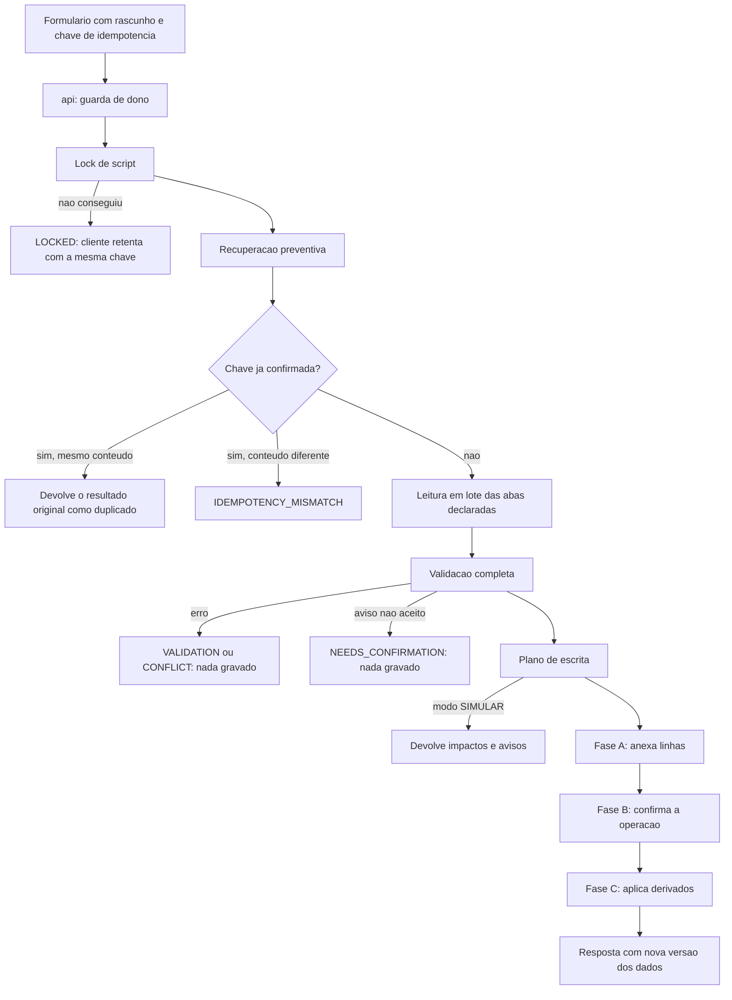
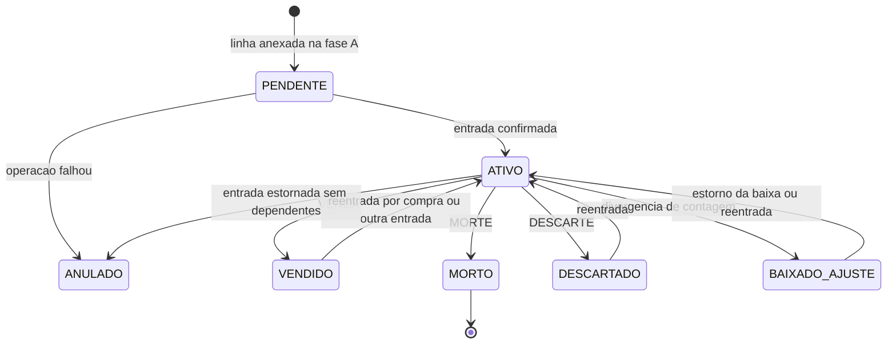
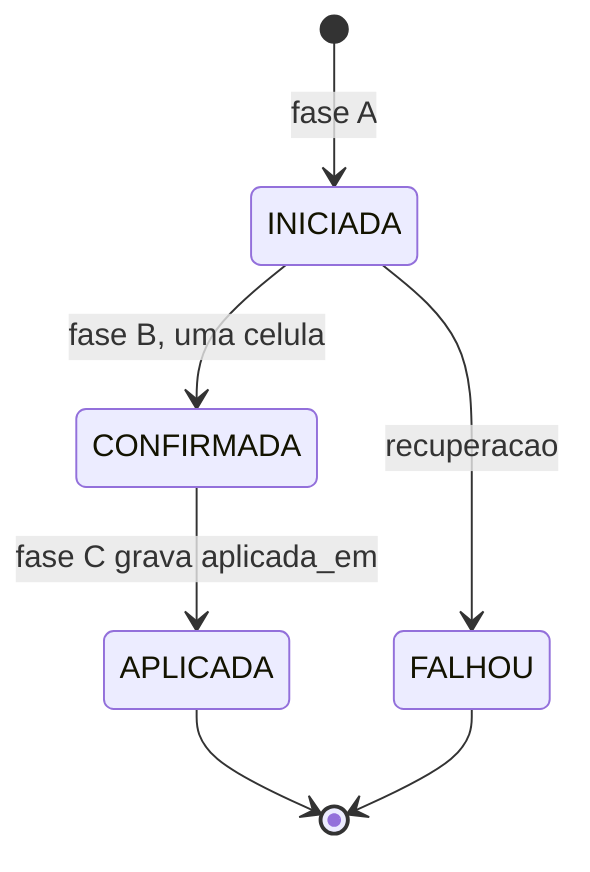
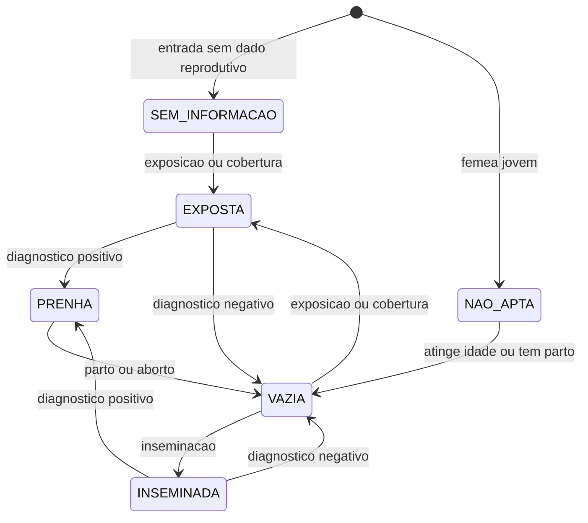
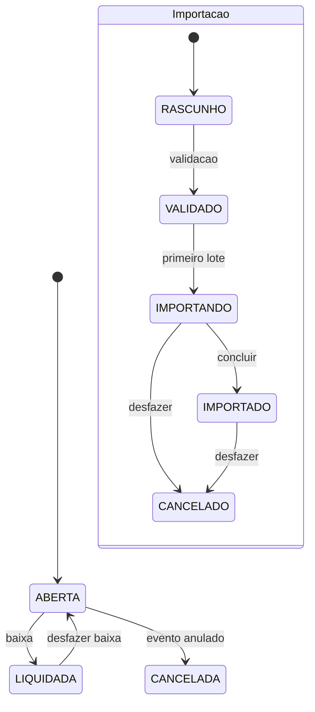

# 04 — Motor de eventos

## Em resumo

- Tudo o que muda o rebanho é um **evento**: registra o que aconteceu, quando, com quais animais e com quais efeitos operacionais e financeiros. O cadastro do animal é só o resultado consolidado dos eventos vigentes (§2.3).
- São **21 tipos de evento**, definidos num catálogo declarativo que serve ao mesmo tempo à validação no servidor e ao formulário na tela.
- **Estorno anula; correção substitui.** Um estorno não lança o inverso: ele tira o evento original do cálculo. Corrigir é registrar um evento substituto, que anula e substitui o original num único commit. Nada é apagado.
- **Um validador de linha do tempo serve a tudo:** evento novo, evento com data passada, estorno, substituição e auditoria. Ele garante que nenhum animal é vendido duas vezes, movimentado depois de morto ou transferido de um pasto onde não está.
- **Marco zero:** o inventário é exato da data do inventário inicial em diante. O que é anterior entra como histórico informativo.

**Documentos relacionados:** `03b-dicionario-eventos-financeiro.md` (colunas e campos de cada evento), `05-regras-de-negocio.md` (regras numeradas), `06-persistencia-e-integridade.md` (gravação em três fases e recuperação), `07-financeiro-e-indicadores.md` (fórmulas), `08-ux-ui.md` (formulários).

## 1. Conceitos

| Termo | O que é |
|---|---|
| **Comando** | Um pedido de mudança vindo da tela (registrar evento, editar cadastro, baixar parcela). Todo comando passa pelo mesmo pipeline |
| **Operação** | A execução de um comando, registrada em OPERACOES. É a unidade de commit e de idempotência. Uma operação pode gravar nenhum, um ou vários eventos |
| **Evento** | Um fato do rebanho ou do financeiro, gravado em EVENTOS, com seus animais em EVENTO_ANIMAIS e seus detalhes nas tabelas próprias |
| **Vigente** | Evento que vale. Condições: a operação dele está confirmada; ele não é um estorno; nenhum evento confirmado aponta para ele em `reversal_of_event_id`; e, se veio de importação, ela foi concluída |
| **Anulação** | Um evento ESTORNO confirmado aponta para o original, que deixa de ser vigente |
| **Substituição** | Um evento do mesmo tipo aponta para o original: anula e ocupa o lugar dele |
| **Projeção** | Coluna de estado atual (pasto, situação, peso), sempre recalculável pelos eventos vigentes |

`EVENTOS.status` (PENDENTE, CONFIRMADO, ESTORNADO, FALHOU, CANCELADO) é o resultado gravado do predicado "vigente", para leitura rápida. O conteúdo de negócio do evento nunca muda depois de gravado.

## 2. Pipeline de um comando



Pontos que definem o comportamento:

1. **Tudo ou nada na validação.** A ordem é: esquema dos campos → regras do tipo → linha do tempo de cada animal → regras financeiras → tetos de tamanho. Um erro em um animal rejeita o evento inteiro, com a lista de erros por animal e por campo. Nunca se grava "os 77 que passaram": o usuário tira os 3 da lista e reenvia, de forma explícita.
2. **Avisos com aceite.** Regras que admitem exceção (carência ativa, possível duplicidade, lotação acima da capacidade, peso implausível, período bloqueado) voltam como `NEEDS_CONFIRMATION`. Nada é gravado e a chave não é consumida. O cliente mostra os avisos e reenvia com os aceites. A política por código (bloqueia, avisa, ignora) fica em `avisos_politica`.
3. **Simulação é a mesma função.** `evento.simular` executa os passos de leitura, validação e plano sem gravar. Prévia e gravação não podem divergir, porque não há duas implementações.
4. **Revisão antes de confirmar (§6).** Eventos de `revisao = LOCAL` montam a folha de confirmação no próprio navegador e fazem uma ida ao servidor. Eventos de `revisao = SERVIDOR` chamam a simulação, mostram impactos e rateio calculados, e o commit envia a versão dos dados que o usuário viu; se ela mudou, a resposta é CONFLICT.
5. **As três fases** estão detalhadas, com a análise de queda, em `06-persistencia-e-integridade.md`.

## 3. Máquinas de estado

### 3.1 Animal (`situacao_cadastral`)



Fora desse ciclo: **EXTERNO** (touro de sêmen ou progenitor que não está no rebanho; cadastro de referência, sem evento, fora do inventário) e **HISTORICO** (animal que só tem registros anteriores ao marco zero). A situação é projeção: resulta do último evento vigente de entrada ou saída. Estornar uma saída devolve o animal a ATIVO sem "evento de volta".

### 3.2 Operação e evento



O evento acompanha a operação: PENDENTE enquanto ela está iniciada; CONFIRMADO quando ela é aplicada; FALHOU se ela falha; ESTORNADO quando um estorno ou substituto o anula; CANCELADO quando a importação a que pertence é desfeita.

### 3.3 Situação reprodutiva e cria ao pé



A situação reprodutiva é **projeção, não validação**: um parto é aceito a partir de qualquer situação, porque a monta a campo raramente tem cobertura registrada. `cria_ao_pe` é uma segunda projeção, independente: liga no parto com nascido vivo e desliga na desmama, morte ou venda da cria. Uma vaca pode estar prenha e com cria ao pé ao mesmo tempo.

### 3.4 Parcela e importação



## 4. Catálogo de eventos

### 4.1 Matriz de efeitos

Efeito = variação no inventário por animal. Local = o que acontece com o pasto atual. Revisão: L = local, S = servidor.

| Tipo | Efeito | Local | Grava além de EVENTOS e EVENTO_ANIMAIS | Financeiro | Rev. | Fase |
|---|---|---|---|---|---|---|
| ENTRADA_INICIAL | +1 | define | ANIMAIS, IDENTIFICACOES, PESAGENS e REPRODUCAO opcionais | Valor de abertura opcional, sem parcela | S | 1 |
| OUTRA_ENTRADA | +1 | define | ANIMAIS (novo ou existente) | — | L | 1 |
| NASCIMENTO | +1 por nascido vivo | define | ANIMAIS, REPRODUCAO (parto), PESAGENS opcional | — | L | 2 |
| COMPRA | +1 | define | ANIMAIS, COMPRAS, IDENTIFICACOES, PESAGENS opcional | Aquisição, frete e outros; parcelas; rateio integral | S | 2 |
| VENDA | −1 | limpa | VENDAS, PESAGENS com peso vivo individual | Receita, deduções; parcelas; rateio integral | S | 2 |
| TRANSFERENCIA | 0 | origem → destino | — | — | L | 2 |
| MORTE | −1 | limpa | BAIXAS | Custos associados, opcionais | L | 2 |
| DESCARTE | −1 | limpa | BAIXAS | Receita simples, opcional | L ou S | 2 |
| PESAGEM | 0 | — | PESAGENS | — | L | 3 |
| SANIDADE | 0 | — | SANIDADE, MOVIMENTOS_ESTOQUE | Consumo sem parcela; serviço com parcela | L | 3 |
| REPRODUCAO | 0 | — | REPRODUCAO | Despesa opcional | L | 3 |
| DESMAMA | 0 | destino opcional | REPRODUCAO (desmama), PESAGENS opcional | — | L | 3 |
| CASTRACAO | 0 | — | — | Despesa opcional | L | 3 |
| IDENTIFICACAO | 0 | — | IDENTIFICACOES | — | L | 2 |
| MARCACAO | 0 | — | — | — | L | 2 |
| AJUSTE_INVENTARIO | 0; −1 na divergência de contagem | só na correção de localização | AJUSTES; BAIXAS na divergência | — | L | 1 e 2 |
| OCORRENCIA | 0 | — | — | Despesa opcional | L | 3 |
| LANCAMENTO_FINANCEIRO | — | — | FINANCEIRO, PARCELAS | Sim | S se houver rateio | 4 |
| RATEIO | — | — | RATEIOS, ALOCACOES_FINANCEIRAS | — | S | 2 e 4 |
| ESTOQUE | — | — | MOVIMENTOS_ESTOQUE | Entrada: compra de insumo, com parcela | L | 3 |
| ESTORNO | anula o original | anula | nenhuma linha filha | Lançamentos do original deixam de valer | S | 1 e 2 |

### 4.2 Entradas

**ENTRADA_INICIAL** — "já estava no rebanho". Fotografia do inventário no marco zero.
- Animais: novos, um ou vários (é o evento da importação inicial). Data sempre igual ao marco zero.
- Por animal: brinco (opcional), sexo, raça, nascimento e confiança, mãe e pai, pasto, origem real (nascido, comprado, desconhecida), data de entrada na fazenda e confiança, castrado, reprodutor, partos anteriores, situação reprodutiva e previsão de parto, peso, valor de abertura.
- Valida: unicidade de brinco; genealogia; pasto existente e ativo.
- Estorno: só se o animal não tem outro evento vigente nem referências; ele fica ANULADO.

**OUTRA_ENTRADA** — doação, permuta, animal encontrado, reentrada sem compra. Mesmos campos, com data livre a partir do marco zero e motivo.

**NASCIMENTO** — um parto, uma matriz, uma data (§6.1).
- Cabeçalho: data, matriz, pai (opcional; vazio ou não confirmado quando a exposição teve mais de um touro), tipo de parto (lista), pasto (padrão: o da mãe), observações.
- Crias (grupo repetível, cobre gemelar): situação do nascimento (vivo ou natimorto), sexo, raça (padrão: a da mãe), identificação (opcional), peso ao nascer (opcional).
- Efeitos: cada nascido vivo cria um animal com a mãe associada e entra no pasto; natimorto não cria animal. Sempre grava uma linha de parto em REPRODUCAO, com nascidos vivos e natimortos, mesmo com zero vivos. A matriz passa a "parida" e, havendo vivo, a "cria ao pé".
- Valida: matriz fêmea e presente no início do dia; nascimento posterior ao da mãe; aviso se a matriz é mais nova que a idade reprodutiva mínima ou se o parto vem cedo demais depois do anterior.

**COMPRA** — um ou vários animais, por lote ou individual (§6.2).
- Cabeçalho: fornecedor, data, finalidade, modalidade (cabeça, kg vivo, arroba, lote), base de peso e rendimento quando por arroba, preço, valor dos animais, frete, outros custos, pasto de destino, critério de rateio, forma e condição de pagamento (parcelas), GTA, nota fiscal, anexos.
- Animais: grade de novos (dados comuns do lote, faixa de brincos ou lista colada, exceções por animal) com brinco da casa (opcional), brinco de origem, sexo, raça, nascimento ou idade estimada, peso, valor individual. Aceita também animal já cadastrado que esteja fora do rebanho (reentrada).
- Financeiro: lançamento de aquisição pelo valor dos animais; frete e outros custos em lançamentos próprios, com parceiro e vencimento próprios; rateio integral entre os animais. O custo de aquisição do animal é a soma das alocações.
- Valida: valor informado × quantidade × preço dentro da tolerância (aviso); soma das parcelas igual ao valor.

### 4.3 Saídas

**VENDA** (§6.3).
- Cabeçalho: comprador, data, finalidade (abate, recria e engorda, reprodução, outra), modalidade, base de peso (vivo ou carcaça), rendimento e seu tipo (apurado, negociado, estimado), preço e unidade, valor bruto, desconto comercial, deduções (grupo repetível: tipo, valor, parceiro, vencimento, retida pelo comprador), critério de rateio, parcelas, GTA, nota fiscal, observações.
- Por animal: peso vivo, peso de carcaça, preço unitário, motivo de saída (por exemplo, descarte).
- Efeitos: animal sai do inventário, fica VENDIDO, pasto limpo. Receita = bruto − desconto comercial; cada dedução é uma despesa de venda. Peso vivo individual vira pesagem do tipo venda; peso de carcaça nunca vira pesagem.
- Valida: animal ATIVO na data; peso e preço coerentes com a modalidade; carência ativa bloqueia quando a finalidade é abate (aviso configurável) e avisa nas demais.
- Depois da venda, o animal não aceita movimentação nem manejo com data posterior.

**MORTE** — animal, data, causa (lista), diagnóstico, responsável, custos associados (lançamento opcional), observações. Aceita animal sem brinco. Entra no relatório de mortalidade.

**DESCARTE** — saída sem negociação comercial: consumo próprio, doação, permuta, sacrifício. Destino (lista), motivo e receita simples opcional. Venda de animal de descarte é VENDA, com o motivo por animal.

### 4.4 Movimentação e identificação

**TRANSFERENCIA** — data, pasto de origem, pasto de destino, animais, responsável, observações; GTA e anexo opcionais quando os pastos são de propriedades diferentes (por exemplo, pasto arrendado em outra fazenda). Valida: destino existente e ativo; **todos** os animais no pasto de origem naquela data; aviso se o destino passa da capacidade.

**IDENTIFICACAO** — rotina de curral, coletiva: primeira identificação, substituição (com motivo: perda, ilegível, padronização) ou remoção. Grava o novo período em IDENTIFICACOES. Valida a unicidade do brinco.

**MARCACAO** — marca ou desmarca um animal como "para descarte" ou "não localizado". Não altera inventário; gera pendência visível e tira a fêmea de "matrizes ativas".

### 4.5 Manejo

**PESAGEM** — individual, coletiva ou por lote. Data, método (balança, fita, estimativa visual), e por animal o peso. Por lote: peso total e número de cabeças; o sistema grava a média para cada animal com método "média do lote", marcada como estimada. Nunca substitui pesagem anterior. Ganho, GMD e variação são calculados na leitura. Valida: peso maior que zero; aviso de variação implausível; aviso de pesagem repetida no mesmo dia.

**SANIDADE** — vacinação, vermifugação, medicação, tratamento, exame, doença. Cabeçalho: data, produto (cadastro ou texto livre), fabricante, lote, validade, modo de dose (por cabeça, por peso, total), dose, via, quantidade total consumida, motivo ou diagnóstico, resultado de exame, próxima aplicação, carência, responsável ou veterinário, protocolo, custo de serviço pago no ato. Grava uma linha por animal. O consumo baixa o estoque (se controlado) e gera o custo. O sistema não sugere produto nem protocolo.

**REPRODUCAO** — exposição (coletiva: matrizes, touros, estação, entrada e retirada), cobertura datada, inseminação (touro ou sêmen), diagnóstico de gestação (resultado, idade gestacional), aborto. Parto é o evento NASCIMENTO; desmama é o evento DESMAMA.

**DESMAMA** — bezerro, data, peso, matriz, pasto de destino, observações. Desliga "cria ao pé" na matriz.

**CASTRACAO** — animais machos, data, custo opcional. Muda a categoria automática.

**OCORRENCIA** — registro genérico, com tipo em lista configurável e custo opcional. Cobre "demais ocorrências" (§1).

### 4.6 Correções

**AJUSTE_INVENTARIO** (sempre com justificativa; grava o valor que a tela mostrava e o valor novo):

| Subtipo | Uso | Efeito |
|---|---|---|
| CORRECAO_CADASTRO | Erro em sexo, nascimento, mãe, pai, castrado | Recalcula a projeção do atributo |
| IDENTIFICACAO_INCORRETA | Brinco digitado errado, animal trocado | Corrige o registro de identificação, sem abrir novo período |
| RECLASSIFICACAO | Categoria manual, ou volta à automática | Altera `categoria_modo` |
| CORRECAO_LOCALIZACAO | Animal estava em outro pasto | Movimento de correção, com origem e destino |
| DIVERGENCIA_CONTAGEM | Animal não encontrado na contagem | Baixa (−1); reaparecimento é o estorno da baixa |

Animal a mais na contagem entra por OUTRA_ENTRADA ou ENTRADA_INICIAL, não por ajuste.

**ESTORNO** — evento apontado, motivo. Bloqueios: dependentes na linha do tempo; referências fora dela (filhos, uso como touro, alocações de rateios); parcela liquidada. A simulação lista o que bloqueia.

### 4.7 Financeiro e estoque

**LANCAMENTO_FINANCEIRO** — receita ou despesa avulsa: conta, competência (data ou período), valor, parceiro, vínculos (pasto, propriedade, categoria, evento de referência), parcelas. Exemplo: aluguel de pasto arrendado.

**RATEIO** — distribui um lançamento entre animais por cabeças, peso vivo, dias de permanência ou percentual manual. Re-ratear é um novo evento; o anterior deixa de valer sem ser alterado.

**ESTOQUE** — entrada (compra de insumo, com quantidade e custo) ou ajuste de saldo.

## 5. Linha do tempo

### 5.1 Regras

- **Ordem canônica:** `(event_date, classe, event_seq)`. Classe 0 = entradas; 1 = movimentos e demais; 2 = saídas. Não há hora; "na data D" significa o estado ao fim do dia D.
- **Permanência:** pares de entrada e saída. MORTO é terminal; os demais admitem reentrada.
- **Continuidade de local:** o pasto de origem de cada movimento é o pasto de destino do movimento anterior.
- **Fato independente** (pesagem, sanidade, reprodução, desmama, identificação): válido se a data cai dentro de um período de permanência, com os dois limites incluídos. O dia da saída conta.
- **Validação única:** o mesmo validador recebe a linha do tempo do animal já com a alteração proposta e diz se ela continua válida.

| Situação | O que o validador recebe | Se ficar inválida |
|---|---|---|
| Evento novo | Linha do tempo + linhas novas | VALIDATION |
| Evento com data passada | Linhas novas inseridas na posição da data; eventos posteriores são revalidados | CONFLICT, listando os eventos posteriores incompatíveis |
| Estorno | Linha do tempo sem as linhas do evento | CONFLICT, listando os dependentes |
| Substituição | Linhas do original trocadas pelas novas, validadas uma vez | CONFLICT só se a mudança for estrutural (animais, data, pasto) |
| Integridade | Linha do tempo de todos os animais | Erro no relatório |

### 5.2 Exemplos

**(i) Transferência com data passada que conflita.** O animal 0457 está no Pasto A. Em 10/03 foi registrada a transferência A → C. Em 15/03 o usuário registra, com data de 01/03, a transferência A → B. Inserida na posição de 01/03, a cadeia fica A → B (01/03) e A → C (10/03): a origem de 10/03 deveria ser B. Resposta: CONFLICT, "0457: a transferência de 10/03 parte do Pasto A, mas em 10/03 o animal estaria no Pasto B". Saída: corrigir a transferência de 10/03 (substituto B → C) e reenviar.

**(ii) Manejos no dia da venda.** O lote foi vendido em 20/06. No dia seguinte o usuário lança a pesagem feita em 20/06, antes do embarque. Pesagem é fato independente e o dia da saída conta: aceita. Se ele lançasse uma transferência A → B em 20/06, ela entraria antes da venda (classe 1 antes da classe 2), e a venda, que registra saída a partir do Pasto A, ficaria com origem errada: CONFLICT.

**(iii) Estorno de compra com dependentes.** Compra de 20 animais em 05/02; pesagem dos 20 em 12/02; transferência de 5 em 01/03. Estornar a compra deixaria pesagens e transferências de animais que nunca entraram: bloqueado, com a lista "2 eventos dependem desta compra". Se o erro for no valor, o caminho é a substituição do exemplo (iv).

**(iv) Substituição para corrigir o frete.** Compra de 3 animais por R$ 9.000,00 (R$ 3.000,00 cada), em 2 parcelas de R$ 4.500,00, a primeira já paga; frete lançado como R$ 30,00, quando era R$ 300,00. O usuário abre "corrigir evento", muda o frete e confirma. O evento substituto tem os mesmos três `animal_id`, as mesmas linhas de animais e a mesma data: a linha do tempo não muda e os eventos posteriores não bloqueiam. No financeiro, os lançamentos antigos deixam de valer e os novos nascem do substituto; a baixa da primeira parcela é transportada, porque valor e vencimento não mudaram; a parcela do frete, agora de R$ 300,00, nasce aberta. Custo de aquisição por animal: de R$ 3.010,00 para R$ 3.100,00 (R$ 3.000,00 + R$ 300,00 ÷ 3).

**(v) Inventário em três datas.** Marco zero em 01/01, com 100 animais: 60 no Pasto A e 40 no B. Em 15/01 nascem 2 no A. Em 01/02, 10 vão de A para B. Em 20/02 vendem-se 5 do B. Em 10/03 morre 1 no A.

| Data | Total | Pasto A | Pasto B | Conta |
|---|---:|---:|---:|---|
| 31/01 | 102 | 62 | 40 | 100 + 2 |
| 15/02 | 102 | 52 | 50 | transferência não muda o total |
| 31/03 | 96 | 51 | 45 | 100 + 2 − 5 − 1 |

Se a venda de 20/02 for estornada em abril, a consulta de 31/03 passa a devolver 101: o inventário passado é sempre recalculado com os eventos vigentes hoje. O que foi registrado e depois anulado continua consultável no histórico de eventos e na auditoria.

## 6. Marco zero e histórico anterior

- `data_marco_zero` é a data do inventário inicial. ENTRADA_INICIAL é sempre datada dela, com o pasto daquele dia.
- De lá em diante, a linha do tempo é validada e o inventário fecha.
- Eventos com data anterior (pesagens, vacinações, compras e vendas antigas) entram com `pre_marco_zero = S`: efeito de inventário zero, fora da linha do tempo, validados só contra a data de nascimento e a data de entrada informada. Contam para a curva de peso, o histórico sanitário, a reprodução e o custo de aquisição; não contam para inventário nem para localização.
- Animal que só aparece antes do marco zero fica HISTORICO (ou VENDIDO ou MORTO, se a saída histórica for conhecida), fora do inventário.
- Consulta de inventário com data anterior ao marco zero devolve "sem dado", com o motivo.
- A **reconciliação** (§14) é um relatório ao fim da importação: último pasto do histórico diferente do pasto da fotografia; animal com venda ou morte histórica presente na fotografia; brinco citado em evento sem animal; contagem por pasto diferente da informada. Cada divergência recebe uma decisão registrada: aceitar a fotografia, ajustar ou ignorar a linha.

## 7. EventCatalog: o esquema

O catálogo é uma estrutura declarativa em `EventCatalog`, enviada ao navegador na carga inicial. Vocabulário fechado:

| Nível | Atributos |
|---|---|
| Tipo | `rotulo`, `grupo_ui` (Movimentação, Manejo, Reprodução, Financeiro, Correções), `ordem`, `frequente`, `selecao_animais` (NENHUM, UM, VARIOS, NOVOS), `filtro_elegiveis`, `modo_entrada` (FORM, CURRAL), `revisao` (LOCAL, SERVIDOR), `critico`, `reads[]`, `fase` |
| Campo | `id`, `rotulo`, `tipo` (texto, inteiro, decimal, dinheiro, data, lista, ref:TABELA, bool, anexo), `obrigatorio`, `visivel_se`, `obrigatorio_se`, `default` (valor, HOJE ou derivado de outro registro), `escopo` (EVENTO, POR_ANIMAL), `unidade`, `min`, `max`, `ajuda` |
| Grupos repetíveis | crias, parcelas, deduções |
| Componentes compostos (escritos à mão) | `seletor_animais`, `grade_novos_animais`, `bloco_negociacao`, `bloco_parcelas` |

Exemplo simples:

```js
TRANSFERENCIA: {
  rotulo: 'Transferir de pasto', grupo_ui: 'Movimentação', frequente: true,
  selecao_animais: 'VARIOS', filtro_elegiveis: { situacao: 'ATIVO', pasto: '$pasto_origem_id' },
  modo_entrada: 'FORM', revisao: 'LOCAL', critico: false, fase: 2,
  reads: ['EVENTOS', 'EVENTO_ANIMAIS', 'ANIMAIS', 'PASTOS'],
  campos: [
    { id: 'event_date', rotulo: 'Data', tipo: 'data', obrigatorio: true, default: 'HOJE' },
    { id: 'pasto_origem_id', rotulo: 'Pasto de origem', tipo: 'ref:PASTOS', obrigatorio: true },
    { id: 'pasto_destino_id', rotulo: 'Pasto de destino', tipo: 'ref:PASTOS', obrigatorio: true },
    { id: 'responsible', rotulo: 'Responsável', tipo: 'texto' },
    { id: 'gta_numero', rotulo: 'GTA', tipo: 'texto', visivel_se: { campo: 'outra_propriedade', valores: [true] } },
    { id: 'notes', rotulo: 'Observações', tipo: 'texto' }
  ]
}
```

Exemplo com negociação:

```js
VENDA: {
  rotulo: 'Vender animais', grupo_ui: 'Movimentação', frequente: true,
  selecao_animais: 'VARIOS', filtro_elegiveis: { situacao: 'ATIVO' },
  modo_entrada: 'FORM', revisao: 'SERVIDOR', critico: true, fase: 2,
  reads: ['EVENTOS', 'EVENTO_ANIMAIS', 'ANIMAIS', 'PESAGENS', 'SANIDADE', 'PARCEIROS', 'PLANO_CONTAS'],
  campos: [
    { id: 'event_date', rotulo: 'Data da venda', tipo: 'data', obrigatorio: true, default: 'HOJE' },
    { id: 'partner_id', rotulo: 'Comprador', tipo: 'ref:PARCEIROS', obrigatorio: true },
    { id: 'finalidade', rotulo: 'Finalidade', tipo: 'lista', obrigatorio: true },
    { id: 'gta_numero', rotulo: 'GTA', tipo: 'texto' },
    { id: 'peso', rotulo: 'Peso vivo', tipo: 'decimal', unidade: 'kg', escopo: 'POR_ANIMAL', min: 1 },
    { id: 'peso_carcaca_kg', rotulo: 'Peso de carcaça', tipo: 'decimal', unidade: 'kg', escopo: 'POR_ANIMAL',
      visivel_se: { campo: 'base_peso', valores: ['CARCACA'] } },
    { id: 'motivo_saida', rotulo: 'Motivo', tipo: 'lista', escopo: 'POR_ANIMAL' }
  ],
  componentes: ['seletor_animais', 'bloco_negociacao', 'bloco_parcelas'],
  grupos_repetiveis: {
    deducoes: [
      { id: 'tipo', tipo: 'lista', obrigatorio: true },
      { id: 'valor', tipo: 'dinheiro', obrigatorio: true, min: 0.01 },
      { id: 'partner_id', tipo: 'ref:PARCEIROS' },
      { id: 'retida_pelo_comprador', tipo: 'bool', default: false }
    ]
  }
}
```

O `bloco_negociacao` cuida de modalidade, base de peso, rendimento, preço, valor bruto, desconto comercial e critério de rateio, com as dependências entre eles. Um teste em Node percorre todos os tipos e confere que cada campo é renderizável e faz ida e volta.

## 8. Importação como caso do motor

Cada importador chama o **mesmo comando** do formulário correspondente; não há regra de negócio própria da importação. O que muda é a embalagem: lotes de tamanho fixo, cada lote uma operação com vários eventos, e o arquivo inteiro passando a valer só quando a importação é concluída. Retomar, desfazer e a análise de queda estão em `06-persistencia-e-integridade.md`; o fluxo de telas, em `08-ux-ui.md`.
