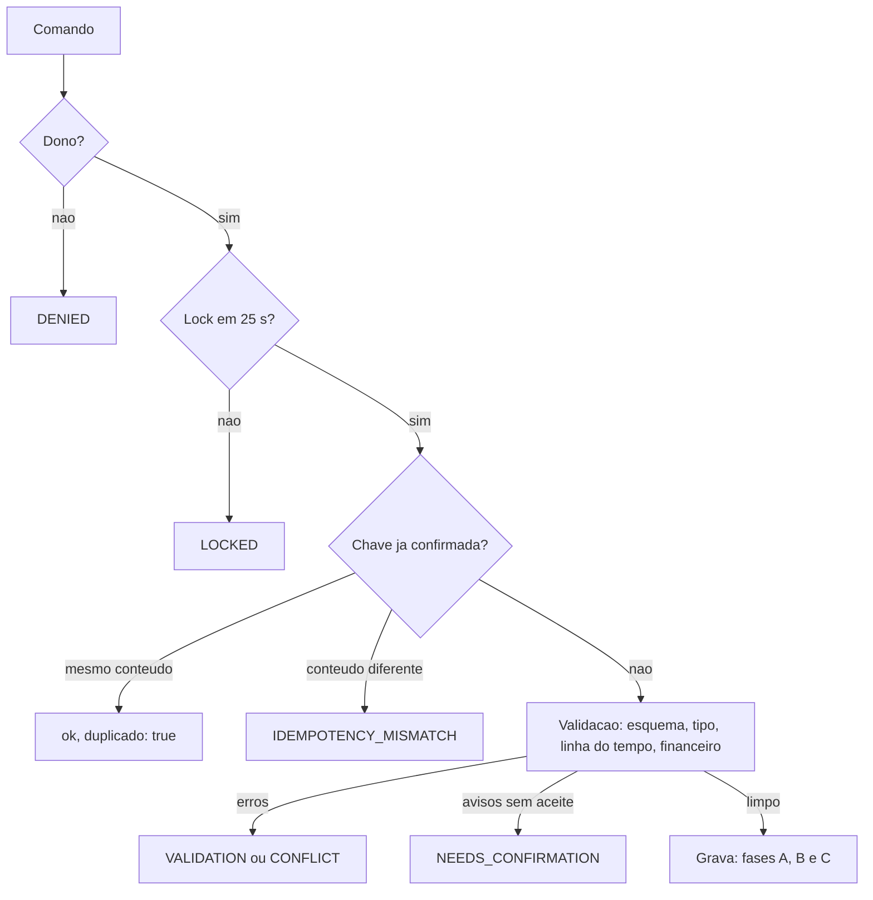

# 05 — Regras de negócio

## Em resumo

- **112 regras, RN-001 a RN-112, em 16 áreas.** Este é o único documento que numera regras; os demais as citam pelo número ou em palavras.
- **Quatro tipos**: 50 ERRO (bloqueia), 13 AVISO (exige aceite; política por código em `avisos_politica`), 6 ALERTA (pendência visível) e 43 INVARIANTE (conferida pela verificação de integridade ou por teste).
- **Tudo é validado no servidor** (§16, última linha). Um único validador de linha do tempo atende evento novo, retroativo, estorno, substituição e integridade; as cinco situações não têm como divergir.
- **As 20 regras da §16 estão mapeadas** na seção 3, com a leitura adotada onde o texto é ambíguo.
- **O sistema registra e alerta; não prescreve** protocolo veterinário, alíquota nem capacidade de suporte (seção 6).

**Documentos relacionados:** `README.md` · `02-modelo-de-dados.md` · `03a-dicionario-cadastros-suporte.md` · `03b-dicionario-eventos-financeiro.md` · `04-motor-de-eventos.md` · `06-persistencia-e-integridade.md` · `07-financeiro-e-indicadores.md` · `08-ux-ui.md` · `09-plano-de-testes.md`.

## 1. Como ler a matriz

| Tipo | Efeito | Resposta da API |
|---|---|---|
| ERRO | Bloqueia sempre; nada é gravado | VALIDATION (o comando fere a regra), CONFLICT (choca com evento ou estado já gravado) ou o código da linha |
| AVISO | Exige aceite. Política por código em `avisos_politica`: AVISA (padrão), BLOQUEIA (vira erro VALIDATION com o mesmo código no detalhe) ou IGNORA | NEEDS_CONFIRMATION; a coluna Código traz o código do aviso. O cliente reenvia com `avisosAceitos[]`; o aceite fica em `EVENTOS.payload_json` |
| ALERTA | Pendência visível em `alerta.listar`; não bloqueia | — |
| INVARIANTE | Propriedade que vale sempre nos dados ou nas respostas, por construção | Só aparece no relatório de `sistema.integridade` ou em teste; nunca é erro para o usuário |

- **Ordem de validação**: esquema (tipo, obrigatório, enum, faixa) → regras do tipo de evento → linha do tempo de cada animal → regras financeiras. Os erros são coletados e devolvidos juntos em `error.details[]`, por animal e campo. Havendo erro, a resposta é de erro mesmo que existam avisos.
- Erro, aviso e LOCKED não consomem a chave de idempotência: o reenvio corrigido usa a mesma chave.
- **Colunas.** Origem: § da especificação, ou `DV-nn` (divergência documentada nos dicionários). Onde: módulo de `src/`; Timeline = `TimelineValidator` e `Projector`; Integridade = verificação em `AuditService`. CT: cenário de `09-plano-de-testes.md`; "novo" = nenhum CT cobre, pede caso próprio no nível 1.
- **Códigos de aviso** (lista completa; são as chaves de `avisos_politica`). Do desenho-base: CARENCIA_ATIVA, POSSIVEL_DUPLICIDADE, BRINCO_PARECIDO, LOTACAO_ACIMA_DA_CAPACIDADE, PESO_IMPLAUSIVEL, IDADE_REPRODUTIVA, PERIODO_BLOQUEADO. Fechados aqui: VALOR_DIVERGENTE, RATEIO_SEM_PESO, INTERVALO_PARTO_CURTO, PRODUTO_VENCIDO, ESTOQUE_INSUFICIENTE, CATEGORIAS_SEM_COBERTURA.

## 2. Matriz de regras

### 2.1 Identificação e cadastro

| RN | Regra | Origem | Tipo | Onde | Código | CT |
|---|---|---|---|---|---|---|
| RN-001 | Toda PK é UUID em texto gerado pelo sistema, única na tabela e nunca derivada do número da linha. | §2.1, §16.2 | INVARIANTE | Utils; Integridade | — | novo |
| RN-002 | Dois animais não anulados, ativos ou baixados, não têm o mesmo `brinco_norm` preenchido. | §2.1, §16.1 | ERRO | Validation | VALIDATION | CT-09 |
| RN-003 | Com `brinco_ignora_zeros_esquerda` = N, brincos que só diferem por zeros à esquerda convivem, com aviso. | DV-05 | AVISO | Validation | BRINCO_PARECIDO | novo |
| RN-004 | Brinco de período já encerrado em outro animal só é aceito com `brinco_permite_reuso` = S. | §2.1 | ERRO | Validation | VALIDATION | novo |
| RN-005 | Animal ATIVO sem brinco vigente aparece na pendência "sem brinco"; brinco é opcional. | §16.19 | ALERTA | AnimalService | — | novo |
| RN-006 | Animal EXTERNO fica fora do inventário e só aceita papel de progenitor ou TOURO. | DV-06 | ERRO | Timeline | VALIDATION | novo |

### 2.2 Genealogia

| RN | Regra | Origem | Tipo | Onde | Código | CT |
|---|---|---|---|---|---|---|
| RN-007 | Animal não é a própria mãe nem o próprio pai. | §5.2, §16.8 | ERRO | Validation | VALIDATION | CT-09 |
| RN-008 | Mãe é fêmea; pai é macho. | §5.2 | ERRO | Validation | VALIDATION | CT-09 |
| RN-009 | Nascimento do filho é posterior ao da mãe e ao do pai, quando as datas são conhecidas. | §5.2, §16.7 | ERRO | Validation | VALIDATION | CT-09 |
| RN-010 | Vínculo que torna o animal ancestral de si mesmo é recusado. | §5.2, §16.9 | ERRO | Validation | VALIDATION | CT-09 |
| RN-011 | Mãe e pai podem ficar vazios (desconhecidos); vínculo preenchido exige confiança CONFIRMADA ou ESTIMADA. | §5.2 | ERRO | Schema | VALIDATION | novo |
| RN-012 | Corrigir sexo ou nascimento de um animal reaplica RN-008 e RN-009 aos vínculos em que ele é progenitor. | §5.2 | ERRO | Validation | VALIDATION | novo |

### 2.3 Inventário e linha do tempo

| RN | Regra | Origem | Tipo | Onde | Código | CT |
|---|---|---|---|---|---|---|
| RN-013 | Todo animal ATIVO tem exatamente uma entrada vigente (+1) sem saída posterior. | DV-06 | INVARIANTE | Timeline; Integridade | — | CT-08 |
| RN-014 | Saída (VENDA, MORTE, DESCARTE, DIVERGENCIA_CONTAGEM) exige animal ATIVO na data. | §16.3 | ERRO | Timeline | VALIDATION | CT-09 |
| RN-015 | MORTO é terminal: não aceita evento com data posterior à morte nem reentrada. | §16.4 | ERRO | Timeline | VALIDATION | CT-09 |
| RN-016 | VENDIDO, DESCARTADO ou BAIXADO_AJUSTE só aceita reentrada (COMPRA, OUTRA_ENTRADA) com data posterior à saída. | §6.3 | ERRO | Timeline | VALIDATION | CT-09 |
| RN-017 | Pesagem, sanidade, reprodução, parto (matriz), desmama e identificação exigem data dentro de um período de permanência, limites inclusivos. | §6.3 | ERRO | Timeline | VALIDATION | CT-17 |
| RN-018 | Na TRANSFERENCIA, cada animal está no pasto de origem informado na data do evento. | §6.4, §16.6 | ERRO | Timeline | VALIDATION | CT-02 |
| RN-019 | Pasto de destino, como toda referência de evento, existe e está ativo; destino difere da origem. | §16.5 | ERRO | Validation | VALIDATION | novo |
| RN-020 | Evento retroativo que invalida eventos posteriores do animal é recusado, listando-os. | §2.3 | ERRO | Timeline | CONFLICT | CT-17 |
| RN-021 | `event_date` não é futura nem anterior ao nascimento do animal; em pares início/fim, início ≤ fim. | §16.10 | ERRO | Validation | VALIDATION | novo |
| RN-022 | ENTRADA_INICIAL é datada do marco zero; evento anterior a ele entra só como informativo, com efeito 0. | §14 | ERRO | Timeline | VALIDATION | CT-12 |
| RN-023 | Eventos do mesmo animal no mesmo dia valem na ordem entrada, demais, saída; depois `event_seq`. | §2.3 | INVARIANTE | Timeline | — | CT-17 |
| RN-024 | Σ `efeito_inventario` dos eventos vigentes = número de animais ATIVOS. | §16.20 | INVARIANTE | Integridade | — | CT-08 |
| RN-025 | Projeções de ANIMAIS e `EVENTOS.status` coincidem com o replay dos eventos vigentes. | §2.3, §16.20 | INVARIANTE | Timeline; Integridade | — | CT-08 |
| RN-026 | Animal ATIVO sem `pasto_atual_id` aparece na pendência "sem pasto". | §16.18 | ALERTA | InventoryService | — | novo |
| RN-027 | Entrada ou transferência que leva o pasto acima da capacidade informada gera aviso. | §7 | AVISO | PastureService | LOTACAO_ACIMA_DA_CAPACIDADE | novo |

### 2.4 Eventos coletivos e atomicidade

| RN | Regra | Origem | Tipo | Onde | Código | CT |
|---|---|---|---|---|---|---|
| RN-028 | Erro em um animal rejeita o evento coletivo inteiro, com a lista por animal e campo. | §2.4, §16.14 | ERRO | EventService | VALIDATION | novo |
| RN-029 | Cada animal aparece uma vez por papel; há ao menos um animal; totais do cabeçalho = contagem das linhas. | §16.14 | ERRO | Validation | VALIDATION | CT-03 |
| RN-030 | Só linhas de operação CONFIRMADA são visíveis em consulta. | §2.4 | INVARIANTE | Repository | — | CT-10 |
| RN-031 | Operação órfã é resolvida antes do próximo comando: INICIADA vira FALHOU; CONFIRMADA sem `aplicada_em` reaplica a fase C. | §2.4 | INVARIANTE | UnitOfWork | — | novo |
| RN-032 | Com importação em IMPORTANDO, os demais comandos de escrita são recusados. | §2.4 | ERRO | UnitOfWork | CONFLICT | CT-12 |

### 2.5 Idempotência e concorrência

| RN | Regra | Origem | Tipo | Onde | Código | CT |
|---|---|---|---|---|---|---|
| RN-033 | Há no máximo uma operação CONFIRMADA por `idempotency_key`; reenvio idêntico devolve o resultado original com `duplicado: true`. | §2.4, §16.13 | INVARIANTE | UnitOfWork | — | CT-10 |
| RN-034 | Mesma chave com conteúdo diferente é recusada. | §16.13 | ERRO | UnitOfWork | IDEMPOTENCY_MISMATCH | CT-10 |
| RN-035 | Toda escrita roda sob lock; sem lock em 25 s, nada é gravado. | §2.4 | ERRO | UnitOfWork | LOCKED | CT-10 |
| RN-036 | Evento de mesmo tipo e data com ≥ 80% dos animais de um evento vigente gera aviso. | §2.4 | AVISO | EventService | POSSIVEL_DUPLICIDADE | CT-10 |
| RN-037 | Commit com `dataVersionEsperada` diferente da versão atual é recusado. | §6 | ERRO | EventService | CONFLICT | novo |
| RN-038 | `event_seq` e `codigo_interno` são únicos e crescentes (máximo + 1 sob lock). | §3.2 | INVARIANTE | UnitOfWork; Integridade | — | CT-10 |

### 2.6 Estorno, substituição e ajuste

| RN | Regra | Origem | Tipo | Onde | Código | CT |
|---|---|---|---|---|---|---|
| RN-039 | ESTORNO anula o original sem apagá-lo: ele fica ESTORNADO e sai do replay. | §2.3, §16.15 | INVARIANTE | EventService | — | CT-07 |
| RN-040 | Estorno que deixa inválida a linha do tempo restante é recusado, listando os dependentes. | §2.3 | ERRO | Timeline | CONFLICT | novo |
| RN-041 | Estorno de evento criador exige animal sem outro evento vigente e sem referência (mãe, pai, touro, rateio); o animal fica ANULADO. | §2.3 | ERRO | EventService | CONFLICT | novo |
| RN-042 | Estorno de evento com parcela LIQUIDADA exige desfazer a baixa antes. | §11.3 | ERRO | FinancialService | CONFLICT | CT-15 |
| RN-043 | ESTORNO não é estornável; evento estornado não é estornado de novo. | §16.15 | ERRO | EventService | VALIDATION | novo |
| RN-044 | Substituto tem o tipo do original, anula-o no mesmo commit e reaproveita os `animal_id` criados. | §2.1, §2.3 | ERRO | EventService | VALIDATION | CT-18 |
| RN-045 | Substituição é validada uma vez sobre o conjunto final; mudança só de valores, parceiro, parcelas ou observações nunca é bloqueada por dependentes. | §2.3 | ERRO | Timeline | CONFLICT | CT-18 |
| RN-046 | Substituição transporta a baixa da parcela com valor e vencimento inalterados; se mudaram, exige desfazer a baixa. | §11.3 | ERRO | FinancialService | CONFLICT | CT-15 |
| RN-047 | Todo AJUSTE_INVENTARIO exige justificativa e grava valor anterior e novo. | §6.12, §16.15 | ERRO | Validation | VALIDATION | novo |
| RN-048 | Sexo, nascimento, mãe, pai, brinco e castrado só mudam por evento; o valor de criação é preservado. | §16.17 | INVARIANTE | AnimalService | — | novo |

### 2.7 Pesagem

| RN | Regra | Origem | Tipo | Onde | Código | CT |
|---|---|---|---|---|---|---|
| RN-049 | Peso vivo é maior que zero, com uma casa decimal, até o teto do campo no EventCatalog. | §16.11 | ERRO | Schema | VALIDATION | CT-05 |
| RN-050 | Variação diária contra a pesagem anterior fora da faixa `gmd_plausivel_*` gera aviso. | §16.11 | AVISO | WeightService | PESO_IMPLAUSIVEL | novo |
| RN-051 | Nova pesagem nunca altera nem substitui linha anterior. | §6.5 | INVARIANTE | Repository | — | CT-05 |
| RN-052 | GMD exige intervalo ≥ `gmd_intervalo_min_dias` e método individual; senão devolve `null` (DADOS_INSUFICIENTES). | §8 | INVARIANTE | WeightService | — | CT-05 |
| RN-053 | Projeção, média calculada e peso de carcaça nunca entram em PESAGENS. | §6.3, §8 | INVARIANTE | WeightService | — | CT-14 |

### 2.8 Sanidade

| RN | Regra | Origem | Tipo | Onde | Código | CT |
|---|---|---|---|---|---|---|
| RN-054 | Aplicação coletiva gera uma linha por animal, um movimento de estoque e um lançamento de consumo sem parcela. | §6.6 | INVARIANTE | HealthService | — | CT-06 |
| RN-055 | Dose e quantidade consumida são maiores que zero; no modo TOTAL a dose individual fica vazia. | §16.12 | ERRO | Validation | VALIDATION | CT-06 |
| RN-056 | Validade do lote anterior à data da aplicação gera aviso. | §10 | AVISO | HealthService | PRODUTO_VENCIDO | novo |
| RN-057 | Consumo acima do saldo, em produto com `controla_estoque` = S, gera aviso. | §10 | AVISO | HealthService | ESTOQUE_INSUFICIENTE | novo |
| RN-058 | Pendência sanitária = animal elegível a protocolo ativo sem aplicação posterior da mesma chave. | §10 | INVARIANTE | HealthService | — | CT-06 |
| RN-059 | Procedimento vencido ou próximo do vencimento e animal em carência aparecem na agenda e nos alertas. | §10 | ALERTA | HealthService | — | novo |

### 2.9 Reprodução

| RN | Regra | Origem | Tipo | Onde | Código | CT |
|---|---|---|---|---|---|---|
| RN-060 | Sujeito de evento reprodutivo é fêmea; `touro_id` é macho ATIVO ou EXTERNO. | §5.2 | ERRO | Validation | VALIDATION | novo |
| RN-061 | Parto ou evento reprodutivo de fêmea abaixo de `idade_min_reprodutiva_meses` gera aviso. | §5.2 | AVISO | ReproductionService | IDADE_REPRODUTIVA | novo |
| RN-062 | Cada parto é um NASCIMENTO com uma linha REPRODUCAO(PARTO); nascidos vivos + natimortos ≥ 1. | §6.1 | ERRO | Validation | VALIDATION | CT-01 |
| RN-063 | Só nascido vivo cria animal (+1, com `mae_id`); natimorto não cria. | §6.1 | INVARIANTE | EventService | — | CT-01 |
| RN-064 | Parto a menos de `dias_gestacao` dias do parto anterior da matriz gera aviso. | §9 | AVISO | ReproductionService | INTERVALO_PARTO_CURTO | novo |
| RN-065 | Situação reprodutiva é projeção, nunca pré-condição: parto é aceito de qualquer situação. | §9 | INVARIANTE | Timeline | — | CT-01 |
| RN-066 | Indicador com n abaixo de `indicador_n_minimo` devolve `null` (DADOS_INSUFICIENTES), nunca zero. | §9 | INVARIANTE | ReproductionService | — | novo |

### 2.10 Compra e venda

| RN | Regra | Origem | Tipo | Onde | Código | CT |
|---|---|---|---|---|---|---|
| RN-067 | Modalidade ARROBA exige `base_peso`; base VIVO exige rendimento NEGOCIADO ou ESTIMADO. | §6.3, §11.1 | ERRO | Validation | VALIDATION | CT-14 |
| RN-068 | Valor informado prevalece; diferença para quantidade × preço acima de `fin_tolerancia_conferencia_pct` gera aviso. | §11.1 | AVISO | FinancialService | VALOR_DIVERGENTE | novo |
| RN-069 | Receita da venda = bruto − desconto comercial; cada dedução é lançamento DESPESA_VENDA próprio. | §6.3 | INVARIANTE | FinancialService | — | CT-04 |
| RN-070 | Lançamentos de COMPRA e VENDA são 100% alocados aos animais pelo critério do evento. | §6.3 | INVARIANTE | FinancialService; Integridade | — | CT-13 |
| RN-071 | Rateio MANUAL soma exatamente o valor do lançamento. | §6.3 | ERRO | FinancialService | VALIDATION | novo |
| RN-072 | Venda de animal em carência: bloqueada por padrão se a finalidade é ABATE; nas demais, aviso. | §10 | AVISO | HealthService | CARENCIA_ATIVA | novo |
| RN-073 | Rateio por peso sem peso individual usa a última pesagem escalada ou cai para CABECAS, com aviso. | §6.3 | AVISO | FinancialService | RATEIO_SEM_PESO | novo |
| RN-074 | DESCARTE é saída sem negociação: grava BAIXAS, nunca VENDAS. | §6.9 | INVARIANTE | EventService | — | novo |

### 2.11 Financeiro, parcelas e rateio

| RN | Regra | Origem | Tipo | Onde | Código | CT |
|---|---|---|---|---|---|---|
| RN-075 | Valor monetário tem 2 casas e não é negativo; valor de lançamento e quantidade são maiores que zero. | §16.12 | ERRO | Validation | VALIDATION | CT-03 |
| RN-076 | Σ `PARCELAS.valor` = `FINANCEIRO.valor`. | §11.3 | ERRO | FinancialService; Integridade | VALIDATION | CT-03 |
| RN-077 | Σ alocações vigentes de um lançamento ≤ valor; a diferença aparece como "não alocado". | §11.2 | INVARIANTE | Integridade | — | CT-13 |
| RN-078 | Rateio fecha em centavos pelo maior resto: Σ alocado = valor rateado. | §11.2 | INVARIANTE | FinancialService | — | CT-13 |
| RN-079 | Toda alocação pertence a um rateio com critério, escopo, base e data ou período gravados. | §11.2 | INVARIANTE | FinancialService; Integridade | — | CT-13 |
| RN-080 | Custo compartilhado só chega ao animal por evento RATEIO; re-rateio é evento novo e não altera linhas antigas. | §11.2 | INVARIANTE | FinancialService | — | novo |
| RN-081 | Baixa exige parcela ABERTA, data não futura e `valor_pago` = valor + juros − desconto. | §11.3 | ERRO | FinancialService | VALIDATION | CT-15 |
| RN-082 | Criar ou cancelar lançamento, ou mexer em baixa, até `fin_bloqueio_ate` exige aceite com justificativa. | §11.3 | AVISO | FinancialService | PERIODO_BLOQUEADO | novo |
| RN-083 | O resultado usa `natureza`: aquisição de animais, compra de insumos e não operacional ficam fora do custeio. | §11.3 | INVARIANTE | FinancialService | — | CT-19 |
| RN-084 | Caixa, resultado e custo por animal conciliam pela identidade de `07-financeiro-e-indicadores.md`. | §11.3 | INVARIANTE | FinancialService | — | CT-19 |

### 2.12 Patrimônio

| RN | Regra | Origem | Tipo | Onde | Código | CT |
|---|---|---|---|---|---|---|
| RN-085 | Valor do animal: manual vigente, senão preço da categoria, senão geral, senão `null` (SEM_VALOR_DE_REFERENCIA). | §11.4 | INVARIANTE | FinancialService | — | novo |
| RN-086 | Peso vigente: última pesagem dentro de `peso_validade_dias`; senão o maior entre último peso e peso de referência, marcado estimado. | §7 | INVARIANTE | InventoryService | — | novo |
| RN-087 | Valor estimado, custo e valor negociado têm rótulos distintos, nunca são somados, e o total traz a cobertura. | §11.4 | INVARIANTE | ReportService | — | novo |

### 2.13 Importação

| RN | Regra | Origem | Tipo | Onde | Código | CT |
|---|---|---|---|---|---|---|
| RN-088 | Linha inconsistente fica em ERRO com o motivo; nunca é importada em silêncio. | §14 | ERRO | ImportService | VALIDATION | CT-12 |
| RN-089 | Arquivo com linhas em erro só é importado no modo PARCIAL_APROVADO, com aprovação explícita. | §14 | ERRO | ImportService | VALIDATION | CT-12 |
| RN-090 | Cada linha passa pelo mesmo comando e pelas mesmas regras do formulário. | §14 | INVARIANTE | ImportService | — | CT-12 |
| RN-091 | Linha repetida no arquivo ou já existente na base fica DUPLICADA e não entra. | §14 | ERRO | ImportService | VALIDATION | CT-12 |
| RN-092 | Eventos importados só valem com a importação IMPORTADO; interrompida, nada vale até Retomar ou Desfazer. | §14 | INVARIANTE | Repository | — | CT-12 |
| RN-093 | O texto original de cada linha é preservado; vazio = desconhecido, sem valor padrão. | §14 | INVARIANTE | ImportService | — | CT-12 |
| RN-094 | Progenitor não encontrado mantém a linha em erro até a decisão: desconhecido, criar EXTERNO ou corrigir. | §14 | ERRO | ImportService | VALIDATION | novo |
| RN-095 | A reconciliação lista divergências entre a fotografia do marco zero e o histórico, sem bloquear. | §14 | ALERTA | ImportService | — | CT-12 |

### 2.14 Configuração e categorias

| RN | Regra | Origem | Tipo | Onde | Código | CT |
|---|---|---|---|---|---|---|
| RN-096 | Categoria = reclassificação manual vigente; senão a primeira categoria ativa, por `prioridade`, que casa sexo, idade e condição. | §4.12, §6.12 | INVARIANTE | AnimalService | — | novo |
| RN-097 | Salvar categorias deixando combinação de sexo, idade e condição sem cobertura gera aviso. | §4.12 | AVISO | Validation | CATEGORIAS_SEM_COBERTURA | novo |
| RN-098 | Animal sem categoria aplicável aparece na pendência "sem categoria". | §4.12 | ALERTA | AnimalService | — | novo |
| RN-099 | `setup()` repetido não duplica abas, colunas nem sementes, nem sobrescreve valor do usuário. | §3.2 | INVARIANTE | Schema | — | CT-11 |
| RN-100 | Parâmetro é validado por tipo e faixa; chave desconhecida é recusada. | §21 | ERRO | Validation | VALIDATION | novo |
| RN-101 | `data_marco_zero` não muda enquanto houver evento vigente com efeito de inventário. | §14 | ERRO | Validation | CONFLICT | novo |
| RN-102 | `codigo` de lista, categoria e conta é único e imutável; `grupo` e `natureza` da conta travam após o primeiro lançamento. | §4.12 | ERRO | Validation | VALIDATION | novo |

### 2.15 Segurança e acesso

| RN | Regra | Origem | Tipo | Onde | Código | CT |
|---|---|---|---|---|---|---|
| RN-103 | Toda função pública começa por `assertOwner_()`; quem não é o dono recebe DENIED sem leitura de dados. | §17 | ERRO | Api | DENIED | novo |
| RN-104 | E-mail de sessão vazio só passa com a flag de contingência ligada. | §17 | ERRO | Api | DENIED | novo |
| RN-105 | Anexo, foto e exportação são arquivos privados; nenhum dado de negócio vai em URL ou log público. | §17 | INVARIANTE | FileService | — | novo |
| RN-106 | A exportação neutraliza células iniciadas por `=`, `+`, `-`, `@`; a gravação preserva o texto digitado. | §17 | INVARIANTE | ReportService | — | CT-16 |
| RN-107 | Backup atrasado além de `alerta_backup_atrasado_dias` ou integridade com erro gera alerta. | §17 | ALERTA | Maintenance | — | novo |

### 2.16 Auditoria e histórico

| RN | Regra | Origem | Tipo | Onde | Código | CT |
|---|---|---|---|---|---|---|
| RN-108 | Evento confirmado e suas linhas filhas são imutáveis; não há rota de edição nem de exclusão. | §2.2, §16.16 | INVARIANTE | Api; Repository | — | CT-07 |
| RN-109 | Edição de campo `[cad]` grava AUDITORIA (anterior, novo, usuário, hora) no mesmo commit. | §16.17 | INVARIANTE | UnitOfWork | — | novo |
| RN-110 | Não há exclusão de cadastro: pasto, parceiro, produto, categoria e conta só são desativados. | §16.16 | INVARIANTE | Api | — | novo |
| RN-111 | Todo evento grava data de ocorrência, data de registro, usuário, origem e status. | §2.5 | INVARIANTE | EventService | — | CT-07 |
| RN-112 | A verificação de integridade detecta edição manual da planilha e só relata; nunca corrige em silêncio. | §17 | INVARIANTE | Integridade | — | CT-20 |

<!-- CONTINUA -->
