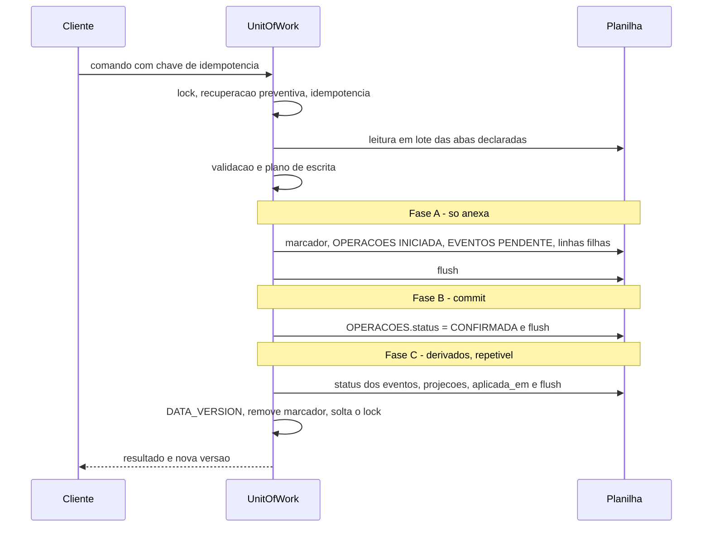

# 06 — Estratégia de persistência e integridade

## Em resumo

- O Google Sheets não tem transação, converte tipos por conta própria e fica a um clique do dono. O desenho compensa com três mecanismos: **gravação em três fases com commit em uma única célula**, **contrato de tipos "valor lido = valor gravado"** e **verificação de integridade que compara o estado atual com a reconstrução pelos eventos**.
- Uma operação só passa a valer quando `OPERACOES.status` muda de `INICIADA` para `CONFIRMADA`. Antes disso, tudo o que foi gravado são linhas anexadas e inertes; depois disso, o que falta é derivado e pode ser refeito quantas vezes for preciso. **A recuperação nunca precisa desfazer nada.**
- A forma de gravar na planilha (Sheets API com valores tipados ou `SpreadsheetApp` com formato de texto) é a primeira decisão do spike (SP-01). O protocolo lógico é o mesmo nas duas.
- O que o desenho **não** garante: isolamento de leitura como num banco relacional (uma consulta pode ter de ser repetida), proteção contra edição manual maliciosa, nem desempenho de banco. Cada limite está escrito na seção 1.

**Documentos relacionados:** `01-arquitetura.md` (camadas e estado em Script Properties), `04-motor-de-eventos.md` (pipeline e linha do tempo), `03a-dicionario-cadastros-suporte.md` (OPERACOES, AUDITORIA, IMPORTACOES), `09-plano-de-testes.md` (testes de queda), `12-fatos-de-plataforma.md` (o que é fato e o que é suposição).

## 1. O problema e o que o desenho garante

| O Sheets não oferece | Consequência sem tratamento | O que o desenho faz | Limite assumido |
|---|---|---|---|
| Transação entre abas | Uma venda de 5 animais pode ficar com 3 baixados | Três fases; commit em uma célula; linhas inertes até a confirmação | Depende de uma gravação de célula única ser tudo ou nada (a confirmar em SP-03) |
| Tipos estáveis | `0012` vira 12; `=A1` vira fórmula; `2026-11-13` vira data | Contrato de tipos, codec único, corpus de ida e volta, normalização na leitura | A primitiva de gravação só é escolhida depois do corpus passar em planilha real (SP-01) |
| Isolamento de leitura | Uma consulta lê metade antes e metade depois de um commit | Leitura otimista validada: confere marcador e versão antes e depois | A consulta pode ser repetida até 3 vezes; depois devolve "sistema ocupado" |
| Chave única e chave estrangeira | Brinco duplicado; evento apontando para animal inexistente | Validação sob lock antes de gravar; verificação de integridade periódica | Edição manual pode violar; é detectada, não impedida |
| Controle de concorrência | Duas gravações se intercalam | Lock de script único para toda escrita | Uma gravação por vez em todo o sistema |
| Tempo de execução | Importação grande morre aos 6 minutos | Lotes pequenos, retomáveis, com commit do arquivo inteiro em uma célula | A importação deixa de ser uma única chamada |

## 2. Primitiva de E/S

A escolha é entre duas formas de falar com a planilha. Não se misturam as duas no mesmo comando.

| Critério | Serviço avançado Sheets (API v4) | `SpreadsheetApp` |
|---|---|---|
| Gravação | `Sheets.Spreadsheets.batchUpdate` com `appendCells` e `updateCells`, valores tipados (`stringValue`, `numberValue`) | `insertRowsAfter` → `setNumberFormats` no bloco exato → `setValues` |
| Coerção de tipos | Não há: `stringValue` é gravado como texto | Depende de formato de texto aplicado antes do valor; comportamento com `=` não confirmado |
| Várias abas em uma chamada | Sim; a documentação diz que, se um pedido é inválido, nada é aplicado | Não; uma chamada por aba |
| Leitura | `Values.batchGet`, várias abas em uma requisição, valores sem formatação | `getValues` por aba; devolve `Date` e `number` conforme a célula |
| Escopo | `spreadsheets` (o mesmo) | `spreadsheets` |
| Risco | Cota de requisições da API; serviço avançado a habilitar no manifesto | Três comportamentos sem fonte (coerção, herança de formato, append em abas aparadas) |

**Decisão:** preferência pela Sheets API, a fechar no SP-01 com três critérios: (1) todo valor do corpus volta idêntico; (2) um `batchUpdate` com um pedido inválido no meio não aplica nada; (3) uma venda de 5 animais grava em tempo aceitável. Se reprovar, usa-se `SpreadsheetApp` com a primitiva única de append e o protocolo de três fases completo.

**Se a atomicidade do `batchUpdate` for confirmada**, um comando simples vira uma única requisição que anexa todas as linhas, já com a operação confirmada, e atualiza as projeções. As fases A, B e C continuam existindo como desenho, mas ocorrem juntas. O caminho de recuperação fica para dois casos: operações de várias requisições (importação) e resposta perdida, que a idempotência resolve.

**Corpus de ida e volta** (spike e testes; o fake de testes reproduz a coerção de uma célula de formato "Geral", para o teste falhar quando o adaptador esquecer o tipo):

`=1+1` · `+55 69 99999-0000` · `-10 kg` · `@lote` · `0012` · `1E5` · `2026-11-13` · `13/11/2026` · `12:30` · `TRUE` · `1.234,56` · `50%` · texto com apóstrofo inicial · texto com espaços nas pontas.

O saneamento de prefixos `= + - @` **não** é aplicado na gravação, porque alteraria dado legítimo (um telefone, um peso negativo de ajuste). Ele fica na exportação CSV e XLSX, onde o leitor é o Excel.

## 3. Codec de tipos

Um único codec no adaptador converte entre o valor de domínio e a célula. Os tipos estão definidos em `03a-dicionario-cadastros-suporte.md`.

| Tipo | Na planilha | Na leitura, se a célula vier diferente |
|---|---|---|
| ID, TEXTO, ENUM | Texto | Número onde se esperava texto é **erro de integridade** (zeros à esquerda já se perderam) |
| DATA | Texto `yyyy-MM-dd` | Chegou como data: reformata no fuso da planilha e registra "célula coercida" |
| TS | Texto ISO-8601 em UTC | Idem |
| INT, DEC1, DEC4 | Número | Texto numérico: converte e registra alerta |
| DINHEIRO | Número com 2 casas (reais) | A lógica trabalha em centavos inteiros; a conversão é feita só no codec |
| BOOL | Texto `S` ou `N` | Booleano nativo: converte e registra alerta |
| JSON | Texto, até 40.000 caracteres | Texto inválido: erro de integridade |
| Vazio | `''` | `''` ↔ `null` em todos os tipos |

Linha sem chave primária é ignorada com alerta. O envelope da API passa por serialização e desserialização JSON antes de sair, para que nenhum objeto de data chegue ao `google.script.run`, que falha com esse tipo.

## 4. `setup()` e migrações

O `setup()` pode ser executado quantas vezes for preciso, sem duplicar nem apagar.

1. Confere o dono e toma o lock.
2. Se já existe banco, faz backup antes de qualquer alteração.
3. Cria o que falta: pastas e planilha-banco pela Drive API; abas na dimensão exata; cabeçalhos.
4. Fixa o fuso e o locale `pt_BR` da planilha.
5. Acrescenta **ao final** as colunas novas de cada aba. Nunca remove, renomeia ou reordena coluna existente; o mapeamento é por nome de cabeçalho.
6. Semeia por chave natural, "insere se ausente": CONFIGURACOES por `chave`; LISTAS por `lista` + `codigo`; PLANO_CONTAS e CATEGORIAS por `codigo`. Nunca sobrescreve valor alterado pelo dono nem recria item que ele desativou.
7. Confere contadores: `event_seq` e `codigo_interno` são o máximo + 1 lido da própria planilha sob lock, nunca um contador externo.
8. Grava SCHEMA_META (versão do esquema e das sementes por aba).
9. Garante os gatilhos: compara os existentes pelo nome da função, cria o que falta, apaga duplicata.
10. Aplica proteção "somente aviso" nas abas.
11. Roda a verificação de integridade e devolve o relatório.

Uma versão publicada antiga continua funcionando sobre o banco migrado, porque a migração só acrescenta.

## 5. UnitOfWork: as três fases

Regra que sustenta tudo: **toda alteração em linha existente é função determinística de linhas anexadas e vigentes.** A fase A só anexa; a fase B troca uma célula; a fase C recalcula.

### 5.1 Análise de queda: comando de evento

"Queda" é a execução morrer sem tratar exceção (por exemplo, pelo limite de 6 minutos). Escritas ainda não descarregadas podem ter chegado em qualquer subconjunto.

| # | A execução morre... | O que ficou gravado | O que um leitor vê antes da recuperação | O que a recuperação faz | Estado final |
|---|---|---|---|---|---|
| 1 | Depois do marcador, antes de qualquer linha | Só o marcador | Nada: a leitura para no marcador e tenta o lock | Não acha operação órfã; remove o marcador e registra em ERROS_LOG | Nada aconteceu. O cliente consulta o estado (INEXISTENTE) e reenvia com a mesma chave |
| 2 | Depois de OPERACOES(INICIADA), antes ou no meio das linhas filhas | Operação INICIADA; evento PENDENTE e filhas em qualquer subconjunto | Nada (marcador) | Operação → FALHOU. Nada a desfazer: as linhas são inertes. Animal criado pela operação fica ANULADO na reconstrução | Evento não aconteceu. Linhas inertes ficam, fora de toda consulta |
| 3 | Com filhas gravadas, mas sem a linha de OPERACOES ou de EVENTOS (buffer parcial) | Filhas sem pai | Nada (marcador) | Não há operação: remove o marcador. Filha cujo evento não existe é inerte por definição | Evento não aconteceu. A verificação de integridade lista as linhas sem pai como alerta |
| 4 | Depois do flush da fase A, antes da fase B | Tudo anexado; operação INICIADA | Nada (marcador) | Igual ao caso 2 | Evento não aconteceu |
| 5 | Durante a gravação da célula de commit | A célula chegou ou não chegou | Nada (marcador) | Relê a célula: se INICIADA, caso 4; se CONFIRMADA, caso 6 | Um dos dois, nunca um meio-termo |
| 6 | Depois de CONFIRMADA, antes ou no meio da fase C | Operação CONFIRMADA sem `aplicada_em`; projeções ausentes ou parciais | Nada (marcador) | Reexecuta a fase C inteira, com reconstrução de **todas** as projeções; grava `aplicada_em` | Evento aconteceu por completo |
| 7 | Depois de `aplicada_em`, antes de incrementar a versão | Tudo aplicado; marcador presente | Nada (marcador) | Nada a refazer; incrementa a versão e remove o marcador | Evento aconteceu; o cliente recarrega |
| 8 | Depois de incrementar a versão, antes de remover o marcador | Tudo aplicado | Nada (marcador) | Remove o marcador; incrementa a versão de novo (inofensivo) | Evento aconteceu |
| 9 | Depois de remover o marcador, antes de soltar o lock | Tudo aplicado | Dados corretos | — | O lock cai com o fim da execução (a confirmar em SP-03) |

Dois pontos merecem atenção. Primeiro, o **caso 5** é a única fronteira em que o desenho depende de um comportamento da plataforma: a gravação de uma célula ser tudo ou nada. Segundo, em nenhum caso a recuperação restaura valor anterior; por isso ela é reentrante e pode morrer no meio sem piorar o estado.

### 5.2 Análise de queda: comando sem evento

Vale para edição de cadastro, baixa de parcela, configuração e cadastro de animal externo. A fase A anexa a operação e as linhas de AUDITORIA, que servem de registro de refazer: entidade, registro, campo, valor anterior e valor novo. A fase C aplica o valor novo nas células.

| A execução morre... | Recuperação | Estado final |
|---|---|---|
| Antes do commit | Operação → FALHOU. As linhas de AUDITORIA ficam inertes (a consulta de auditoria só mostra operações confirmadas) | Nada mudou |
| Depois do commit, antes ou durante a fase C | Reaplica cada valor novo registrado na AUDITORIA da operação | A alteração vale por inteiro |

Aplicar duas vezes o mesmo valor novo dá o mesmo resultado, por isso a fase C pode ser repetida.

### 5.3 Análise de queda: importação

A importação é comandada pelo cliente em lotes de tamanho fixo (`importacao_lote_linhas`, padrão 200). Cada lote é uma operação com N eventos. Os eventos importados **só passam a vigentes quando `IMPORTACOES.status` vira `IMPORTADO`**: o commit do arquivo inteiro é uma célula.

| A execução morre... | O que fica | Como se resolve |
|---|---|---|
| No meio de um lote, antes do commit do lote | Linhas inertes do lote | Lote → FALHOU; o cliente reenvia o mesmo lote (chave `imp:<import_id>:<n>`) |
| Depois do commit de um lote | Lote gravado; importação ainda `IMPORTANDO`; eventos não vigentes | A tela mostra "importação incompleta" com Retomar ou Desfazer |
| Entre lotes (o usuário fecha o navegador) | Importação `IMPORTANDO` | Idem. Enquanto isso, os demais comandos de escrita são recusados |
| Durante `importacao.concluir`, depois do commit | Operação confirmada sem `aplicada_em` | A recuperação conclui: status `IMPORTADO`, status dos eventos e reconstrução total das projeções |

Desfazer é um comando que leva a importação a `CANCELADO`: todos os eventos dela deixam de ser vigentes de uma vez, sem apagar linha. Antes de concluir uma importação, o sistema faz backup.

## 6. Recuperação

A verdade está dentro da planilha: **operação órfã** é uma linha de OPERACOES `INICIADA`, ou `CONFIRMADA` com `aplicada_em` vazio. O marcador em Script Properties é só um atalho para os leitores não precisarem ler OPERACOES a cada chamada.

Algoritmo, usado na abertura de todo comando, em toda leitura que encontra o marcador e em `recoverAll()`:

1. Tentar o lock com `tryLock`. Não existe API para perguntar se outra execução detém o lock; a única sonda é tentar adquiri-lo.
2. Não conseguiu: há escrita em curso. A leitura espera alguns segundos e, se persistir, devolve "sistema ocupado", que o cliente retenta sozinho.
3. Conseguiu: **reler** o marcador e a cauda de OPERACOES, descartando tudo o que já estava em memória. A operação pode ter terminado bem entre a primeira leitura e a obtenção do lock.
4. Para cada órfã, decidir só pelo que foi relido: `INICIADA` → `FALHOU`; `CONFIRMADA` sem `aplicada_em` → refazer a fase C.
5. Incrementar a versão dos dados, remover o marcador, registrar em AUDITORIA e ERROS_LOG, soltar o lock.

Por que "marcador presente e lock livre" não basta como teste: entre ler o marcador e obter o lock, a operação original pode ter concluído; decidir com a leitura antiga marcaria como falha uma operação boa. Por isso a decisão é tomada só depois da releitura, com o lock na mão. Só a UnitOfWork externa adquire e solta o lock; nenhum subcomando faz isso.

`recoverAll()` faz o mesmo sobre a tabela OPERACOES inteira e reconstrói todas as projeções. É usado depois de restaurar um backup e pela verificação semanal.

## 7. Concorrência

Há um usuário, mas várias origens de execução: duas abas, celular e computador, duplo toque, gatilhos.

| Intercalação | O que acontece |
|---|---|
| Dois comandos ao mesmo tempo | O segundo espera o lock (até 25 s). Se não conseguir, recebe "sistema ocupado"; o cliente retenta em 2, 5 e 10 s com a mesma chave |
| Leitura durante uma gravação | Leitura otimista validada: lê marcador e versão, lê as abas, relê marcador e versão. Se mudaram, repete (até 3 vezes). Nunca serve dados com marcador presente |
| Gatilho de backup ou integridade durante uma gravação | O gatilho entra pela UnitOfWork: espera o lock e recupera antes de trabalhar. O backup copia um estado sem operação pela metade |
| Reenvio com a mesma chave enquanto a primeira tentativa ainda roda | O reenvio espera o lock; ao obtê-lo, encontra a operação confirmada com o mesmo conteúdo e devolve o resultado dela, marcado como duplicado |
| Consulta de estado da operação durante a gravação | Responde "em andamento" sem tomar lock; o cliente pergunta de novo |

## 8. Idempotência e duplicidade

A autoridade é OPERACOES: `idempotency_key` mais `payload_hash` (resumo de rota e dados; não inclui os avisos aceitos nem a versão esperada, para que o reenvio com aceite seja a mesma operação). `EVENTOS.idempotency_key` é cópia para rastreio. Há no máximo uma operação confirmada por chave.

| Caso | Resposta |
|---|---|
| Mesma chave, mesmo conteúdo, operação confirmada | Resultado original, reconstruído a partir do evento, com `duplicado: true`. Nada é gravado |
| Mesma chave, conteúdo diferente | Erro `IDEMPOTENCY_MISMATCH`. Nunca "duplicado" |
| Mesma chave, operação anterior falhou | Nova tentativa normal; fica mais uma linha em OPERACOES |
| Chave nova, mesmo tipo, mesma data e cerca de 80% dos mesmos animais | Aviso `POSSIVEL_DUPLICIDADE`, que exige aceite |
| Resposta perdida (rede caiu depois do commit) | O cliente não gera chave nova: consulta `operacao.status` e recebe CONFIRMADA, EM_ANDAMENTO, FALHOU ou INEXISTENTE |

## 9. Verificação de integridade

Roda sob demanda (`sistema.integridade`), no fim do `setup()` e uma vez por semana. Entra pela UnitOfWork, sob lock, depois da recuperação. O resultado aparece na tela de sistema.

| Checagem | Severidade | Correção |
|---|---|---|
| Chaves primárias únicas e preenchidas | Erro | Restaurar backup ou corrigir a linha |
| Brinco único entre os preenchidos | Erro | Evento de identificação ou ajuste |
| Chaves estrangeiras apontam para registro existente e não anulado | Erro | Ajuste; investigar edição manual |
| Cada animal ATIVO tem exatamente uma entrada vigente em aberto | Erro | Estorno ou ajuste |
| Linha do tempo de todos os animais (estado e continuidade de pasto) | Erro | Estornar o evento conflitante |
| Projeção × reconstrução pelos eventos (inclui atributos sensíveis, custo de aquisição e estoque) | Erro, com reparo automático oferecido | Reconstruir projeções |
| `EVENTOS.status` × predicado de vigência | Erro, com reparo | Reconstruir |
| Inventário: soma dos efeitos dos eventos vigentes = contagem de animais ATIVOS, no total e por pasto | Erro | Ver abaixo |
| Soma das alocações ≤ valor do lançamento; igual ao total do rateio; 100% nos lançamentos de compra e venda | Erro | Novo rateio |
| Soma das parcelas = valor do lançamento | Erro | Evento substituto |
| `FINANCEIRO.animal_id` preenchido ⇔ uma única alocação direta | Erro, com reparo | Reconstruir |
| Rateio com base diferente da recalculada hoje | Alerta | Re-ratear, por decisão do dono; nunca recálculo silencioso |
| Cópia × fonte (data do detalhe = data do evento; subtipo = tipo do detalhe) | Erro | Investigar edição manual |
| Células coercidas; texto que virou número | Alerta ou erro | Corrigir a célula; rever a primitiva |
| Operações órfãs; linhas filhas sem evento | Erro ou alerta | Recuperação; limpeza auditada |
| Cabeçalhos × SCHEMA_META; fuso e locale da planilha | Erro | Rodar o `setup()` |
| Animal ativo sem pasto, sem brinco ou sem categoria | Alerta | Pendência visível |

**Coerência entre inventário e movimentações (§16, regra 20).** Para qualquer data D a partir do marco zero:

`ativos(D) = Σ efeito_inventario dos eventos vigentes com event_date ≤ D`

e, para o período de D1 a D2:

`saldo(D2) = saldo(D1) + nascimentos + compras + entradas iniciais e outras entradas − vendas − mortes − descartes − baixas por ajuste`

A checagem confere a primeira igualdade contra a contagem de animais com situação ATIVO, no total e por pasto. Divergência indica projeção desatualizada ou edição manual.

## 10. Backup e restauração

- **Rotina.** Um gatilho diário, de madrugada, executa em ordem: backup (cópia da planilha pela Drive API para `ERP Pecuário/Backups`) e limpeza de exportações e anexos temporários. Retenção: 30 diários e 12 mensais (`backup_retencao_diarios`, `backup_retencao_mensais`).
- **Backups extras.** Sob demanda pelo botão; antes de `setup()` com migração; antes de concluir uma importação.
- **Restauração**, só por comando do sistema (`sistema.restaurarBackup`):
  1. O dono escolhe o backup na tela de sistema.
  2. O sistema copia o backup pela Drive API (a cópia passa a ser um arquivo do aplicativo).
  3. Troca o banco em uso e cria a versão de dados do banco novo acima da última servida.
  4. Roda `recoverAll()`: conclui ou anula operações órfãs e reconstrói as projeções.
  5. Roda a verificação de integridade e mostra o relatório.
  6. O banco anterior não é apagado; fica como arquivo no Drive.
- **Ensaio.** Restaurar um backup numa base de teste faz parte do relatório de testes da Fase 1.
- **O que não está no backup e por que não importa.** As Script Properties não são copiadas, mas nada essencial vive lá: o registro de operações, a idempotência e os contadores estão na planilha. Os arquivos do Drive (fotos, documentos) não são duplicados pelo backup; continuam na pasta de anexos, referenciados por ID.
- **Segunda linha de defesa.** O histórico de versões do próprio Google Sheets.

## 11. Volumetria e limites

Estimativa para 500 animais ativos, em ordem de grandeza. As maiores tabelas, em dez anos:

| Aba | Linhas por ano | Colunas | Células em 10 anos |
|---|---:|---:|---:|
| EVENTO_ANIMAIS | 10.000 | 14 | 1.400.000 |
| SANIDADE | 4.000 | 23 | 920.000 |
| ALOCACOES_FINANCEIRAS | 15.000 | 6 | 900.000 |
| PESAGENS | 3.000 | 8 | 240.000 |
| FINANCEIRO | 800 | 28 | 224.000 |
| OPERACOES | 2.000 | 11 | 220.000 |
| EVENTOS | 600 | 25 | 150.000 |
| RATEIOS | 900 | 15 | 135.000 |
| PARCELAS | 900 | 13 | 117.000 |
| AUDITORIA | 1.000 | 11 | 110.000 |
| REPRODUCAO | 600 | 18 | 108.000 |
| ANIMAIS | 150 novos (2.000 no total) | 39 | 78.000 |
| Demais 22 abas | — | — | cerca de 100.000 |
| **Total** | | | **cerca de 4,7 milhões** |

O limite por planilha usado no planejamento é de 10 milhões de células (há indicação de que passou a 20 milhões em 2026, sem confirmação na fonte). As abas são criadas na dimensão exata, porque célula vazia também conta.

**Orçamento de desempenho**, a aprovar no SP-05: comando com p95 de até 5 s com 10 mil linhas em EVENTO_ANIMAIS e até 15 s com 100 mil. Cada tipo de evento declara as abas que lê, e o comando lê só essas.

**Arquivamento.** Limiar de 60 mil linhas por tabela de fato (`arquivamento_limiar_linhas`). Acima dele, fatos independentes (pesagens, sanidade, alocações) de animais baixados há anos vão para uma planilha de arquivo, por comando auditado. O inventário não é afetado, porque as linhas de movimentação de animais ativos ficam.

## 12. Edição manual da planilha

O dono pode abrir a planilha. O desenho assume que isso vai acontecer.

| O que ele faz | Efeito | Como é tratado |
|---|---|---|
| Lê, filtra, copia para outra planilha | Nenhum | Livre |
| Altera coluna de estado atual (pasto, situação, peso atual) | A tela mostra o valor alterado até a próxima reconstrução | A verificação acusa "projeção × reconstrução"; reconstruir restaura |
| Altera fato (peso de uma pesagem, valor de um lançamento) | O histórico muda sem registro | Não é detectável por comparação; fica o aviso de proteção e o histórico de versões do Sheets. O caminho certo é corrigir pelo sistema |
| Apaga linha, reordena ou renomeia coluna | Chaves quebradas, cabeçalho divergente | Verificação acusa; restaurar backup |
| Acrescenta coluna própria ao final | Nenhum | Colunas desconhecidas são preservadas |

A proteção das abas é "somente aviso": a planilha pergunta antes de aceitar a edição, mas não impede o dono.

## 13. Caminho para um banco relacional

A regra de negócio não conhece a planilha. Trocar de banco é trocar o adaptador.

| Mecanismo neste desenho | Equivalente em SQL |
|---|---|
| Três fases com commit em `OPERACOES.status` | Uma transação: `BEGIN` … `COMMIT` |
| Linhas inertes até a confirmação | Deixam de existir: a transação não confirma linhas parciais |
| Predicado "vigente" calculado na leitura | Visão ou coluna calculada; estorno continua sendo evento |
| Projeções em ANIMAIS recalculadas na fase C | Mesma rotina, dentro da transação; ou visão materializada |
| Verificação de chaves e de tipos | Restrições `PRIMARY KEY`, `FOREIGN KEY`, `UNIQUE`, tipos de coluna |
| Lock de script | Isolamento da transação e bloqueio por linha |
| OPERACOES como registro e idempotência | Continua igual, com índice único na chave |
| Recuperação e leitura otimista | Deixam de ser necessárias |

O que permanece idêntico: o catálogo de eventos, o validador de linha do tempo, o projetor, as regras financeiras e os testes de domínio.
