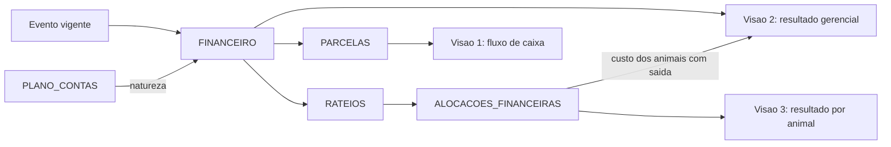

# 07 — Modelo financeiro e dicionário de indicadores

## Em resumo

- **Dois níveis.** FINANCEIRO guarda o fato econômico (conta, competência, valor, vínculos) e é o único alvo de rateio; PARCELAS guarda o título (vencimento, pagamento, juros, desconto). Todo cálculo usa a `natureza` da conta, nunca o `grupo` (DV-02, DV-12).
- **Três visões que não se misturam e que conciliam**: fluxo de caixa (parcelas liquidadas), resultado gerencial por competência (o custo de aquisição só entra quando o animal sai; o insumo, quando é consumido) e resultado por animal (só alocações).
- **Valor por animal tem uma única fonte**, ALOCACOES_FINANCEIRAS, calculada em centavos inteiros pelo maior resto com desempate determinístico. O que não foi rateado aparece como "não alocado"; nunca é distribuído em silêncio (§11.2).
- **Peso vivo e carcaça não se confundem** (§6.3, §11.1): todo R$/@ exibido traz a base de peso e o tipo de rendimento (apurado, negociado ou estimado).
- **Sem dado, sem indicador** (P9): cada indicador declara fórmula, fonte, tipo (POSICAO ou FLUXO), filtros aplicáveis e o motivo com que devolve `null`. Peso estimado, projeção e valor de referência são sempre rotulados.
- Os exemplos foram conferidos por script, em centavos inteiros: é conferência da aritmética do documento, não teste do sistema.

**Documentos relacionados:** `02-modelo-de-dados.md` · `03a-dicionario-cadastros-suporte.md` · `03b-dicionario-eventos-financeiro.md` · `04-motor-de-eventos.md` · `05-regras-de-negocio.md` · `06-persistencia-e-integridade.md` · `08-ux-ui.md` · `09-plano-de-testes.md` (CT-13, CT-14, CT-19) · `10-plano-de-implementacao.md`.

Convenções: valores em R$, lógica em centavos inteiros (P6); "vigente" é o predicado P3 do desenho-base; P = período com os dois limites inclusivos; "em D" = fim do dia D.

## 1. Modelo em dois níveis

### 1.1 Lançamento × título

| | FINANCEIRO (lançamento) | PARCELAS (título) |
|---|---|---|
| Representa | fato econômico: qual conta, qual competência, quanto | compromisso de caixa: quando vence, quando e por quanto foi pago |
| Responde a | resultado gerencial e custo por animal | fluxo de caixa realizado e previsto |
| É alvo de | RATEIOS e ALOCACOES_FINANCEIRAS | baixa (`parcela.baixar`, `parcela.desfazerBaixa`) |
| Mutabilidade | conteúdo imutável; corrige-se por evento substituto | controle: `data_pagamento`, `valor_pago`, `juros_multa`, `desconto`, `forma_pagamento`, `status` |

- Σ `PARCELAS.valor` = `FINANCEIRO.valor`, com as parcelas divididas pelo maior resto. O nominal não muda na baixa: `valor_pago` = `valor` + `juros_multa` − `desconto`. Juros são caixa e resultado do mês do pagamento, nunca custo do animal.
- Lançamento sem parcela é fato sem efeito de caixa (consumo de insumo, saldo de abertura do rebanho): `status_pagamento*` = SEM_CAIXA.
- "Pago", "recebido" e "atrasado" não são gravados (P1): atrasado = parcela ABERTA com `data_vencimento` anterior a hoje. Baixa parcial = desdobrar a parcela em duas, ligadas por `parcela_origem_id`.
- **Por que separar**: a §4.9 põe pagamento no lançamento e a §11.3 exige vencimento e pagamento por título. Com uma linha por parcela, a compra parcelada quebraria a soma das alocações e a competência se espalharia pelos vencimentos.
- Vínculos pedidos na §11: animal (alocações), pasto (`pasture_id`, no máximo um por lançamento), categoria (`categoria_animal_id`), evento (`event_id` criou a linha; `ref_event_id` é o evento de negócio), propriedade (`property_id`) e período (`competencia_inicio`, `competencia_fim`).
- **Competência por período**: lançamento com `competencia_inicio` e `competencia_fim` entra no resultado de cada mês por valor × dias de interseção ÷ dias totais, calculado na leitura e fechado pelo maior resto; nenhuma linha extra é gravada. Arrendamento anual de R$ 24.000,00 (01/01 a 31/12/2027): março = 24.000,00 × 31 ÷ 365 = R$ 2.038,36. Arredondar mês a mês somaria R$ 24.000,02; o maior resto fecha o ano em R$ 24.000,00.

### 1.2 O que cada natureza faz em cada visão

| Natureza | Fluxo de caixa | Resultado gerencial | Resultado por animal |
|---|---|---|---|
| RECEITA_VENDA_ANIMAIS | entra no recebimento da parcela | entra na competência (data da venda) | receita alocada (100%) |
| OUTRA_RECEITA | entra no recebimento | entra na competência | só quando alocada (receita simples do DESCARTE) |
| AQUISICAO_ANIMAIS | sai no pagamento; saldo de abertura não tem parcela | **não entra na compra**; entra como custo dos animais com saída no período | custo de aquisição |
| CUSTEIO | sai no pagamento; consumo de insumo não tem parcela | entra na competência (pro rata), alocado ou não | custeio alocado, por classe de custo |
| DESPESA_VENDA | sai no pagamento; se retida, liquida junto com a receita | entra na competência da venda | despesa de venda alocada (100%) |
| ESTOQUE_INSUMOS | sai no pagamento | não entra (vira CUSTEIO no consumo) | não entra |
| NAO_OPERACIONAL | entra e sai | não entra | não entra |
| Juros, multa e desconto de baixa (colunas de PARCELAS) | dentro de `valor_pago` | linha calculada no mês do pagamento | não entram |

### 1.3 Plano de contas-semente (29 contas)

`grupo` reproduz os blocos A a D da §11 (mais NAO_OPERACIONAL) e só organiza a apresentação. `natureza` decide o cálculo. `classe_custo_animal` separa as colunas da §11.2 (aquisição, sanitário, alimentação, adicionais) sem depender do nome da conta (P8). Grupo e natureza ficam imutáveis depois do primeiro lançamento; para mudar, cria-se outra conta. O "Transporte" da §11-B vira três contas porque o frete tem três papéis: custo de aquisição na compra, despesa de venda e custeio no transporte interno. Com uma conta só, o frete de compra entraria no custeio do mês e de novo no custo do animal.

O código sugerido é texto com prefixo do grupo: um código como "1.10" viraria 1,1 numa célula coercida. Código em negrito = `sistema` S: conta citada pelo `EventCatalog` pelo `codigo`; pode ser renomeada, não desativada.

| Código | Conta | Grupo | Natureza | Tipo | Classe de custo |
|---|---|---|---|---|---|
| **REC-01** | Venda de animais | RECEITA | RECEITA_VENDA_ANIMAIS | RECEITA | NAO_SE_APLICA |
| **REC-02** | Outras receitas operacionais | RECEITA | OUTRA_RECEITA | RECEITA | NAO_SE_APLICA |
| REC-03 | Receitas extraordinárias | RECEITA | OUTRA_RECEITA | RECEITA | NAO_SE_APLICA |
| **DIR-01** | Compra de animais | CUSTO_DIRETO | AQUISICAO_ANIMAIS | DESPESA | AQUISICAO |
| **DIR-02** | Frete e despesas de compra | CUSTO_DIRETO | AQUISICAO_ANIMAIS | DESPESA | AQUISICAO |
| **DIR-03** | Saldo de abertura do rebanho | CUSTO_DIRETO | AQUISICAO_ANIMAIS | DESPESA | AQUISICAO |
| **DIR-04** | Alimentação | CUSTO_DIRETO | CUSTEIO | DESPESA | ALIMENTACAO |
| **DIR-05** | Vacinas | CUSTO_DIRETO | CUSTEIO | DESPESA | SANITARIO |
| **DIR-06** | Medicamentos | CUSTO_DIRETO | CUSTEIO | DESPESA | SANITARIO |
| **DIR-07** | Tratamentos | CUSTO_DIRETO | CUSTEIO | DESPESA | SANITARIO |
| DIR-08 | Transporte interno | CUSTO_DIRETO | CUSTEIO | DESPESA | OUTROS |
| DIR-09 | Reprodução | CUSTO_DIRETO | CUSTEIO | DESPESA | REPRODUCAO |
| **DIR-10** | Frete de venda | CUSTO_DIRETO | DESPESA_VENDA | DESPESA | NAO_SE_APLICA |
| **DIR-11** | Comissão de venda | CUSTO_DIRETO | DESPESA_VENDA | DESPESA | NAO_SE_APLICA |
| **DIR-12** | Taxas e retenções sobre venda | CUSTO_DIRETO | DESPESA_VENDA | DESPESA | NAO_SE_APLICA |
| **DIR-13** | Compra de insumos | CUSTO_DIRETO | ESTOQUE_INSUMOS | DESPESA | NAO_SE_APLICA |
| OPE-01 | Manutenção de pastos | CUSTO_OPERACIONAL | CUSTEIO | DESPESA | ALIMENTACAO |
| OPE-02 | Arrendamento de pasto | CUSTO_OPERACIONAL | CUSTEIO | DESPESA | ALIMENTACAO |
| OPE-03 | Mão de obra | CUSTO_OPERACIONAL | CUSTEIO | DESPESA | OUTROS |
| OPE-04 | Equipamentos | CUSTO_OPERACIONAL | CUSTEIO | DESPESA | OUTROS |
| OPE-05 | Combustível | CUSTO_OPERACIONAL | CUSTEIO | DESPESA | OUTROS |
| OPE-06 | Energia | CUSTO_OPERACIONAL | CUSTEIO | DESPESA | OUTROS |
| OPE-07 | Serviços veterinários | CUSTO_OPERACIONAL | CUSTEIO | DESPESA | SANITARIO |
| ADM-01 | Contabilidade | DESPESA_ADMINISTRATIVA | CUSTEIO | DESPESA | OUTROS |
| ADM-02 | Despesas gerais | DESPESA_ADMINISTRATIVA | CUSTEIO | DESPESA | OUTROS |
| ADM-03 | Outros gastos | DESPESA_ADMINISTRATIVA | CUSTEIO | DESPESA | OUTROS |
| NOP-01 | Aportes | NAO_OPERACIONAL | NAO_OPERACIONAL | RECEITA | NAO_SE_APLICA |
| NOP-02 | Retiradas | NAO_OPERACIONAL | NAO_OPERACIONAL | DESPESA | NAO_SE_APLICA |
| NOP-03 | Empréstimos | NAO_OPERACIONAL | NAO_OPERACIONAL | RECEITA | NAO_SE_APLICA |

- O catálogo fixa a natureza dos lançamentos de evento: COMPRA só aceita contas AQUISICAO_ANIMAIS; deduções de VENDA, só DESPESA_VENDA.
- Consumo de insumo usa a conta pela `PRODUTOS.categoria`: VACINA → DIR-05; VERMIFUGO e MEDICAMENTO → DIR-06; SUPLEMENTO → DIR-04; OUTRO → DIR-07. A receita simples do DESCARTE vai para REC-02.
- Pasto é o alimento do sistema a pasto: manutenção e arrendamento levam classe ALIMENTACAO. Despesas de venda não compõem o custo acumulado (NAO_SE_APLICA): aparecem em coluna própria no resultado do animal.
- `tipo` é da conta e é copiado para o lançamento. "Empréstimos" é a entrada do principal (RECEITA); a amortização pede outra conta NAO_OPERACIONAL, de tipo DESPESA, criada em `conta.salvar`.

## 2. As três visões

### 2.1 Fórmulas

Todas leem só registros vigentes.

**Visão 1: fluxo de caixa realizado em P**

Caixa(P) = Σ `valor_pago` das parcelas LIQUIDADAS de lançamentos de tipo RECEITA com `data_pagamento` em P − Σ `valor_pago` das parcelas LIQUIDADAS de lançamentos de tipo DESPESA com `data_pagamento` em P.

Todas as naturezas entram. Previsto = parcelas ABERTAS por `data_vencimento` (a receber, a pagar, vencidas). Saldo de caixa só existe quando `caixa_saldo_inicial` e `caixa_saldo_inicial_data` estão preenchidos; sem eles a tela mostra líquido e acumulado, e o saldo devolve `null` (DADOS_INSUFICIENTES).

**Visão 2: resultado gerencial de P (competência)**

Resultado(P) = RV + OR − DV − CA − CT − J + DB

- RV = Σ lançamentos RECEITA_VENDA_ANIMAIS com competência em P. Valor = bruto − desconto comercial; competência = `event_date` da venda.
- OR = Σ lançamentos OUTRA_RECEITA com competência em P.
- DV = Σ lançamentos DESPESA_VENDA com competência em P.
- CA = Σ `custo_aquisicao*` dos animais com `data_saida*` em P, em três linhas: vendidos e descartados; mortes; baixas por ajuste.
- CT = Σ lançamentos CUSTEIO na competência P (pro rata da 1.1), alocados ou não.
- J, DB = Σ `juros_multa` e Σ `desconto` das parcelas de despesa liquidadas em P. Nas parcelas de receita o sinal inverte: juros recebidos somam, desconto concedido subtrai.

Não entram: AQUISICAO_ANIMAIS na compra, ESTOQUE_INSUMOS e NAO_OPERACIONAL. É a leitura da §11.3 ("não considerar uma compra como despesa integral de manutenção"): a compra troca caixa por rebanho, e o custo só vira resultado quando o animal sai.

**Visão 3: por animal**

- Custo de aquisição = Σ alocações vigentes de lançamentos AQUISICAO_ANIMAIS.
- Custeio alocado = Σ alocações vigentes de lançamentos CUSTEIO, de qualquer competência.
- Custo acumulado = custo de aquisição + custeio alocado.
- Resultado realizado (só para animal com saída) = receita alocada − despesas de venda alocadas − custo de aquisição − custeio alocado. Animal morto: −(aquisição + custeio).

"Alocação vigente" é um predicado só, numa função só, usada por todos os relatórios: evento vigente, lançamento não cancelado e rateio vigente do lançamento.

A soma dos resultados por animal não é o resultado do período, por construção. A diferença é custeio não alocado, custeio alocado em competência de outro período ou a animal ainda ativo, juros e descontos de baixa, e receitas não alocadas. A tela mostra ao lado "custeio não alocado do período: R$ X".

**Conciliação entre as visões** (teste automatizado CT-19; sem tela no MVP)

Resultado acumulado até D = caixa líquido acumulado até D + a receber em D − a pagar em D + custo de aquisição do rebanho ativo em D + insumos em estoque em D + despesa antecipada em D − saldo de abertura lançado − entradas líquidas não operacionais.

- A receber e a pagar: nominal das parcelas ainda não liquidadas em D, de todas as naturezas.
- Insumos em estoque: saldo contábil = Σ lançamentos ESTOQUE_INSUMOS − Σ lançamentos de consumo.
- Despesa antecipada: parte dos lançamentos CUSTEIO com competência posterior a D. O termo não está na identidade resumida do desenho-base; é exigido pela competência por período. No arrendamento anual da 1.1, pago em 05/01, em 31/03: resultado −5.917,81 = caixa −24.000,00 + despesa antecipada 18.082,19.
- Entradas líquidas não operacionais: Σ lançamentos NAO_OPERACIONAL de tipo RECEITA − Σ de tipo DESPESA.

### 2.2 Caso numérico: uma compra, uma morte, uma venda

Três garrotes, A1, A2 e A3 (códigos internos A-000101 a A-000103).

| Data (2027) | Evento | Fato |
|---|---|---|
| 10/03 | COMPRA por cabeça | A1 R$ 3.000,00, A2 R$ 3.100,00, A3 R$ 2.900,00; duas parcelas de R$ 4.500,00 (09/04 e 09/05); frete de R$ 100,00 à vista, rateado por CABECAS |
| 02/04 | ESTOQUE (ENTRADA) | um frasco de vacina com 10 doses por R$ 30,00 à vista: R$ 3,00 por dose |
| 05/04 | SANIDADE (VACINACAO) | uma dose em cada um dos 3 |
| 24/05 | baixa de parcela | 2ª parcela da compra paga com R$ 45,00 de juros |
| 01/06 e 11/06 | TRANSFERENCIA | A1 e A3 entram no Pasto 2 (arrendado) em 01/06; A2 entra em 11/06 |
| 05/06 | LANCAMENTO_FINANCEIRO + RATEIO | arrendamento do Pasto 2: R$ 600,00, competência 01/06 a 30/06, rateio por DIAS_PERMANENCIA |
| 16/06 | MORTE | A3 |
| 30/06 | LANCAMENTO_FINANCEIRO | contabilidade, R$ 200,00, sem rateio |
| 20/11 | VENDA para abate | A1 e A2 a R$ 320,00 por arroba de carcaça; romaneio de 285,0 kg e 270,0 kg = 555,0 kg ÷ 15 = 37,00 @; bruto de R$ 11.840,00; taxas de R$ 177,60 retidas pelo comprador (valor informado); recebimento em 20/12 |

**Lançamentos, parcelas e alocações**

| # | Conta [natureza] | Valor | Parcelas (nominal, pagamento) | Critério | A1 | A2 | A3 | Não alocado |
|---|---|---|---|---|---|---|---|---|
| F1 | Compra de animais [AQUISICAO_ANIMAIS] | 9.000,00 | 4.500,00 pago em 09/04; 4.500,00 pago em 24/05 com 45,00 de juros (`valor_pago` 4.545,00) | VALOR_INDIVIDUAL | 3.000,00 | 3.100,00 | 2.900,00 | 0,00 |
| F2 | Frete e despesas de compra [AQUISICAO_ANIMAIS] | 100,00 | 100,00 pago em 10/03 | CABECAS | 33,34 | 33,33 | 33,33 | 0,00 |
| F3 | Compra de insumos [ESTOQUE_INSUMOS] | 30,00 | 30,00 pago em 02/04 | não se rateia | — | — | — | — |
| F4 | Vacinas [CUSTEIO], consumo | 9,00 | sem parcela | CABECAS | 3,00 | 3,00 | 3,00 | 0,00 |
| F5 | Arrendamento de pasto [CUSTEIO] | 600,00 | 600,00 pago em 05/06 | DIAS_PERMANENCIA | 276,92 | 184,62 | 138,46 | 0,00 |
| F6 | Contabilidade [CUSTEIO] | 200,00 | 200,00 pago em 30/06 | sem rateio | — | — | — | 200,00 |
| F7 | Venda de animais [RECEITA_VENDA_ANIMAIS] | 11.840,00 | 11.840,00 recebido em 20/12 | PESO_CARCACA | 6.080,00 | 5.760,00 | — | 0,00 |
| F8 | Taxas e retenções sobre venda [DESPESA_VENDA], retida | 177,60 | 177,60 liquidada em 20/12 junto com F7 | PESO_CARCACA | 91,20 | 86,40 | — | 0,00 |

Conferências: F2 e F5 estão abertos nas seções 3.2 e 3.3. Em F7, A1 = 285,0 ÷ 15 = 19 @ × 320,00. Depósito esperado em 20/12 = 11.840,00 − 177,60 = R$ 11.662,40.

**Visão 3: resultado por animal**

| | A1 (vendido) | A2 (vendido) | A3 (morto) | Soma |
|---|---|---|---|---|
| Custo de aquisição (F1 + F2) | 3.033,34 | 3.133,33 | 2.933,33 | 9.100,00 |
| Custeio alocado (F4 + F5) | 279,92 | 187,62 | 141,46 | 609,00 |
| Custo acumulado | 3.313,26 | 3.320,95 | 3.074,79 | 9.709,00 |
| Receita alocada (F7) | 6.080,00 | 5.760,00 | — | 11.840,00 |
| Despesas de venda (F8) | 91,20 | 86,40 | — | 177,60 |
| **Resultado realizado** | **2.675,54** | **2.352,65** | **−3.074,79** | **1.953,40** |

**Visões 1 e 2, mês a mês**

| Mês | Caixa | Resultado | O que explica a diferença |
|---|---|---|---|
| mar | −100,00 | 0,00 | o frete pago é custo de aquisição, não resultado |
| abr | −4.530,00 | −9,00 | caixa: 1ª parcela e frasco de vacina; resultado: só as 3 doses consumidas |
| mai | −4.545,00 | −45,00 | caixa: 2ª parcela com juros; resultado: só os juros |
| jun | −800,00 | −3.733,33 | resultado: custeio de 800,00 + custo de aquisição de A3 (2.933,33) |
| nov | 0,00 | +5.495,73 | 11.840,00 − 177,60 − 6.166,67 (aquisição de A1 e A2); nada recebido ainda |
| dez | +11.662,40 | 0,00 | depósito do frigorífico já líquido da retenção |
| **Acumulado** | **1.687,40** | **1.708,40** | |

Resultado acumulado = 11.840,00 − 177,60 − 6.166,67 − 2.933,33 − 809,00 (custeio) − 45,00 (juros) = R$ 1.708,40. Ponte para a visão 3: 1.953,40 − 200,00 (custeio não alocado) − 45,00 (juros) = 1.708,40.

**Conciliação**

| Termo | 30/06 | 30/11 | 31/12 |
|---|---|---|---|
| Caixa líquido acumulado | −9.975,00 | −9.975,00 | 1.687,40 |
| + A receber | 0,00 | 11.840,00 | 0,00 |
| − A pagar | 0,00 | 177,60 | 0,00 |
| + Custo de aquisição do rebanho ativo | 6.166,67 | 0,00 | 0,00 |
| + Insumos em estoque (7 doses) | 21,00 | 21,00 | 21,00 |
| + Despesa antecipada − abertura − não operacional | 0,00 | 0,00 | 0,00 |
| **= Total** | **−3.787,33** | **1.708,40** | **1.708,40** |
| Resultado gerencial acumulado | −3.787,33 | 1.708,40 | 1.708,40 |

A identidade fecha nas três datas. Os R$ 21,00 que separam caixa e resultado no fim do ano são as 7 doses ainda em estoque.

## 3. Rateio

Rateio é o único caminho de um lançamento até o animal. RATEIOS guarda o método e ALOCACOES_FINANCEIRAS, a conta por animal (`base_valor`, `valor_alocado`): a §11.2 exige exibir o critério.

### 3.1 Critérios

| Critério | `base_valor` do animal | Se faltar a base |
|---|---|---|
| DIRETO | o valor inteiro, de um animal | — |
| VALOR_INDIVIDUAL | `EVENTO_ANIMAIS.valor_individual` | bloqueia |
| CABECAS | 1 por animal no escopo em `data_base` | — |
| PESO_VIVO | última pesagem até `data_base` | bloqueia, ou usa `peso_referencia_kg` como estimado, por escolha explícita |
| PESO_CARCACA | `EVENTO_ANIMAIS.peso_carcaca_kg` | cai para PESO_VIVO ou CABECAS, com aviso |
| DIAS_PERMANENCIA | dias no escopo dentro do período (3.3) | base zero: não alocado |
| MANUAL | valor ou percentual digitado | a soma tem de fechar |

`escopo_tipo`: EVENTO (COMPRA e VENDA, sempre 100%), REBANHO, PASTO, CATEGORIA ou LISTA. Fora de COMPRA e VENDA o rateio pode ser parcial: "não alocado" = valor − Σ alocações.

### 3.2 Maior resto em centavos inteiros

1. V = valor em centavos; bᵢ = base inteira do animal i; B = Σ bᵢ.
2. Quota qᵢ = piso(V × bᵢ ÷ B); resto rᵢ = (V × bᵢ) mod B.
3. Sobram S = V − Σ qᵢ centavos. Os S primeiros recebem 1 centavo cada, na ordem: maior resto → maior base → menor `codigo_interno`.

Percentual é só exibição. A ordem é total: simulação e commit dão o centavo ao mesmo animal.

Exemplo (CT-13): R$ 100,00 entre 3 cabeças. V = 10.000, B = 3: quotas de 3.333, restos de 1/3, S = 1. Restos e bases empatam e decide o código: A-000101 recebe R$ 33,34; os outros, R$ 33,33.

### 3.3 Dias de permanência

- Os intervalos saem de EVENTO_ANIMAIS: abre quando `pasto_destino_id` é o pasto do escopo; fecha quando `pasto_origem_id` é esse pasto ou `efeito_inventario` = −1.
- Convenção [entrada, saída): o dia da entrada conta, o da saída não. Nenhum dia cai em dois pastos, e Σ dias nos pastos = dias no rebanho.
- Base = dias dentro de [`periodo_inicio`, `periodo_fim`], inclusivos. Animal já baixado recebe o custo dos dias em que esteve presente.

Exemplo, o F5 do caso (arrendamento do Pasto 2, R$ 600,00, 01/06 a 30/06/2027): A1 ficou o mês inteiro (30 dias); A2 entrou em 11/06 (20 dias); A3 morreu em 16/06 (15 dias). Base de 65 dias; quotas exatas de 27.692,31, 18.461,54 e 13.846,15 centavos. Os pisos somam 59.999 e o centavo restante vai para A2, o maior resto (35/65): R$ 276,92, 184,62 e 138,46. Custo por animal-dia: 600,00 ÷ 65 = R$ 9,23. Aluguel por cabeça/mês: `quantidade` guarda cabeças × meses; o rateio segue por dias.

### 3.4 `data_base`, base zero e re-rateio

- `data_base` (CABECAS e PESO_VIVO) fixa o dia em que se conta quem está no escopo e qual peso vale; sem ela, o rateio mudaria depois de uma transferência.
- Base zero (pasto vazio): rateio gravado com `total_alocado` = 0 e o motivo na `justificativa`; o valor aparece inteiro como "não alocado".
- Re-rateio = novo evento RATEIO para o mesmo `financial_id`; as linhas antigas não mudam e vale o rateio do último evento vigente. COMPRA e VENDA são re-rateadas sem estorno.
- Base desatualizada: a verificação de integridade recalcula a base dos rateios vigentes e, se diferir, levanta o alerta "rateio desatualizado"; nunca recalcula em silêncio. No caso, a entrada retroativa de A2 em 05/06 mudaria a base de 65 para 71 dias.

## 4. Compra e venda

### 4.1 Modalidade × base de peso

| `modalidade` | `base_peso` | Informado | Derivado | Rateio padrão |
|---|---|---|---|---|
| CABECA | — | valor por animal, ou preço × quantidade | total | VALOR_INDIVIDUAL |
| KG_VIVO | VIVO | peso vivo e R$/kg | valor | PESO_VIVO |
| ARROBA | CARCACA | carcaça do romaneio e R$/@ | arrobas = carcaça ÷ 15; rendimento = carcaça ÷ vivo (APURADO) | PESO_CARCACA |
| ARROBA | VIVO | peso vivo, rendimento e R$/@ | arrobas = vivo × rendimento ÷ 15 (NEGOCIADO ou ESTIMADO) | PESO_VIVO |
| LOTE | — | valor fechado | preços médios | peso, valor individual ou manual (§6.3) |

- **Peso vivo × carcaça** (§6.3, §11.1): `EVENTO_ANIMAIS.peso` é sempre peso vivo; a carcaça fica em `peso_carcaca_kg` e nunca entra em PESAGENS, UA ou GMD. Das três grandezas (vivo, carcaça, rendimento) informam-se duas; a terceira é derivada. A arroba tem 15 kg (`arroba_kg`) nas duas bases; muda o peso que se divide. Todo R$/@ exibido diz "@ de carcaça (apurado)", "@ a x% (negociado)" ou "@ estimada".
- **O valor informado prevalece**: `valor_animais` e `valor_bruto` vêm da nota ou do romaneio; quantidade × preço é conferência, e diferença acima de `fin_tolerancia_conferencia_pct` (1%) gera aviso.
- Venda só com peso do lote não grava PESAGENS; o rateio usa a última pesagem individual escalada (estimado) ou CABECAS, com aviso.

### 4.2 Fórmulas

Calculadas na leitura. "Valor" = `valor_animais` na compra e a receita (bruto − desconto comercial) na venda. Sem o divisor, `null`.

- Preço médio por cabeça = valor ÷ `qtd_animais`.
- Preço médio por kg vivo = valor ÷ peso vivo total.
- Arrobas = carcaça total ÷ 15; ou peso vivo × rendimento ÷ 15, rotulado.
- Preço por arroba = valor ÷ arrobas, com a base ao lado.
- Custo total da compra = `valor_animais` + `frete` + `outros_custos`.
- Resultado da negociação = receita − Σ despesas de venda. Não conhece custo: a margem do animal é a visão 3.
- Depósito esperado = receita − Σ despesas com `retida_pelo_comprador` = S.

A receita é o lançamento RECEITA_VENDA_ANIMAIS e a base do rateio. Cada dedução (tipo em LISTAS, valor informado, sem alíquota codificada) é um lançamento DESPESA_VENDA com parceiro e vencimento próprios, rateado pelo critério da receita. Se retida, sua parcela é liquidada na baixa da receita (encontro de contas): o título segue pelo nominal e o caixa do dia é igual ao depósito. Sem isso, o depósito menor nunca liquidaria a parcela.

### 4.3 Exemplos

**(a) Frigorífico, arroba de carcaça com romaneio** (a venda do caso; CT-14). 555,0 kg ÷ 15 = 37,00 @ × R$ 320,00 = R$ 11.840,00. Pesos vivos de 540,0 e 520,0 kg: rendimento apurado de 555,0 ÷ 1.060,0 = 52,36%; R$ 5.920,00 por cabeça; R$ 11,17 por kg vivo. Resultado da negociação = depósito esperado = R$ 11.662,40. Rateado por peso vivo, A1 receberia R$ 6.031,70 em vez dos R$ 6.080,00 do romaneio: por isso o critério é PESO_CARCACA.

**(b) Reposição por kg vivo.** 10 bezerros, 2.150,0 kg, R$ 12,50/kg: bruto de R$ 26.875,00, R$ 2.687,50 por cabeça. Comissão de R$ 500,00 paga à parte (não retida): resultado da negociação de R$ 26.375,00; depósito esperado de R$ 26.875,00. Em arroba, só como equivalente rotulado: 71,67 "@ estimadas a 50%", a R$ 375,00.

**(c) Compra por arroba com rendimento negociado.** 20 garrotes, 4.800,0 kg vivos, R$ 300,00/@ a 50% (`base_peso` VIVO, `rendimento_tipo` NEGOCIADO): 4.800,0 × 50% ÷ 15 = 160,00 @ e `valor_animais` de R$ 48.000,00. Dividir o peso vivo por 15 daria 320 @ e R$ 96.000,00: é o erro que a base explícita impede. Com frete de R$ 1.500,00, custo total de R$ 49.500,00. Nota de R$ 48.150,00: vale a nota (diferença de 0,31%, dentro da tolerância).

## 5. Insumos: custo no consumo

O insumo entra no resultado quando é aplicado, não quando é comprado (PR-11). Sem a regra, a compra do frasco e a despesa da aplicação contariam o mesmo dinheiro duas vezes.

1. **Compra de produto com `controla_estoque` = S**: o evento ESTOQUE (ENTRADA) grava um lançamento ESTOQUE_INSUMOS (com `product_id`, `quantidade` e parcela) e o movimento de ENTRADA. Caixa no pagamento; nada no resultado nem no animal.
2. **Aplicação de produto em estoque**: SANIDADE grava o movimento de SAIDA e um lançamento de consumo CUSTEIO, sem parcela, = quantidade consumida × custo unitário congelado. Nada no caixa; custeio na data da aplicação; alocação igual por cabeça ou proporcional à dose.
3. **Produto ou serviço pago no ato**: lançamento CUSTEIO com parcela, no próprio evento. Caixa no pagamento; custeio na competência; alocação aos animais do evento.

Exemplo: frasco de 50 doses por R$ 90,00 (R$ 1,80 por dose) e vacinação de 30 animais. Casos 1 e 2: caixa −90,00; resultado −54,00; 20 doses (R$ 36,00) em estoque; R$ 1,80 por animal. Caso 3 (frasco lançado direto na vacinação, sobra descartada): caixa e resultado −90,00; R$ 3,00 por animal.

## 6. Custo por animal (§11.2)

Colunas do relatório 14, lidas das alocações vigentes pela `classe_custo_animal` da conta:

- custo de aquisição (AQUISICAO; = `ANIMAIS.custo_aquisicao*`);
- custos sanitários (SANITARIO), de alimentação (ALIMENTACAO, inclui manutenção e arrendamento de pasto) e adicionais atribuídos (REPRODUCAO e OUTROS);
- custo acumulado = soma das quatro; custo diário = custeio alocado ÷ dias no rebanho;
- receita, despesas de venda e resultado realizado (visão 3), só com saída; margem por arroba = resultado ÷ arrobas do animal na venda (`null` sem peso de venda).

No caso da 2.2, A1 ficou 255 dias: custo diário de R$ 1,10 e margem de R$ 140,82 por @ de carcaça.

- **Nascidos**: custo de aquisição de R$ 0,00 por definição (`custo_aquisicao_origem` = NAO_SE_APLICA), exibido como "nascido na fazenda".
- **Rebanho de abertura**: valor de abertura opcional na ENTRADA_INICIAL, por animal (ABERTURA_INFORMADA) ou em massa pela TABELA_PRECOS de D0 (ABERTURA_ESTIMADA). Gera lançamento AQUISICAO_ANIMAIS na conta DIR-03, sem parcela, com alocação por animal.
- **Sem valor de abertura**: custo nulo (DESCONHECIDO), nunca zero; o resultado sai rotulado "parcial: N cabeças baixadas sem custo de aquisição". Exemplo: venda de 40 bois de abertura por R$ 192.000,00 e custeio do mês de R$ 12.000,00. Sem abertura: R$ 180.000,00, parcial. Com abertura de R$ 3.800,00 por cabeça (R$ 152.000,00): R$ 28.000,00.

## 7. Patrimônio (§11.4)

Valor do animal em D, pelo primeiro que existir:

1. valor manual: TABELA_PRECOS de escopo ANIMAL, vigente em D e com até `patrimonio_valor_manual_validade_dias` (180); vencido, cai para o passo 2, com aviso;
2. preço da categoria do animal em D (escopo CATEGORIA);
3. linha geral (escopo GERAL);
4. sem referência: fica fora da soma e é contado (SEM_VALOR_DE_REFERENCIA).

**Peso vigente em D**, o mesmo de UA e peso médio: última pesagem até D com no máximo `peso_validade_dias` (180). Vencida: o maior entre o último peso e o `peso_referencia_kg` da categoria, rotulado como estimado. Sem ambos: sem peso. Peso projetado por GMD não entra (P10).

- CABECA: valor.
- KG_VIVO: peso vigente × R$/kg. Novilho com 210,0 kg em 10/01/2027: em 31/10 (294 dias, vencida) vale a referência de 330,0 kg, estimada, × R$ 11,00 = R$ 3.630,00; pelo peso vencido seriam R$ 2.310,00.
- ARROBA: peso vigente × `rendimento_carcaca_pct` ÷ 15 × R$/@. Boi de 540,0 kg a 52%: 18,72 @ × R$ 320,00 = R$ 5.990,40.

- **Cobertura ao lado do total**: "412 de 430 cabeças valoradas (95,8%): 35 por valor manual, 377 pela tabela; 61 com peso estimado; 18 sem valor de referência". Nenhuma média é extrapolada para as 18.
- **Três rótulos, nunca somados**: *estimado* (a hierarquia acima); *custo* (Σ `custo_aquisicao*` do rebanho ativo, o termo da conciliação); *negociado* (vendas vigentes do período).
- **Série histórica** sem tabela de snapshots (DV-10): cada ponto = inventário em D por replay × preço vigente em D. Evento retroativo corrige a série sozinho; mudar o preço de hoje não altera o passado, porque a vigência antiga continua na tabela.
- Valor por categoria e por pasto = a mesma soma, agrupada pelo atributo do animal em D.

## 8. Indicadores zootécnicos

Contrato único (P9): `{valor, motivo, n}`. Sem outro motivo indicado, o `null` é DADOS_INSUFICIENTES; data anterior a D0 devolve ANTERIOR_AO_MARCO_ZERO.

### 8.1 Peso e desempenho (§8)

Fonte: PESAGENS (`peso_kg`, `data_pesagem`, `metodo`, `tipo`); o GMD por pasto usa também EVENTO_ANIMAIS.

| Indicador | Fórmula | `null` quando |
|---|---|---|
| Peso atual, ao nascer, à desmama | última pesagem; pesagem de `tipo` NASCIMENTO; de `tipo` DESMAMA | não pesado |
| Ganho absoluto, dias, variação % | P2 − P1; D2 − D1; (P2 ÷ P1 − 1) × 100; ganho acumulado = última − primeira | menos de 2 pesagens individuais |
| GMD individual (kg/dia) | (P2 − P1) ÷ (D2 − D1), só `metodo` BALANCA (FITA se `gmd_aceita_fita`) | intervalo menor que `gmd_intervalo_min_dias` (28) |
| GMD de lote | (média 2 − média 1) ÷ dias, só com os animais presentes nas duas pesagens | n abaixo de `indicador_n_minimo` (5) |
| GMD por pasto | Σ ganho atribuído ao pasto ÷ Σ dias no pasto; o ganho de cada intervalo é dividido na proporção dos dias em cada pasto | n abaixo de 5 |
| Peso médio por categoria ou pasto | Σ peso vigente ÷ cabeças com peso, com "x% estimado" | nenhuma cabeça com peso |
| Projeção de peso | último peso + GMD de referência × dias; GMD de referência = da primeira à última pesagem válida dos últimos `gmd_referencia_janela_dias` (120) | sem GMD de referência; data além de `projecao_peso_horizonte_dias` (90) |

Exemplos: 300,0 kg em 01/03 e 345,0 kg em 30/04/2027 dão 60 dias, ganho de 45,0 kg, GMD de 0,750 kg/dia e variação de 15,0%. Lote de 20 cabeças com 6.840 kg em 03/05 e 7.600 kg em 02/07: (380,0 − 342,0) ÷ 60 = 0,633 kg/dia.

Limites: GMD fora de −1,0 a 2,0 kg/dia (`gmd_plausivel_*`) gera o aviso PESO_IMPLAUSIVEL, sem bloquear. Linhas MEDIA_LOTE e ESTIMATIVA_VISUAL servem a UA e peso vivo total, nunca ao GMD individual. A projeção é linear, de horizonte curto, não distingue águas de seca, nunca vira pesagem e sai rotulada no gráfico.

### 8.2 Lotação (§7)

Fonte: inventário em D por replay, peso vigente (seção 7) e PASTOS.

- Peso vivo total = Σ peso vigente dos animais no pasto em D; UA = peso vivo total ÷ `ua_peso_kg` (450). `null` sem cabeça com peso.
- UA/ha = UA ÷ `area_hectares`. `null` sem área.
- Ocupação % = UA/ha ÷ `capacidade_estimada_ua_ha`; sem ela, cabeças ÷ `capacidade_estimada_cabecas`. `null` sem capacidade informada: ela nunca é deduzida da área (§7.1).

Exemplo: 50 cabeças e 19.800 kg dão 44,0 UA; em 40 ha, 1,10 UA/ha; com capacidade de 1,2 UA/ha, ocupação de 91,7%. O painel separa a UA em pesada, "pesagem vencida" e "sem pesagem"; cabeça sem peso algum fica fora da UA e é contada.

### 8.3 Reprodução (§9)

Por estação de monta E; fontes: REPRODUCAO, ESTACOES_MONTA, ANIMAIS, BAIXAS. Exposta em E = fêmea com EXPOSICAO, COBERTURA ou INSEMINACAO vinculada a E. O parto pertence à exposição mais recente da matriz cuja janela [início + `dias_gestacao` − `parto_tolerancia_dias`, fim + `dias_gestacao` + `parto_tolerancia_dias`] (290 e 20 dias) contém a data do parto. Todo indicador mostra numerador, denominador e n; denominador abaixo de `indicador_n_minimo` (5) devolve `null`.

| Indicador | Numerador | Denominador e janela | Rótulo quando parcial |
|---|---|---|---|
| Matrizes ativas | fêmeas ATIVAS aptas (idade ≥ `idade_min_reprodutiva_meses` ou partos ≥ 1) sem marca de descarte | contagem em D | — |
| Matrizes prenhas | matrizes ativas com `situacao_reprodutiva*` PRENHA | contagem em D | "N sem informação" |
| Taxa de prenhez | prenhas no último DG de E | expostas em E | cobertura do DG abaixo de `prenhez_cobertura_dg_min_pct` (90): "prenhez entre diagnosticadas" |
| Taxa de parição | expostas que pariram | expostas em E | "parcial" com prenha sem desfecho |
| Taxa de natalidade | nascidos vivos desses partos | expostas em E | idem; sem estação: "natalidade anual" = nascidos vivos no ano ÷ matrizes ativas no início do ano |
| Perda gestacional | prenhas no DG − paridas | prenhas no DG de E | idem |
| Taxa de desmama | desmamados | expostas em E | "parcial" com cria ao pé |
| Bezerros por matriz (ficha) | crias nascidas vivas e desmamadas | contagem na vida da matriz | — |
| IEP (dias) | Σ intervalos entre partos consecutivos encerrados em P | nº de intervalos em P | — |
| Mortalidade de bezerros | mortos + baixados por divergência antes da desmama (sem DESMAMA, corte em `idade_desmama_padrao_meses`) | nascidos vivos da safra | "parcial" com bezerro em risco; vendidos ao pé à parte |

Exemplo: 80 expostas, 76 diagnosticadas (cobertura de 95,0%), 64 prenhas, 60 paridas, 61 nascidos vivos (um parto gemelar), 4 mortos, 1 vendido ao pé e 56 desmamados. Prenhez de 80,0% (84,2% entre diagnosticadas); parição 75,0%; natalidade 76,3%; perda gestacional 6,3%; desmama 70,0%; mortalidade até a desmama 6,6%. Parto com zero vivos conta para parição e IEP; gemelar é um parto. Matriz sem histórico reprodutivo = matriz ativa sem linha em REPRODUCAO, em lista própria.

### 8.4 Sanidade e mortalidade (§10)

- Cobertura de protocolo = elegíveis com aplicação em dia ÷ elegíveis pelo sexo, idade e categoria do protocolo (PROTOCOLOS_SANITARIOS, SANIDADE); `null` sem elegíveis. Exemplo: 188 de 200 = 94,0%.
- Pendências vencidas e próximas = contagem por (animal, protocolo) ou (animal, produto), com `agenda_antecedencia_dias` e `agenda_tolerancia_dias`; animais em carência = ativos com `data_fim_carencia` ≥ hoje. Zero é informação.
- Custo sanitário de P = Σ lançamentos de contas de classe SANITARIO com competência em P, alocado × não alocado.
- Mortalidade de P = mortes em P ÷ (cabeças no início de P + entradas em P), de BAIXAS e EVENTO_ANIMAIS; `null` se P começa antes de D0. Exemplo: 6 ÷ (430 + 52) = 1,24%. Baixa por DIVERGENCIA_CONTAGEM é causa própria.

## 9. Matriz do dashboard (§12)

`dashboard.obter(filtros)` devolve todos os itens e `geradoEm` (data de atualização). Filtros: Di e Df (datas), Pr (propriedade), Pa (pasto), S (sexo), C (categoria). Tipo: P = POSICAO (estado ao fim de Df), F = FLUXO (soma de Di a Df), m = série mensal. Pasto e categoria do animal são os da data: Df na posição; a data do evento no fluxo (pasto de destino na entrada, de origem na saída). Filtro não aplicável, entre parênteses na tabela:

- **E**: o filtro é ignorado e o item mostra uma etiqueta ("posição em Df", "todos os pastos");
- **A**: o valor passa a ser só a parte alocada a animais do filtro, pelos atributos na data de competência, com "não atribuída: R$ X" ao lado; o filtro Pa soma também os lançamentos com `pasture_id`;
- **N**: `null` com FILTRO_NAO_APLICAVEL.

Df anterior a D0 devolve `null` em todos; período que começa antes de D0 conta os fluxos de D0 em diante, com etiqueta. A fonte passa a existir na Fase 1 (itens 1 a 3, 15, 16, G2 a G4), 2 (4 a 10, 12, G1, G6, G7), 3 (G5) ou 4 (11, 13, 14, G8, G9); o dashboard completo é da Fase 5.

| Item (tipo) | Definição e fonte | Filtros (não aplicável) |
|---|---|---|
| 1 Total de cabeças (P) | Σ `efeito_inventario` de EVENTO_ANIMAIS até Df | Df,Pr,Pa,S,C (Di:E) |
| 2 Machos (P) | item 1, sexo M | Df,Pr,Pa,C (Di,S:E) |
| 3 Fêmeas (P) | item 1, sexo F | Df,Pr,Pa,C (Di,S:E) |
| 4 Nascimentos (F) | nascidos vivos (NASCIMENTO) | todos |
| 5 Compras (F) | cabeças e valor (COMPRA) | todos |
| 6 Vendas (F) | cabeças e valor (VENDA) | todos |
| 7 Mortes (F) | cabeças (MORTE); baixas por divergência à parte | todos |
| 8 Total de UA (P) | 8.2, com % estimado | Df,Pr,Pa,S,C (Di:E) |
| 9 Peso médio (P) | Σ peso vigente ÷ cabeças com peso | Df,Pr,Pa,S,C (Di:E) |
| 10 Peso vivo total (P) | Σ peso vigente | Df,Pr,Pa,S,C (Di:E) |
| 11 Valor estimado do rebanho (P) | seção 7, com cobertura (TABELA_PRECOS) | Df,Pr,Pa,S,C (Di:E) |
| 12 Receita de vendas (F) | Σ FINANCEIRO de natureza RECEITA_VENDA_ANIMAIS, por competência | Di,Df,Pr (Pa,S,C:A) |
| 13 Custos operacionais (F) | Σ CUSTEIO (pro rata) + DESPESA_VENDA, por grupo; aquisição nunca entra | Di,Df,Pr (Pa,S,C:A) |
| 14 Resultado financeiro (F) | resultado gerencial (2.1) e caixa líquido ao lado; rótulo "parcial" da seção 6 | Di,Df,Pr (Pa,S,C:A no resultado, N no caixa) |
| 15 Distribuição por pasto (P) | cabeças e UA por pasto | Df,Pr,S,C (Di,Pa:E) |
| 16 Distribuição por categoria (P) | cabeças por categoria em Df (CATEGORIAS) | Df,Pr,Pa,S (Di,C:E) |
| G1 Evolução do rebanho (Pm) | item 1 no fim de cada mês | todos (mês anterior a D0: `null`) |
| G2 Distribuição por sexo (P) | itens 2 e 3 | Df,Pr,Pa,C (Di,S:E) |
| G3 Distribuição por categoria (P) | item 16 | Df,Pr,Pa,S (Di,C:E) |
| G4 Animais por pasto (P) | item 15 | Df,Pr,S,C (Di,Pa:E) |
| G5 Evolução do peso (Fm) | média das pesagens individuais do mês, com n (PESAGENS); projeção nunca entra | todos (mês com n abaixo de 5: `null`) |
| G6 Nascimentos e mortes (Fm) | itens 4 e 7 | todos |
| G7 Compras e vendas (Fm) | itens 5 e 6 | todos |
| G8 Receitas e custos (Fm) | receitas (venda + outras) e item 13, por competência | Di,Df,Pr (Pa,S,C:A) |
| G9 Valor estimado do rebanho (Pm) | item 11 no fim de cada mês, por replay × preço vigente na data | todos (mês sem preço vigente: SEM_VALOR_DE_REFERENCIA) |

Nos fluxos, zero é informação; ausência de dado é `null`. Histórico e projeção nunca dividem a mesma série.

## 10. Relatórios (§13)

Os 17 saem do `ReportCatalog` por `relatorio.obter` e são entregues na Fase 5. A fonte existe desde a Fase 1 (relatórios 1 e 4), 2 (2, 3, 5, 6, 7 e 13), 3 (8 a 12) ou 4 (14 a 17). Formatos de todos: CSV e XLSX; PDF a confirmar no spike (SP-07); mecânica em `08-ux-ui.md`. Filtros: P (período), D (data de posição), Pr, Pa, S, C, An (animal), Pc (parceiro).

| Relatório | Fonte | Filtros | Colunas principais | Totais |
|---|---|---|---|---|
| 1 Inventário atual | inventário em D | D,Pr,Pa,S,C | código, brinco, sexo, categoria, idade, pasto, peso vigente e data | cabeças, peso, UA |
| 2 Inventário por pasto | idem, agrupado | D,Pr | pasto, área, cabeças M e F, peso, UA, UA/ha, ocupação | por propriedade |
| 3 Histórico de movimentações | EVENTOS, EVENTO_ANIMAIS | P,Pr,Pa,An | data, tipo, animal, origem, destino, efeito | entradas, saídas, saldo |
| 4 Histórico individual | linha do tempo do animal | An | data, evento, detalhe, peso, valor | custo acumulado |
| 5 Nascimentos | NASCIMENTO, REPRODUCAO | P,Pr,Pa,S | data, cria, sexo, mãe, pai, peso, natimortos | partos, nascidos vivos |
| 6 Compras | COMPRAS, FINANCEIRO | P,Pr,Pc | data, fornecedor, cabeças, peso, modalidade e base, valor, frete, preços médios | valor, custo total |
| 7 Vendas | VENDAS, FINANCEIRO | P,Pr,Pc | data, comprador, cabeças, peso vivo, carcaça, rendimento e tipo, bruto, deduções, R$/@ com base | receita, deduções |
| 8 Pesagens | PESAGENS | P,Pr,Pa,S,C,An | data, animal, peso, método, ganho, dias, GMD | n, peso médio |
| 9 Desempenho por categoria | 8.1 | P,Pr,Pa,S | categoria, n, peso médio inicial e final, GMD | geral |
| 10 Desempenho por pasto | 8.1 | P,Pr,S,C | pasto, n, dias-animal, ganho atribuído, GMD | geral |
| 11 Histórico sanitário | SANIDADE | P,Pr,Pa,C,An | data, animal, procedimento, produto, lote, dose, fim da carência, custo | aplicações, custo |
| 12 Reprodução | 8.3 | E ou P, Pr | matriz, exposição, DG, parto, crias, desmama, IEP | indicadores da 8.3 |
| 13 Mortalidade | BAIXAS | P,Pr,Pa,S,C | data, animal, categoria, causa, pasto, custo acumulado | mortes por causa, taxa de P |
| 14 Custos por animal | alocações (seção 6) | P,Pr,Pa,S,C | colunas da seção 6 e o critério de cada alocação | por coluna; custeio não alocado de P |
| 15 Custos por pasto | FINANCEIRO com `pasture_id`, alocações | P,Pr | pasto, posse (próprio × arrendado), conta, valor, R$/ha, R$/animal-dia, alocado × não alocado | por posse |
| 16 Fluxo financeiro | PARCELAS | P,Pr | mês, recebido, pago, a receber, a pagar, vencidos, líquido, acumulado, saldo (só com saldo inicial) | período |
| 17 Patrimônio pecuário | seção 7 | D,Pr,Pa,S,C | categoria ou pasto, cabeças, peso, estimado, cobertura, custo, negociado | total com cobertura |

No 15, R$/ha = custo ÷ `area_hectares` e R$/animal-dia = custo ÷ animais-dia do período (3.3).

## 11. Fora do MVP × estrutural

Ficam fora do MVP sem alterar os números: baixa parcial automática (o desdobramento da parcela cobre); contas bancárias e conciliação bancária (caixa único); custo médio ponderado ou PEPS (vale o custo unitário congelado no consumo); rateio por UA-dia e recorrente (dias de permanência e re-rateio cobrem); depreciação e custo da matriz no bezerro (nascido tem custo 0,00 declarado); tela da ponte de conciliação, orçado × realizado e reversões de fechamento (a conciliação roda como teste, CT-19; o passado é reapresentado sob `fin_bloqueio_ate`); peso ajustado à desmama e entidade LOTES.

Estrutural, porque mudar depois exigiria reescrever fatos confirmados (P11): lançamento × parcela; cálculo por natureza; razão único de alocações com predicado de vigência; valor de abertura e `custo_aquisicao_origem`; competência por período; `base_peso`, `rendimento_tipo` e `peso_carcaca_kg`; `retida_pelo_comprador`; `classe_custo_animal`; TABELA_PRECOS com vigência.
