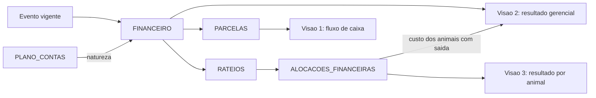

# 07 — Modelo financeiro e dicionário de indicadores

## Em resumo

- **Dois níveis.** FINANCEIRO guarda o fato econômico (conta, competência, valor, vínculos) e é o único alvo de rateio; PARCELAS guarda o título (vencimento, pagamento, juros, desconto). Todo cálculo usa a `natureza` da conta, nunca o `grupo` (DV-02, DV-12).
- **Três visões que não se misturam e que conciliam**: fluxo de caixa (parcelas liquidadas), resultado gerencial por competência (o custo de aquisição só entra quando o animal sai; o insumo, quando é consumido) e resultado por animal (só alocações). Um caso numérico percorre as três e fecha a identidade de conciliação em três datas.
- **Valor por animal tem uma única fonte**, ALOCACOES_FINANCEIRAS, calculada em centavos inteiros pelo maior resto com desempate determinístico. O que não foi rateado aparece como "não alocado"; nunca é distribuído em silêncio (§11.2).
- **Peso vivo e carcaça não se confundem** (§6.3, §11.1): todo R$/@ exibido traz a base de peso e o tipo de rendimento (apurado, negociado ou estimado).
- **Sem dado, sem indicador** (P9): cada indicador declara fórmula, fonte, tipo (POSICAO ou FLUXO), filtros aplicáveis e o motivo com que devolve `null`. Peso estimado, projeção e valor de referência são sempre rotulados.
- Os exemplos foram recalculados por script em centavos inteiros, com a mesma regra de maior resto da seção 3. É conferência da aritmética do documento, não teste do sistema: a Fase 0 é desenho.

**Documentos relacionados:** `02-modelo-de-dados.md` (DER e fontes × cópias) · `03a-dicionario-cadastros-suporte.md` (PLANO_CONTAS, TABELA_PRECOS, CONFIGURACOES) · `03b-dicionario-eventos-financeiro.md` (colunas de COMPRAS, VENDAS, FINANCEIRO, PARCELAS, RATEIOS, ALOCACOES_FINANCEIRAS) · `04-motor-de-eventos.md` · `05-regras-de-negocio.md` · `06-persistencia-e-integridade.md` · `08-ux-ui.md` · `09-plano-de-testes.md` (CT-13, CT-14, CT-19) · `10-plano-de-implementacao.md` · `11-riscos-e-premissas.md`.

Convenções: valores em R$ com duas casas, lógica em centavos inteiros (P6). "Vigente" é o predicado do desenho-base (evento de operação confirmada, não estornado, de importação concluída). P = período com os dois limites inclusivos; "em D" = fim do dia D.

## 1. Modelo em dois níveis

### 1.1 Lançamento × título

| | FINANCEIRO (lançamento) | PARCELAS (título) |
|---|---|---|
| Representa | fato econômico: qual conta, qual competência, quanto | compromisso de caixa: quando vence, quando e por quanto foi pago |
| Responde a | resultado gerencial e custo por animal | fluxo de caixa realizado e previsto |
| É alvo de | RATEIOS e ALOCACOES_FINANCEIRAS | baixa (`parcela.baixar`, `parcela.desfazerBaixa`) |
| Mutabilidade | conteúdo imutável; corrige-se por evento substituto | controle: `data_pagamento`, `valor_pago`, `juros_multa`, `desconto`, `forma_pagamento`, `status` |

- Σ `PARCELAS.valor` = `FINANCEIRO.valor`, com as parcelas divididas pelo maior resto. O nominal não muda na baixa: `valor_pago` = `valor` + `juros_multa` − `desconto`. Juros são caixa e resultado do mês do pagamento, nunca custo do animal.
- Lançamento sem parcela é fato sem efeito de caixa (consumo de insumo, saldo de abertura do rebanho): `status_pagamento*` = SEM_CAIXA.
- "Pago", "recebido" e "atrasado" não são gravados (P1): atrasado = parcela ABERTA com `data_vencimento` anterior a hoje. Baixa parcial = desdobrar a parcela em duas, ligadas por `parcela_origem_id`.
- **Por que separar**: a §4.9 põe pagamento no lançamento e a §11.3 exige vencimento e pagamento por título. Com uma linha por parcela, a compra parcelada quebraria a soma das alocações e a competência se espalharia pelos vencimentos.
- Vínculos pedidos na §11: animal (alocações), pasto (`pasture_id`, no máximo um por lançamento), categoria (`categoria_animal_id`), evento (`event_id` criou a linha; `ref_event_id` é o evento de negócio), propriedade (`property_id`) e período (`competencia_inicio`, `competencia_fim`).
- **Competência por período**: lançamento com `competencia_inicio` e `competencia_fim` entra no resultado de cada mês por valor × dias de interseção ÷ dias totais, calculado na leitura e fechado pelo maior resto; nenhuma linha extra é gravada. Arrendamento anual de R$ 24.000,00 (01/01 a 31/12/2027): março = 24.000,00 × 31 ÷ 365 = R$ 2.038,36. Arredondar mês a mês somaria R$ 24.000,02; pelo maior resto, fevereiro fica com R$ 1.841,09, dezembro com R$ 2.038,35 e o ano fecha em R$ 24.000,00.

### 1.2 O que cada natureza faz em cada visão

| Natureza | Fluxo de caixa | Resultado gerencial | Resultado por animal |
|---|---|---|---|
| RECEITA_VENDA_ANIMAIS | entra no recebimento da parcela | entra na competência (data da venda) | receita alocada (100%) |
| OUTRA_RECEITA | entra no recebimento | entra na competência | só quando alocada (receita simples do DESCARTE) |
| AQUISICAO_ANIMAIS | sai no pagamento; saldo de abertura não tem parcela | **não entra na compra**; entra como custo dos animais com saída no período | custo de aquisição |
| CUSTEIO | sai no pagamento; consumo de insumo não tem parcela | entra na competência (pro rata), alocado ou não | custeio alocado, por classe de custo |
| DESPESA_VENDA | sai no pagamento; se retida, liquida junto com a receita | entra na competência da venda | despesa de venda alocada (100%) |
| ESTOQUE_INSUMOS | sai no pagamento | não entra (vira CUSTEIO no consumo) | não entra |
| NAO_OPERACIONAL | entra e sai | não entra | não entra |
| Juros, multa e desconto de baixa (colunas de PARCELAS) | dentro de `valor_pago` | linha calculada no mês do pagamento | não entram |

### 1.3 Plano de contas-semente (29 contas)

`grupo` reproduz os blocos A a D da §11 (mais NAO_OPERACIONAL) e só organiza a apresentação. `natureza` decide o cálculo. `classe_custo_animal` separa as colunas da §11.2 (aquisição, sanitário, alimentação, adicionais) sem depender do nome da conta (P8). Grupo e natureza ficam imutáveis depois do primeiro lançamento; para mudar, cria-se outra conta. O "Transporte" da §11-B vira três contas porque o frete tem três papéis: custo de aquisição na compra, despesa de venda e custeio no transporte interno. Com uma conta só, o frete de compra entraria no custeio do mês e de novo no custo do animal.

O código sugerido é texto com prefixo do grupo: um código como "1.10" viraria 1,1 numa célula coercida. `sistema = S` marca a conta citada pelo `EventCatalog` pelo `codigo`; ela pode ser renomeada, não desativada.

| Código | Conta | Grupo | Natureza | Tipo | Classe de custo | Sistema |
|---|---|---|---|---|---|---|
| REC-01 | Venda de animais | RECEITA | RECEITA_VENDA_ANIMAIS | RECEITA | NAO_SE_APLICA | S |
| REC-02 | Outras receitas operacionais | RECEITA | OUTRA_RECEITA | RECEITA | NAO_SE_APLICA | S |
| REC-03 | Receitas extraordinárias | RECEITA | OUTRA_RECEITA | RECEITA | NAO_SE_APLICA | N |
| DIR-01 | Compra de animais | CUSTO_DIRETO | AQUISICAO_ANIMAIS | DESPESA | AQUISICAO | S |
| DIR-02 | Frete e despesas de compra | CUSTO_DIRETO | AQUISICAO_ANIMAIS | DESPESA | AQUISICAO | S |
| DIR-03 | Saldo de abertura do rebanho | CUSTO_DIRETO | AQUISICAO_ANIMAIS | DESPESA | AQUISICAO | S |
| DIR-04 | Alimentação | CUSTO_DIRETO | CUSTEIO | DESPESA | ALIMENTACAO | S |
| DIR-05 | Vacinas | CUSTO_DIRETO | CUSTEIO | DESPESA | SANITARIO | S |
| DIR-06 | Medicamentos | CUSTO_DIRETO | CUSTEIO | DESPESA | SANITARIO | S |
| DIR-07 | Tratamentos | CUSTO_DIRETO | CUSTEIO | DESPESA | SANITARIO | S |
| DIR-08 | Transporte interno | CUSTO_DIRETO | CUSTEIO | DESPESA | OUTROS | N |
| DIR-09 | Reprodução | CUSTO_DIRETO | CUSTEIO | DESPESA | REPRODUCAO | N |
| DIR-10 | Frete de venda | CUSTO_DIRETO | DESPESA_VENDA | DESPESA | NAO_SE_APLICA | S |
| DIR-11 | Comissão de venda | CUSTO_DIRETO | DESPESA_VENDA | DESPESA | NAO_SE_APLICA | S |
| DIR-12 | Taxas e retenções sobre venda | CUSTO_DIRETO | DESPESA_VENDA | DESPESA | NAO_SE_APLICA | S |
| DIR-13 | Compra de insumos | CUSTO_DIRETO | ESTOQUE_INSUMOS | DESPESA | NAO_SE_APLICA | S |
| OPE-01 | Manutenção de pastos | CUSTO_OPERACIONAL | CUSTEIO | DESPESA | ALIMENTACAO | N |
| OPE-02 | Arrendamento de pasto | CUSTO_OPERACIONAL | CUSTEIO | DESPESA | ALIMENTACAO | N |
| OPE-03 | Mão de obra | CUSTO_OPERACIONAL | CUSTEIO | DESPESA | OUTROS | N |
| OPE-04 | Equipamentos | CUSTO_OPERACIONAL | CUSTEIO | DESPESA | OUTROS | N |
| OPE-05 | Combustível | CUSTO_OPERACIONAL | CUSTEIO | DESPESA | OUTROS | N |
| OPE-06 | Energia | CUSTO_OPERACIONAL | CUSTEIO | DESPESA | OUTROS | N |
| OPE-07 | Serviços veterinários | CUSTO_OPERACIONAL | CUSTEIO | DESPESA | SANITARIO | N |
| ADM-01 | Contabilidade | DESPESA_ADMINISTRATIVA | CUSTEIO | DESPESA | OUTROS | N |
| ADM-02 | Despesas gerais | DESPESA_ADMINISTRATIVA | CUSTEIO | DESPESA | OUTROS | N |
| ADM-03 | Outros gastos | DESPESA_ADMINISTRATIVA | CUSTEIO | DESPESA | OUTROS | N |
| NOP-01 | Aportes | NAO_OPERACIONAL | NAO_OPERACIONAL | RECEITA | NAO_SE_APLICA | N |
| NOP-02 | Retiradas | NAO_OPERACIONAL | NAO_OPERACIONAL | DESPESA | NAO_SE_APLICA | N |
| NOP-03 | Empréstimos | NAO_OPERACIONAL | NAO_OPERACIONAL | RECEITA | NAO_SE_APLICA | N |

- O catálogo fixa a natureza dos lançamentos de evento: COMPRA só aceita contas AQUISICAO_ANIMAIS; deduções de VENDA, só DESPESA_VENDA.
- Consumo de insumo usa a conta pela `PRODUTOS.categoria`: VACINA → DIR-05; VERMIFUGO e MEDICAMENTO → DIR-06; SUPLEMENTO → DIR-04; OUTRO → DIR-07. A receita simples do DESCARTE vai para REC-02.
- Pasto é o alimento do sistema a pasto: manutenção e arrendamento levam classe ALIMENTACAO. Despesas de venda não compõem o custo acumulado (NAO_SE_APLICA): aparecem em coluna própria no resultado do animal.
- `tipo` é da conta e é copiado para o lançamento. "Empréstimos" nasce como entrada do principal (RECEITA); a amortização pede uma conta NAO_OPERACIONAL de tipo DESPESA, criada em `conta.salvar`. Fica registrada a sugestão de semeá-la.

## 2. As três visões

### 2.1 Fórmulas

Todas leem só registros vigentes.

**Visão 1: fluxo de caixa realizado em P**

Caixa(P) = Σ `valor_pago` das parcelas LIQUIDADAS de lançamentos de tipo RECEITA com `data_pagamento` em P − Σ `valor_pago` das parcelas LIQUIDADAS de lançamentos de tipo DESPESA com `data_pagamento` em P.

Todas as naturezas entram. Previsto = parcelas ABERTAS por `data_vencimento` (a receber, a pagar, vencidas). Saldo de caixa só existe quando `caixa_saldo_inicial` e `caixa_saldo_inicial_data` estão preenchidos; sem eles a tela mostra líquido e acumulado, e o saldo devolve `null` (DADOS_INSUFICIENTES).

**Visão 2: resultado gerencial de P (competência)**

Resultado(P) = RV + OR − DV − CA − CT − J + DB

| Termo | Definição |
|---|---|
| RV | Σ lançamentos RECEITA_VENDA_ANIMAIS com competência em P. Valor = bruto − desconto comercial; competência = `event_date` da venda |
| OR | Σ lançamentos OUTRA_RECEITA com competência em P |
| DV | Σ lançamentos DESPESA_VENDA com competência em P |
| CA | Σ `custo_aquisicao*` dos animais com `data_saida*` em P, em três linhas: vendidos e descartados; mortes; baixas por ajuste |
| CT | Σ lançamentos CUSTEIO na competência P (pro rata da 1.1), alocados ou não |
| J, DB | Σ `juros_multa` e Σ `desconto` das parcelas de despesa liquidadas em P. Nas parcelas de receita o sinal inverte: juros recebidos somam, desconto concedido subtrai |

Não entram: AQUISICAO_ANIMAIS na compra, ESTOQUE_INSUMOS e NAO_OPERACIONAL. É a leitura da §11.3 ("não considerar uma compra como despesa integral de manutenção"): a compra troca caixa por rebanho, e o custo só vira resultado quando o animal sai.

**Visão 3: por animal**

- Custo de aquisição = Σ alocações vigentes de lançamentos AQUISICAO_ANIMAIS.
- Custeio alocado = Σ alocações vigentes de lançamentos CUSTEIO, de qualquer competência.
- Custo acumulado = custo de aquisição + custeio alocado.
- Resultado realizado (só para animal com saída) = receita alocada − despesas de venda alocadas − custo de aquisição − custeio alocado. Animal morto: −(aquisição + custeio).

"Alocação vigente" é um predicado só, numa função só, usada por todos os relatórios: evento vigente, lançamento não cancelado e rateio vigente do lançamento.

A soma dos resultados por animal não é o resultado do período, por construção. A diferença é custeio não alocado, custeio alocado em competência de outro período ou a animal ainda ativo, juros e descontos de baixa, e receitas não alocadas. A tela mostra ao lado "custeio não alocado do período: R$ X".

**Conciliação entre as visões** (teste automatizado CT-19; sem tela no MVP)

Resultado acumulado até D = caixa líquido acumulado até D + a receber em D − a pagar em D + custo de aquisição do rebanho ativo em D + insumos em estoque em D + despesa antecipada em D − saldo de abertura lançado − entradas líquidas não operacionais.

- A receber e a pagar: nominal das parcelas ainda não liquidadas em D, de todas as naturezas.
- Insumos em estoque: saldo contábil = Σ lançamentos ESTOQUE_INSUMOS − Σ lançamentos de consumo.
- Despesa antecipada: parte dos lançamentos CUSTEIO com competência posterior a D. O termo não está na identidade resumida do desenho-base; é exigido pela competência por período. No arrendamento anual da 1.1, pago em 05/01, em 31/03: resultado −5.917,81 = caixa −24.000,00 + despesa antecipada 18.082,19.
- Entradas líquidas não operacionais: Σ lançamentos NAO_OPERACIONAL de tipo RECEITA − Σ de tipo DESPESA.

### 2.2 Caso numérico: uma compra, uma morte, uma venda

Três garrotes, A1, A2 e A3 (códigos internos A-000101 a A-000103).

| Data (2027) | Evento | Fato |
|---|---|---|
| 10/03 | COMPRA por cabeça | A1 R$ 3.000,00, A2 R$ 3.100,00, A3 R$ 2.900,00; duas parcelas de R$ 4.500,00 (09/04 e 09/05); frete de R$ 100,00 à vista, rateado por CABECAS |
| 02/04 | ESTOQUE (ENTRADA) | um frasco de vacina com 10 doses por R$ 30,00 à vista: R$ 3,00 por dose |
| 05/04 | SANIDADE (VACINACAO) | uma dose em cada um dos 3 |
| 24/05 | baixa de parcela | 2ª parcela da compra paga com R$ 45,00 de juros |
| 01/06 e 11/06 | TRANSFERENCIA | A1 e A3 entram no Pasto 2 (arrendado) em 01/06; A2 entra em 11/06 |
| 05/06 | LANCAMENTO_FINANCEIRO + RATEIO | arrendamento do Pasto 2: R$ 600,00, competência 01/06 a 30/06, rateio por DIAS_PERMANENCIA |
| 16/06 | MORTE | A3 |
| 30/06 | LANCAMENTO_FINANCEIRO | contabilidade, R$ 200,00, sem rateio |
| 20/11 | VENDA para abate | A1 e A2 a R$ 320,00 por arroba de carcaça; romaneio de 285,0 kg e 270,0 kg = 555,0 kg ÷ 15 = 37,00 @; bruto de R$ 11.840,00; taxas de R$ 177,60 retidas pelo comprador (valor informado; nenhuma alíquota é codificada); recebimento em 20/12 |

**Lançamentos, parcelas e alocações**

| # | Conta [natureza] | Valor | Parcelas (nominal, pagamento) | Critério | A1 | A2 | A3 | Não alocado |
|---|---|---|---|---|---|---|---|---|
| F1 | Compra de animais [AQUISICAO_ANIMAIS] | 9.000,00 | 4.500,00 pago em 09/04; 4.500,00 pago em 24/05 com 45,00 de juros (`valor_pago` 4.545,00) | VALOR_INDIVIDUAL | 3.000,00 | 3.100,00 | 2.900,00 | 0,00 |
| F2 | Frete e despesas de compra [AQUISICAO_ANIMAIS] | 100,00 | 100,00 pago em 10/03 | CABECAS | 33,34 | 33,33 | 33,33 | 0,00 |
| F3 | Compra de insumos [ESTOQUE_INSUMOS] | 30,00 | 30,00 pago em 02/04 | não se rateia | — | — | — | — |
| F4 | Vacinas [CUSTEIO], consumo | 9,00 | sem parcela | CABECAS | 3,00 | 3,00 | 3,00 | 0,00 |
| F5 | Arrendamento de pasto [CUSTEIO] | 600,00 | 600,00 pago em 05/06 | DIAS_PERMANENCIA | 276,92 | 184,62 | 138,46 | 0,00 |
| F6 | Contabilidade [CUSTEIO] | 200,00 | 200,00 pago em 30/06 | sem rateio | — | — | — | 200,00 |
| F7 | Venda de animais [RECEITA_VENDA_ANIMAIS] | 11.840,00 | 11.840,00 recebido em 20/12 | PESO_CARCACA | 6.080,00 | 5.760,00 | — | 0,00 |
| F8 | Taxas e retenções sobre venda [DESPESA_VENDA], retida | 177,60 | 177,60 liquidada em 20/12 junto com F7 | PESO_CARCACA | 91,20 | 86,40 | — | 0,00 |

Conferências: em F2 os três restos empatam (1/3) e as bases também; o centavo vai para o menor `codigo_interno`, A1. Em F5 as bases são 30, 20 e 15 dias (seção 3.3). Em F7, A1 = 285,0 ÷ 15 × 320,00 = 19 @ × 320,00. Depósito esperado em 20/12 = 11.840,00 − 177,60 = R$ 11.662,40.

**Visão 3: resultado por animal**

| | A1 (vendido) | A2 (vendido) | A3 (morto) | Soma |
|---|---|---|---|---|
| Custo de aquisição (F1 + F2) | 3.033,34 | 3.133,33 | 2.933,33 | 9.100,00 |
| Custeio alocado (F4 + F5) | 279,92 | 187,62 | 141,46 | 609,00 |
| Custo acumulado | 3.313,26 | 3.320,95 | 3.074,79 | 9.709,00 |
| Receita alocada (F7) | 6.080,00 | 5.760,00 | — | 11.840,00 |
| Despesas de venda (F8) | 91,20 | 86,40 | — | 177,60 |
| **Resultado realizado** | **2.675,54** | **2.352,65** | **−3.074,79** | **1.953,40** |

**Visões 1 e 2, mês a mês**

| Mês | Caixa | Resultado | O que explica a diferença |
|---|---|---|---|
| mar | −100,00 | 0,00 | o frete pago é custo de aquisição, não resultado |
| abr | −4.530,00 | −9,00 | caixa: 1ª parcela e frasco de vacina; resultado: só as 3 doses consumidas |
| mai | −4.545,00 | −45,00 | caixa: 2ª parcela com juros; resultado: só os juros |
| jun | −800,00 | −3.733,33 | resultado: custeio de 800,00 + custo de aquisição de A3 (2.933,33) |
| nov | 0,00 | +5.495,73 | 11.840,00 − 177,60 − 6.166,67 (aquisição de A1 e A2); nada recebido ainda |
| dez | +11.662,40 | 0,00 | depósito do frigorífico já líquido da retenção |
| **Acumulado** | **1.687,40** | **1.708,40** | |

Resultado acumulado = 11.840,00 − 177,60 − 6.166,67 − 2.933,33 − 809,00 (custeio) − 45,00 (juros) = R$ 1.708,40. Ponte para a visão 3: 1.953,40 − 200,00 (custeio não alocado) − 45,00 (juros) = 1.708,40.

**Conciliação**

| Termo | 30/06 | 30/11 | 31/12 |
|---|---|---|---|
| Caixa líquido acumulado | −9.975,00 | −9.975,00 | 1.687,40 |
| + A receber | 0,00 | 11.840,00 | 0,00 |
| − A pagar | 0,00 | 177,60 | 0,00 |
| + Custo de aquisição do rebanho ativo | 6.166,67 | 0,00 | 0,00 |
| + Insumos em estoque (7 doses) | 21,00 | 21,00 | 21,00 |
| + Despesa antecipada | 0,00 | 0,00 | 0,00 |
| − Saldo de abertura e não operacional | 0,00 | 0,00 | 0,00 |
| **= Total** | **−3.787,33** | **1.708,40** | **1.708,40** |
| Resultado gerencial acumulado | −3.787,33 | 1.708,40 | 1.708,40 |

A identidade fecha nas três datas. Os R$ 21,00 que separam caixa e resultado no fim do ano são as 7 doses ainda em estoque.

<!-- CONTINUA -->
