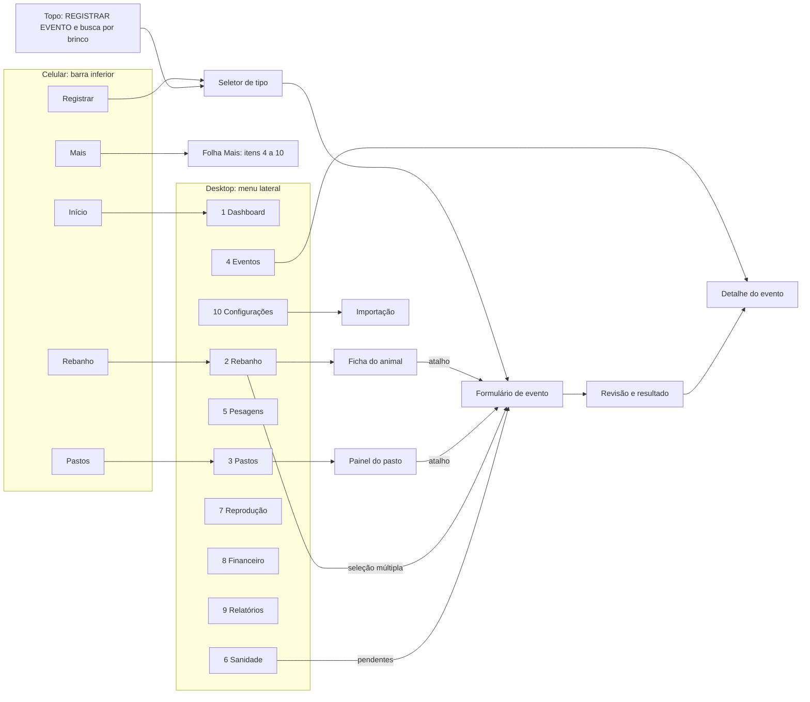
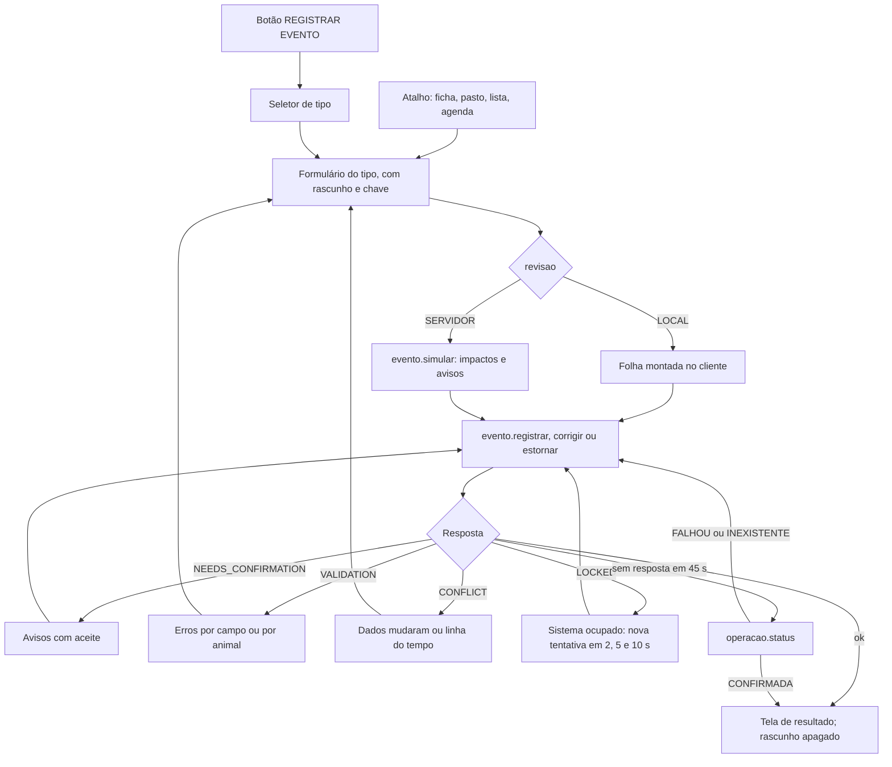

# 08 — Experiência de uso: telas, fluxos e modo curral

## Em resumo

- **Dois contextos, um produto.** Escritório (desktop, tabelas) e curral (celular, uma mão, sinal fraco). Toda tela de registro é desenhada primeiro para 360 px e teclado numérico.
- **Registrar evento em uma ida ao servidor.** Botão global e atalhos por contexto, com pré-preenchimento. Revisão LOCAL nos tipos simples; simulação no servidor só em compra, venda, estorno e correção.
- **Modo curral** (pesagem, sanidade, desmama, identificação): brinco → Enter → peso → Enter, sem tocar em botão. Um único evento ao final, tudo ou nada.
- **Nada se perde nem duplica.** Rascunho persistente com chave de idempotência; sem resposta em ~45 s, o app pergunta ao servidor se gravou antes de reenviar.
- **Só aparece o que está entregue.** Menu e seletor seguem a lista de módulos ativos; dado ausente vira "—" com motivo, nunca zero.
- **Catálogo antes de tela à mão.** Formulários de evento saem do `EventCatalog`; os 17 relatórios, do `ReportCatalog`.

**Documentos relacionados:** `README.md` · `01-arquitetura.md` (envelope, rotas, módulos do cliente) · `04-motor-de-eventos.md` (catálogo e pipeline) · `05-regras-de-negocio.md` · `07-financeiro-e-indicadores.md` (definição dos indicadores) · `09-plano-de-testes.md` · `10-plano-de-implementacao.md` · `11-riscos-e-premissas.md` · `12-fatos-de-plataforma.md`.

---

## 1. Princípios e contextos de uso

| | Escritório | Curral |
|---|---|---|
| Aparelho | Desktop ou notebook, ≥ 900 px | Celular, ~360 px, uma mão, sol |
| Rede | Estável | Fraca; o sistema pode descartar a aba |
| Tarefas | Importação, compra e venda, financeiro, relatórios | Pesagem, vacinação, transferência, nascimento, morte |
| Prioridade | Densidade: tabelas, filtros, comparação | Poucos toques, texto grande, rascunho |

A §15 pede desktop, notebook, tablet e celular; o desenho prevê dois leiautes, com corte em 900 px (tablet em pé usa o do celular).

1. **Operação simples = uma tela e uma ida** (§15: "não exigir navegação por várias telas"). Simulação no servidor só onde ele calcula o que o usuário não digitou: rateio, parcelas, dependentes.
2. **O que foi digitado não se perde.** Todo formulário em edição é rascunho persistente (PR-06).
3. **O servidor decide; a tela diz o que é prévia.** O cliente valida só formato; total exibido antes da resposta leva o rótulo "prévia" (P5; §20 regra 8).
4. **Tudo ou nada, com saída.** Evento coletivo nunca grava parte (§2.4); a tela mostra quem falhou e oferece corrigir, tirar da lista e reenviar, sempre por ação explícita.
5. **Sem dado, sem número.** "—" com motivo em vez de zero (§12; P9); estimativa e projeção sempre rotuladas.
6. **Sem botão sem função.** Módulo não entregue não aparece (§20 regra 3).
7. **Linguagem do pecuarista.** "Já estava no rebanho", não ENTRADA_INICIAL; erro com brinco, data e motivo: "0612 nasceu em 11/11 — não pode ser vacinado em 10/11".

---

## 2. Mapa de navegação

Desktop: menu lateral com os 10 itens da §15, na ordem dela; no topo, "REGISTRAR EVENTO" e busca por brinco. Celular: barra inferior Início · Rebanho · [Registrar] · Pastos · Mais. Não há botão flutuante: ele cobriria a última linha das listas e o botão de confirmar.



As rotas de tela são por hash (coluna "Rota" da seção 3) e levam só tela e ID opaco: a §17 proíbe dado em URL, então filtros, contexto e digitação ficam no `store` e no rascunho. O espelhamento no histórico do navegador usa `google.script.history` e `google.script.url`, sem fonte verificada — a confirmar no spike (SP-06); contingência: navegação só em memória.

**Módulos por fase.** O bootstrap entrega a lista de módulos ativos. Item não entregue **não é renderizado** (nem acinzentado); a ordem dos 10 não muda. Leitura adotada para o atrito entre a §15 (menu de 10 itens) e a §20 regra 3 (nenhum botão sem função): a §15 fixa estrutura e ordem, e o menu chega aos 10 na Fase 5.

| Item do menu | Ativo desde | Observação |
|---|---|---|
| 1 Dashboard | Fase 1 | Nasce como "Visão geral" (cabeças, sexo, pasto, categoria, pendências); completo na Fase 5 |
| 2 Rebanho | Fase 1 | Blocos E a H da ficha enchem nas Fases 2 a 4 |
| 3 Pastos | Fase 1 | UA/ha, ocupação e data histórica na Fase 2 |
| 4 Eventos | Fase 1 | O seletor cresce pelo campo `fase` do catálogo |
| 5 Pesagens · 6 Sanidade · 7 Reprodução | Fase 3 | — |
| 8 Financeiro | Fase 4 | Antes disso, lançamentos e parcelas de compra e venda aparecem no detalhe do evento e no bloco H da ficha |
| 9 Relatórios | Fase 5 | Antes disso, só o CSV da listagem do rebanho |
| 10 Configurações | Fase 1 | Parceiros na Fase 2; plano de contas e preços na Fase 4 |

---

## 3. Inventário de telas

"Store" = dado já no cliente desde o bootstrap, sem ida ao servidor. Fase = quando a tela nasce. ¹ = uso de rota explicado na seção 16.

| Tela | Rota | O que mostra | Ações | Consultas e comandos | Fase |
|---|---|---|---|---|---|
| Visão geral / Dashboard | `#/inicio` | Filtros, 16 indicadores, 9 gráficos, pendências, rascunhos | Filtrar; abrir pendência | `dashboard.obter`, `alerta.listar` | 1 → 5 |
| Rebanho: lista | `#/rebanho` | Colunas e filtros da §5; cartões no celular | Selecionar vários → registrar; cadastrar; exportar CSV | store; `animal.listar` (baixados) | 1 |
| Ficha do animal | `#/animal/<id>/<aba>` | Cabeçalho fixo; blocos A a J em abas; linha do tempo | Pesar, Vacinar/Tratar, Transferir, Vender, Registrar morte, Mais | store; `animal.ficha`; `anexo.obter` | 1 |
| Árvore genealógica | aba da ficha | Pais, avós e bisavós; crias em lista; "não confirmado" tracejado | Abrir parente; informar mãe ou pai | store; `animal.ficha` | 1 |
| Edição do animal | folha da ficha | Um formulário para cadastro e campos sensíveis | Salvar; trocar brinco; anexar | `animal.editar`¹; `anexo.adicionar`, `anexo.remover` | 1 |
| Pastos: lista | `#/pastos` | Cartões: cabeças, UA/ha, ocupação %, próprio ou arrendado | Abrir; novo pasto | `pasto.listar`; `pasto.salvar` | 1 |
| Painel do pasto | `#/pasto/<id>` | Campos da §7; composição por sexo e categoria; animais; "posição em [data]" | Transferir daqui, Pesar, Vacinar; editar | `pasto.painel` | 1; data histórica 2 |
| Registrar evento | `#/evento/novo/<tipo>` | Seletor → formulário → revisão → resultado (seção 4) | Revisar; confirmar; "+ Novo" | `evento.simular`, `evento.registrar`, `operacao.status`, `inventario.elegiveis` | 1 |
| Eventos: histórico | `#/eventos` | Tipo, data, nº de animais, valor, status; filtros; operações não concluídas | Abrir | `evento.listar` | 1 |
| Evento: detalhe, estornar, corrigir | `#/evento/<id>` | Animais e valores, lançamentos e parcelas, anexos, avisos aceitos, estorno ou substituto | Estornar; Corrigir | `evento.obter`, `evento.simular`, `evento.estornar`, `evento.corrigir` | 1 |
| Pesagens | `#/pesagens` | Filtros da §8; peso médio e GMD por categoria e pasto; curvas de 2 a 5 animais; projeção "estimativa" | Nova pesagem; colar pesagens | `peso.desempenho` | 3 |
| Sanidade: agenda | `#/sanidade/agenda` | Vencidos, próximos, pendentes, carência ativa, custos | Registrar aplicação nos pendentes | `sanidade.agenda` | 3 |
| Sanidade: produtos | `#/sanidade/produtos` | Dose padrão, carência, estoque × mínimo, validade | Editar; entrada de estoque | store¹; `produto.salvar`; `evento.registrar` | 3 |
| Sanidade: protocolos | `#/sanidade/protocolos` | Regras de recorrência (nenhuma ativa de fábrica) | Editar; ativar | store¹; `protocolo.salvar` | 3 |
| Reprodução: matrizes | `#/reproducao/matrizes` | Situação reprodutiva; partos previstos; matrizes sem histórico | Registrar exposição, IA, diagnóstico, parto | store; `reproducao.indicadores` | 3 |
| Reprodução: estações | `#/reproducao/estacoes` | Período e tipo de cada estação de monta | Editar | store¹; `estacao.salvar` | 3 |
| Reprodução: indicadores | `#/reproducao/indicadores` | Taxas por estação, com numerador, denominador e n | Trocar estação | `reproducao.indicadores` | 3 |
| Financeiro: lançamentos | `#/financeiro/lancamentos` | Conta, competência, valor, vínculos, não alocado | Novo lançamento; ratear | `financeiro.resultado`¹; `evento.registrar` | 4 |
| Financeiro: parcelas | `#/financeiro/parcelas` | A pagar e a receber por vencimento; depósito esperado | Baixar; desfazer baixa | `financeiro.fluxoCaixa`¹; `parcela.baixar`, `parcela.desfazerBaixa` | 4 |
| Financeiro: fluxo e resultado | `#/financeiro/fluxo`, `#/financeiro/resultado` | Caixa realizado × previsto; resultado por competência, com o caixa líquido ao lado | Mudar período | `financeiro.fluxoCaixa`, `financeiro.resultado` | 4 |
| Financeiro: custos | `#/financeiro/custos` | Por animal e por pasto; critério de rateio; não alocado | Ratear de novo | `financeiro.custosAnimal`¹ | 4 |
| Financeiro: patrimônio | `#/financeiro/patrimonio` | Estimado × custo × negociado; cobertura | Definir preços | `inventario.posicao`¹; `preco.salvar` | 4 |
| Relatórios | `#/relatorios/<id>` | Catálogo dos 17 → filtros → prévia | CSV, XLSX, PDF | `relatorio.obter`, `relatorio.exportar` | 5 |
| Configurações: parâmetros, listas, categorias | `#/config/<secao>` | Chaves com unidade e padrão; política de avisos; teste de cobertura das categorias | Editar | `config.salvar`, `lista.salvar`, `categoria.salvar`, `propriedade.salvar` | 1 |
| Configurações: parceiros, plano de contas, preços | `#/config/<secao>` | Cadastros; natureza das contas; vigência dos preços | Editar; desativar | store¹; `parceiro.salvar` (2); `conta.salvar`, `preco.salvar` (4) | 2 e 4 |
| Configurações: sistema | `#/config/sistema` | Último backup; integridade; auditoria; versão | Backup agora; restaurar; verificar | `sistema.backup`, `sistema.restaurarBackup`¹, `sistema.integridade`, `auditoria.listar` (2) | 1 |
| Importação | `#/importar/<import_id>` | Assistente de 5 telas; importações em andamento | Retomar; desfazer | as cinco rotas `importacao.*` | 1 |

**Blocos da ficha (§5.1).** A, B e C abrem sem ida ao servidor; D a J chegam em uma consulta `animal.ficha`.

| Bloco | Aba | Conteúdo |
|---|---|---|
| A Informações gerais · C Localização | Resumo | Brinco, código interno, sexo, raça, nascimento com confiança, idade, categoria, situação; pasto e data de chegada |
| B Genealogia | Genealogia | Árvore e lista de crias ("todos os bezerros de uma matriz"). Sem pai nem mãe conhecidos, a aba diz "sem genealogia registrada" (§5.2: "quando houver informações suficientes") |
| D Pastos | Pastos | Períodos de permanência |
| E Peso | Peso | Curva em SVG e tabela com ganho, dias, GMD e variação %; projeção tracejada, rotulada "estimativa" |
| F Sanidade · G Reprodução | Sanidade · Reprodução | Aplicações, carência, próximas doses; partos, coberturas, diagnósticos, intervalo entre partos |
| H Financeiro | Financeiro | Aquisição, custeio alocado, receita, resultado; critério de rateio de cada valor |
| I Eventos | Linha do tempo | Todos os eventos em ordem cronológica; estornados riscados |
| J Fotos e documentos | Anexos | Miniaturas (~15 KB); original sob toque |

**Edição.** Campo de cadastro (nome, raça, observações, foto) é gravado direto, com auditoria. Campo sensível alterado (sexo, nascimento, mãe, pai, castrado) abre "justificativa" e vira evento de ajuste; o usuário vê um formulário só. Brinco não se edita ali: "Pôr ou trocar brinco" abre o evento de identificação (rotina) e "Corrigir identificação", o ajuste (erro).

**Cadastrar animal** pergunta antes "Como entrou?" — Nasceu aqui · Foi comprado · Já estava no rebanho · Outra entrada · É de fora do rebanho (touro de sêmen, progenitor). As quatro primeiras levam ao evento correspondente; a última, a `animal.cadastrarExterno` (DV-06). Só aparecem as opções cujo evento já foi entregue.

---

## 4. Fluxo "Registrar evento"

### 4.1 Entradas

| Entrada | Onde fica | Já vem preenchido |
|---|---|---|
| Botão "REGISTRAR EVENTO" | Topo (desktop); centro da barra inferior (celular) | Nada: abre o seletor |
| Ficha do animal | Pesar, Vacinar/Tratar, Transferir, Vender, Registrar morte, Mais | O animal; no nascimento, mãe, pasto e raça |
| Painel do pasto | Transferir daqui, Pesar, Vacinar | Pasto de origem e "todos do pasto" |
| Listagem | "Registrar evento com 28 selecionados" | Os animais marcados |
| Agenda sanitária | "Registrar aplicação" | Pendentes e produto do protocolo |
| Início | Rascunho pendente | O rascunho inteiro |

### 4.2 Seletor de tipo

Uma tela: no alto, os tipos marcados `frequente` (4 a 6); abaixo, os cinco grupos de `grupo_ui`. Subtipo é o primeiro campo do formulário, não uma segunda tela. Só aparecem tipos cuja `fase` foi entregue. Estorno e correção partem do detalhe do evento. A tabela é proposta de rótulos; a fonte é o `EventCatalog`.

| Grupo | Tipos, com o rótulo de tela |
|---|---|
| Movimentação | Nascimento · Compra · Venda · Transferência · Morte · Descarte · Já estava no rebanho (ENTRADA_INICIAL) · Outra entrada |
| Manejo | Pesagem · Sanidade · Desmama · Castração · Pôr ou trocar brinco (IDENTIFICACAO) · Marcar para descarte ou como não localizado (MARCACAO) · Ocorrência |
| Reprodução | Exposição, cobertura, inseminação, diagnóstico de gestação, aborto (REPRODUCAO) |
| Financeiro | Receita ou despesa (LANCAMENTO_FINANCEIRO) · Entrada de insumo (ESTOQUE) · Rateio, a partir de um lançamento |
| Correções | Ajuste de inventário |

### 4.3 Formulário dinâmico

O renderizador monta o formulário a partir do catálogo recebido no bootstrap, em ordem fixa e em uma tela: data → animais (`seletor_animais` ou modo curral, conforme `modo_entrada`) → campos do tipo → grupos repetíveis (crias, parcelas, deduções) → observações e anexos.

- **Condicionais** (`visivel_se`, `obrigatorio_se`): na venda, rendimento de carcaça só aparece em modalidade ARROBA com base CARCACA.
- **Padrões** (`default`): HOJE é calculado no fuso da fazenda, nunca pelo relógio UTC. Às 21:30 de 13/11 em Porto Velho (UTC−4) o UTC já marca 01:30 de 14/11; o nascimento sairia datado de amanhã. `{de: ...}` herda pasto e raça da mãe; lote, validade e carência do produto.
- **"+ Novo"** em parceiro e produto: miniformulário em folha sobreposta que grava o cadastro e volta com o item selecionado, sem desmontar o formulário pai.
- **Celular**: rota de tela cheia, sem barra inferior; formulário, revisão e resultado são entradas de histórico, então o Voltar do aparelho recua uma etapa e o "×" pergunta se guarda o rascunho. **Desktop**: painel lateral.
- A ação principal fica depois do último campo, no fluxo de rolagem; rodapé fixo seria coberto pelo teclado virtual.

### 4.4 Revisão: LOCAL × SERVIDOR

A §6 exige "confirmação antes da gravação". Simular todo evento no servidor dobraria a espera nos registros mais frequentes para devolver o que o usuário acabou de digitar. O campo `revisao` decide:

| `revisao` | Tipos | O que a folha mostra | Idas |
|---|---|---|---|
| LOCAL | Transferência, nascimento, morte, pesagem, sanidade, desmama, castração, identificação, reprodução, ocorrência | Resumo montado no cliente: "Transferir 12 animais · Pasto 1 → Pasto 2 · 13/11/2026" | 1; 2 só se voltar aviso |
| SERVIDOR | Compra, venda, descarte com receita, lançamento com rateio, estorno, correção | `evento.simular`: impactos (inventário, pastos, lançamentos, rateio por animal, parcelas, estoque, dependentes) e avisos, pela mesma função que grava | 2; a confirmação envia `dataVersionEsperada` |

Na correção, a folha mostra a diferença para o original ("1 linha alterada: 0457 de 4500 para 450 kg"). No estorno, o que será desfeito e o que bloqueia (eventos dependentes, parcela liquidada).

### 4.5 Avisos com aceite

Aviso não aceito não grava nada: a resposta é NEEDS_CONFIRMATION e a chave de idempotência é preservada. A folha lista cada aviso com a caixa "Vi e confirmo" (por animal, quando for o caso); PERIODO_BLOQUEADO exige justificativa. "Confirmar mesmo assim" reenvia com `avisosAceitos[]` e a mesma chave. Código marcado BLOQUEIA em `avisos_politica` chega como erro, sem caixa.

Exemplo: venda de 30 bois em 13/11; dois receberam vermífugo em 01/11 com carência de 35 dias (até 06/12). Finalidade ABATE: erro CARENCIA_ATIVA com os dois brincos (padrão BLOQUEIA). Finalidade recria: aviso com aceite, gravado junto do evento.

### 4.6 Resultado e operações críticas

Evento coletivo ou marcado `critico` termina em tela persistente, não em aviso passageiro (fácil de perder ao sol): "80 pesagens gravadas · média 387,0 kg · Ver evento · Registrar outro · Desfazer". Custo e baixa de estoque da sanidade aparecem ali, calculados pelo servidor. Evento individual simples: aviso de sucesso e retorno à tela de origem.

Operação crítica (venda, morte, descarte, estorno, baixa por divergência, restauração de backup, desfazer importação) pede confirmação que descreve a consequência, com botão que repete o verbo: "Estornar venda de 30 animais" (§15).



---

## 5. Modo curral (pesagem coletiva)

No brete os animais passam em ordem aleatória; o operador tem o brinco e a leitura da balança. Selecionar 80 e depois procurar a linha de cada um custa 3 a 4 interações por animal. O modo curral inverte: digita-se na ordem em que o gado passa. É o `modo_entrada = CURRAL` de PESAGEM, SANIDADE, DESMAMA e IDENTIFICACAO.

```text
+----------------------------------------+
| <  Pesagem   13/11/2026   Balança      |  cabeçalho fixo: data, método,
|    Pasto 3 · 37 de 80 · faltam 43 (ver)|  pasto esperado e contador
+----------------------------------------+
| Brinco [ 0457     ]   Peso [ 412,5 ] kg|  dois campos; teclado numérico
| 0457 · Novilha · Pasto 3               |  conferência imediata
| último 398,0 kg em 03/09               |
| prévia: +14,5 kg em 71 dias            |
+----------------------------------------+
| 37  0457   412,5   ok                  |  mais recente no topo
| 36  0391   455,0   (i) fora do pasto   |
| 35  0388    45,0   (!) variação        |
| 34  0999     —     (x) não encontrado  |
| ...                                    |
+----------------------------------------+
| [ Revisar 37 pesagens ]   1 pendência  |
| Todos do pasto  ·  Colar brinco;peso   |
+----------------------------------------+
```

**Enter.** No campo Brinco: resolve o brinco, mostra a conferência e leva o foco ao Peso (não resolvido: abre a lista de candidatos ou marca "não encontrado"). No campo Peso: valida o formato (vírgula decimal, 1 casa, maior que zero), põe a linha no topo da lista, salva o rascunho, limpa os campos e devolve o foco ao Brinco. Nenhum botão é tocado e o teclado não fecha. Em sanidade e identificação o segundo campo muda (dose por animal; brinco novo) ou não existe, e o Enter do brinco já acrescenta a linha.

**Resolução do brinco** (no `store`, por `brinco_norm`, sem ida): (1) igual exato; (2) sem zeros à esquerda, se o resultado for único — "457" acha "0457" com `brinco_ignora_zeros_esquerda` = S; (3) mais de um candidato → lista para escolher. Animal sem brinco é achado pelo código interno ou pelo brinco da mãe ("crias da 0231"). A conferência traz a prévia do ganho: 412,5 − 398,0 = +14,5 kg em 71 dias (03/09 a 13/11), ou 0,20 kg/dia.

**Estados por linha** (ícone e texto, nunca só cor):

| Estado | Quando | Efeito | O que fazer |
|---|---|---|---|
| Ok | Animal ativo, peso plausível | Conta | — |
| Não encontrado | Brinco sem candidato | Pendência: impede o envio | Corrigir o brinco ou tirar da lista |
| Inativo | Vendido, morto, descartado ou baixado | Bloqueado | Tirar da lista |
| Repetido | Brinco já lançado nesta sessão | Pede decisão | Substituir o peso ou manter o anterior |
| Fora do pasto | Pasto atual diferente do esperado | Informativo; conta à parte | Nada |
| Variação implausível | (peso − último peso) ÷ dias fora de `gmd_plausivel_min_kg_dia` a `gmd_plausivel_max_kg_dia` | Aviso; não bloqueia | Conferir a digitação; aceitar na revisão |

Exemplo: último peso 441,0 kg em 03/09; digitado 45,0 em 13/11 (faltou um dígito). (45,0 − 441,0) ÷ 71 dias = −5,58 kg/dia, fora da faixa padrão de −1,0 a 2,0. As marcas são pré-conferência com dados do `store`; o servidor repete a validação e é a autoridade (aviso PESO_IMPLAUSIVEL).

**Contador.** Com pasto esperado no cabeçalho: "37 de 80 · faltam 43 (ver)". Conta animais distintos daquele pasto já lançados; "ver" lista os que faltam; os de outro pasto contam à parte ("+2 de outros pastos"). Sem pasto esperado, só "37 pesados".

**Alternativas na mesma tela.** "Todos do pasto" abre uma grade com uma linha por animal, para quem digita do caderno. "Colar brinco;peso" aceita linhas copiadas de planilha e passa pelas mesmas marcas; cobre a "importação de pesagens" do dia a dia (§6).

**Fim.** "Revisar 37 pesagens" → folha LOCAL (quantidade, média, linhas com aviso) → um único `evento.registrar`. Linha "não encontrado" desabilita o envio e diz por quê.

---

## 6. Toques e idas ao servidor nos cinco casos frequentes

**Estimativa de desenho**: contagem sobre o fluxo descrito, não medição. "Antes" é o fluxo da primeira versão do desenho (botão global → tipo → selecionar → preencher → simular → confirmar, para todo tipo). A medição real entra no relatório de testes de cada fase.

| Caso | Antes | Depois | De onde vem o ganho |
|---|---|---|---|
| Pesagem de 80 animais | ~8 toques fixos + 3 a 4 interações por animal para achar a linha (240 a 320); 2 idas | 6 toques fixos + 2 Enter por animal (160); 1 ida | Modo curral; revisão LOCAL |
| Vacinação de um pasto | ~11 toques; 2 idas | 5 a 6, a partir do painel do pasto; 1 ida | "Todos do pasto" já marcado; lote, validade e carência herdados do produto |
| Transferência | ~9 a 10 toques; 2 idas | 5; 1 ida | "Transferir daqui" traz origem e animais |
| Nascimento | ~7 toques + digitação; 2 idas | 4 a 5, a partir da ficha da mãe; 1 ida | Mãe, pasto e raça herdados |
| Venda de lote de 30 | ~20 a 25 toques; 2 idas; comprador novo obriga a sair do formulário | ~12 a 15 toques; 2 idas (3 com comprador novo, sem sair) | Seleção múltipla na listagem; "+ Novo". A simulação fica: rateio e parcelas só o servidor calcula |

Conferência: 80 × 3 = 240 e 80 × 4 = 320; 80 × 2 = 160. Os seis toques fixos da pesagem: Registrar, Pesagem, abrir e escolher o pasto esperado (2), Revisar, Confirmar; data (hoje) e método (balança) vêm por padrão.

---

## 7. Seleção de animais e data retroativa

`seletor_animais` é um componente único para todo tipo com `selecao_animais` = UM ou VARIOS. O `filtro_elegiveis` do catálogo restringe os candidatos (venda: ativos; desmama: crias ao pé; castração: machos inteiros).

| Modo | Como funciona |
|---|---|
| Busca | Brinco, nome ou código interno, com a resolução do modo curral; o resultado mostra categoria, pasto e último peso |
| Filtros | Os da listagem (pasto, sexo, categoria, situação, faixa etária) e "selecionar os N filtrados" |
| Todos do pasto | Um toque; a lista aparece para desmarcar exceções |
| Colar lista | Brincos separados por linha, vírgula ou ponto e vírgula; antes de acrescentar, mostra achados, não encontrados e repetidos |
| Sem brinco | Aparece como "A-000123 · cria da 0231 · 12/09/2026"; achado pelo código, pelo brinco da mãe ou pelo filtro "sem brinco" |

Antes do envio, o cliente pré-marca os inelegíveis com dados do `store` (situação, datas de entrada e saída, sexo). É atalho de conferência; a validação é do servidor.

**Data retroativa.** O `store` guarda a posição de hoje; o servidor valida a posição na data do evento. Regra: se `event_date` ≠ hoje, "todos do pasto" e a elegibilidade são resolvidos no servidor por `inventario.elegiveis({tipo, data, pasto})`, e a lista ganha o rótulo "posição em 01/11/2026".

Exemplo: em 13/11 lança-se a pesagem feita em 01/11 em "todos do Pasto 2". Em 08/11, 15 animais foram do Pasto 2 para o Pasto 4. O `store` lista 25; o servidor devolve os 40 que estavam lá em 01/11 (25 + 15). Sem a regra, 15 pesagens ficariam de fora sem erro algum; numa transferência retroativa ocorreria o inverso.

Mudar a data depois de selecionar refaz a consulta e marca (não remove) quem deixou de ser elegível. Data anterior ao marco zero abre a faixa "entra como histórico informativo, sem efeito no inventário".

---

## 8. Estados e mensagens

Cada estado é um componente único, usado por todas as telas. A mensagem diz o que aconteceu e o que fazer; o código técnico fica no detalhe expansível.

| Estado | Gatilho | O que o usuário vê | O que pode fazer |
|---|---|---|---|
| Carregando | Consulta ou comando em curso | Esqueleto da tela; em comando, botão "Enviando…" travado (duplo clique, §15) | Aguardar; sair não perde o rascunho |
| Vazio | Consulta sem linhas | Frase com ação: "Nenhum animal neste pasto — Transferir para cá" | Seguir a ação |
| Sucesso | `ok` | Aviso passageiro (evento simples) ou tela de resultado (coletivo ou crítico) | Ver evento; registrar outro; desfazer |
| Erro por campo | VALIDATION com `campo` | Mensagem sob o campo; foco no primeiro; "2 campos para corrigir" | Corrigir e reenviar |
| Erro por animal | VALIDATION com `animal_id` | Faixa fixa "3 de 80 com problema"; filtro "só com problema"; motivo na linha | "Corrigir" ou "Tirar da lista"; o botão vira "Gravar os 77 restantes" e abre nova revisão |
| Conflito de linha do tempo | CONFLICT com `conflito` | "0457: a transferência de 08/11 (Pasto 2 → Pasto 4) deixaria de valer" | Abrir o evento conflitante; mudar a data; tirar o animal |
| Dados mudaram | CONFLICT por `dataVersionEsperada` | "Os dados mudaram desde a revisão" | "Revisar de novo"; rascunho intacto |
| Sistema ocupado | LOCKED | "Sistema ocupado, tentando de novo (2 de 3)": tentativas em 2, 5 e 10 s, mesma chave | Aguardar; depois, botão "Tentar de novo" |
| Sem resposta | 45 s sem retorno | "Verificando se gravou…" | Aguardar ou sair: a verificação se repete na próxima abertura |
| Sem conexão | Falha de transporte | "Sem conexão. O que você digitou está guardado neste aparelho." | Continuar digitando; enviar quando o sinal voltar |
| Sessão expirada ou conta errada | DENIED, ou falha de transporte repetida | "Não foi possível confirmar seu acesso" | "Entrar de novo" (recarrega a janela inteira; rascunho preservado) |
| Já gravado | `ok` com `duplicado: true` | Resultado com a nota "já estava gravado; nada foi duplicado" | Seguir |
| Possível duplicidade | Aviso POSSIVEL_DUPLICIDADE | "Já existe pesagem de 13/11 com 78 destes 80 animais" | Ver o evento existente; gravar mesmo assim; descartar |
| Formulário já usado | IDEMPOTENCY_MISMATCH | "Este formulário já foi gravado com outro conteúdo" | Ver o evento gravado; para alterar, "Corrigir" |
| Nova versão | `meta.appVersion` diferente da página | Faixa "Nova versão disponível" | "Recarregar" quando quiser; rascunho preservado |
| Importação incompleta | `IMPORTACOES.status` = IMPORTANDO | Faixa em todas as telas; registros desabilitados, com o motivo | "Retomar" ou "Desfazer" |

- "3 de 80": o evento inteiro foi recusado (§2.4). Gravar os 77 é novo envio, explícito e com nova revisão — nunca parcial em silêncio.
- Possível duplicidade dispara com mesmo tipo, mesma data e ~80% dos mesmos animais; no exemplo, 78 ÷ 80 = 97,5%.
- Distinguir sessão expirada de rede caída depende de como o `google.script.run` sinaliza cada falha — a confirmar no spike (SP-04, SP-06).

---

## 9. Rascunho persistente e rede fraca

Cenário a vencer: 13/11, curral, 80 pesos digitados em uma hora e meia; às 16:40 o usuário confirma e o sinal cai depois de a requisição sair. O servidor grava; a resposta não chega.

| Momento | Comportamento previsto |
|---|---|
| Abertura do formulário | Nasce a `idempotencyKey` (UUID) e o rascunho: tipo, campos, linhas, chave, estado EDITANDO |
| A cada campo ou linha | Rascunho regravado em `localStorage` (com tratamento de falha) |
| Confirmar | Estado ENVIANDO; botão travado |
| `ok` (com ou sem `duplicado`) | Rascunho apagado; só então o próximo formulário gera chave nova |
| VALIDATION, NEEDS_CONFIRMATION, CONFLICT | Volta a EDITANDO; mesma chave no reenvio |
| 45 s sem resposta | `operacao.status`: CONFIRMADA → tela de resultado; EM_ANDAMENTO → consulta de novo; FALHOU ou INEXISTENTE → reenvia com a mesma chave |
| Página recarregada ou aba descartada | Rascunho EDITANDO → "Pesagem de 13/11 não concluída (50 animais) — Continuar · Descartar". Rascunho ENVIANDO → consulta `operacao.status` antes de qualquer outra coisa |
| Operação que falhou no servidor | Faixa: "A pesagem de 13/11 16:40 não foi gravada — Enviar de novo", ligada ao rascunho |

- **Por que 45 s**: espera máxima do lock (25 s) + orçamento do comando no pior volume planejado (15 s) + folga de rede (5 s).
- **Um rascunho por tipo de evento**; a tela Início lista os pendentes. Rascunho só some por sucesso confirmado ou descarte explícito.
- **Sem fila offline no MVP** (§17). Sem sinal, a digitação continua e o rascunho fica; enviar é sempre um gesto do usuário. Comando idempotente e rascunho são o que permitirá a fila offline no futuro sem tocar o backend.
- **Abertura com sinal fraco.** Bootstrap condicional: o cliente envia a `dataVersion` da lista que guarda e só recebe carga nova se ela mudou. Fotos são reduzidas no cliente antes do envio (miniatura ~15 KB, imagem ~300 KB).
- **Segundo aparelho ou aba antiga.** Depois de um comando, o cliente aplica o delta se a nova versão for a local + 1; senão recarrega a lista. Ao voltar ao primeiro plano, a aba compara a versão.
- **A confirmar no spike (SP-06)**: se o `localStorage` do iframe sobrevive a recarga e fechamento no Chrome Android e no Safari iOS. Contingência do desenho-base: rascunho guardado no servidor.

---

## 10. Listagem do rebanho

| Coluna (§5) | Origem e regra de exibição |
|---|---|
| Brinco | `brinco`; sem brinco, mostra o código interno e a marca "sem brinco" |
| ID | `codigo_interno` (A-000123). Leitura adotada: o UUID não serve à leitura humana e não é exibido |
| Sexo · Raça | Texto ("Fêmea"), não só letra ou cor |
| Idade | Calculada do nascimento, em anos e meses completos ("1a 9m"); "≈" se a data é estimada; "—" se desconhecida |
| Categoria | Calculada na leitura; marca "manual" quando reclassificada |
| Peso atual | Último peso e data; marca "vencido" além de `peso_validade_dias` |
| Pasto atual · Situação · Nascimento | Projeções do cadastro; "sem pasto" em destaque (§16 regra 18) |

Desktop: tabela de 10 colunas com cabeçalho fixo; clicar no cabeçalho ordena. Celular (abaixo de 900 px): cartões, com ordenação por seletor.

```text
+--------------------------------------+
| [ ] 0457               Novilha · F   |
|     Nelore · 1a 9m · nasc. 02/02/2025|
|     Pasto 3 · 412,5 kg em 13/11      |
|     Ativo                   A-000123 |
+--------------------------------------+
```

- **Busca**: brinco (com a regra de zeros à esquerda), nome ou código interno.
- **Filtros** (§5): pasto, sexo, categoria, situação (padrão: ativos; escolher vendidos ou mortos busca os baixados por `animal.listar`) e faixa etária pelos cortes de `faixas_etarias_meses` (0–12, 12–24, 24–36, 36+). Atalhos: sem pasto, sem brinco, sem categoria (§16 regras 18 e 19).
- **Ordenação**: qualquer coluna; brinco numérico ordena como número. **Paginação** no cliente: `itens_por_pagina` = 50 (500 animais = 10 páginas).
- **Seleção múltipla**: caixa por linha e "selecionar os N filtrados"; barra de ação "Registrar evento com N selecionados".
- **Exportação**: CSV do conjunto filtrado (todas as páginas), montado no cliente. XLSX e PDF chegam com o relatório "Inventário atual", na Fase 5.

---

## 11. Dashboard

Uma consulta, `dashboard.obter(filtros)`, devolve todos os cartões e séries; cada item é `{valor | null, motivo, n}`. O cliente guarda a resposta por (`dataVersion`, filtros).

| Faixa | Conteúdo | Tipo |
|---|---|---|
| Topo | Os 6 filtros da §12; "dados de 14/11 08:32" (`geradoEm`, no fuso da fazenda); "Atualizar" | — |
| Pendências | Alertas e rascunhos, cada um com sua ação | — |
| Rebanho | Total de cabeças, machos, fêmeas, UA total, peso médio, peso vivo total, valor estimado | POSICAO na data final |
| Movimento | Nascimentos, compras, vendas, mortes | FLUXO no período |
| Financeiro | Receita de vendas, custos operacionais, resultado financeiro (com o caixa líquido ao lado) | FLUXO, por competência |
| Distribuição | Por pasto e por categoria, em barras horizontais | POSICAO |
| Gráficos | Os 9 da §12: linha para as evoluções (rebanho, peso, valor estimado, receitas e custos); barras para sexo, categoria, pasto, nascimentos × mortes, compras × vendas | Série |

7 + 4 + 3 + 2 = os 16 indicadores da §12. Cartão de posição diz "em dd/mm" para não ser lido como total do período. Período padrão: últimos 12 meses. Desktop: cartões em 4 colunas, gráficos em 2. Celular: filtros em folha com "Aplicar" (uma ida), cartões em 2 colunas, gráficos empilhados, cada um com "ver tabela".

**Filtro não aplicável.** Cada indicador declara os filtros que aceita (`07-financeiro-e-indicadores.md`). Na tela:

| Caso | O que aparece |
|---|---|
| Filtro de sexo ativo | "Machos", "Fêmeas" e o gráfico por sexo viram "—" com motivo FILTRO_NAO_APLICAVEL (seriam zero ou 100% por construção) |
| Pasto, sexo ou categoria nos indicadores financeiros | Valor pelas alocações, mais a linha "não atribuído: R$ …"; sem ela, o custo pareceria baixo e o resultado, inflado |
| Caixa líquido com filtro de animal | Valor com a etiqueta "não filtrado por pasto, sexo ou categoria": parcela não tem animal |

**Dado ausente** (§12): "—" e, ao toque, o motivo: DADOS_INSUFICIENTES ("n = 3; mínimo 5"), ANTERIOR_AO_MARCO_ZERO, SEM_VALOR_DE_REFERENCIA ("definir em Configurações › Preços"). Série com menos de 2 pontos não desenha linha: "dados insuficientes desde dd/mm". Histórico e projeção nunca na mesma série. Valor com cobertura parcial mostra a cobertura: "412 de 430 cabeças valoradas".

---

## 12. Importação: 5 telas para os 10 passos da §14

Tarefa de desktop; no celular, só acompanhamento. Etapas longas rodam em blocos comandados pelo cliente, com progresso real e retomada.

| Passo da §14 | Tela | O que acontece |
|---|---|---|
| 1 Upload ou seleção | 1 Tipo e arquivo | Tipo (enum de `IMPORTACOES.tipo`); arquivo local CSV ou XLSX, ou "colar da planilha"; "baixar modelo". Sem seletor do Drive: o escopo `drive.file` não enxerga arquivo que o app não criou |
| 2 Leitura | 1 Tipo e arquivo | `importacao.criar`; delimitador, codificação, formato de data e decimal; primeiras linhas como texto bruto |
| 3 Mapeamento | 2 Mapeamento | Coluna do arquivo → campo; modelo conhecido já vem mapeado; confiança padrão por coluna (confirmada, estimada, desconhecida) |
| 4 Validação | 3 Validação | `importacao.validarBloco` em blocos, com barra de progresso |
| 5 Pré-visualização | 3 Validação | Linha interpretada ao lado do texto original |
| 6 Duplicidades · 7 Erros | 3 Validação | Resumo "válidas · com erro · duplicadas"; filtro por status; motivo por linha; CSV dos erros |
| 8 Confirmação | 4 Confirmação | Totais e marco zero. Havendo erro, "Importar" só habilita ao marcar "importar só as N válidas e ignorar M" (modo PARCIAL_APROVADO). Backup automático antes |
| 9 Importação | 5 Execução | `importacao.importarBloco` em blocos de `importacao_lote_linhas` (200); depois `importacao.concluir`. Interrompida: "Retomar · Desfazer" |
| 10 Relatório final | 5 Execução | Contadores, registros criados, pendências de reconciliação, "Desfazer importação" |

Exemplo: 4.500 linhas ÷ 200 = 22,5 → 23 blocos; a barra mostra "1.400 de 4.500 linhas".

---

## 13. Relatórios e exportação

Um fluxo para os 17 relatórios da §13 (mesma numeração): catálogo → filtros → prévia paginada → exportar. Cada relatório é uma entrada do `ReportCatalog` (título, filtros, colunas com tipo e total, agrupamento); não há tela escrita por relatório. No celular, a prévia rola na horizontal com a primeira coluna fixa.

| Formato | Onde é gerado | Entrega | Limite |
|---|---|---|---|
| CSV | No cliente, com as linhas da consulta (`;` e BOM, para o Excel em pt-BR) | Imediata, sem ida | — |
| XLSX | Servidor (`relatorio.exportar`) | Estado "Gerando arquivo…"; depois, link que abre em nova aba (arquivo em `ERP Pecuário/Exportações`) | 10 MB; acima disso, mensagem oferecendo CSV |
| PDF | Servidor; paisagem, com filtros e data no cabeçalho | Idem | "Quando tecnicamente viável" (§13): a confirmar no spike (SP-07) |

Saneamento contra fórmula (`=`, `+`, `-`, `@` no início da célula) só na exportação, nunca na gravação. O link em nova aba evita download dentro do iframe; a abertura no celular é item do spike (SP-07). Todo arquivo traz os filtros e "dados de dd/mm hh:mm"; o CT-16 confere exportação contra tela.

---

## 14. Diretrizes visuais e critérios de aceite

Aparência profissional (§15) por contenção: tema claro, fundo neutro, uma cor de ação, cores de estado (ok, aviso, erro, informação) sempre com ícone e texto, fonte do sistema (nenhum download), números tabulares, cartões e tabelas sem ornamento.

| Critério | Medida | Como se verifica |
|---|---|---|
| Contraste | ≥ 7:1 em dados (brinco, peso, valores); ≥ 4,5:1 no resto | Teste automatizado sobre as variáveis de tema |
| Tipografia | Base 16 px; campos ≥ 16 px (evita zoom no iOS); brinco e peso ≥ 20 px no modo curral | Teste estático do CSS |
| Alvos de toque | ≥ 48 × 48 px, com 8 px de respiro | Playwright a 360 px |
| Largura | Sem rolagem horizontal a 360 px (exceto prévia de relatório) | Playwright |
| Estado | Ícone e texto, nunca só cor; rótulo de campo sempre visível | Revisão por tela |
| Teclado | Foco visível; Enter percorre os campos; teclado decimal em pesos e valores; numérico no brinco quando `brinco_somente_numerico` = S | Playwright |
| Diálogos e avisos | Diálogo modal anunciado, com retorno de foco; avisos passageiros em região `aria-live` | Teste de acessibilidade (nível 3) |
| Gráficos | Todo gráfico tem tabela equivalente | Teste estático |
| Peso da página | ≤ ~450 KB; abertura a frio medida em 3G | Teste estático; SP-05 |
| Viewport | Definido no `doGet` por `addMetaTag` | Teste de nível 1 |

Fica para o guia de implantação: atalho na tela inicial do celular e a conta do app como conta padrão do navegador (SP-04).

---

## 15. Componentes reutilizáveis

Casca (menu lateral, barra inferior, topo) · cartão de indicador · tabela ordenável e paginada, com versão em cartões · barra e folha de filtros · campos (texto, inteiro, decimal, dinheiro, data, lista, referência com "+ Novo", sim/não, anexo) · renderizador de formulário · modo curral · folha de revisão · tela de resultado · lista de erros por animal · avisos com aceite · confirmação crítica · aviso passageiro · faixa · esqueleto · estado vazio · estado de erro · gráfico (linha, barras) com "ver tabela" · curva de peso em SVG · linha do tempo · árvore genealógica · barra de progresso · exportador CSV.

| Gerado por catálogo | Escrito à mão |
|---|---|
| Seletor de tipo: rótulo, grupo, ordem, frequente, fase | Os quatro compostos: `seletor_animais`, `grade_novos_animais`, `bloco_negociacao`, `bloco_parcelas` |
| Campos de todo formulário de evento: tipo, obrigatoriedade, condicionais, padrões, unidade, limites, ajuda | Modo curral |
| Grupos repetíveis; folha de revisão LOCAL; filtro de elegíveis | Ficha, painel do pasto, dashboard e telas de módulo |
| Relatórios: filtros, colunas, totais e exportação (`ReportCatalog`) | Assistente de importação; formulários de cadastro (pasto, parceiro, produto), com os mesmos campos |

Regra: se um tipo de evento pedir tela própria, a necessidade vira campo do catálogo ou componente composto, nunca formulário paralelo — isso duplicaria validação (§20 regra 8). Teste de nível 1: todo campo de todo tipo renderiza e faz ida e volta.

Gráficos: Chart.js em versão fixa, com verificação de integridade, carregado só nas telas com gráfico; se não carregar, a tela mostra a tabela. A curva de peso da ficha é SVG próprio desde o início. Chart.js × SVG próprio para o resto: SP-08.

---

## 16. Notas de rota (¹) e itens do spike

A lista canônica de rotas não tem leitura própria para algumas telas. Para não criar rota fora dela, as telas marcadas com ¹ na seção 3 usam o que já existe:

| Tela | Uso previsto | Porquê |
|---|---|---|
| Financeiro: lançamentos, parcelas, custos por pasto, patrimônio | `financeiro.resultado` (detalhe por lançamento), `financeiro.fluxoCaixa` (parcelas abertas e liquidadas), `financeiro.custosAnimal` (agregado por pasto), `inventario.posicao` (com valor e cobertura) | Os dados já saem dessas consultas; rota própria, se criada, só troca a coluna de consultas |
| Produtos, protocolos, estações, parceiros, plano de contas, preços | Chegam no bootstrap, na fase que entrega cada cadastro | São pequenos e alimentam os campos de referência dos formulários |
| Edição do animal | `animal.editar` recebe um comando só; o servidor separa o que é auditoria do que vira evento de ajuste (DV-07) | O usuário não precisa conhecer a diferença |
| Restaurar backup | `sistema.restaurarBackup` com `modo: 'SIMULAR'` devolve os backups disponíveis e o que será substituído; confirmar exige digitar RESTAURAR | Operação destrutiva: a prévia vem do servidor e o aceite é explícito |

Itens do spike que condicionam este documento: SP-04 (conta e sessão no celular) · SP-05 (abertura a frio em 3G) · SP-06 (`localStorage` no iframe; histórico e URL; comportamento do `google.script.run` em queda de rede; tamanho de fotos e blocos) · SP-07 (abrir exportação no celular; XLSX e PDF) · SP-08 (Chart.js × SVG próprio).
