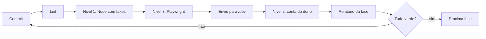

# 09 — Plano de testes

## Em resumo

- **Três níveis.** Nível 1 em Node, contra fakes fiéis, a cada commit, executado neste repositório; nível 2 dentro do Apps Script, pelo dono, em planilha temporária; nível 3 de interface, com Playwright e `google.script.run` simulado. Cada nível declara o que prova e o que não prova.
- **20 cenários com valores fechados.** CT-01 a CT-10 são os dez da §18, marcador por marcador; CT-11 a CT-20 cobrem o que a §18 não alcança (setup, importação, centavos, arroba, parcela paga, exportação, retroativo, substituição, conciliação, tipos).
- **O protocolo de gravação é testado por queda injetada** em cada ponto da análise de `06-persistencia-e-integridade.md`, com perda de qualquer subconjunto das escritas não descarregadas, e por intercalação de execuções no lock simulado.
- **Nenhuma das 20 regras da §16 fica sem teste** (seção 7), e toda RN marcada "novo" em `05-regras-de-negocio.md` ganha caso próprio.
- **Regra de honestidade (§20, regra 10).** O relatório de cada fase separa "executado aqui" de "a executar na conta do dono"; nada conta como testado sem a saída do comando ou a evidência do dono.

**Documentos relacionados:** `04-motor-de-eventos.md` (catálogo, linha do tempo) · `05-regras-de-negocio.md` (RN-nnn) · `06-persistencia-e-integridade.md` (análise de queda) · `07-financeiro-e-indicadores.md` (caso numérico) · `08-ux-ui.md` (critérios de aceite de tela) · `10-plano-de-implementacao.md` (fases, spike) · `12-fatos-de-plataforma.md`.

## 1. Estratégia em três níveis

|Nível|Onde e quem|O que prova|O que NÃO prova|
|---|---|---|---|
|1|Node (`node --test`), neste repositório, a cada commit|Regras, validador de linha do tempo e projetor; três fases, recuperação e idempotência sob queda e intercalação; codec contra a coerção emulada; `setup()` repetível; carga dos arquivos nas duas ordens; lint|Que a planilha real coage como o fake; o comportamento real do lock e do buffer; cotas, latência, escopos, gatilhos; o iframe do HtmlService|
|2|Apps Script, conta do dono: `runAcceptanceTests()` e página de concorrência|Os mesmos cenários com serviços reais: coerção real, lock entre execuções paralelas, Drive só com `drive.file`, tempos|Queda no meio do protocolo (não há como matar a execução no ponto exato: fica no nível 1 e no SP-03); telas|
|3|Playwright sobre `src/*.html`, com `google.script.run` simulado|Fluxos de tela em celular (360 px) e desktop: registrar evento, modo curral, rascunho e reenvio, avisos com aceite, erro em evento coletivo, acessibilidade (critérios de `08-ux-ui.md`)|Regra de negócio (quem decide é o backend, P5); iframe real, `localStorage` no celular e download (SP-06, SP-07)|

**Regra de honestidade.** Cada item do relatório tem um de quatro estados: `EXECUTADO AQUI` (comando, data e contagens copiadas da saída), `EXECUTADO PELO DONO` (com o arquivo de resultado gerado na conta dele), `PENDENTE NA CONTA DO DONO` ou `NÃO SE APLICA NESTA FASE`. O nível 3 só é "executado aqui" se o navegador rodar neste ambiente; senão fica pendente, com o motivo. Fase não fecha com item pendente.

**Nível 2, como roda.** `runAcceptanceTests()` cria pela Drive API (`Drive.Files.create`) a planilha "ERP Pecuário — BASE DE TESTE" na pasta `ERP Pecuário/Testes`, guarda o ID em `TEST_SPREADSHEET_ID` e executa `setup()` e os cenários passando esse banco como parâmetro do contexto de execução. `SPREADSHEET_ID` nunca é trocado; `DATA_VERSION:<id>` e `PENDING_OP:<id>` já são por planilha. Por causa do limite de 6 min, a função é retomável: para perto de 4 min, grava o cursor e continua na chamada seguinte. O resultado sai como arquivo JSON na mesma pasta; a planilha só vai para a lixeira se tudo passou. O lock de script é o mesmo da base real: durante o teste, um comando real espera.

**Nível 3, como simula.** Dois modos: respostas fixas para estados de tela (vazio, erro, lento, nova versão) e ponte para o backend do nível 1, em que a chamada simulada entrega o pedido ao `api()` carregado no harness com os fakes. O segundo evita que a tela seja testada contra respostas que o servidor não daria.

## 2. Harness e fakes

**Reaproveitado de `inbox-intelligence/tests/`:** `createGas()` (contexto `vm` isolado, carga de `src/*.js` em ordem alfabética ou inversa, relógio falso, captura de logs); `makePropertyStore` (limites de 9 KB por valor e 500 KB no total); `makeUtilities` (UUID, datas por fuso, digest); `makeScriptApp` (gatilhos); `makeHtmlService` (templates); `makeUrlFetch` (respostas HTTP por handler, aqui para `files.export`); de `tests/ui/`, `mock-gas.js` (API encadeável, respostas clonadas, registro de argumento inválido como `Date`) e `static-rules.js` (regras por regex com autoteste de detecção). Saem os fakes de Gmail e BigQuery. O que é novo:

|Fake|Comportamento exigido|Por quê|
|---|---|---|
|FakeSheets: um estado, duas fachadas (`SpreadsheetApp` e serviço avançado `Sheets`)|Célula = valor + formato. Pela fachada `SpreadsheetApp`, escrita em célula "Geral" coage: `0012` → 12, `=1+1` → 2, `2026-11-13` → data, `TRUE` → booleano, `50%` → 0,5, `1E5` → 100000; `getValues` devolve `Date`, número ou booleano. Pela fachada `Sheets`, `stringValue` nunca é interpretado e `batchUpdate` com pedido inválido não aplica nada|O teste falha quando o adaptador esquece o tipo (P6); sem coerção, o CT-20 passaria por construção|
|Buffer de escrita|Escritas pendentes até `flush()`; `crashAt(n, subconjunto)` mata a execução na n-ésima escrita e descarta qualquer subconjunto das pendentes|Premissa pessimista da análise de queda|
|Falha injetável|`failOn(aba, operação, n)` lança erro tratável; `failAfter(ms)` simula o limite de 6 min pelo relógio falso|Exceção tratada × morte sem tratamento|
|FakeLock com agendador|Um lock compartilhado por N execuções simuladas; pontos de troca declarados (entre "ler marcador" e "obter lock", entre fases); `tryLock` e `waitLock` no tempo do relógio falso; conta aquisições e liberações|Reproduz as intercalações; acusa subcomando que solta o lock|
|FakeProperties|O do projeto irmão, mais a contagem de `getProperties()` por execução (esperado: uma)|Estado por banco; orçamento de leitura|
|FakeDrive (serviço avançado `Drive`)|`Files.create`, `copy`, `update` e listagem por pasta; só enxerga arquivo criado por ele; teto de 10 MB na exportação|Emula `drive.file`: arquivo nascido por outro caminho quebra o teste|
|FakeSession|E-mail ativo do dono, de terceiro ou vazio|Guarda de dono sem presumir e-mail|

**Por que fiéis, e como se confere.** Um fake complacente dá verde falso justamente nos três riscos maiores (tipos, gravação parcial, concorrência). A tabela de coerção do fake é um arquivo de dados (`tests/fixtures/coercao.json`: valor escrito, formato → valor e tipo lidos). O SP-01 grava o mesmo corpus na planilha real, pelas duas primitivas, e devolve um JSON no mesmo formato; um teste do nível 1 compara os dois. Divergiu: corrige-se o fake antes de confiar em qualquer verde. Até lá a coerção do fake é hipótese (a confirmar no spike, SP-01), assim como o destino do buffer e a liberação do lock (SP-03); o relatório da Fase 1 registra isso.

**Convenções dos cenários.** Relógio falso em 13/11/2026 10:00, fuso `America/Porto_Velho`; gerador de IDs determinístico; marco zero em 01/01/2026. Base mínima: propriedade "Fazenda Teste"; Pasto 1 (30 ha), Pasto 2 (25 ha), Baixada (40 ha); parceiros F1 (fornecedor), C1 (comprador), T1 (transportador). "Entra em D0" = ENTRADA_INICIAL em 01/01/2026. Verificações comuns, não repetidas nas fichas: (a) `sistema.integridade` sem erro ao final; (b) Σ `efeito_inventario` = animais ATIVOS; (c) nenhuma linha preexistente de tabela imutável muda, comparada célula a célula; (d) toda resposta sobrevive à ida e volta em JSON, sem `Date`; (e) comando rejeitado não grava linha alguma nem muda `DATA_VERSION`.

## 3. Cenários da §18

### CT-01 — Nascimento

**Objetivo:** parto cria o animal, liga à mãe e atualiza inventário e histórico reprodutivo. **Nível:** 1, 2, 3. **RN:** 005, 047, 048, 062, 063, 065, 109.

**Massa:** matriz 0102, fêmea, nascida em 15/03/2021, entra em D0 no Pasto 1 (A-000001).

**Passos:**
1. NASCIMENTO em 12/09/2026: matriz 0102, uma cria viva, macho, 32,0 kg, sem brinco, pasto padrão (o da mãe).
2. Consultar `inventario.posicao` em 11/09 e 12/09 e `animal.ficha` dos dois.
3. Extensão (§16.17): editar o nome da matriz para "Mimosa" (campo `[cad]`) e corrigir o sexo da cria para F (AJUSTE_INVENTARIO/CORRECAO_CADASTRO, com justificativa).
4. Variante: parto gemelar com um vivo e um natimorto.

**Verificações:**
- Inventário: 1 cabeça em 11/09, 2 em 12/09; Pasto 1 = 2.
- Tabelas: EVENTOS 1 linha (CONFIRMADO, `event_date` 12/09, `registration_date` 13/11); EVENTO_ANIMAIS 2 linhas (CRIA +1 com destino Pasto 1; MATRIZ 0); PESAGENS 1 (NASCIMENTO, 32,0); REPRODUCAO 1 (PARTO, 1 vivo, 0 natimorto); FINANCEIRO 0.
- Cria (A-000002): ATIVO, origem NASCIDO, `mae_id` = 0102 com confiança CONFIRMADA, Pasto 1, `peso_atual` 32,0, custo de aquisição 0,00, categoria Bezerro, 2 meses de idade; aparece na pendência "sem brinco" e no seletor como "A-000002 · cria da 0102 · 12/09/2026".
- Matriz: 1 parto na ficha reprodutiva, situação VAZIA, cria ao pé = S; categoria calculada passa de Novilha a Vaca; a cria consta em "bezerros da matriz".
- Passo 3: AUDITORIA 1 linha (campo `nome`, anterior vazio, novo "Mimosa", usuário, horário); AJUSTES 1 linha (M → F); `atributos_iniciais_json` continua com M; categoria vira Bezerra.
- Passo 4: +1 cabeça, REPRODUCAO com 1 vivo e 1 natimorto, nenhum animal para o natimorto.

### CT-02 — Transferência

**Objetivo:** movimento coletivo tudo ou nada, com histórico preservado e inventário reconstruível. **Nível:** 1, 2, 3. **RN:** 018, 019, 024, 025, 028.

**Massa:** 0201 a 0210 entram em D0 no Pasto 1; 0211 entra em D0 no Pasto 2.

**Passos:**
1. TRANSFERENCIA em 01/03/2026, Pasto 1 → Pasto 2, com 0201 a 0210 e, por engano, 0211.
2. Reenviar sem 0211, com a mesma chave.
3. Consultar `pasto.painel`, `inventario.posicao` em 28/02 e 01/03 e a ficha de 0201.

**Verificações:**
- Passo 1: VALIDATION com um detalhe ("em 01/03/2026, 0211 estava no Pasto 2"); zero linhas gravadas (§16.6, §16.14).
- Quantidades hoje: Pasto 1 = 0, Pasto 2 = 11. Em 28/02: Pasto 1 = 10, Pasto 2 = 1. Total 11 nas duas datas.
- Tabelas: EVENTO_ANIMAIS 10 linhas, efeito 0, origem Pasto 1, destino Pasto 2; ANIMAIS com `pasto_atual_id` Pasto 2 e `data_ultimo_movimento` 01/03.
- Histórico de 0201: entrada (Pasto 1, 01/01) e transferência (01/03); histórico de pastos: Pasto 1 por 59 dias (o dia da saída não conta), Pasto 2 desde 01/03. A linha da entrada não mudou.
- Financeiro: nada. Auditoria: 1 operação CONFIRMADA; a tentativa rejeitada não deixa linha em OPERACOES.

### CT-03 — Compra

**Objetivo:** compra de lote cadastra cada animal e grava financeiro completo (P11). **Nível:** 1, 2. **RN:** 029, 068, 070, 075, 076, 083.

**Massa:** base mínima; Pasto 2 vazio.

**Passos:**
1. Tentar COMPRA com parcelas de 25.000,00 e 24.000,00 → VALIDATION (Σ parcelas ≠ valor).
2. COMPRA em 05/02/2026, fornecedor F1: 20 garrotes, brincos 0301 a 0320, 240,0 kg cada, modalidade CABECA a R$ 2.500,00 → `valor_animais` R$ 50.000,00 em 2 parcelas de 25.000,00 (07/03 e 06/04); frete de R$ 1.200,00 (T1, vencimento 05/03); destino Pasto 2; rateio por CABECAS.
3. Variante: `valor_animais` 51.000,00 com o mesmo preço (diferença de 2% > 1%) → aviso VALOR_DIVERGENTE.

**Verificações:**
- Cadastro: 20 ANIMAIS novos, ATIVO, origem COMPRADO, Pasto 2, `peso_atual` 240,0, `evento_origem_id` = a compra, `custo_aquisicao` R$ 2.560,00 (2.500,00 + 1.200,00 ÷ 20), origem do custo NEGOCIADO; 20 IDENTIFICACOES e 20 PESAGENS (COMPRA).
- COMPRAS: `qtd_animais` 20, `valor_animais` 50.000,00, `frete` 1.200,00, `valor_total` 51.200,00; `EVENTOS.partner_id` = F1.
- Financeiro: 2 lançamentos AQUISICAO_ANIMAIS (50.000,00 e 1.200,00); 3 PARCELAS abertas; 2 RATEIOS de escopo EVENTO; 40 alocações (2.500,00 e 60,00 por animal), Σ = 51.200,00, 100% alocado. Preço médio de R$ 2.500,00 por cabeça e R$ 10,42 por kg vivo (50.000,00 ÷ 4.800,0 kg).
- Resultado gerencial de fevereiro = 0,00 (compra não é custeio); a pagar previsto = 51.200,00.
- Inventário: Pasto 2 com 0 em 04/02 e 20 em 05/02.

### CT-04 — Venda

**Objetivo:** venda baixa os animais, gera receita rateada e preserva o histórico. **Nível:** 1, 2, 3. **RN:** 014, 017, 069, 070, 108.

**Massa:** 0401 a 0405 entram em D0 no Pasto 1, sem valor de abertura.

**Passos:**
1. VENDA em 20/08/2026, comprador C1, finalidade RECRIA_ENGORDA, modalidade KG_VIVO a R$ 10,00: pesos 450,0, 462,0, 438,0, 471,0 e 455,0 kg (2.276,0 kg) → bruto R$ 22.760,00; comissão de R$ 455,20, não retida; recebimento em 19/09; rateio por PESO_VIVO. Revisão pelo servidor (`evento.simular`) e confirmação.
2. Tentar PESAGEM de 0401 em 25/08/2026.

**Verificações:**
- Inventário: Pasto 1 com 5 em 19/08 e 0 em 20/08.
- ANIMAIS: VENDIDO, `data_saida` 20/08, pasto vazio. VENDAS 1 linha; EVENTO_ANIMAIS 5 linhas −1 com peso e `valor_individual`; PESAGENS 5 linhas (VENDA).
- Receita: lançamento RECEITA_VENDA_ANIMAIS de 22.760,00 com 1 parcela aberta para 19/09; DESPESA_VENDA de 455,20. Alocações: receita 4.500,00, 4.620,00, 4.380,00, 4.710,00 e 4.550,00; comissão 90,00, 92,40, 87,60, 94,20 e 91,00. Resultado da negociação = 22.304,80; R$ 4.552,00 por cabeça; R$ 300,00 por arroba **estimada** (2.276,0 × 50% ÷ 15 = 75,87 @), com a base ao lado.
- Histórico: a ficha de 0401 continua mostrando a entrada e os registros anteriores; resultado por animal sai como "parcial: sem custo de aquisição", não como lucro integral.
- Passo 2: VALIDATION (fora do período de permanência).

### CT-05 — Pesagem

**Objetivo:** pesagens acumulam; ganho, dias, GMD e variação são calculados na leitura. **Nível:** 1, 2, 3. **RN:** 049 a 053.

**Massa:** 0501, macho, entra em D0.

**Passos:**
1. PESAGEM em 10/03/2026: 300,0 kg, BALANCA.
2. PESAGEM em 09/06/2026: 372,8 kg, BALANCA.
3. PESAGEM em 19/06/2026: 380,0 kg.
4. Tentar peso 0 e, em 29/06, 450,0 kg.

**Verificações:**
- Dias entre 10/03 e 09/06 = 91 (21 + 30 + 31 + 9), contados por data, sem hora.
- Ganho = 372,8 − 300,0 = 72,8 kg; GMD = 72,8 ÷ 91 = 0,800 kg/dia; variação = (372,8 ÷ 300,0 − 1) × 100 = 24,27%.
- Intervalo de 10 dias (< 28): ganho de 7,2 kg exibido; GMD `null` com DADOS_INSUFICIENTES, nunca zero.
- PESAGENS: 3 linhas, as duas primeiras intactas; nenhuma coluna de GMD persistida; `peso_atual` 380,0, `data_ultima_pesagem` 19/06.
- Histórico gráfico: a série da ficha traz os 3 pontos em ordem de data; no nível 3, a curva SVG tem 3 marcadores e a tabela equivalente; a projeção vem rotulada "estimativa" e não cria linha em PESAGENS.
- Passo 4: peso 0 → VALIDATION; 450,0 kg (7,0 kg/dia > 2,0) → NEEDS_CONFIRMATION com PESO_IMPLAUSIVEL.

### CT-06 — Vacinação coletiva

**Objetivo:** uma aplicação gera um registro por animal, baixa o estoque e lança o custo. **Nível:** 1, 2. **RN:** 028, 054, 055, 058, 059.

**Massa:** 0601 a 0630 no Pasto 1; produto "Vacina X" (unidade dose, R$ 3,00 por dose, `controla_estoque` = S); ESTOQUE/ENTRADA de 100 doses em 02/04/2026; protocolo ativo com INTERVALO_DIAS = 180.

**Passos:**
1. Tentar a aplicação com dose 0 → VALIDATION.
2. SANIDADE/VACINACAO em 05/04/2026: 30 animais, `modo_dose` POR_CABECA, 1 dose, `quantidade_consumida_total` 30, lote L123.
3. Consultar `sanidade.agenda` com o relógio em 20/09/2026 e em 13/11/2026.

**Verificações:**
- SANIDADE: 30 linhas com o mesmo `event_id`, produto e lote; `custo` 3,00 em cada.
- Consumo: 1 linha em MOVIMENTOS_ESTOQUE (SAIDA, 30); `estoque_atual` de 100 para 70.
- Custo: 1 lançamento CUSTEIO na conta Vacinas, R$ 90,00, sem parcela (`status_pagamento` SEM_CAIXA); 30 alocações de 3,00. O caixa não se move.
- Próxima aplicação: 05/04 + 180 dias = 02/10/2026 nas 30 linhas. Em 20/09 as 30 pendências aparecem como próximas (antecedência de 15 dias); em 13/11, como vencidas (tolerância de 7 dias). Sem protocolo nem data informada, não há pendência.
- Inventário inalterado.

### CT-07 — Estorno

**Objetivo:** estorno anula sem apagar. **Nível:** 1, 2. **RN:** 039, 040, 041, 043, 108, 111.

**Massa:** 0701 a 0703 entram em D0 no Pasto 1.

**Passos:**
1. TRANSFERENCIA em 10/04/2026, Pasto 1 → Baixada (evento E1).
2. `evento.estornar` de E1, motivo "pasto errado" (evento E2).
3. Tentar estornar E1 de novo e estornar E2.
4. Variantes: com uma transferência posterior de 0701 (Baixada → Pasto 2, 01/05), o estorno de E1 é recusado; estorno da entrada de um animal sem outros eventos.

**Verificações:**
- Localização: os 3 voltam ao Pasto 1; `inventario.posicao` em 15/04 passa a mostrar Pasto 1 = 3 e Baixada = 0.
- Original preservado: E1 e suas 3 linhas de EVENTO_ANIMAIS idênticas célula a célula; mudam só os caches `status` = ESTORNADO e `reversed_by_event_id` = E2. E2: tipo ESTORNO, `reversal_of_event_id` = E1, data 13/11/2026, efeito 0, nenhuma linha filha.
- Auditoria: `auditoria.listar` mostra E2 com usuário, data de registro e motivo; `evento.listar` ainda devolve E1 como estornado; OPERACOES com 2 CONFIRMADAS.
- Passo 3: VALIDATION nos dois.
- Passo 4: CONFLICT listando a transferência de 01/05; o animal da entrada estornada fica ANULADO, fora das listas e da unicidade de brinco.

### CT-08 — Histórico

**Objetivo:** inventário em qualquer data sai do replay dos eventos vigentes. **Nível:** 1, 2. **RN:** 013, 023, 024, 025.

**Massa e passos:** D0 com 100 animais (60 no Pasto 1, 40 no Pasto 2); 15/01/2026 nascem 2 no Pasto 1; 01/02 transferência de 10 do Pasto 1 para o Pasto 2; 20/02 venda de 5 do Pasto 2; 10/03 morte de 1 no Pasto 1.

**Verificações** (`inventario.posicao` e composição do pasto na data):

|Data|Total|Pasto 1|Pasto 2|Conta|
|---|---:|---:|---:|---|
|31/12/2025|`null`|—|—|ANTERIOR_AO_MARCO_ZERO|
|01/01/2026|100|60|40|fotografia|
|31/01/2026|102|62|40|100 + 2|
|15/02/2026|102|52|50|transferência não muda o total|
|31/03/2026|96|51|45|100 + 2 − 5 − 1|

- Hoje: 96 ATIVOS = Σ `efeito_inventario`; saldo por período fecha (entradas − saídas).
- Estornada a venda, 31/03 passa a devolver 101 (51 e 50): o passado é recalculado com os eventos vigentes.
- A reconstrução total das projeções produz ANIMAIS idêntico ao gravado.

### CT-09 — Integridade

**Objetivo:** o backend bloqueia, chamado direto por `api()`, sem interface. **Nível:** 1, 2 (3 só confere a mensagem).

**Massa:** 0901 vendido em 02/10/2026; 0902 morto em 05/09/2026; 0903 fêmea nascida em 20/08/2025; 0904 macho; 0905 mãe de 0906, que é mãe de 0907.

|#|Tentativa|Resposta|RN|
|---|---|---|---|
|1|VENDA de 0901 em 13/11/2026|VALIDATION "já saiu por venda em 02/10/2026"|014|
|2|TRANSFERENCIA de 0902 em 13/11/2026|VALIDATION "morreu em 05/09/2026"|015|
|3|Novo animal com brinco " 0901 " e, depois, "901"|VALIDATION nos dois (brinco de vendido segue ocupado)|002|
|4|Mãe = 0904 (macho)|VALIDATION|008|
|5|Mãe 0903 para bezerro nascido em 12/09/2024|VALIDATION|009|
|6|0905 como mãe de 0905|VALIDATION|007|
|7|0907 como mãe de 0905|VALIDATION com o caminho 0905 → 0906 → 0907|010|
|8|Extensão: transferência para pasto inexistente e para pasto inativo|VALIDATION|019|
|9|Extensão: evento datado de 14/11/2026 (futuro)|VALIDATION|021|

**Verificações:** `ok: false`, com código e `error.details[]` por animal e campo; conteúdo de todas as abas idêntico antes e depois; chave de idempotência não consumida.

### CT-10 — Concorrência e duplicidade

**Objetivo:** reenvio não duplica; gravações não se intercalam. **Nível:** 1 (passos 1 a 6), 2 (passo 7), 3 (duplo clique e "verificando se gravou"). **RN:** 030, 033 a 038.

**Massa:** 1001 a 1010 no Pasto 1.

**Passos e verificações:**
1. PESAGEM de 1001 (13/11/2026, 410,0 kg) enviada duas vezes com a chave K1 → a segunda devolve `duplicado: true` e o mesmo `event_id`; 1 linha em EVENTOS, 1 em PESAGENS, 1 operação CONFIRMADA.
2. K1 com 415,0 kg → IDEMPOTENCY_MISMATCH.
3. Mesma pesagem com chave nova K2 → NEEDS_CONFIRMATION com POSSIVEL_DUPLICIDADE (1 ÷ 1 = 100%); com `avisosAceitos`, grava e o aceite fica em `payload_json`.
4. Resposta perdida depois do commit: o cliente consulta `operacao.status` e recebe CONFIRMADA; não reenvia.
5. Lock tomado por outra execução: LOCKED após 25 s do relógio falso; nova tentativa com a mesma chave grava uma vez.
6. Duas execuções no agendador, a segunda iniciada entre as fases A e B da primeira: ela espera e relê; `event_seq` distintos e consecutivos; linhas de cada operação contíguas em cada aba.
7. Real: a página de concorrência dispara em paralelo 5 comandos com chaves diferentes e 2 com a mesma chave → 6 eventos, 6 operações CONFIRMADAS, 1 resposta `duplicado: true`, 6 `event_seq` distintos, nenhuma linha intercalada.

<!-- CONTINUA -->
