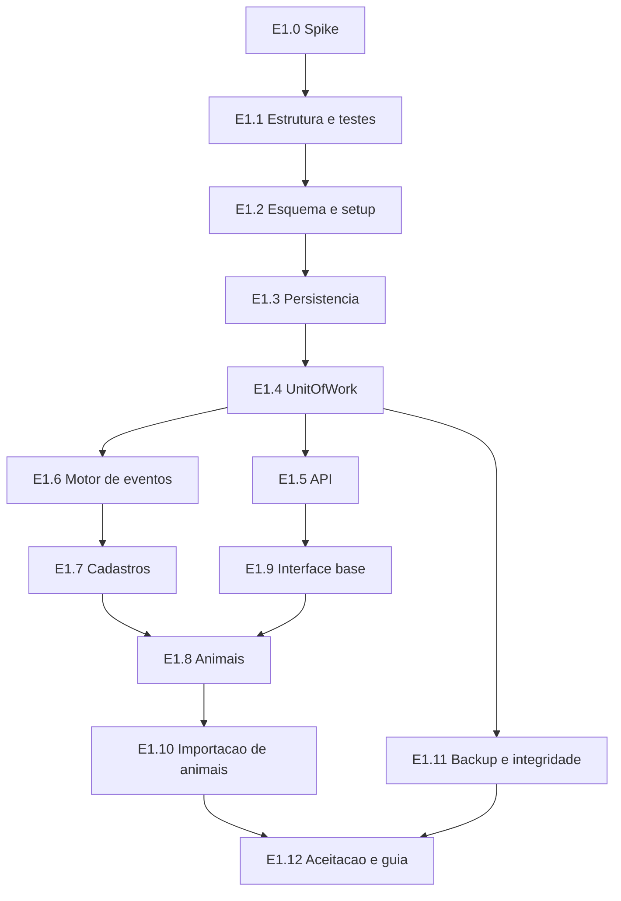

# 10 — Plano de implementação incremental

## Em resumo

- São cinco fases, na ordem da §19. Cada uma termina com software utilizável, testado e versionado, e só avança com os testes da fase passando.
- A Fase 1 começa por um **spike técnico de 10 itens** (SP-01 a SP-10): antes de construir, confirmar no ambiente real o que a documentação não permitiu verificar. O primeiro item decide a forma de gravar na planilha.
- O plano muda a distribuição da §19 em seis pontos, todos pelo mesmo motivo: a base recebe dados reais já na Fase 1, então correção, auditoria, backup e integridade não podem esperar a Fase 2; e um evento precisa gravar todos os seus fatos na fase em que nasce.
- Não há estimativa em dias: falta base para isso. As entregas estão ordenadas por dependência e têm tamanho relativo (P, M, G).

**Documentos relacionados:** `01-arquitetura.md` (arquivos de `src/`), `04-motor-de-eventos.md` (catálogo), `09-plano-de-testes.md` (cenários CT-nn), `11-riscos-e-premissas.md` (premissas PR-nn), `12-fatos-de-plataforma.md` (o que o spike precisa fechar).

## 1. Regras do plano

1. **Fase só fecha com teste verde.** Os cenários da fase passam em Node (nível 1) e o dono roda os testes de aceitação na própria conta (nível 2). O relatório separa "executado aqui" de "executado na conta do dono".
2. **Evento grava fatos completos na fase em que nasce (P11).** A compra da Fase 2 já grava lançamento, parcelas, rateio e alocações. Nenhuma fase volta para completar evento já confirmado.
3. **Sem botão sem função (§20).** O menu e o seletor de eventos mostram só os módulos entregues; a lista vem do servidor.
4. **Esquema completo desde a Fase 1.** O `setup()` cria as 34 abas de uma vez; fases seguintes só acrescentam colunas e sementes, nunca removem.
5. **Entregas pequenas e versionadas.** Cada entrega numerada vira commits próprios, com registro no CHANGELOG e marca no CHECKLIST.

## 2. O que muda em relação à §19, e por quê

| Item da §19 | Fase na §19 | Fase no plano | Motivo |
|---|---|---|---|
| Auditoria | 2 | Gravação na 1; tela de consulta na 2 | A Fase 1 já altera cadastro e importa o rebanho; alteração sem auditoria violaria a §16 regra 17 |
| Estorno | 2 | Estorno e substituição de entradas na 1; dos demais eventos na 2 | Sem isso, um erro na importação inicial não teria conserto |
| Ajuste de inventário | (§6) | Correção de cadastro, de identificação e de localização na 1; reclassificação e divergência de contagem na 2 | "Editar dados cadastrais" (§5) é da Fase 1 e passa por ajuste nos campos sensíveis |
| Backup e verificação de integridade | Sem fase (§17) | 1 | Dados reais entram na Fase 1 |
| Importação inicial | 1 | Animais na 1; compras, vendas, transferências, nascimentos e mortes na 2; pesagens, sanidade, reprodução e ocorrências na 3 | Cada importador usa o mesmo comando do formulário, que só existe quando o evento existe |
| Compras e vendas | 2 e 4 | Evento completo, com financeiro, na 2; módulo financeiro (avulsos, baixas, custos compartilhados) na 4 | P11; os cenários 3 e 4 da §18 pedem "verificar financeiro" e "verificar receita" |
| Reprodução | 3 | Parto na 2 (faz parte do nascimento); demais registros na 3 | O nascimento atualiza o histórico reprodutivo da matriz (§6.1) |
| Rateios | 4 | Rateio de compra e de venda na 2; custos compartilhados na 4 | A compra por lote e a venda por lote exigem rateio (§6.2, §6.3) |
| Gráficos | 5 | Curva de peso na 3; demais na 5 | O cenário 5 da §18 pede "verificar histórico gráfico" |
| Exportações | 5 | CSV da listagem na 1; XLSX e PDF na 5 | "Exportar dados" está na listagem da §5 |
| Alertas | 5 | Cada alerta nasce com seu módulo; a 5 consolida no dashboard | Um alerta sanitário só faz sentido junto da sanidade |
| Dashboard | 5 | "Visão geral" com números reais desde a 1; dashboard completo na 5 | O menu da §15 começa por Dashboard |

## 3. Spike técnico (abre a Fase 1)

Cada item tem critério de aprovação e contingência. "Quem": **N** = roda em Node neste repositório; **D** = só o dono pode rodar, na conta dele, com roteiro e uma função de diagnóstico que devolve o resultado sem dados sensíveis.

| ID | O que testar | Critério de aprovação | Se reprovar | Quem |
|---|---|---|---|---|
| SP-01 | Primitiva de gravação: corpus de tipos pela Sheets API com valores tipados × `setValues` com formato de texto; atomicidade do `batchUpdate` com um pedido inválido no meio; tempo de uma venda de 5 animais | Todo valor do corpus volta idêntico; nada é aplicado quando um pedido falha | Usar `SpreadsheetApp` com a primitiva única de append; manter o protocolo de três fases completo | D |
| SP-02 | Escopo `drive.file`: criar planilha e pasta, copiar, exportar, ler bytes, listar e mandar para a lixeira pela Drive API; abrir com `SpreadsheetApp.openById` a planilha criada assim | Todas as operações funcionam só com `drive.file` | Escopo `drive` completo, com nova autorização | D |
| SP-03 | Lock: o que acontece com o lock e com escritas não descarregadas quando a execução morre por tempo | O lock é liberado; o estado encontrado é um dos previstos na análise de queda | Ajustar a recuperação ao comportamento observado; `flush()` mais frequente | D |
| SP-04 | E-mail do usuário ativo no modo "executar como eu, acesso só meu" em conta pessoal; abertura com várias contas logadas | O e-mail vem preenchido para o dono | Ligar a contingência da guarda de dono; orientar perfil único no celular | D |
| SP-05 | Tempo de leitura e gravação com 10 mil, 50 mil, 100 mil e 300 mil linhas; custo de ler as propriedades | Comando p95 ≤ 5 s com 10 mil linhas em EVENTO_ANIMAIS e ≤ 15 s com 100 mil | Leituras parciais por bloco de colunas; arquivamento antecipado | D (massa gerada por N) |
| SP-06 | Tamanho de payload de `google.script.run`; `localStorage` dentro do iframe no celular do dono | Rascunho sobrevive a recarga e a fechamento do navegador | Rascunho guardado no servidor | D |
| SP-07 | Exportar XLSX e PDF pela Drive API e abrir o arquivo no celular | Arquivo abre a partir do link | CSV sempre; PDF por conversão de HTML | D |
| SP-08 | Biblioteca de gráficos por CDN, com verificação de integridade, dentro do iframe | Carrega e desenha no celular e no desktop | Gráficos SVG próprios | D |
| SP-09 | Gatilho diário chamando a função de manutenção; criação idempotente de gatilhos | Dispara uma vez; rodar o `setup()` de novo não duplica | Ajustar o registro de gatilhos | D |
| SP-10 | Aparar abas à dimensão exata e herança de formato em linhas novas (só se a primitiva escolhida for `SpreadsheetApp`) | Linhas novas mantêm formato de texto | Aplicar formato a cada bloco gravado | D |

Saída do spike: um relatório curto em `docs/` com o resultado de cada item, a decisão tomada e a atualização de `12-fatos-de-plataforma.md` (o que era "não verificado" passa a ter evidência).

## 4. Fases e entregas

### Fase 1 — Fundação

**Objetivo:** o rebanho atual entra no sistema, por importação ou cadastro, com correção, auditoria, backup e integridade funcionando.

| Entrega | Conteúdo | Arquivos principais | Tam. |
|---|---|---|---|
| E1.0 | Spike técnico e relatório | `TestRunner`, funções de diagnóstico | M |
| E1.1 | Estrutura do projeto: manifesto, harness de testes com fakes (planilha, lock, propriedades, Drive), testes estáticos, script de envio | `appsscript.json`, `tests/`, `scripts/push-gas.js` | M |
| E1.2 | Esquema e `setup()` idempotente: 34 abas, tipos, enums, sementes, SCHEMA_META, gatilhos | `Schema`, `Config`, `Code`, `Maintenance` | M |
| E1.3 | Persistência: adaptador de E/S com codec de tipos; repositório com linhas vigentes e índices | `Database`, `Repository`, `Utils`, `Validation`, `FileService` | G |
| E1.4 | UnitOfWork: três fases, journal, idempotência, recuperação, leitura otimista, auditoria | `UnitOfWork`, `AuditService` | G |
| E1.5 | API: roteador, guarda de dono, envelope, avisos com aceite, estado da operação, carga inicial | `Api`, `Code` | M |
| E1.6 | Motor: catálogo, pipeline, validador de linha do tempo, projetor; eventos ENTRADA_INICIAL, OUTRA_ENTRADA, AJUSTE_INVENTARIO (correção de cadastro, identificação incorreta, correção de localização); estorno e substituição de entradas | `EventCatalog`, `EventService`, `Timeline` | G |
| E1.7 | Cadastros: propriedades, pastos com painel básico, categorias, listas, parâmetros | `PastureService`, `AnimalService`, `Config` | M |
| E1.8 | Animais: listagem com os filtros da §5, ficha, genealogia com árvore, edição com auditoria, foto e documento, exportação CSV | `AnimalService`, `FileService`, `Animals.html` | G |
| E1.9 | Interface base: estrutura, estilos, cliente da API, store, roteador, rascunhos, componentes, registrar evento, "Visão geral", configurações | `Index`, `Styles`, `JavaScript`, `Components`, `Events`, `Dashboard`, `Settings`, `Pastures` | G |
| E1.10 | Importação de animais: assistente com os 10 passos da §14, preparação, validação, duplicidades, parcial aprovada, desfazer, relatório | `ImportService`, `Import.html` | G |
| E1.11 | Backup diário e sob demanda, restauração por comando, verificação básica de integridade, tela de sistema | `Maintenance`, `AuditService`, `FileService` | M |
| E1.12 | Testes de aceitação, base de demonstração, guia de implantação, relatório de testes da fase | `TestRunner`, `docs/` | M |

- **Eventos que nascem:** ENTRADA_INICIAL, OUTRA_ENTRADA, AJUSTE_INVENTARIO (três subtipos), ESTORNO.
- **Testes para fechar:** CT-09 (brinco duplicado, mãe inválida), CT-10, CT-11, CT-12, CT-18 (entradas), CT-20; testes de queda do protocolo; ensaio de restauração de backup.
- **O dono faz:** responder PR-12; criar o projeto Apps Script e enviar o código; rodar o spike e mandar o resultado; rodar `setup()` e os testes de aceitação; informar a data do marco zero e importar o rebanho.
- **Riscos da fase:** R-01, R-04, R-09, R-10, R-23, R-25, R-27.

### Fase 2 — Motor de eventos

**Objetivo:** o inventário se movimenta só por eventos, com compra e venda completas, e pode ser reconstruído em qualquer data a partir do marco zero.

| Entrega | Conteúdo | Tam. |
|---|---|---|
| E2.1 | NASCIMENTO: parto simples e gemelar, natimorto, peso ao nascer, histórico reprodutivo da matriz | M |
| E2.2 | TRANSFERENCIA entre pastos, com validação na data | P |
| E2.3 | PARCEIROS e COMPRA: modalidades, grade de novos animais, rateio, lançamentos, parcelas, alocações | G |
| E2.4 | VENDA: modalidades × base de peso, deduções, parcelas, rateio, aviso de carência | G |
| E2.5 | MORTE e DESCARTE | P |
| E2.6 | IDENTIFICACAO, MARCACAO, AJUSTE_INVENTARIO (reclassificação, divergência de contagem) | M |
| E2.7 | Estorno e substituição de qualquer evento; histórico e detalhe de eventos; tela de auditoria | M |
| E2.8 | Inventário em data passada; composição do pasto em data histórica; UA, UA/ha e ocupação | M |
| E2.9 | Anexos de evento | P |
| E2.10 | Importadores de compras, vendas, transferências, nascimentos e mortes; relatório de reconciliação | G |
| E2.11 | Verificação de integridade completa (linha do tempo, financeiro) | M |

- **Arquivos:** `EventCatalog`, `EventService`, `Timeline`, `FinancialService`, `InventoryService`, `ReproductionService`, `PastureService`, `ImportService`; `Events.html`, `Pastures.html`.
- **Testes para fechar:** CT-01, CT-02, CT-03, CT-04, CT-07, CT-08, CT-09 (completo), CT-13 (rateio de compra), CT-14, CT-17, CT-18.
- **O dono faz:** validar as fórmulas de compra e venda com um caso real; confirmar PR-09.
- **Riscos da fase:** R-11, R-12, R-13.

### Fase 3 — Manejo

**Objetivo:** pesagem, sanidade e reprodução registradas no curral, com indicadores zootécnicos.

| Entrega | Conteúdo | Tam. |
|---|---|---|
| E3.1 | PESAGEM: modo curral, individual, coletiva e por lote; GMD; curva de peso; projeção rotulada; tela de desempenho | G |
| E3.2 | PRODUTOS, estoque opcional (evento ESTOQUE), PROTOCOLOS_SANITARIOS | M |
| E3.3 | SANIDADE: subtipos, modo de dose, consumo e custo, carência, agenda, alertas | G |
| E3.4 | ESTACOES_MONTA e REPRODUCAO (exposição, cobertura, inseminação, diagnóstico, aborto); situação reprodutiva; ficha da matriz; indicadores | G |
| E3.5 | DESMAMA, CASTRACAO, OCORRENCIA | M |
| E3.6 | Importadores de pesagens, sanidade, reprodução e ocorrências | M |
| E3.7 | Gráficos (biblioteca decidida no spike) | P |

- **Arquivos:** `WeightService`, `HealthService`, `ReproductionService`; `Weights.html`, `Health.html`, `Reproduction.html`.
- **Testes para fechar:** CT-05, CT-06; cenários novos de agenda sanitária, carência e indicadores reprodutivos descritos em `09-plano-de-testes.md`.
- **O dono faz:** confirmar PR-06, PR-07, PR-10 e PR-11; cadastrar produtos e protocolos com o veterinário; testar o modo curral no celular, no curral.
- **Riscos da fase:** R-08, R-14, R-23, R-24.

### Fase 4 — Financeiro

**Objetivo:** fluxo de caixa, resultado gerencial, custo por animal e por pasto, e patrimônio.

| Entrega | Conteúdo | Tam. |
|---|---|---|
| E4.1 | LANCAMENTO_FINANCEIRO avulso; edição do plano de contas | M |
| E4.2 | Parcelas: baixa, desfazer baixa, desdobramento, encontro de contas; fluxo de caixa previsto e realizado | G |
| E4.3 | RATEIO de custos compartilhados: cabeças, peso vivo, dias de permanência, manual; re-rateio; alerta de rateio desatualizado | G |
| E4.4 | Custos por animal e por pasto; resultado por animal | M |
| E4.5 | Resultado gerencial por competência; teste de conciliação com o caixa | M |
| E4.6 | TABELA_PRECOS e patrimônio: valoração, cobertura, série histórica | M |
| E4.7 | Bloqueio de período; alertas financeiros | P |

- **Arquivos:** `FinancialService`, `InventoryService`; `Financial.html`.
- **Testes para fechar:** CT-13 (completo), CT-15, CT-19.
- **O dono faz:** conferir as três visões com um mês real; definir os preços de referência.
- **Riscos da fase:** R-13, R-14.

### Fase 5 — Inteligência gerencial

**Objetivo:** decisão apoiada em dashboard, relatórios e alertas.

| Entrega | Conteúdo | Tam. |
|---|---|---|
| E5.1 | Dashboard completo: 16 indicadores, 6 filtros, 9 gráficos | G |
| E5.2 | Catálogo de relatórios e os 17 relatórios da §13 | G |
| E5.3 | Exportação XLSX e PDF | M |
| E5.4 | Alertas consolidados | P |
| E5.5 | Revisão de desempenho, arquivamento se necessário, guia do usuário | M |

- **Arquivos:** `ReportService`; `Dashboard.html`, `Reports.html`.
- **Testes para fechar:** CT-16; testes de interface em celular e desktop.
- **Riscos da fase:** R-14, R-18.

## 5. Ordem de construção dentro da Fase 1

O caminho crítico é spike → persistência → UnitOfWork → motor → animais → importação. Interface base e backup correm em paralelo ao motor.

## 6. Requisito → fase

| Requisito | Fase |
|---|---|
| §3.2 rotina de inicialização | 1 |
| §4 modelo de dados completo | 1 |
| §5 listagem, filtros, ordenação, paginação, cadastro, edição, exportação | 1 |
| §5.1 ficha: A geral, B genealogia, C localização, I eventos, J fotos e documentos | 1 |
| §5.1 ficha: D histórico de pastos | 2 |
| §5.1 ficha: E peso, F sanitário, G reprodutivo | 3 (parto na 2) |
| §5.1 ficha: H financeiro | 2 (compra e venda), 4 (custos) |
| §5.2 genealogia e árvore | 1 |
| §6.1 nascimento; §6.2 compra; §6.3 venda; transferência; morte; descarte | 2 |
| §6 pesagem; vacinação; vermifugação e tratamentos; reprodução; desmama | 3 |
| §6 ajuste de inventário | 1 e 2 |
| §7 painel de pasto: cabeças, sexo, categorias, capacidade em cabeças | 1 |
| §7 UA, UA/ha, ocupação, composição em data histórica | 2 |
| §8 indicadores de peso, GMD, projeção, gráficos | 3 |
| §9 ficha e indicadores reprodutivos | 3 |
| §10 histórico, produtos, protocolos, agenda, alertas, carência | 3 |
| §11.1 compras e vendas | 2 |
| §11.2 custos por animal: aquisição | 2 |
| §11.2 custos sanitários por animal | 3 |
| §11.2 custos compartilhados e rateios; §11.3 fluxo financeiro; §11.4 patrimônio | 4 |
| §12 "Visão geral" | 1 |
| §12 dashboard completo | 5 |
| §13 relatórios 1 a 17, XLSX e PDF | 5 (CSV da listagem na 1) |
| §14 importação de animais | 1 |
| §14 importação de compras, vendas, transferências, nascimentos, mortes; reconciliação | 2 |
| §14 importação de pesagens, vacinações e outros eventos | 3 |
| §15 menu, botão de ação rápida, estados, validação, prevenção de duplo clique | 1 |
| §16 regras 1, 2, 7 a 13, 15 a 19 | 1 |
| §16 regras 3 a 6, 14, 20 | 2 |
| §17 acesso, publicação, backup, integridade, registro de erros, restauração | 1 |
| §18 cenários 9 (parte), 10 | 1 |
| §18 cenários 1 a 4, 7, 8, 9 | 2 |
| §18 cenários 5, 6 | 3 |
| §21 tela de configurações | 1 (plano de contas e preços na 4) |

## 7. Forma de trabalho e entrega (§20)

- **Onde o código vive.** Repositório `Meus-experimentos`, pasta `erp-pecuario/`, no ramo de desenvolvimento, com PR em rascunho. Nada é substituído fora dessa pasta.
- **Como chega ao Apps Script.** Nesta sessão não há acesso ao projeto Apps Script do dono. O código é entregue no repositório e enviado por ele com `npm run gas:push` (clasp, como no projeto irmão) ou por cópia manual. O guia de implantação da Fase 1 diz, para cada arquivo: nome, onde inserir, dependências, como executar e como testar.
- **O que cada entrega traz.** Arquivos completos (nunca trechos soltos), testes, e a linha correspondente no CHANGELOG e no CHECKLIST.
- **O que nunca será dito sem evidência.** Que algo foi implantado, ou que passou em teste na conta do dono. O relatório de testes de cada fase separa o que rodou aqui (Node) do que só o dono pode rodar.
- **Mudança de desenho durante a implementação.** Se o spike ou o uso real contrariar uma decisão desta fase, a mudança é registrada no CHANGELOG com o motivo, e o documento da Fase 0 afetado é atualizado no mesmo commit.
- **Premissas e limitações.** Ficam em `11-riscos-e-premissas.md`, atualizado a cada fase.

## 8. Checklist mestre

### Fase 0 — Desenho técnico

- [x] Especificação mestre versionada
- [x] Revisão adversarial do desenho-base (sete lentes, 110 achados)
- [x] Resumo executivo (`README.md`)
- [x] Arquitetura técnica e estrutura de arquivos (`01`)
- [x] Diagrama de entidades e relacionamentos (`02`)
- [x] Dicionário de dados (`03a`, `03b`)
- [x] Fluxo de eventos (`04`)
- [x] Matriz de regras de negócio (`05`)
- [x] Persistência e integridade (`06`)
- [x] Modelo financeiro e indicadores (`07`)
- [x] Experiência de uso (`08`)
- [x] Plano de testes (`09`)
- [x] Plano de implementação (`10`)
- [x] Riscos, premissas e inconsistências da especificação (`11`)
- [x] Fatos de plataforma (`12`)
- [ ] Aprovação do dono

### Fase 1 — Fundação

- [ ] E1.0 Spike técnico
- [ ] E1.1 Estrutura do projeto e testes
- [ ] E1.2 Esquema e `setup()`
- [ ] E1.3 Persistência
- [ ] E1.4 UnitOfWork
- [ ] E1.5 API
- [ ] E1.6 Motor de eventos (entradas, ajustes, estorno)
- [ ] E1.7 Cadastros
- [ ] E1.8 Animais
- [ ] E1.9 Interface base
- [ ] E1.10 Importação de animais
- [ ] E1.11 Backup e integridade
- [ ] E1.12 Aceitação, guia de implantação e relatório

### Fases 2 a 5

- [ ] Fase 2: E2.1 a E2.11
- [ ] Fase 3: E3.1 a E3.7
- [ ] Fase 4: E4.1 a E4.7
- [ ] Fase 5: E5.1 a E5.5

## 9. O que depende do dono antes da Fase 1

| Item | Necessário para começar? | Observação |
|---|---|---|
| Aprovar a Fase 0 | Sim | É o único pré-requisito |
| PR-12 — gado de terceiros, parceria ou pasto alugado | Não, mas convém | Afeta patrimônio e financeiro; sem resposta vale o padrão |
| PR-16 — forma de implantação | Não | Necessário só na primeira implantação |
| PR-03 — data do marco zero | Não | Necessário na importação inicial (E1.10) |
| Demais premissas | Não | Cada uma tem a fase-limite em `11-riscos-e-premissas.md` |
